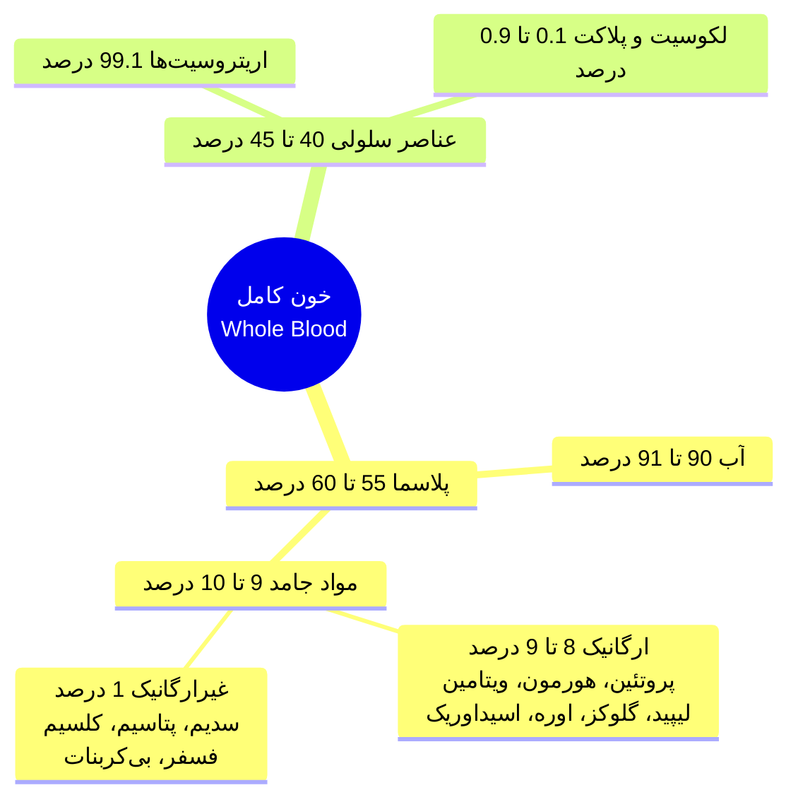
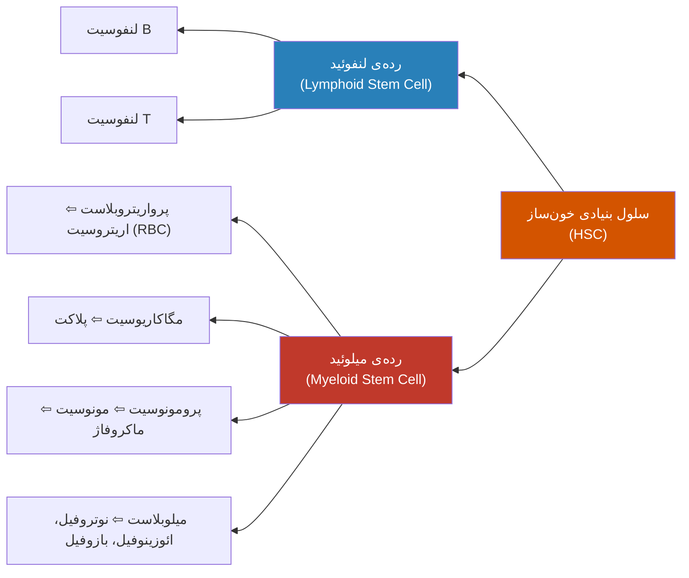
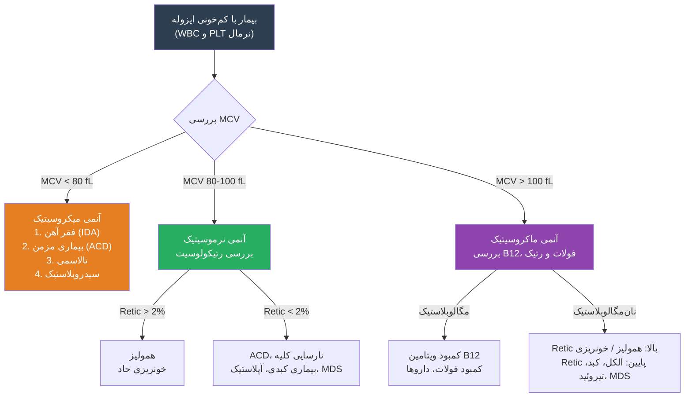
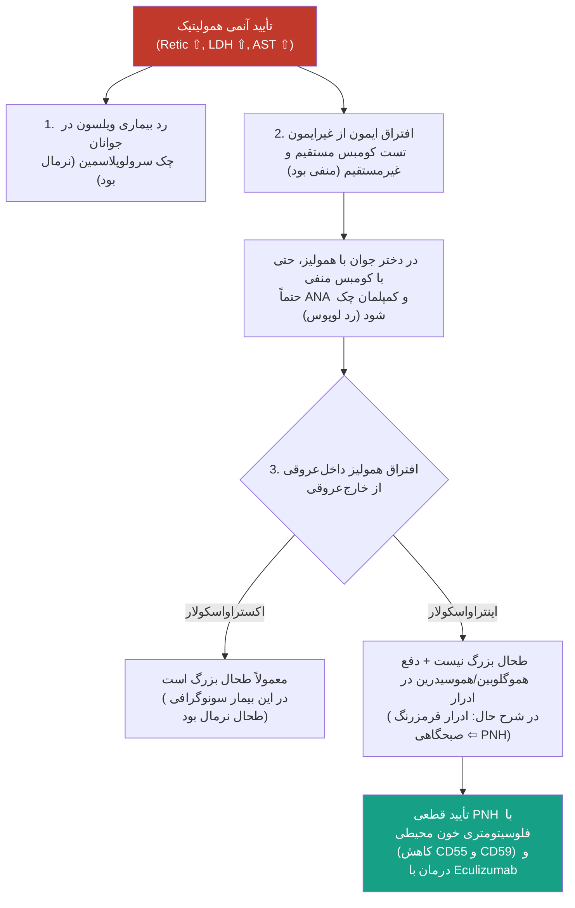

# مقدمات هماتوپوئز، تفسیر CBC و اپروچ بالینی به کم‌خونی‌ها

## ۱. کلیات خون و ترکیبات آن

> [!info] تعریف و وظیفه اصلی خون
> خون در حقیقت هم یک **بافت (Tissue)** است و هم یک **مایع (Fluid)**. وظیفه‌ی اصلی و حیاتی خون که از زیست‌شناسی به خاطر داریم، **رساندن اکسیژن و مواد مغذی به بافت‌ها** و **برگرداندن دی‌اکسید کربن (pCO₂) و مواد زائد به ریه و ارگان‌های دفعی** است.

اگر ۱۰ سی‌سی خون کامل (Whole Blood) را برداریم و داخل دستگاه سانتریفیوژ قرار دهیم، به دو بخش تقریباً مساوی (نصف به نصف) تقسیم می‌شود:

1. **بخش مایع (پلاسما - Plasma):** مایع زردرنگی که حدود **55% تا 60%** حجم خون را می‌سازد.
   - **آب:** حدود **90% تا 91%** پلاسما آب خالص است.
   - **بخش جامد (Solid - حدود 9% تا 10%):**
     - **مواد ارگانیک (8% تا 9% کل پلاسما):** عمده‌ی آن **پروتئین‌ها** (حدود 6 تا 8 درصد) هستند و مابقی شامل هورمون‌ها، ویتامین‌ها، لیپیدها، گلوکز، آمینواسیدها، اوره و اسید اوریک است.
     - **مواد غیرارگانیک و املاح (حدود 1%):** شامل سدیم (Na⁺)، پتاسیم (K⁺)، کلسیم (Ca²⁺)، منیزیم (Mg²⁺)، کلر (Cl⁻)، فسفر (HPO₄²⁻) و بی‌کربنات (HCO₃⁻) است.
2. **بخش سلولی (Formed Elements):** حدود **40% تا 45%** حجم خون را تشکیل می‌دهد.
   - **اریتروسیت‌ها (گلبول‌های قرمز - RBC):** عمده‌ی بخش سلولی یعنی حدود **99% تا 99.1%** آن را می‌سازند.
   - **لکوسیت‌ها (WBC) و پلاکت‌ها:** تنها حدود **0.1% تا 0.9%** از حجم سلولی را به خود اختصاص می‌دهند.



---

## ۲. هماتوپوئز نرمال (خون‌سازی) و سلول‌های بنیادی

### منشأ جنینی و تکامل سنی خون‌سازی
خون‌سازی در اوایل دوران جنینی آغاز می‌شود. سلول بنیادی خون‌ساز (HSC) و سلول‌های اندوتلیال پوشش‌دهنده‌ی عروق، هر دو از یک پیش‌ساز مشترک به نام **هماتوبلاست (Hematoblast)** در سیستم *آئورت-گناد-مزونفروز (AGM)* منشأ می‌گیرند.

مراحل تغییر مکان خون‌سازی از دوران جنینی تا پیری به شرح زیر است:
1. **کیسه زرده (Yolk Sac):** آغاز خون‌سازی در دوران جنینی از **Yolk Sac** است (در ماه‌های اول جنینی).
2. **کبد و طحال (Liver & Spleen):** از حدود **۱ ماهگی** جنینی، کم‌کم کبد و طحال شروع به خون‌سازی می‌کنند و در میانه‌ی بارداری به اوج می‌رسند.
3. **مغز استخوان (Bone Marrow):** از حدود **۴ ماهگی** جنینی شروع به خون‌سازی می‌کند و به تدریج اوج می‌گیرد.
4. **زمان تولد (Birth):** وقتی متولد می‌شویم، دیگر کیسه زرده، کبد و طحال عملاً خون‌سازی ندارند و **تقریباً تمام مسئولیت اریتروپوئز و خون‌سازی با مغز استخوان (Bone Marrow)** است.

```chart
{
  "type": "line",
  "data": {
    "labels": ["1m", "2m", "4m", "6m", "Birth", "10y", "20y", "40y", "60y"],
    "datasets": [
      {
        "label": "Yolk Sac",
        "data": [85, 40, 0, 0, 0, 0, 0, 0, 0],
        "borderColor": "#f39c12",
        "fill": false
      },
      {
        "label": "Liver & Spleen",
        "data": [15, 70, 85, 60, 5, 0, 0, 0, 0],
        "borderColor": "#27ae60",
        "fill": false
      },
      {
        "label": "Vertebra & Pelvis (Axial BM)",
        "data": [0, 0, 20, 60, 95, 90, 80, 70, 60],
        "borderColor": "#e74c3c",
        "fill": false
      },
      {
        "label": "Femur & Tibia (Long Bones)",
        "data": [0, 0, 20, 60, 95, 50, 5, 0, 0],
        "borderColor": "#8e44ad",
        "fill": false
      }
    ]
  }
}
```

### تغییرات خون‌سازی با افزایش سن (Aging)
با گذشت زمان و افزایش سن، قدرت هماتوپوئز کم‌کم کاهش پیدا می‌کند و مغز استخوان قرمز (Red Marrow فعال) به مغز استخوان زرد (Yellow Marrow حاوی چربی) تبدیل می‌شود:
* **شیرخوار زیر ۱ سال (Infant):** تقریباً **تمام استخوان‌های بدن** اریتروپوئز دارند.
* **بزرگسالی (حدود ۲۰ تا ۳۰ سالگی به بعد):** استخوان‌های اندام‌ها مانند *هومروس، رادیوس، اولنا، فمور، تیبیا و فیبولا* دیگر تقریباً هیچ خون‌سازی و اریتروپوئزی ندارند! در این دوران، عمده‌ی مسئولیت خون‌سازی به عهده‌ی **اسکلت محوری** یعنی **مهره‌ها (Vertebra)**، **لگن (Pelvis)**، **استرنوم (جناغ)**، **دنده‌ها (Ribs)** و مقداری هم **جمجمه (Skull)** است. در بین تمام استخوان‌های مختلف در بزرگسالی، **بیشترین مسئولیت اریتروپوئز و هماتوپوئز با مهره‌ها (Vertebra) است**.
* **سالمندی:** با افزایش بیشتر سن، حتی در مهره‌ها هم به تدریج اریتروپوئز کمتر و محدودتر می‌شود؛ این مسئله شاید علت برخی از *آنمی‌های بدون علت خاص در افراد مسن* باشد.

> [!important] نکته بالینی و امتحانی بسیار مهم (رادیوتراپی ستون فقرات)
> از آنجا که در بزرگسالان و افراد مسن، عمده‌ی خون‌سازی بدن در **مهره‌ها (Vertebra)** انجام می‌شود، وقتی یک بیمار مسن مبتلا به کنسر (با متاستاز به ستون فقرات) را برای **رادیوتراپی ستون فقرات** می‌فرستیم، بیمار به شدت دچار افت سلول‌های خونی می‌شود؛ یعنی هم **کم‌خون (Anemic)** می‌شود، هم **پلاکتش افت می‌کند** و هم **گلبول سفیدش پایین می‌آید**.

---

### سلول بنیادی خون‌ساز (Hematopoietic Stem Cell - HSC)

> [!info] تعریف سلول بنیادی (Stem Cell)
> به هر سلولی نمی‌توان گفت سلول بنیادی! یک سلول بنیادی باید حتماً **دو خصوصیت کلیدی** داشته باشد:
> 1. **خودنوزایی (Self-renewal):** بتواند تقسیم شود و یک سلول دیگر **دقیقاً عین خودش** (با همان توانایی‌ها) درست کند.
> 2. **تمایز (Differentiation):** بتواند به **رده‌های سلولی مختلف** تمایز پیدا کند.
> 
> *مثال نقض:* یک سلول اپی‌تلیال دستگاه گوارش تقسیم می‌شود و سلول دیگری می‌سازد، اما Stem Cell نیست؛ چون به انتهای تمایزش رسیده و نمی‌تواند به رده‌های دیگر تمایز یابد.

**نکات طلایی و بالینی درباره‌ی گردش و لانه‌گزینی Stem Cell:**
* **گردش در خون و پیوند مغز استخوان:** از زمانی که Stem Cellها از کیسه زرده حرکت می‌کنند تا بافت‌ها را پر کنند، وارد خون می‌شوند و حتی در بزرگسالان هم به تعداد کم **در خون محیطی گردش می‌کنند**. این ویژگی، مبنای **پیوند مغز استخوان اتولوگ (Autologous)** است (یعنی پیوند از خودِ بیمار به خودش). در این روش، پیش از شیمی‌درمانیِ سنگین، دارویی به بیمار می‌زنیم تا آزاد شدن Stem Cellها از مغز استخوان به خون بیشتر شود، سپس آن‌ها را از خون جمع‌آوری کرده و پس از شیمی‌درمانیِ سنگین، دوباره به خود بیمار تزریق می‌کنیم.
* **لانه‌گزینی در بافت‌ها و بیدار شدن در استرس:** سلول‌های بنیادی در ارگان‌های مختلف بدن (مثل **کبد، طحال و کلیه**) می‌نشینند. این سلول‌ها به طور عادی **خاموش (Regressed)** هستند و کاری نمی‌کنند؛ اما **در زمان استرس (به هر دلیلی)**، مثل بیماری‌های میلوپرولیفراتیو، میلوفیبروز یا کم‌خونی‌های شدید، تقریباً همه‌ی این ارگان‌ها می‌توانند دوباره فعال شوند و اریتروپوئز و خون‌سازی را از سر بگیرند.

### خون‌سازی میلوئید (اینترامدولاری) در برابر اکسترامدولاری

> [!info] تعریف خون‌سازی مدولاری (Myeloid / Intramedullary) و اکسترامدولاری (Extramedullary)
> * **خون‌سازی میلوئید یا اینترامدولاری (Intramedullary):** خون‌سازی طبیعی که از **داخل حفره‌ی مغز استخوان (Bone Marrow)** شروع و انجام می‌شود.
> * **خون‌سازی اکسترامدولاری یا اکسترامیلوئید (Extramedullary):** خون‌سازی که **خارج از مغز استخوان** (در ارگان‌هایی مثل کبد و طحال) انجام می‌شود.

* **مثال بالینی کلاسیک (تالاسمی):** در بیماران مبتلا به **تالاسمی** (به ویژه کسانی که تزریق خون مکرر و منظم نداشته‌اند)، چون مغز استخوان نمی‌تواند خون مؤثر بسازد، بارِ خون‌سازی به دوش کبد و طحال می‌افتد و بیمار دچار **هپاتواسپلنومگالی شدید (بزرگی کبد و طحال)** می‌شود. همچنین در گرافی قفسه سینه (CXR) این بیماران، گاهی اریتروپوئز در **دنده‌ها (Ribs)** آن‌قدر تشدید می‌شود که **توده‌های هماتوپوئتیک** بزرگی در قفسه سینه ایجاد می‌کند که اگر از آن‌ها نمونه‌برداری کنیم، کاملاً بافتی شبیه مغز استخوان می‌بینیم!

---

## ۳. رده‌های سلولی و مراحل تکامل در مغز استخوان

سلول بنیادی خون‌ساز (HSC یا Hemocytoblast) به دو رده‌ی اصلی تقسیم می‌شود:
1. **رده‌ی لنفوئید (Lymphoid):** که سلول‌های **T-Cell** و **B-Cell** را می‌سازد (در تنظیم آپوپتوز آن پروتئین‌های *Caspase 3, Bcl-XL, Bax, Bim* نقش دارند).
2. **رده‌ی میلوئید (Myeloid):** که تمام سلول‌های دیگر یعنی **اریتروسیت‌ها (RBC)**، **پلاکت‌ها** (از طریق پرومگاکاریوسیت و مگاکاریوسیت)، **نوتروفیل‌ها**، **مونوسیت‌ها** (از طریق پرومونوسیت و تمایز به ماکروفاژ و سلول دندریتیک)، **ائوزینوفیل‌ها** و **بازوفیل‌ها** را می‌سازد (در مسیرهای آن عواملی چون *Caspase 8, Mcl-1, Bcr/Abl, Bcl-2* دخیل‌اند).



### الف) مراحل تکامل رده‌ی میلوپوئز (ساخت نوتروفیل)
شناخت морفولوژی این سلول‌ها برای دیدن لام خون محیطی (PBS) و مغز استخوان حیاتی است. سیر تکامل یک **طیف تدریجی** است:

1. **میلوبلاست (Myeloblast):**
   - اولین و بالاترین سلول رده است.
   - سلول بزرگی است که **نسبت هسته به سیتوپلاسم (N/C ratio) بسیار بالایی دارد** (هسته‌اش نسبت به سیتوپلاسم خیلی بزرگ است).
   - **کروماتین هسته کاملاً باز و نارس است** (به قول اساتید پاتولوژی، انگار هسته‌اش را با یک **کاموای درشت** بافته‌اند و متراکم نیست!).
   - دارای **هستک (Nucleoli) واضح** (۳ تا ۴ عدد) است.
   - **گرانول اصلاً ندارد** (یا تقریباً ندارد).
   - *نکته بالینی:* در بیماران **لوکمی حاد (Acute Leukemia)**، این سلول در خون محیطی دیده می‌شود و در مغز استخوان **بیش از 20%** از سلول‌ها را تشکیل می‌دهد.
2. **پرومیلوسیت (Promyelocyte):**
   - سیتوپلاسمش نسبت به میلوبلاست کمی بیشتر شده است.
   - هسته‌اش هنوز گرد و باز است و **هنوز هستک دارد**.
   - **مهم‌ترین ویژگی:** پیدا شدن **گرانول‌های اولیه‌ی آزوروفیلیک (Primary Azurophilic Granules)** در سیتوپلاسم.
3. **میلوسیت (Myelocyte):**
   - هسته‌اش **متراکم‌تر (Condensed)** شده و **دیگر هستک ندارد**.
   - هسته بیضی‌شکل است، **هنوز فرورفتگی ندارد**، اما **کمی به کنار سلول آمده است (Eccentric)**.
   - سیتوپلاسم بیشتر شده، گرانول‌های اولیه کمتر شده و **گرانول‌های ثانویه (Secondary Granules)** اضافه شده‌اند.
   - *نکته تکمیلی:* سلول‌های این رده **فقط تا مرحله‌ی میلوسیت توانایی تقسیم میتوز دارند** (از مرحله‌ی بعد دیگر تقسیم نمی‌شوند).
4. **متامیلوسیت (Metamyelocyte):**
   - هسته در کنار سلول قرار دارد و **دچار فرورفتگی (Indentation) شده است** (شبیه لوبیا یا کلیه؛ که عمق فرورفتگی کمتر از نصف قطر هسته است).
   - کروماتین کاملاً بالغ است و فقط گرانول‌های ثانویه دارد.
5. **بند سل (Band Form / Juvenile):**
   - فرورفتگی هسته **خیلی زیاد و عمیق** می‌شود (بیشتر از نصف قطر هسته)، به طوری که هسته نعل‌اسبی یا نواری می‌شود اما هنوز تکهتکه نشده است.
6. **نوتروفیل سگمانته (Segmented Neutrophil):**
   - سلول نهایی و بالغ که هسته‌اش **تکه‌تکه (۳ تا ۵ لوب)** شده و این تکه‌ها با رشته‌های باریک کروماتینی به هم وصل هستند؛ دقیقاً **شبیه تکه‌های سوسیس که با بندهای نازکی به هم وصل‌اند**!

| مرحله سلولی | وضعیت و شکل هسته | وضعیت هستک (Nucleoli) | وضعیت گرانول‌های سیتوپلاسم | نکته کلیدی و افتراقی |
| :--- | :--- | :--- | :--- | :--- |
| **میلوبلاست** | بسیار بزرگ، کروماتین باز (شبیه بافت کاموای درشت) | دارد (۳ تا ۴ عدد واضح) | **فاقد گرانول** | افزایش > 20% در مغز استخوان = لوکمی حاد |
| **پرومیلوسیت** | گرد، کروماتین هنوز باز | دارد | پیدایش **گرانول‌های اولیه‌ی آزوروفیلیک** | سیتوپلاسم کمی بیشتر از میلوبلاست |
| **میلوسیت** | متراکم، بدون فرورفتگی، **کشیده شده به کنار (Eccentric)** | **ندارد** (حذف هستک) | کاهش اولیه و پیدایش **گرانول‌های ثانویه** | آخرین مرحله‌ای که قدرت **تقسیم میتوز** دارد |
| **متامیلوسیت** | کنار سلول، **شروع فرورفتگی** (لوبیایی‌شکل) | ندارد | فقط گرانول‌های ثانویه | فرورفتگی کمتر از نصف قطر هسته |
| **بند سل (Band)** | **فرورفتگی بسیار عمیق** ولی بدون قطعه شدن کامل | ندارد | فقط گرانول‌های ثانویه | فرورفتگی بیشتر از نصف قطر هسته |
| **نوتروفیل بالغ** | **قطعه قطعه شده (۳ تا ۵ لوب)** با اتصالات باریک | ندارد | فقط گرانول‌های ثانویه | هسته شبیه **تکه‌های سوسیس متصل به هم** |

---

### سلولاریته مغز استخوان (Bone Marrow Cellularity)
وقتی از مغز استخوان بیوپسی می‌گیریم، زیر میکروسکوپ دو بخش می‌بینیم: **سلول‌ها** و **حفره‌های خالی سفیدرنگ**.
* **این حفره‌های خالی چیست؟** این‌ها **بافت چربی** هستند که در جریان آماده‌سازی لام مغز استخوان، چربیِ آن‌ها در حلال حل شده و فقط فضای خالی‌شان باقی مانده است.
* **فرمول محاسبه‌ی سلولاریته نرمال:** درصد سلول‌ها نسبت به کل فضا (سلول + چربی) از فرمول زیر به دست می‌آید:
$$\text{Normal BM Cellularity (\%)} = 100 - \text{Age}$$
* **مثال‌ها:**
  - یک جوان **۲۰ ساله** انتظار داریم سلولاریته‌ی مغز استخوانش حدود **80%** باشد (80% سلول در برابر 20% چربی).
  - اگر در یک لام بیوپسی ببینیم سلول و چربی **نصف‌نصف (حدود 50%)** است، حدس می‌زنیم مربوط به یک فرد **۴۰ تا ۶۰ ساله** باشد.
  - در یک فرد **۸۰ ساله**، سلولاریته به حدود **20%** می‌رسد (با افزایش سن، سلولاریته‌ی مغز استخوان کاهش می‌یابد).

---

### ب) ویژگی‌های گلبول قرمز (RBC) و مراحل اریتروپوئز
* **ابعاد و شکل RBC:** قطر یک گلبول قرمز نرمال حدود **7 میکرون (7 μm)** است. شکل آن از روبه‌رو گرد و از نیم‌رخ **مقعرالحرفین (Biconcave disc)** است (دو طرفش فرورفته است).
* **چرا RBC به شکل مقعرالحرفین (Biconcave) ساخته شده است؟ (۲ دلیل مهم):**
  1. **مهم‌تر از همه:** نسبت به حجمش، **بیشترین سطح (Surface Area)** را پیدا کند تا بتواند **تبادل گازی** را خیلی بهتر انجام دهد.
  2. **انعطاف‌پذیری بالا:** وقتی به رگ‌های تنگ و مویرگ‌های باریک می‌رسد، بتواند کاملاً شکل خودش را تغییر دهد و **بدون اینکه لیز (پاره) شود**، به راحتی از مجاری نازک عبور کند.
* **متابولیسم RBC:** گلبول قرمز بالغ **میتوکندری ندارد** و در نتیجه **سیکل کربس (Krebs cycle) هم ندارد**! بنابراین متابولیسم قند خود را صرفاً از طریق **گلیکولیز بی‌هوازی** انجام می‌دهد. برای انجام گلیکولیز (تبدیل فسفوانول‌پیرووات به پیرووات و سپس تبدیل پیرووات به اسید لاکتیک) حضور آنزیم **لاکتات دهیدروژناز (LDH)** در داخل RBC کاملاً ضروری است (به همین دلیل وقتی RBC لیز می‌شود، LDH خون به شدت بالا می‌رود!).

#### سفر ۴ روزه‌ی اریتروپوئز (تکامل RBC در مغز استخوان)
از زمانی که سلول پیش‌ساز در مغز استخوان شروع به تمایز می‌کند تا زمانی که به رتیکولوسیت و RBC بالغ تبدیل شود، حدود **۴ روز** طول می‌کشد:
1. **پرواریتروبلاست (Proerythroblast / Pronormoblast):** اولین سلول رده است (حدود ۲۰ ساعت). هسته‌اش کاملاً باز است، هستک دارد و **سیتوپلاسمش به علت تراکم بالای RNA کاملاً بنفش/آبی‌رنگ است**.
2. **اریتروبلاست بازوفیلیک (Basophilic Erythroblast / Early Normoblast):** حدود ۲۰ ساعت؛ هنوز رنگ آبی/بنفش سیتوپلاسم را دارد و هسته کمی متراکم‌تر می‌شود.
3. **اریتروبلاست پلی‌کروماتوفیلیک (Polychromatophilic / Intermediate Erythroblast):** حدود ۲۵ ساعت؛ آخرین مرحله‌ای که سلول تقسیم می‌شود. ساخت هموگلوبین در حال افزایش است.
4. **اریتروبلاست ارتوکروماتوفیلیک (Orthochromatophilic / Late Erythroblast):** حدود ۳۰ ساعت؛ هسته به شدت متراکم و پیکنوتیک (Pyknotic) می‌شود و سیتوپلاسم به دلیل تجمع هموگلوبین **به سمت رنگ صورتی/اسیدوفیلیک** می‌رود.
5. **گلبول قرمز هسته‌دار (Nucleated RBC - NRBC):** در پایان این مرحله، سلول **هسته‌ی خود را به بیرون پرتاب می‌کند (Extruding Nucleus)**.
6. **رتیکولوسیت (Reticulocyte):** سلول بدون هسته‌ای که هنوز بقایای RNA دارد (با رنگ‌آمیزی *Brilliant Cresyl Blue* شبکه‌های آبی در آن دیده می‌شود). حدود **۳ روز** طول می‌کشد تا کاملاً به **اریتروسیت بالغ (RBC)** در خون محیطی تبدیل شود.

> [!important] قانون کلی در تکامل رده‌ی اریتروئید
> هرچه از پرواریتروبلاست به سمت اریتروسیت نهایی جلوتر می‌آییم:
> * **ساخت و تجمع هموگلوبین بیشتر می‌شود** (رنگ سیتوپلاسم از **بنفش به سمت صورتی** می‌رود).
> * **سنتز پروتئین و میزان RNA کمتر می‌شود**.
> * **هسته متراکم‌تر (Condensed) می‌شود** تا در نهایت از سلول خارج گردد.

---

## ۴. بررسی دقیق گلبول‌های سفید، پلاکت‌ها و فاکتورهای رشد در PBS

### ۱. نوتروفیل (Neutrophil)
* **طول عمر و زمان ساخت:** ساخت آن در مغز استخوان ۱۲ تا ۱۳ روز طول می‌کشد. **نیمه‌عمر (Half-life) نوتروفیل در خون محیطی بسیار کوتاه و حدود ۱۲ ساعت است!** (در بافت‌ها می‌تواند چند روز زنده بماند).
* **ذخیره‌ی مغز استخوان:** عمده‌ی تجمع نوتروفیل‌ها داخل مغز استخوان است (ذخیره‌ی مغز استخوان ۳۰ تا ۴۰ برابر تعداد در گردش خون است) تا در مواقع نیاز و عفونت، به سرعت تعداد زیادی نوتروفیل وارد خون شود.
* **نقش:** دفاع اصلی بدن علیه پاتوژن‌ها.

### ۲. مونوسیت (Monocyte) و ماکروفاژ
* **طول عمر:** ۱ تا ۳ روز در مغز استخوان و ۸ تا ۷۲ ساعت در خون محیطی می‌ماند.
* **تبدیل به ماکروفاژ:** همین مونوسیت وقتی از خون خارج شود و **وارد بافت گردد، به آن ماکروفاژ (Macrophage) می‌گوییم** (که می‌تواند تا ۸۰ روز در بافت زنده بماند).
* **مورفولوژی اختصاصی مونوسیت در لام خون محیطی (PBS):**
  1. **هسته:** حالت **نعل‌اسبی (یا کلیوی)** دارد.
  2. **سیتوپلاسم (۲ ویژگی بسیار مهم):**
     - دارای **واکوئل (Vacuole)** است.
     - به تعبیر اساتید هماتولوژی، سیتوپلاسمش دقیقاً شبیه **یک ژله‌ی خاکستری است که روی آن گردِ آجرِ قرمز پاشیده باشند**!

### ۳. ائوزینوفیل (Eosinophil)
* **درصد نرمال:** حدود **0% تا 2%** گلبول‌های سفید خون را تشکیل می‌دهد.
* **مورفولوژی در PBS:** هسته‌ی آن برخلاف نوتروفیل، کلاسیکاً **دو لوبه (Bilobed)** است و سیتوپلاسم آن پر از **گرانول‌های کاملاً قرمز و نارنجی‌رنگ** است.
* **محتویات گرانول‌ها:** حاوی پروتئین‌های متعددی است که مهم‌ترین آن‌ها **Major Basic Protein (MBP)** است.
* **موارد افزایش (ائوزینوفیلی):** واکنش‌های **آلرژیک**، **مصرف برخی داروها**، **عفونت‌های انگلی** (به ویژه لارو کرم‌های لوله‌ای و هلمینت‌ها) و برخی **بدخیمی‌ها (Malignancies)**.

### ۴. بازوفیل (Basophil) و ماست‌سل
* **درصد نرمال:** **کمترین سلول خون محیطی ماست** (حدود **0% تا 1%** از WBCها).
* **مورفولوژی در PBS:** دارای **گرانول‌های درشت و بنفش‌رنگِ بسیار زیادی** است که **تقریباً تمام سطح هسته را می‌پوشانند**؛ به طوری که شما دیگر هسته را به وضوح نمی‌بینید!
* **محتویات گرانول‌ها:** حاوی **هیستامین، هپارین و اسید هیالورونیک** است (آزاد شدن هیستامین یا دگرانولاسیون بازوفیل بخشی از واکنش آلرژیک است).
* **موارد افزایش (بازوفیلی):** در بیماری **CML (Chronic Myelogenous Leukemia - لوکمی میلوئیدی مزمن)** و سایر اختلالات میلوپرولیفراتیو افزایش می‌یابد.
* **ماست‌سل (Mast Cell):** وقتی بازوفیل‌ها از خون **وارد بافت می‌شوند، تبدیل به ماست‌سل می‌شوند** (که در دفاع علیه انگل‌ها و آلرژی نقش دارند).

### ۵. پلاکت‌ها (Platelets / Thrombocytes)
* **منشأ و طول عمر:** از قطعه قطعه شدن استطاله‌های سیتوپلاسمی سلول‌های غول‌پیکر مغز استخوان به نام **مگاکاریوسیت (Megakaryocyte)** پدید می‌آیند. **نیمه‌عمر پلاکت حدود ۷ روز (۷ تا ۱۰ روز) است**.
* **رابطه با طحال:** پلاکت‌ها ۱ تا ۲ روز اول عمر خود را در طحال می‌گذرانند و در صورت بزرگی طحال (اسپلنومگالی ناشی از احتقان یا التهاب) می‌توانند در طحال به دام بیفتند.
* **نقش:** نقش مرکزی در هموستاز (انعقاد) و همچنین التهاب (به دلیل داشتن فاکتورهای رشد).

| رده سلولی | نیمه‌عمر در خون محیطی | مورفولوژی شاخص در لام خون محیطی (PBS) | نکات بالینی و پاتوفیزیولوژیک کلیدی |
| :--- | :--- | :--- | :--- |
| **نوتروفیل** | **۱۲ ساعت** (کوتاه‌ترین عمر) | هسته چند لوبه (۳ تا ۵ لوب) شبیه تکه‌های سوسیس | **اولین رده‌ای که پس از شیمی‌درمانی یا آسیب مغز استخوان افت می‌کند** |
| **مونوسیت** | ۸ تا ۷۲ ساعت | هسته نعل‌اسبی + **واکوئل** + سیتوپلاسم شبیه **ژله خاکستری با گرد آجر قرمز** | با ورود به بافت تبدیل به **ماکروفاژ** می‌شود |
| **ائوزینوفیل** | چند ساعت تا چند روز | **هسته دو لوبه** + گرانول‌های درشت **قرمز/نارنجی** | حاوی **MBP**؛ تشکیل‌دهنده ۲٪ WBCها؛ افزایش در آلرژی، دارو، انگل و کنسر |
| **بازوفیل** | چند ساعت تا چند روز | پر از **گرانول‌های بنفش تیره که روی هسته را کاملاً پوشانده‌اند** | **کمیاب‌ترین WBC خون**؛ افزایش کلاسیک در **CML**؛ در بافت = **Mast cell** |
| **پلاکت** | **۷ روز** (۷ تا ۱۰ روز) | قطعات بسیار ریز بدون هسته در لابه‌لای RBCها | حاصل شکسته شدن استطاله‌های مگاکاریوسیت؛ تخمین تعداد در بزرگنمایی ۱۰۰ |
| **اریتروسیت** | **۱۲۰ روز** (طولانی‌ترین عمر) | دیسک مقعرالحرفین بدون هسته با کمرنگی مرکزی (Central Pallor = ⅓ قطر) | فاقد میتوکندری؛ متابولیسم صرفاً با **گلیکولیز** وابسته به آنزیم **LDH** |

> [!warning] نکته امتحانی بسیار مهم: ترتیب افت سلول‌ها در شیمی‌درمانی
> نیمه‌عمر سه رده‌ی اصلی خون را مقایسه کنید: **WBC (نوتروفیل) حدود ۱۲ ساعت**، **پلاکت حدود ۷ روز** و **RBC حدود ۱۲۰ روز**.
> بنابراین وقتی به بیمار داروی شیمی‌درمانی می‌دهیم یا آسیبی (Insult) به Stem Cellهای مغز استخوان وارد می‌شود، **اولین رده‌ای که در خون افت می‌کند گلبول سفید (WBC) است**، چون نیمه‌عمرش از همه کوتاه‌تر است!

---

### تکنیک عملی دیدن لام خون محیطی (PBS) و تخمین تعداد پلاکت
در میکروسکوپ نوری دو عدسی شیئی مهم برای خون داریم:
1. **عدسی ۱۰ (دارای حلقه زردرنگ):** با عدسی چشمی ۱۰، **بزرگنمایی ۱۰۰ برابر** می‌دهد.
2. **عدسی ۱۰۰ (دارای حلقه سفیدرنگ):** با عدسی چشمی ۱۰، **بزرگنمایی ۱۰۰۰ برابر** می‌دهد. ما در هماتولوژی فقط با همین دو عدسی کار داریم!

> [!tip] قانون طلایی تخمین تعداد پلاکت از روی لام خون محیطی (PBS)
> هر زمان در گزارش CBC بیمار **ترومبوسیتوپنی (افت پلاکت)** دیدید، **حتماً باید اول لام خون محیطی را ببینید** تا مطمئن شوید با گزارش دستگاه هماهنگی دارد (رد ترومبوسیتوپنی کاذب):
> 1. لام را زیر **عدسی ۱۰۰ (حلقه سفید / بزرگنمایی ۱۰۰۰)** قرار می‌دهیم.
> 2. **کجای لام را نگاه کنیم؟ (بسیار مهم):** جایی که **RBCها تقریباً کنار هم هستند اما روی همدیگر هم‌پوشانی (Overlap) ندارند**.
> 3. تعداد پلاکت‌های موجود در یک میدان دید را می‌شماریم و **هر ۱ عدد پلاکت را ضربدر 15,000 می‌کنیم**.
> * **مثال:** اگر در یک میدان دید **۱۰ عدد پلاکت** شمردیم، انتظار داریم گزارش CBC بیمار حدود **150,000** پلاکت باشد ($10 \times 15,000 = 150,000$). اگر دستگاه پلاکت را 20,000 گزارش کرده باشد، آن را قبول نمی‌کنیم و سایر نقاط لام را بررسی می‌کنیم!

---

### فاکتورهای رشد خون‌ساز (Colony Stimulating Factors) و داروهای مربوطه
در هماتولوژی سه فاکتور رشد بسیار مهم داریم که به عنوان دارو در بیماران دچار لکوپنی، آنمی یا ترومبوسیتوپنی (ناشی از دارو، شیمی‌درمانی یا علل مادرزادی) استفاده می‌شوند:
1. **G-CSF (Granulocyte-Colony Stimulating Factor):** (و همچنین GM-CSF که کمتر در دسترس است)؛ این دارو **میلوپوئز را تحریک می‌کند** و باعث افزایش گلبول‌های سفید (WBC) می‌شود.
2. **اریتروپوئتین (Erythropoietin - EPO):**
   - با نام تجاری **Eprex** در بازار موجود است و **آمپول‌های 4,000 و 10,000 واحدی** دارد.
   - وظیفه‌اش تحریک اریتروپوئز و افزایش تقسیم پرواریتروبلاست‌ها برای ساخت RBC است.
   - **محل ترشح طبیعی:** به طور عمده از **کلیه‌ها** (و مقدار بسیار کمی از کبد) آزاد می‌شود. به همین دلیل بیماران دچار **نارسایی کلیه (CRF)** دچار آنمی می‌شوند و موقع دیالیز به آن‌ها آمپول اریتروپوئتین می‌زنند تا کم‌خونی‌شان اصلاح شود.
3. **ترومبوپوئتین (Thrombopoietin - TPO):** که **هم فرم تزریقی دارد و هم فرم خوراکی**؛ این دارو ساخت مگاکاریوسیت‌ها و قطعه قطعه شدن آن‌ها به پلاکت (ترومبوپوئز) را تحریک می‌کند (البته خود اریتروپوئتین هم تا حدی در تحریک مگاکاریوسیت‌ها نقش کمکی دارد).

---

## ۵. تفسیر گام‌به‌گام آزمایش CBC نرمال

یک برگه‌ی آزمایش CBC شامل بخش‌های زیر است:
1. **WBC و Diff (افتراق گلبول‌های سفید):**
   - رنج نرمال WBC در بزرگسالان: حدود **4,000 تا 10,000** (یا 4,500 تا 11,000 در هر میلی‌متر مکعب).
   - در نوزاد تازه متولد شده (Newborn): 13,000 تا 38,000 و در شیرخوار ۲ هفته‌ای: 5,000 تا 20,000 است.
   - **Diff چیست؟** یعنی مشخص کند چند درصد از این WBCها نوتروفیل (PMN)، لنفوسیت، مونوسیت، ائوزینوفیل یا بازوفیل هستند و **آیا سلول بلاست (Blast) وجود دارد یا خیر**.

> [!warning] قانون طلایی راند بخش خون (معرفی بیمار با لکوسیتوز)
> هر زمان در راند بالینی یا امتحان، بیماری را معرفی کردید که **لکوسیتوز (WBC بالا)** داشت (مثلاً گفتید خانم ۲۵ ساله با WBC = 27,000)، **باید بلافاصله و بدون اینکه استاد از شما بپرسد، Diff آن را بگویید!** چون آن 27,000 می‌تواند 90% نوتروفیل باشد یا 90% میلوبلاست/لنفوبلاست! حتی یک WBC نرمال (مثلاً 7,000) هم می‌تواند تماماً بلاست باشد، پس همیشه به Diff دقت کنید.

2. **هموگلوبین (Hb) و هماتوکریت (Hct / PCV):**
   - **قانون نسبت Hb به Hct:** اگر عدد هموگلوبین را **ضربدر 3** کنید، عدد هماتوکریت به دست می‌آید ($\text{Hct} \approx 3 \times \text{Hb}$). مثلاً هموگلوبین 15 معادل هماتوکریت 45 است و هموگلوبین 10 معادل هماتوکریت 30 است.
   - **رنج نرمال هموگلوبین و مرز آنمی و پلی‌سیتمی:**
     - **در مردان:** زیر **13 g/dL** آنمی محسوب می‌شود و بالای **17 تا 18 g/dL** غیرطبیعی (پلی‌سیتمی) است (رنج اسلاید: 13.8 تا 17.2).
     - **در زنان:** زیر **12 g/dL** آنمی محسوب می‌شود و بالای **16 g/dL** غیرطبیعی است (رنج اسلاید: 12.1 تا 15.1).
     - *(در نوزادان 14 تا 24 و در شیرخواران 9.5 تا 13 است).*
   - **چرا هموگلوبین آقایان از خانم‌ها بالاتر است؟** به خاطر وجود هورمون **تستوسترون (آندروژن‌ها)** در مردان که اریتروپوئز را تحریک می‌کند!
3. **اندکس‌های گلبول قرمز (MCV, MCH, MCHC, RDW):**
   - **MCV (Mean Corpuscular Volume):** میانگین حجم یا سایز RBCها بر حسب فمتولیتر (fL). **رنج نرمال آن را همیشه رُند به خاطر بسپارید: 80 تا 100 fL** (یا $87 \pm 7$). فرمول محاسبه:
$$\text{MCV} = \frac{\text{Hct (\%)} \times 10}{\text{RBC count (millions/mm}^3\text{)}}$$
   - **MCH (Mean Cell Hemoglobin):** میانگین وزن هموگلوبین در هر RBC بر حسب پیکوگرم (pg). رنج نرمال: **28 تا 34 pg**. رابطه مستقیم خطی با MCV دارد و فرمول آن:
$$\text{MCH} = \frac{\text{Hb (g/dL)} \times 10}{\text{RBC count (}\times 10^{12}\text{/L)}}$$
   - **MCHC (Mean Corpuscular Hemoglobin Concentration):** غلظت هموگلوبین در RBCها. فرمول آن:
$$\text{MCHC} = \frac{\text{Hb (g/dL)} \times 100}{\text{Hct (\%)}}$$
4. **پلاکت (PLT) و MPV:**
   - **رنج نرمال پلاکت:** بین **150,000 تا 450,000** است (البته در عمل بالینی، **زیر 100,000 را ترومبوسیتوپنی** و بالای 450,000 را ترومبوسیتوز در نظر می‌گیریم).

> [!important] دو تغییر فیزیولوژیک بسیار مهم در خانم‌های باردار (تله امتحانی!)
> در یک خانم باردار، به ویژه در **سه‌ماهه‌ی سوم (Third Trimester / ماه نهم بارداری)**، دو تغییر کاملاً فیزیولوژیک رخ می‌دهد که نباید شما را نگران بیماری خونی کند:
> 1. **آنمی فیزیولوژیک بارداری (Physiologic Anemia of Pregnancy):** به این دلیل رخ می‌دهد که در بارداری حجم پلاسما (خون) به شدت بالا می‌رود، اما توده‌ی RBC به آن اندازه افزایش نمی‌یابد (رقت خون).
> 2. **لکوسیتوز فیزیولوژیک بارداری:** افزایش WBC تا حدود **13,000** (رنج 5,800 تا 13,200) در سه‌ماهه‌ی سوم بارداری کاملاً طبیعی است!

---

## ۶. تعریف، پاتوفیزیولوژی و علائم بالینی کم‌خونی (Anemia)

> [!info] تعریف کم‌خونی (Anemia)
> کاهش مقدار کل گلبول‌های قرمز (RBC) یا هموگلوبین خون (**Hb < 13 در مردان** و **Hb < 12 در زنان**) که منجر به کاهش توانایی خون در حمل و رساندن اکسیژن به بافت‌ها می‌شود.

### چرا کم‌خون می‌شویم؟ (مثال مغازه‌دار و فقیر شدن!)
استاد مکانیسم‌های کم‌خونی را به **سه روش فقیر شدن یک انسان** تشبیه می‌کنند:
1. **درآمدمان کم باشد (کاهش تولید در مغز استخوان):**
   - یا خودِ کارخانه یعنی **مغز استخوان خراب شده است** (مثل آنمی آپلاستیک، MDS، ارتشاح تومور).
   - یا **مواد اولیه‌ی لازم برای اریتروپوئز** را نداریم! مواد اولیه‌ی خون‌سازی عبارتند از: **آهن (Iron)**، **اسید فولیک (Folate)**، **ویتامین B12**، هورمون **اریتروپوئتین** و عناصر کمیاب (Trace Elements) که در رأس آن‌ها **مس (Copper)** قرار دارد.
2. **از دخل مغازه‌مان بدزدند (از دست دادن خون - Blood Loss):**
   - یعنی خون از جایی از بدن خارج شود (خونریزی **حاد** یا **مزمن**، مثل خونریزی گوارشی یا GI Bleeding).
3. **خرجمون نسبت به درآمدمون زیاد باشد (تخریب زودرس خون - Hemolysis):**
   - یعنی مغز استخوان خون می‌سازد، اما سلول‌ها در محیط به سرعت تخریب می‌شوند (**آنمی‌های همولیتیک**).

### علائم و نشانه‌های بالینی کم‌خونی
علائم آنمی از ۴ منبع ناشی می‌شوند: ۱) هایپوکسی بافتی، ۲) مکانیسم‌های جبرانی بدن، ۳) علائم اختصاصی هر نوع آنمی، و ۴) علائم بیماری زمینه‌ای:
* **علائم عمومی:** خستگی، ضعف، بی‌حالی، عدم تمرکز، کاهش تحمل فعالیت (Lack of exercise) و تنگی نفس فعالیتی (Dyspnea on exertion).
* **درد قفسه سینه (Chest Pain / آنژین صدری) - نکته بالینی حیاتی:** بیماری که زمینه‌ی **آترواسکلروز عروق کرونر** دارد، ممکن است با هموگلوبین نرمال هیچ علامتی نداشته باشد؛ اما به محض اینکه کم‌خون شود (مثلاً به علت خونریزی مخفی ناشی از **کنسر کولون**)، دچار **Chest Pain** می‌شود! در یکی از کیس‌های واقعی بیمارستان، بیماری با Chest Pain مستقیم تحت آنژیوگرافی قرار گرفته بود بدون اینکه کسی به CBC او و کم‌خونی ناشی از کنسر کولون دقت کند!
* **پایکا (Pica) - علامت اختصاصی کم‌خونی فقر آهن:**
  - یعنی تمایل بیمار به خوردن موادی که ماده‌ی غذایی نیستند؛ مثل **خاک‌خوری**، خوردن **مُهر نماز** (در قدیم خانم‌های باردار که مکمل آهن نمی‌خوردند مهرهای مساجد را می‌خوردند!)، خوردن **برنج خام** و از همه مهم‌تر **یخ‌خوری (Pagophagia)**.
  - **تمایل دائمی به خوردن یخ کاملاً کاراکتریستیک و اختصاصیِ کم‌خونی فقر آهن است** و به محض اصلاح فقر آهن، این تمایل کاملاً از بین می‌رود!

---

## ۷. اصطلاحات طلایی مورفولوژی RBC در لام خون محیطی (PBS)

برای درک زبان هماتولوژی، این اصطلاحات را باید دقیق بشناسید:
* **آنیزوسیتوز (Anisocytosis):** یعنی **سایز (اندازه) RBCها با هم برابر نیست**؛ یکی بزرگ‌تر است و یکی کوچک‌تر (در CBC با افزایش RDW مشخص می‌شود).
* **پوئیکیلوسیتوز (Poikilocytosis):** یعنی **شکل ظاهری RBCها با هم فرق می‌کند** و از حالت یکنواخت خارج شده‌اند.
* **اوالوسیتوز و الیپتوسیتوز (Ovalocytosis / Elliptocytosis):** گلبول‌های قرمز به جای اینکه گرد باشند، حالت **بیضی‌شکل یا تخم‌مرغی/سیگاری** پیدا کرده‌اند.
* **اسفروسیت (Spherocyte):**
  - گلبول‌های قرمز نرمال در مرکز خود یک **کمرنگی مرکزی (Central Pallor)** دارند که حدود **⅓ قطر RBC** را تشکیل می‌دهد.
  - **تعریف دقیق اسفروسیت:** گلبول قرمز گرد و کروی‌شکلی است که **نسبت به RBC معمولی کوچک‌تر است و آن کمرنگی مرکزی (Central Pallor) را ندارد!**
  - **در چه بیماری‌هایی دیده می‌شود؟** کلاسیک‌ترین آن **اسفروسیتوز ارثی (Hereditary Spherocytosis)** است و دیگری **آنمی‌های همولیتیک (به ویژه اتوایمیون)**.
* **سلول اشکی (Tear Drop Cell / Dacrocyte):** گلبول‌های قرمز شبیه قطره اشک (معمولاً در میلوفیبروز و اختلالات مغز استخوان).
* **گلبول قرمز هسته‌دار (NRBC):** حضور پیش‌سازهای هسته‌دار اریتروئید در خون محیطی (نشانه‌ی استرس شدید خون‌سازی یا ارتشاح مغز استخوان).
* **پلی‌کرومازی (Polychromasia):** زمانی که رنگ RBCها در لام با هم فرق می‌کند؛ یعنی تعدادی از RBCها به جای رنگ صورتی، **به رنگ بنفش/آبی می‌زنند** (که همان رتیکولوسیت‌های نارس حاوی RNA هستند). این حالت در **آنمی‌های همولیتیک** دیده می‌شود، یعنی هر زمان که مغز استخوان اریتروپوئز را به شدت تشدید کرده و سلول‌ها را تندتند و قبل از تکامل کامل وارد خون می‌ریزد.
* **نقطه‌گذاری بازوفیلیک (Basophilic Stippling):**
  - وجود **ذرات و نقطه‌های ریز بنفش‌رنگ در داخل سیتوپلاسم RBCها** (ناشی از رسوب ریبوزوم‌ها در اثر اختلال ساخت هِم یا گلوبین).
  - **دو تشخیص افتراقی بسیار مهم در امتحان:** ۱) **مسمومیت با سرب (Lead Poisoning)** (تشخیص اول!) و ۲) **سندرم میلودیسپلاستیک (MDS)**.

### فرمول رتیکولوسیت اصلاح‌شده (Corrected Reticulocyte Count)
درصد نرمال رتیکولوسیت در خون **0.5% تا 2.5%** است (تعداد مطلق نرمال: $18 - 158 \times 10^9/\text{L}$). وقتی بیماری کم‌خون است، درصد رتیکولوسیت گزارش‌شده توسط آزمایشگاه باید بر اساس هماتوکریت بیمار اصلاح شود (چون کل RBCها کم شده‌اند و درصد رتیک به طور کاذب بالا دیده می‌شود). هماتوکریت نرمال را **45** در نظر می‌گیریم:

$$\text{Corrected Reticulocyte (\%)} = \text{Reticulocyte (\%)} \times \frac{\text{Patient's Hct}}{45}$$

* **تفسیر حیاتی:** اگر عدد Corrected Reticulocyte **بالاتر از 2% تا 2.5%** باشد، نشان‌دهنده‌ی پاسخ مناسب مغز استخوان یعنی **همولیز (Hemolysis)** یا **خونریزی حاد (Blood Loss)** است. اگر کمتر از 2% باشد، یعنی مغز استخوان کم‌کار است (Hypoproliferative).

---

## ۸. طبقه‌بندی و اپروچ جامع به کم‌خونی‌ها (Anemia Approach)

> [!warning] شرط اول قبل از شروع اپروچ به آنمی (مرز آنمی ایزوله و پان‌سیتوپنی)
> این اپروچی که در ادامه می‌خوانیم، مربوط به بیماری است که **فقط کم‌خونی (Isolated Anemia)** دارد؛ یعنی گلبول سفید (WBC) و پلاکت (PLT) او نرمال است!
> اگر بیماری هم کم‌خون باشد و هم WBC یا پلاکتش پایین باشد (یعنی **حداقل ۲ رده از ۳ رده‌ی خونی پایین باشد**)، دیگر اپروچ به آنمی نیست، بلکه باید سراغ **اپروچ به پان‌سیتوپنی / بای‌سیتوپنی** برویم!

برای اپروچ به کم‌خونی دو روش در دنیا وجود دارد: یکی بر اساس **رتیکولوسیت** و دیگری بر اساس **MCV**. در تمام دنیا (و در کلینیک ما) تمایل اصلی به استفاده از **MCV** است چون تشخیص‌های افتراقی را به سرعت محدود می‌کند:
1. **آنمی میکروسیتیک (Microcytic Anemia):** $\text{MCV} < 80\text{ fL}$
2. **آنمی نرموسیتیک (Normocytic Anemia):** $\text{MCV} = 80 - 100\text{ fL}$
3. **آنمی ماکروسیتیک (Macrocytic Anemia):** $\text{MCV} > 100\text{ fL}$



---

### الف) اپروچ به آنمی میکروسیتیک (MCV < 80 fL)
چهار بیماری اصلی، **90% کل علل آنمی با MCV پایین** را تشکیل می‌دهند:
1. **کم‌خونی فقر آهن (Iron Deficiency Anemia - IDA):** شایع‌ترین علت آنمی میکروسیتیک و اصلاً **شایع‌ترین آنمی در کل جهان** است!
2. **کم‌خونی بیماری‌های مزمن (Anemia of Chronic Disease - ACD):** در بیماری که یک بیماری التهابی یا عفونی شناخته‌شده‌ی مزمن دارد (مثل **لوپوس، آرتریت روماتوئید یا سل / توبرکلوز**). *(نکته: ACD بیشتر نرموسیتیک است اما می‌تواند میکروسیتیک هم بشود).*
3. **سندرم‌های تالاسمی (Thalassemia):** اختلال ارثی ساخت زنجیره گلوبین.
4. **آنمی سیدروبلاستیک (Sideroblastic Anemia):** که می‌تواند ارثی یا اکتسابی باشد. سه علت اصلیِ اکتسابی آن را مثل اسمتان حفظ کنید: **مسمومیت با سرب (Lead)**، داروی **ایزونیازید (INH - داروی خط اول سل)** و **مصرف الکل (Alcohol)**.

> [!important] نکته بومی و امتحانی بسیار مهم: مسمومیت با سرب در ایران!
> در کشور ما، شایع‌ترین علت مسمومیت با سرب در بزرگسالان، **مصرف تریاک (Opium)** (چه به صورت خوراکی و چه استنشاقی) است! چرا؟ چون قاچاقچیان و فروشندگان برای اینکه تریاک **سنگین‌تر شود** و کیلویی گران‌تر بفروشند، به آن **سرب** اضافه می‌کنند!
> بنابراین هر بیماری که با **آنمی با MCV پایین + درد شکم** مراجعه کرد، حتماً شرح حال دقیق از مصرف اپیوم بگیرید.
> *(تکنیک استاد برای گرفتن شرح حال مخدر بدون توهین به بیمار: ابتدا می‌پرسیم «سیگار می‌کشی؟» چون به مردم برنمی‌خورد؛ اگر گفت بله، می‌پرسیم «بالاتر و پایین‌تر از سیگار هم چیزی مصرف می‌کنی؟» که بیمار خودش منظور را متوجه می‌شود!)*

#### الگوریتم گام‌به‌گام تشخیصی در آنمی میکروسیتیک:
* **قدم اول: چک کردن فریتین سرم (Serum Ferritin):**
  - اولین و قطعی‌ترین آزمایش در هر بیمار با MCV پایین، اندازه‌گیری **فریتین** است.
  - **اگر فریتین پایین باشد** (در خانم‌ها زیر 15 و در آقایان زیر 30، که به طور متوسط **عدد زیر 30** را در نظر می‌گیریم)، تشخیص **قطعاً کم‌خونی فقر آهن (IDA)** است و هیچ تشخیص دیگری ندارد! (سپس باید دنبال علت فقر آهن و خونریزی گوارشی/ژنیکولوژیک بگردیم).
* **قدم دوم: اگر فریتین نرمال (یا بالا) بود چه کنیم؟ (مثلاً فریتین = 120):**
  - از بیمار می‌خواهیم **آزمایش‌های CBC قبلی (قدیمی) خود را بیاورد**!
  - **حالت اول (میکروسیتوز از قدیم وجود داشته است):** اگر در آزمایش‌های سال‌های قبل هم همیشه MCV پایین بوده، تشخیص اول **تالاسمی** است و برای تأیید قطعی آن **الکتروفورز هموگلوبین (Hb Electrophoresis)** درخواست می‌کنیم.
  - **حالت دوم (میکروسیتوز جدید است - New Microcytosis):** یعنی آزمایش‌های قبلی نرمال بوده و الان با MCV پایین و فریتین نرمال آمده است (Non-thalassemic, Non-IDA microcytosis). در اینجا دو دسته‌ی اصلی مطرح است: **آنمی بیماری مزمن (ACD)** و **آنمی سیدروبلاستیک** (مسمومیت با سرب، INH، الکل) یا MDS. در این مرحله **دیدن لام خون محیطی (PBS)** بسیار کمک‌کننده است!

> [!example] کیس واقعی استاد (مادر ۸۰ ساله‌ی یکی از اساتید بیمارستان شریعتی)
> خانم ۸۰ ساله‌ای با کم‌خونی ایزوله (**Hb = 7** و **MCV = 77-78**) و WBC و پلاکت نرمال مراجعه کرد.
> 1. **فریتین** چک شد ⇦ بالای 100 (نرمال) بود.
> 2. **آزمایش‌های قبلی** بررسی شد ⇦ قبلاً MCV نرمال بود، پس تالاسمی رد شد (میکروسیتوز جدید بود).
> 3. **بررسی گوارشی (از نظر بدخیمی در سن بالا):** سه نوبت آندوسکوپی، کولونوسکوپی و بررسی روده باریک انجام شده بود ⇦ کاملاً نرمال بود.
> 4. **شرح حال و تیروئید:** هیچ بیماری مزمنی نداشت، الکل یا داروی خاصی (مثل INH) مصرف نمی‌کرد، سابقه اپیوم نداشت و تست تیروئید هم نرمال بود.
> 5. **اقدام طلایی (مشاهده لام خون محیطی - PBS):** به محض دیدن لام، مشاهده شد که نیمی از RBCها پر از **Basophilic Stippling** هستند! (همچنین اشاره کرد پسرش هم که با او زندگی می‌کرد کم‌خون شده و در کانادا به او خون تزریق کرده‌اند).
> 6. **تشخیص نهایی:** بلافاصله **سطح سرمی سرب (Serum Lead Level)** چک شد که **۱۰ برابر حد نرمال** بود! در بررسی مشخص شد علت آن، مصرف مداوم یک نوع **برنج خارجی آلوده به سرب** توسط مادر و پسر بوده است!

---

### ب) اپروچ به آنمی نرموسیتیک (MCV = 80 - 100 fL)
وقتی بیمار آنمی با MCV نرمال دارد، هدف اصلی در قدم اول، پیدا کردن **علل قابل درمان (Readily Treatable Causes)** است. بنابراین برای تمام بیماران مبتلا به آنمی نرموسیتیک، بدون استثنا این **۴ دسته آزمایش** را در خط اول چک می‌کنیم:
1. **بررسی کمبودهای تغذیه‌ای (Nutritional Anemias):**
   - حتماً **فریتین، ویتامین B12 و فولات** را چک می‌کنیم (چون مراحل اولیه‌ی فقر آهن یا ترکیب فقر آهن و کمبود B12/فولات می‌تواند MCV نرمال بدهد).
2. **بررسی نارسایی کلیه (Anemia of Renal Insufficiency):**
   - در **تمام** بیماران با آنمی نرموسیتیک باید بدون استثنا **BUN و کراتینین (Cr)** چک شود! (در نارسایی کلیه، لام خون محیطی نکته خاصی ندارد و سطح اریتروپوئتین سرم به طور نامتناسبی نرمال یا پایین است).
   - **تله امتحانی و بالینی (مولتیپل میلوما - Multiple Myeloma):** اگر بیماری با **آنمی نرموسیتیک + کراتینین بالا + درد استخوان + کلسیم بالا (Hypercalcemia)** (و ضایعات لیتیک استخوان) مراجعه کرد، تشخیص مثل روز روشن است: **مولتیپل میلوما**!
3. **بررسی آنمی همولیتیک (Hemolytic Anemia):**
   - برای رد همولیز، حتماً این **۳ تست اصلی** را درخواست می‌کنیم: **رتیکولوسیت (Retic)**، **LDH** (که بالا می‌رود) و **هپتوگلوبین (Haptoglobin)** (پروتئینی که به هموگلوبین آزاد باند شده و دفع می‌شود، لذا در همولیز **کاهش می‌یابد**؛ همچنین بیلی‌روبین غیرمستقیم هم بالا می‌رود).
4. **تست تیروئید (TSH, T4):** کم‌کاری تیروئید هم در این مرحله بررسی می‌شود.

* **قدم نهایی در آنمی نرموسیتیک:** اگر تمام موارد بالا (تغذیه‌ای، کلیوی، همولیز، تیروئید) منفی بود و بیمار بیماری زمینه‌ای مزمن (ACD) هم نداشت، شک اصلی به بیماری‌های اولیه‌ی مغز استخوان (مثل **MDS** یا **آنمی آپلاستیک**) می‌رود و قدم بعدی انجام **آسپیراسیون و بیوپسی مغز استخوان (BMA & BMB)** است!

---

### ج) اپروچ به آنمی ماکروسیتیک (MCV > 100 fL)
آنمی‌های ماکروسیتیک به دو دسته‌ی بزرگ تقسیم می‌شوند:
1. **آنمی مگالوبلاستیک (Megaloblastic):** ناشی از اختلال ساخت DNA که سردسته‌ی آن **کمبود ویتامین B12** و **کمبود فولات (اسید فولیک)** است (و همچنین برخی داروها و اوروتیک اسیدوری).
   - *نکته بالینی مهم:* در خانم‌هایی که **جراحی باریاتریک (جراحی لاغری معده)** انجام داده‌اند، جذب B12 و فولات مختل شده و مستعد این نوع آنمی هستند.
2. **آنمی نان‌مگالوبلاستیک (Non-megaloblastic):** یعنی سطح B12 و فولات نرمال است! در اینجا بلافاصله به سراغ **درصد رتیکولوسیت اصلاح‌شده** می‌رویم:
   - **اگر رتیکولوسیت بالا باشد (> 2% تا 2.5%):** تشخیص **آنمی همولیتیک** یا **خونریزی حاد (Acute Blood Loss)** است!
     - *چرا در همولیز MCV بالا می‌رود؟* چون در همولیز تعداد رتیکولوسیت‌ها در خون زیاد می‌شود و **رتیکولوسیت‌ها سایز بزرگ‌تری نسبت به RBCهای بالغ دارند**، بنابراین دستگاه میانگین حجم (MCV) را بالا گزارش می‌کند!
     - *نکته مقایسه‌ای خونریزی حاد و مزمن:* اگر خونریزی (مثل GI Bleeding) **حاد** باشد، به خاطر رتیکولوسیتوز، آنمی با **MCV بالا (یا نرمال)** می‌دهد؛ اما اگر خونریزی **مزمن** باشد، ذخایر آهن تخلیه شده و کلاسیکاً آنمی با **MCV پایین (فقر آهن)** می‌دهد!
   - **اگر رتیکولوسیت پایین یا نرمال باشد (< 2%):** در اینجا **۴ بیماری بسیار مهم و امتحانی** مطرح است که همیشه باید چک شوند:
     1. **مصرف الکل (Alcoholism):** حتماً در شرح حال، حتی از مصرف تفننی الکل سؤال کنید (چون کسی که می‌گوید تفننی می‌خورم معمولاً مصرفش زیاد است!).
     2. **بیماری‌های کبدی (Liver Disease / سیروز):** چک کردن تست‌های کبدی (LFT).
     3. **کم‌کاری تیروئید (Hypothyroidism):** چک کردن T4 و TSH.
     4. **سندرم میلودیسپلاستیک (MDS):** که در هر سه دسته‌ی ماکروسیتیک، نرموسیتیک و حتی گاهی میکروسیتیک دیده می‌شود، اما کلاسیکاً در ماکروسیتیک و نرموسیتیک با رتیک پایین مطرح است.

> [!tip] خلاصه پانل آزمایش‌های مرحله اول در آنمی ماکروسیتیک
> وقتی بیماری با آنمی و MCV > 100 مراجعه می‌کند، در **استپ اول (Step 1)** این موارد را با هم درخواست می‌کنیم:
> **ویتامین B12 + فولات + رتیکولوسیت + فریتین (آهن) + تست‌های کبدی (AST, ALT, AlkP, LDH) + تست‌های تیروئیدی (T4, TSH)**.
> *(چرا با وجود MCV بالا باز هم فریتین را چک می‌کنیم؟ چون ممکن است فقر آهن همزمان وجود داشته باشد!)*

| نوع کم‌خونی (بر اساس MCV) | علل و تشخیص‌های افتراقی اصلی | آزمایش‌های خط اول (Step 1) | اقدام بعدی در صورت نرمال بودن خط اول (Step 2) |
| :--- | :--- | :--- | :--- |
| **میکروسیتیک**<br>(MCV < 80 fL) | 1. فقر آهن (IDA - شایع‌ترین)<br>2. آنمی بیماری مزمن (ACD)<br>3. تالاسمی<br>4. سیدروبلاستیک (سرب، INH، الکل) | **فریتین سرم (Serum Ferritin)**<br>(اگر < 30 باشد = قطعاً فقر آهن) | بررسی **CBCهای قدیمی** (قدیمی = تالاسمی ⇦ الکتروفورز Hb)؛ اگر جدید بود = **دیدن PBS** (از نظر Basophilic stippling) و چک سطح سرب |
| **نرموسیتیک**<br>(MCV 80-100 fL) | 1. کمبودهای تغذیه‌ای اولیه<br>2. نارسایی کلیه (CRF)<br>3. آنمی همولیتیک / خونریزی حاد<br>4. ACD، آپلاستیک، MDS، میلوما | **فریتین، B12، فولات**<br>**BUN و کراتینین** (بسیار مهم)<br>**Retic، LDH و هپتوگلوبین**<br>تست تیروئید | در صورت منفی بودن همه‌ی علل تغذیه‌ای، کلیوی، همولیز و عدم وجود بیماری مزمن ⇦ **آسپیراسیون و بیوپسی مغز استخوان (BM)** |
| **ماکروسیتیک**<br>(MCV > 100 fL) | **مگالوبلاستیک:** کمبود B12 و فولات<br>**نان‌مگالوبلاستیک:**<br>- رتیک بالا: همولیز، خونریزی حاد<br>- رتیک پایین: **الکل، کبد، هیپوتیروئیدی، MDS** | **ویتامین B12 و فولات**<br>**رتیکولوسیت (Retic)**<br>**تست‌های کبدی و تیروئید**<br>فریتین و شرح حال دقیق دارو/الکل | اگر رتیک بالا و همولیز مسجل شد ⇦ ورود به **اپروچ همولیز** (تست کومبس، سرولوپلاسمین، ANA، بررسی ادرار و فلوسیتومتری) |

---

## ۹. کیس استادی جامع و واقعی: اپروچ گام‌به‌گام به بیمار کلینیک هماتولوژی

در این بخش، کیس واقعی مطرح‌شده در کلاس (**خانم شقایق کرمانی، دختر ۱۶-۱۷ ساله**) را قدم‌به‌قدم بررسی می‌کنیم تا تمام نکات اپروچ به همولیز و تشخیص نهایی تثبیت شود.

### قدم اول: بررسی CBC و شرح حال اولیه بیمار
بیمار دختر نوجوانی است که به علت کم‌خونی به کلینیک هماتولوژی ارجاع شده است:
* **WBC = 7,100:** تعداد نرمال است. بلافاصله به **Diff** نگاه می‌کنیم: نوتروفیل 80%، لنفوسیت 13%، مونوسیت 6%، بند 1% و بلاست ندارد (پس Diff کاملاً نرمال است).
* **Hb = 9.4 g/dL و Hct = 29%:** بیمار کم‌خون است ($9.4 \times 3 \approx 29$).
* **MCV = 105.1 fL:** بالای 100 است، پس بیمار **آنمی ماکروسیتیک** دارد (RDW-CV = 25.4% که بالا است).
* **PLT = 145,000:** نرمال است (در لام Giant Plt دیده شده و با PBS چک شده است).
* **نتیجه‌گیری اولیه:** یک دختر جوان با **آنمی ماکروسیتیک ایزوله** (بدون لکوپنی و بدون ترومبوسیتوپنی؛ پس پان‌سیتوپنی نیست). در شرح حال، سابقه‌ی مصرف دارو، الکل، بیماری مزمن، خونریزی یا جراحی باریاتریک ندارد.

> [!note] درس اخلاقی و پزشکی از مجله New England Journal of Medicine (NEJM)
> استاد اشاره کردند که مجله‌ی **NEJM** معتبرترین ژورنال پزشکی دنیاست (با Impact Factor نزدیک به 100 که تمام مقالات Practice-changing در آن چاپ می‌شوند). در مقاله‌ای در این ژورنال درباره‌ی **«چرا پزشکان در تشخیص اشتباه می‌کنند؟»**، یکی از مهم‌ترین علل را **Premature Conclusion (نتیجه‌گیری زودهنگام)** معرفی کرده است؛ یعنی پزشک به محض اینکه یک علت برای علامت بیمار پیدا می‌کند (مثلاً می‌فهمد بیمار همولیز دارد)، پرونده را در ذهنش می‌بندد و دیگر تیروئید یا فریتین یا B12 را چک نمی‌کند! در حالی که ممکن است دو علت همزمان وجود داشته باشد.

### قدم دوم: بررسی آزمایش‌های استپ اول آنمی ماکروسیتیک
1. **ویتامین B12 و اسید فولیک:** چک شد ⇦ هر دو کاملاً نرمال بودند ($\text{B12} = 247\text{ pg/mL}$ و $\text{Folic Acid} = 27.6\text{ ng/mL}$). پس آنمی مگالوبلاستیک رد شد.
2. **فریتین و تست تیروئید (T4, TSH):** چک شدند ⇦ کاملاً نرمال بودند.
3. **شمارش رتیکولوسیت (Reticulocyte Count):**
   - رتیکولوسیت خام بیمار **9.5%** گزارش شد!
   - **رتیکولوسیت اصلاح‌شده (Corrected Retic):** برابر با **7.4%** (یا 7.14%) شد که بسیار بالاتر از 2.5% است! (همچنین سطح G6PD کافی و نرمال گزارش شد).
4. **تست‌های بیوشیمی و کبدی:**
   - $\text{ALT (SGPT)} = 38\text{ U/L}$ (نرمال).
   - $\text{AST (SGOT)} = 140\text{ U/L}$ (بالا؛ رنج نرمال < 31). **چرا AST بالاست ولی ALT نرمال است؟** چون آنزیم AST در داخل گلبول‌های قرمز هم وجود دارد و **در آنمی‌های همولیتیک، AST افزایش پیدا می‌کند اما ALT نرمال می‌ماند!**
   - $\text{Alkaline Phosphatase} = 196\text{ U/L}$: برای یک دختر ۱۶ ساله که در **سن رشد استخوانی** است کاملاً نرمال محسوب می‌شود (کلاً در آلکالن فسفاتاز، مقادیر بالای آن برایمان مهم است و پایین بودن آن به جز چند بیماری نادر ارزشی ندارد). پس بیماری کبدی رد شد.
   - $\text{LDH} = 9,950\text{ U/L}$: در حالی که حداکثر نرمال آن 400 است، به شدت بالا رفته است (**بیش از ۲۰ برابر نرمال!**).
* **نتیجه‌گیری قدم دوم:** با وجود رتیکولوسیت 7.4%، افزایش شدید LDH به 9,950 و افزایش AST، **تشخیص آنمی همولیتیک (Hemolytic Anemia) صددرصد قطعی شد!**

---

### قدم سوم: اپروچ اختصاصی به آنمی همولیتیک در یک بیمار جوان



حالا که فهمیدیم بیمار قطعاً همولیز دارد، در استپ دوم سراغ پیدا کردن علت همولیز می‌رویم:

1. **رد بیماری ویلسون (Wilson Disease) - نکته طلایی و حیاتی:**
   - **قانون طلایی:** در **هر آنمی همولیتیک در افراد جوان**، هرگز نباید بیماری ویلسون را فراموش کنیم! (حق نداریم ویلسون را جا بیندازیم!).
   - **چرا ویلسون آنمی همولیتیک می‌دهد؟** چون مس (Copper) انباشته‌شده از کبد به طور ناگهانی وارد خون آزاد می‌شود و به عنوان یک ماده‌ی توکسیک مستقیم، گلبول‌های قرمز (RBC) را تخریب می‌کند (همراه با حلقه کایزر-فلایشر در چشم و علائم کبدی/عصبی).
   - برای بیمار **سرولوپلاسمین (Ceruloplasmin)** چک شد که **37 g/L** (نرمال: 15-60) بود و ویلسون رد شد.

2. **افتراق همولیز اتوایمیون از غیراتوایمیون (تست کومبس و لوپوس):**
   - **تست کومبس مستقیم و غیرمستقیم (Direct & Indirect Coombs)** درخواست شد تا ببینیم آیا آنتی‌بادی روی RBCها نشسته است یا خیر (Immune-mediated vs Non-immune).
   - اگر در یک دختر جوان تست کومبس مثبت شود (آنمی همولیتیک اتوایمیون)، **مهم‌ترین تشخیص زمینه‌ای که باید به آن فکر کنیم لوپوس (SLE) است!**
   - در این بیمار، **تست کومبس منفی شد**!
   - **نکته بسیار مهم امتحانی:** با اینکه تست کومبس منفی بود، چون بیمار یک **دختر جوان** بود، نمی‌توانستیم از لوپوس بگذریم! چرا؟ **چون گاهی در لوپوس، افینیتی (Affinity / قدرت چسبندگی) آنتی‌بادی‌ها به سطح RBC آن‌قدر کم است که در جریان شست‌وشوی تست کومبس از روی RBC کنده می‌شوند و کومبس کاذباً منفی می‌شود!** بنابراین در دختر جوان با همولیز، **حتی اگر کومبس منفی باشد، حتماً باید ANA و کمپلمان را چک کنیم**. در این بیمار ANA و کمپلمان (و همچنین پنل هپاتیت و HIV) چک شد که همگی منفی/نرمال بودند.

3. **افتراق همولیز داخل‌عروقی (Intravascular) از خارج‌عروقی (Extravascular):**
   - **ویژگی همولیز اکستراواسکولار:** تخریب RBCها در طحال و کبد رخ می‌دهد، بنابراین **معمولاً طحال بزرگ می‌شود (Splenomegaly)** (مثل اسفروسیتوز ارثی، اوالوسیتوز و آنمی همولیتیک اتوایمیون). اما در سونوگرافی این بیمار، **طحال کاملاً نرمال بود و اصلاً بزرگ نبود!**
   - **ویژگی همولیز اینتراواسکولار:** تخریب RBCها داخل رگ رخ می‌دهد، بنابراین انتظار نداریم طحال بزرگ شود؛ در عوض انتظار داریم هموگلوبین و آهن از ادرار دفع شود (**هموگلوبینوری و هموسیدرینوری**).
   - برای بیمار آزمایش ادرار (U/A) و **هموسیدرین ادرار (Urine Hemosiderin)** درخواست شد: در U/A اولیه هموگلوبین $3+$ بود اما هموسیدرین ادرار منفی گزارش شد!
   - *چرا با وجود همولیز داخل‌عروقی ممکن است هموسیدرین ادرار منفی شود؟* چون آهن بدن تابع میزان مصرف و دفع است و از طرفی این بیماری ماهیت **حمله‌ای (Paroxysmal)** دارد و همیشه در هر نمونه ادراری مثبت نمی‌شود (در پزشکی با منفی شدن یک تست واحد نمی‌توان یک بیماری را کنار گذاشت!).

4. **گرهگشایی با شرح حال دقیق (اهمیت طلایی History Taking):**
   - به قول اساتید بزرگ: *«وقتی بیماری می‌بینید که علائم بالینی و آزمایشگاهی‌اش به هیچ تشخیصی نمی‌خورد، حتماً چیزی را در شرح حال یا معاینه جا انداخته‌اید!»*
   - وقتی دوباره از بیمار شرح حال گرفته شد، گفت: **«من چندین بار وقتی صبح‌ها از خواب بلند می‌شوم (یا گاهی در طول روز)، ادرارم کاملاً قرمز و تیره‌رنگ است!»** همان لحظه در کلینیک نمونه ادرار از بیمار گرفته شد که کاملاً قرمز/تیره بود (**Gross Hemoglobinuria**).

---

### قدم چهارم: تشخیص نهایی؛ بیماری PNH (هموگلوبینوری حمله‌ای شبانه)

> [!info] معرفی جامع بیماری PNH (Paroxysmal Nocturnal Hemoglobinuria)
> * **پاتوفیزیولوژی:** یک آنمی همولیتیک اکتسابی و **داخل‌عروقی (Intravascular)** است که به علت از دست رفتن پروتئین‌های متصل به لنگر **GPI (Glycosylphosphatidylinositol)** در سطح گلبول‌های قرمز (به ویژه **CD55 و CD59**) رخ می‌دهد. در غیاب این پروتئین‌های محافظ، **سیستم کمپلمان** به RBCهای خودی حمله کرده و آن‌ها را داخل عروق لیز می‌کند (تخریب وابسته به کمپلمان، در حالی که سطح کمپلمان خون نرمال است).
> * **چرا به آن Paroxysmal (حمله‌ای) می‌گویند؟** چون هموگلوبینوری همیشه در ادرار وجود ندارد، بلکه به صورت حمله‌ای رخ می‌دهد و عواملی مثل **عفونت‌های ویروسی** حملات آن را تشدید و بدتر می‌کنند.
> * **تظاهرات بالینی کلیدی (سه‌گانه‌ی PNH):**
>   1. **همولیز داخل‌عروقی غيرقابل توجیه:** همراه با آنمی، رتیکولوسیت بالا، MCV بالا، LDH بسیار بالا و حملات هموگلوبینوری (و پیامدهای آزاد شدن هموگلوبین آزاد مثل دیستونی عضلات صاف، پرفشاری شریان ریوی و نارسایی کلیه).
>   2. **ترومبوز در محل‌های غیرمعمول (Atypical Thrombosis):** ترومبوز **مهم‌ترین علت مرگ (Leading cause of death) در بیماران PNH است**! گرچه به عنوان علامت اولیه نادر است، اما در نهایت در **تا 40% بیماران** رخ می‌دهد.
>   3. **پان‌سیتوپنی و نارسایی مغز استخوان:** در بخشی از بیماران به دلیل سندرم هم‌پوشانی (Overlap) با **آنمی آپلاستیک (AA)** یا گاهی **MDS** دیده می‌شود (فقر آهن و هایپراسپلنیسم هم می‌توانند سیتوپنی را تشدید کنند).
> * **چه کسانی را باید از نظر PNH غربالگری کنیم؟**
>   1. بیماران با **آنمی همولیتیک با تست کومبس مستقیم منفی (Coombs-negative hemolytic anemia)**.
>   2. بیماران مبتلا به **آنمی آپلاستیک (AA)** یا آنمی مقاوم (MDS).
>   3. بیماران با **ترومبوز غیرقابل توجیه** که همزمان سیتوپنی یا شواهد همولیز دارند.
> * **روش تشخیص قطعی (Gold Standard):** انجام **فلوسیتومتری خون محیطی (Peripheral Blood Flow Cytometry)** برای بررسی مارکرهای **CD55 و CD59** روی گلبول‌های قرمز و گرانولوسیت‌ها (در این بیمار CD59 در رده‌ی اریتروئید و پلی‌مورفونوکلئرها کاهش یافته بود).
> * **درمان اختصاصی:** داروی **اکولیزومب (Eculizumab)** که یک آنتی‌بادی مونوکلونال است و **سیستم کمپلمان را مهار می‌کند**؛ با تزریق این دارو، تخریب RBCها متوقف شده و آنمی بیمار اصلاح می‌شود!
