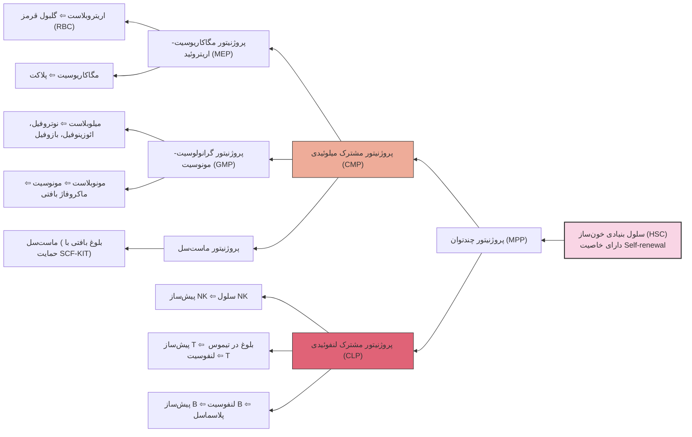
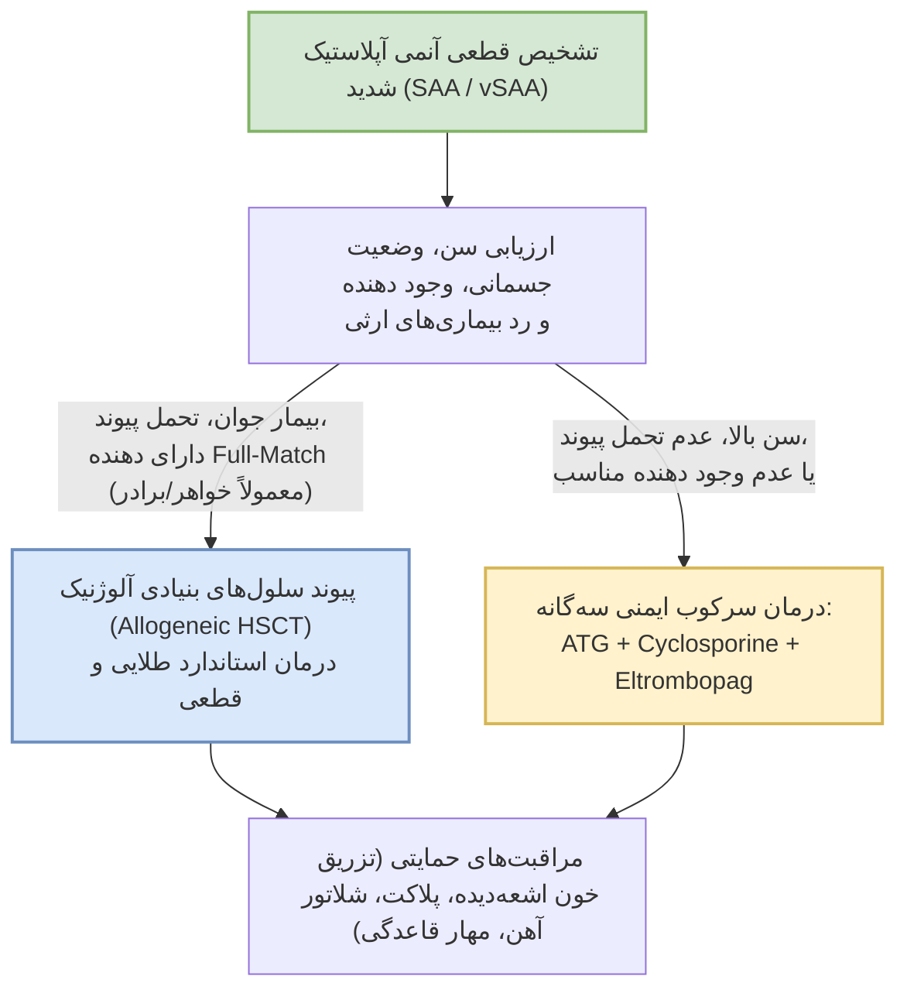
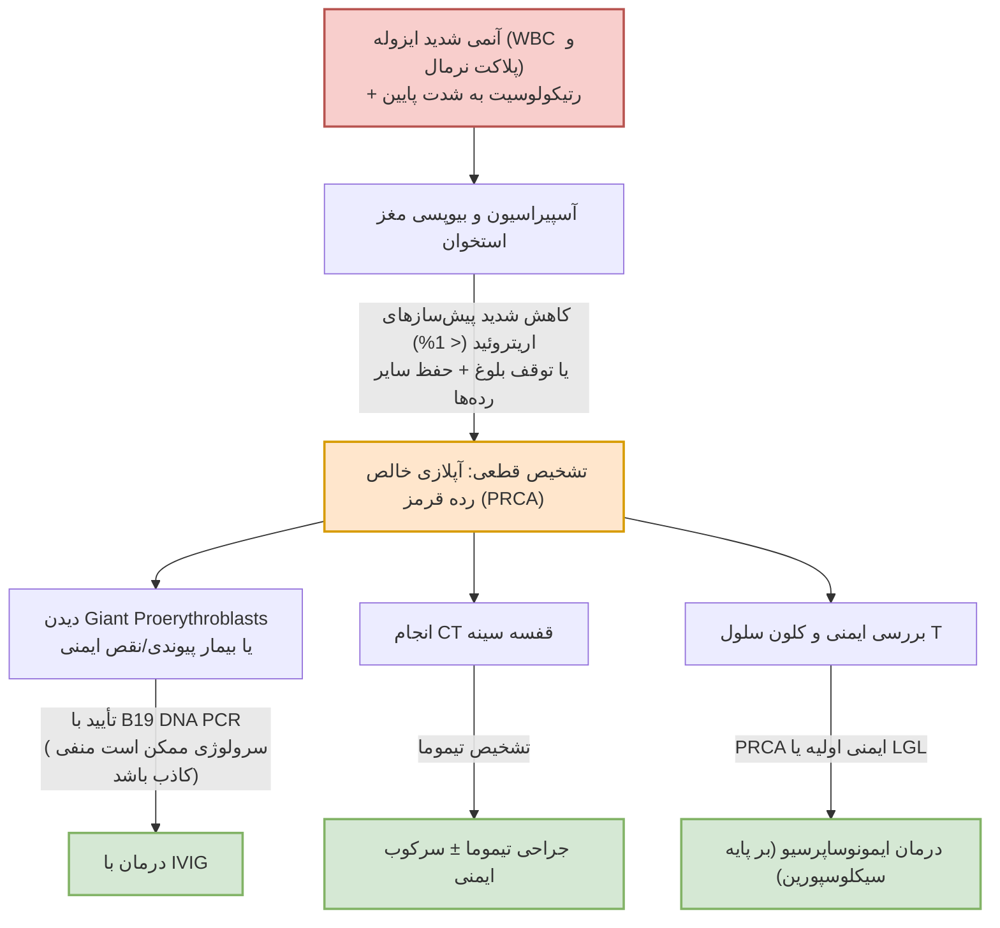

# نارسایی‌های مغز استخوان و سایتوپنی‌های هایپوپرولیفراتیو

## بخش اول: کلیات، تعاریف پایه و هماتوپوئز نرمال

وقتی در بالین با کاهش سلول‌های خونی روبه‌رو می‌شویم، قبل از هر چیز باید چهار مکانیسم اصلی نارسایی تولید در مغز استخوان را از هم تفکیک کنیم. 

> [!info] تعریف چهار الگوی اصلی نارسایی مغز استخوان
> - **آنمی آپلاستیک (Aplastic Anemia):** با اینکه اسمش «آنمی» است و یک *غلط مصطلح* محسوب می‌شود (چون در ظاهر فقط به کاهش رده گلبول قرمز اشاره دارد)، اما در واقعیت بالینی **هر سه رده سلولی (RBC، WBC و پلاکت)** کاهش می‌یابند (**پان‌سایتوپنی**). مشکل اصلی در این بیماری، **کم شدن و تخریب سلول‌های بنیادی (Stem Cells)** و پروژنیتورهایی است که کل سلول‌های خونی از آن‌ها منشأ می‌گیرند.
> - **سندرم میلودیسپلاستیک (MDS):** در اینجا سلول بنیادی وجود دارد و تولید هم می‌کند، اما مشکل اصلی در **بلوغ (Maturation)** سلول‌هاست. به دلیل جهش‌های ژنتیکی، سلول‌ها به حد کافی بالغ نمی‌شوند که وارد خون محیطی شوند یا شکل و عملکرد طبیعی ندارند؛ به این حالت **هماتوپوئز غیرمؤثر (Ineffective Hematopoiesis)** می‌گویند.
> - **میلوفتیزی (Myelophthisis):** مکانیسم اصلی این است که **فضای طبیعی مغز استخوان** با یک بافت غیرطبیعی و خارج از سیستم هماتوپوئز استاندارد (مثل فیبروز، متاستاز تومور یا گرانولوم) **اشغال و جایگزین** می‌شود و کارایی سلول‌های بنیادی از بین می‌رود.
> - **آپلازی خالص گلبول قرمز (Pure Red Cell Aplasia - PRCA):** در این حالت، مشکل به صورت **انتخابی (Selective)** فقط روی **رده اریتروئید (RBC)** است و سایر رده‌ها (گرانولوپوئز و تولید پلاکت/مگاکاریوپوئز) مشکل جدی ندارند و طبیعی هستند.

### مقایسه چهار مکانیسم اصلی نارسایی مغز استخوان

| نام اختلال | ضایعه و مکانیسم اولیه | نمای مورد انتظار در مغز استخوان | سرنخ کلیدی در خون محیطی (PBS) |
| :--- | :--- | :--- | :--- |
| **آنمی آپلاستیک (AA)** | تخلیه و کاهش سلول‌های بنیادی / پروژنیتورها | **هایپوسلولار** و جایگزینی با **بافت چربی** | **پان‌سایتوپنی** به همراه رتیکولوسیت پایین |
| **نئوپلاسم میلودیسپلاستیک (MDS)** | بلوغ غیرمؤثر و کلونال سلول‌ها | معمولاً **نرموسلولار یا هایپرسلولار** به همراه دیسپلازی | **ماکروسیتوز** ± سلول‌های بدشکل (دیسپلاستیک) |
| **میلوفتیزی (Myelophthisis)** | جایگزینی فضا یا فیبروز مغز استخوان | ارتشاح یافته (Infiltrated) یا فیبروتیک | نمای **لکواریتروبلاستیک** و سلول‌های قطره‌اشکی (**داکروسیت**) |
| **آپلازی خالص رده قرمز (PRCA)** | نارسایی انتخابی در رده اریتروئید | کاهش شدید یا فقدان پیش‌سازهای اریتروئیدی | **آنمی ایزوله** به همراه رتیکولوسیت به شدت پایین |

### مرور هماتوپوئز نرمال (از مغز استخوان تا خون محیطی)

برای اینکه بفهمیم در هر بیماری دقیقاً کجای کار می‌لنگد، باید مسیر طبیعی خون‌سازی را بشناسیم:
1. **سلول بنیادی خون‌ساز (HSC):** مهم‌ترین ویژگی این سلول، قابلیت **خودنوزایی (Self-renewal)** است؛ یعنی هم خودش، خودش را تولید می‌کند و هم در نهایت تمام رده‌های خونی از آن منشأ می‌گیرند.
2. **تنظیم‌کننده‌ها و محیط پشتیبان:**
   - هورمون **اریتروپویتین (EPO)** روی پروژنیتورهای اریتروئیدی اثر گذاشته و بقا و بلوغ آن‌ها را حمایت می‌کند.
   - هورمون **ترومبوپویتین (TPO)** از سلول‌های بنیادی و روند مگاکاریوپوئز (تولید پلاکت) حمایت می‌کند.
   - **نیچ (Niche) یا ریزمحیط مغز استخوان** حمایت ساختاری، عروقی و تنظیمی را برای سلول‌های بنیادی فراهم می‌کند.
3. **شاخه‌بندی سلولی:** سلول بنیادی (HSC) به **پروژنیتور چندتوان (MPP)** تبدیل می‌شود و سپس دو رده اصلی از آن جدا می‌شوند:
   - **رده میلوئیدی (CMP):** به چند زیرشاخه تقسیم می‌شود:
     - *پروژنیتور مگاکاریوسیت-اریتروئید (MEP):* یک شاخه آن **اریتروبلاست** را می‌سازد که در نهایت به **اریتروسیت (RBC)** در خون محیطی تبدیل می‌شود. شاخه دیگر **مگاکاریوسیت** است؛ سلول‌های بسیار بزرگی در مغز استخوان که وقتی به خون محیطی می‌رسند، قطعه قطعه شده و سلول‌های کوچکی به نام **پلاکت** را می‌سازند.
     - *پروژنیتور گرانولوسیت-مونوسیت (GMP):* یک دسته از آن تبدیل به **میلوبلاست** می‌شود که نهایتاً **بازوفیل، نوتروفیل و ائوزینوفیل** را تشکیل می‌دهد. دسته دیگر **مونوبلاست** است که تبدیل به **مونوسیت** در خون شده و پس از مهاجرت به بافت، به **ماکروفاژ** تبدیل می‌گردد.
     - *پروژنیتور ماست‌سل (Mast-cell progenitor):* یک دسته مجزا است که پیش‌سازهای آن از مغز استخوان وارد گردش خون شده و بلوغ نهایی خود را در **بافت‌ها** (با حمایت مسیر *SCF–KIT*) طی می‌کنند. ماست‌سل‌ها از بازوفیل‌ها متمایز هستند و با واسطه سیگنالینگ *FcεRI/IgE* باعث حساسیت فوری و آزادسازی هیستامین، تریپتاز، مدیاتورهای لیپیدی و سایتوکاین‌ها می‌شوند.
   - **رده لنفوئیدی (CLP):** 
     - *پیش‌ساز سلول کشنده طبیعی (NK precursor):* در خون محیطی تبدیل به **سلول NK** می‌شود.
     - *پیش‌ساز سلول T:* وارد **تیموس** شده و در نهایت **لنفوسیت T** از آن تولید و بالغ می‌شود.
     - *پیش‌ساز سلول B:* **لنفوسیت‌های B** داخل خون محیطی را می‌سازد که وقتی در بافت‌های لنفاوی محیطی فعال (Activate) شوند، تبدیل به **پلاسماسل** می‌شوند (پلاسماسل‌های با عمر طولانی ممکن است به مغز استخوان برگردند).

### نمای اسمیر خون محیطی نرمال (PBS)
وقتی به یک لام خون محیطی طبیعی نگاه می‌کنیم، این عناصر را می‌بینیم:
- **گلبول‌های قرمز (RBCs):** سلول‌های یکنواخت که در وسط خود یک رنگ‌پریدگی مرکزی (**Central Pallor**) دارند.
- **نوتروفیل‌های بالغ (PMN):** هسته‌های **چندسگمانه** (معمولاً **3 تا 5 سگمان/لوب**) و گرانول‌های سیتوپلاسمی واضح دارند.
- **سلول باند (Band cell):** یک مرحله قبل از نوتروفیل بالغ است که هسته آن شکل **نعل اسبی** دارد.
- **ائوزینوفیل‌ها:** گرانول‌های به رنگ **پرتقالی/نارنجی** دارند.
- **بازوفیل‌ها:** دارای گرانول‌های **سیاه/تیره** هستند.
- **مونوسیت‌ها:** هسته آن‌ها حالت **لوبیایی‌شکل** در وسط دارد.
- **لنفوسیت‌ها:** هسته گرد و متراکم دارند (گاهی می‌توانند کمی حالت آتیپیک داشته باشند).
- **پلاکت‌ها:** قطعات سلولی بسیار کوچک و گرانولار هستند (اگر خیلی بزرگ باشند به آن‌ها *Giant Platelet* می‌گویند).

> [!warning] تله تشخیصی در لام خون محیطی
> دیدن سلول‌هایی با ظاهر طبیعی در لام خون محیطی، به هیچ وجه اثبات‌کننده تولید طبیعی در مغز استخوان نیست! (مثلاً در آنمی آپلاستیک یا PRCA، سلول‌های باقی‌مانده شکل طبیعی دارند اما تعدادشان به شدت کم است).

---

## بخش دوم: رویکرد بالینی به بیمار مبتلا به پان‌سایتوپنی

### کیس اول (آشنایی با مفاهیم پایه در بالین)
خانم 20 ساله‌ای با علائم **تب، پورپورای اندام تحتانی و ضعف (Weakness)** به اورژانس مراجعه می‌کند. آزمایش CBC بیمار به شرح زیر است:
- **WBC:** 2000 /μL (**PMN:** 25%)
- **Hb:** 7 g/dL (**MCV:** 90 fL)
- **PLT:** 30,000 /μL

#### تحلیل گام‌به‌گام آزمایش CBC بیمار:
1. **بررسی رده سفید (WBC و ANC):**
   - رنج طبیعی WBC حدود **4000 تا 10,000** (یا 4500 تا 11,000) است؛ پس بیمار با عدد 2000 دچار **لکوپنی** است. از آنجا که نوتروفیل‌ها بیشترین درصد گلبول‌های سفید در خون و مغز استخوان را تشکیل می‌دهند، تقریباً تمام موارد لکوپنی خودشان را به صورت **نوتروپنی** نشان می‌دهند.
   - **شمارش مطلق نوتروفیل (ANC - Absolute Neutrophil Count):** نوتروفیل‌های بالغ به اضافه سلول‌های باند (یک مرحله قبل از نوتروفیل)، سلول‌های اصلی مقابله با ارگانیسم‌ها و عفونت‌ها هستند.
   - **فرمول محاسبه ANC:** تعداد کل WBC ضربدر درصد (PMN + Band) تقسیم بر 100.
   - در این بیمار: 2000 × 25% = **500 /μL**.
   - **تعریف نوتروپنی:** به **ANC کمتر از 1800/μL** نوتروپنی اطلاق می‌شود (پس بیمار ما به شدت نوتروپنیک است).
2. **بررسی رده قرمز (Hb و MCV):**
   - **تعریف آنمی بر اساس WHO:** به طور کلی هموگلوبین **کمتر از 13 g/dL در مردان** و **کمتر از 12 g/dL در زنان غیرباردار** آنمی محسوب می‌شود. (البته به صورت دقیق‌تر در جداول کتاب، بر اساس سن و شرایط مثل بارداری، یائسگی یا سن رشد کودکان، اگر بیشتر از **2 انحراف معیار (SD)** پایین‌تر از میانگین باشد، آنمی تعریف می‌شود؛ و اعداد زیر 7 تا 8 نشان‌دهنده **آنمی شدید (Severe)** هستند).
   - **MCV (حجم متوسط گلبول قرمز):** رنج طبیعی آن **80 تا 100 فمتولیتر (fL)** است. در این بیمار MCV برابر 90 است، یعنی **نرموسیت** است.
3. **بررسی رده پلاکتی (PLT):**
   - رنج طبیعی پلاکت **150,000 تا 450,000 /μL** است. پلاکت زیر 150,000 **ترومبوسایتوپنی** نامیده می‌شود (بیمار ما پلاکت 30,000 دارد).
4. **نتیجه‌گیری اولیه:** چون هر سه رده اصلی خونی کاهش یافته‌اند، بیمار با تابلو **پان‌سایتوپنی (Pancytopenia)** مراجعه کرده است.

---

### مکانیسم‌ها و علل پان‌سایتوپنی (تشخیص‌های افتراقی)

وقتی در خون محیطی پان‌سایتوپنی می‌بینیم، مشکل می‌تواند از یکی از این سه جا باشد:
1. **کاهش تولید از مبدأ (مغز استخوان):** سلول بنیادی (HSC) کم شده یا کار نمی‌کند (آنمی آپلاستیک)، یا فضای مغز استخوان اشغال شده است (میلوفتیزی).
2. **هماتوپوئز غیرمؤثر (Ineffective Hematopoiesis):** سلول بنیادی در مغز استخوان سلول می‌سازد و مغز استخوان پر از سلول است، اما به دلیل نقص در بلوغ هسته یا سیتوپلاسم (مثل **کمبود B12، فولات، مس** یا جهش‌های ژنتیکی در **MDS** و **لوسمی‌ها**)، سلول‌ها در همان مغز استخوان می‌میرند یا اگر وارد خون شوند، عملکرد طبیعی ندارند.

> [!important] نکته امتحانی: تفاوت مفهومی «هماتوپوئز غیرمؤثر» و «آنمی آپلاستیک»
> در **هماتوپوئز غیرمؤثر** (مثل MDS یا کمبود B12/فولات)، مسیر بلوغ (از میلوبلاست ⇦ پرومیلوسیت ⇦ میلوسیت ⇦ متامیلوسیت ⇦ باند ⇦ نوتروفیل) در یک نقطه متوقف می‌شود یا تناسب هسته و سیتوپلاسم به هم می‌خورد (مثلاً نوتروفیل به جای 3 تا 5 لوب، 2 لوبه یا 8 لوبه می‌شود). یعنی در مغز استخوان **سلول به وفور وجود دارد ولی بی‌کیفیت است و به درد نمی‌خورد**. 
> اما در **آنمی آپلاستیک**، از همان سرمنشأ سلول بنیادی وجود ندارد و مغز استخوان خالی از سلول است؛ البته همان تعداد اندک سلولی که به خون محیطی می‌رسند، **شکل و ویژگی‌های سلول نرمال را دارند**.

3. **تخریب یا به دام افتادن در خون محیطی (Peripheral Destruction / Sequestration):** مغز استخوان کارش را عالی انجام می‌دهد و سلول‌های سالم را وارد خون می‌کند، اما در محیط مصرف یا تخریب می‌شوند. مهم‌ترین مثال آن **هایپراسپلنیسم (بزرگی طحال)** است؛ چه ناشی از یک بیماری غیرهماتولوژیک مثل **سیروز کبدی** باشد، و چه ناشی از اختلالات هماتولوژیک مثل **بیماری‌های لنفوپرولیفراتیو و لنفوم‌ها** که طحال بزرگ شده و سلول‌های سالم خون را می‌بلعد. مثال دیگر، مصرف سلول‌ها در اختلالات انعقادی مثل **DIC** یا همولیز ایمنی است.

### جدول جامع مکانیسم‌های سایتوپنی اکتسابی (Acquired)

| مکانیسم اولیه | علل و زیرگروه‌ها | مسیر سلولی و پاتوفیزیولوژی | وجه تمایز کلیدی |
| :--- | :--- | :--- | :--- |
| **تخلیه HSC با تخریب ایمنی** | آنمی آپلاستیک ایدیوپاتیک، AA پست‌هپاتیت، برخی واکنش‌های دارویی و بیماری‌های ایمنی (مثل لوپوس) | لنفوسیت‌های **T سیتوتوکسیک**، ترشح **IFN-γ** و **TNF** و مسیر **Fas/FasL** رشد HSC را سرکوب و آپوپتوز را القا می‌کنند | آپلازی چندرده‌ای؛ عامل شروع‌کننده ممکن است ناشناخته باشد |
| **فقدان HSC با سمیت مستقیم (Direct Toxicity)** | اشعه یونیزان (رادیوتراپی، حوادث هسته‌ای مثل چرنوبیل، کارمندان رادیولوژی)، داروهای شیمی‌درمانی سایتوتوکسیک | آسیب مستقیم به DNA یا مهار تقسیم سلولی که باعث مرگ پروژنیتورها و HSCها می‌شود | **وابسته به دوز و حجم (اثر تجمعی)**؛ متمایز از فرم ایمنی |
| **تخلیه HSC با آسیب سمی یا مختلط** | **بنزن**، واکنش‌های دارویی **ایدیوسنکراتیک** (مثل آلوپورینول) | متابولیت‌های فعال و آسیب ژنومی؛ مسیرهای ایمنی نیز در فرم ایدیوسنکراتیک نقش دارند | **غیرقابل پیش‌بینی و مستقل از دوز** (حتی با یک یا دو قرص)؛ باید MDS ناشی از بنزن رد شود |
| **آسیب انتخابی یک رده** | **پاروویروس B19** | تکثیر ویروس مستقیماً پیش‌سازهای رده اریتروئید را تخریب می‌کند | بحران آپلاستیک یا **PRCA** می‌دهد؛ معمولاً پان‌سایتوپنی نمی‌دهد |
| **هماتوپوئز غیرمؤثر** | کمبود **B12، فولات یا مس**؛ سندرم **MDS** | اختلال در بلوغ و مرگ داخل مغز استخوان (Intramedullary death) خروجی سلول بالغ را کم می‌کند | پیش‌سازها حضور دارند ولی خروجی کم است؛ مغز استخوان اغلب **هایپرسلولار** است |
| **به‌هم‌ریختگی نیچ و جایگزینی فضا** | فیبروز مغز استخوان، متاستاز سرطان‌ها، ارتشاح لنفوم | از دست رفتن فضای عملکردی، حمایت استرومایی و ساختار عروقی طبیعی | ایجاد **میلوفتیزی**؛ متمایز از آنمی آپلاستیک کلاسیک |
| **تخریب محیطی یا به دام افتادن** | همولیز ایمنی، **DIC**، **هایپراسپلنیسم** (سیروز، لنفوم) | تخریب در خون محیطی، مصرف انعقادی یا تجمع و حذف در طحال | تولید در مغز استخوان کاملاً حفظ شده و طبیعی است |
| **سرکوب مختلط (Mixed)** | ویروس‌های **HIV، CMV، EBV**؛ **سپسیس**؛ آنمی آپلاستیک مرتبط با **بارداری** | التهاب، اثرات ایمنی، داروها یا HLH؛ مکانیسم بارداری هنوز دقیقاً مشخص نیست | هر سایتوپنی به معنای AA نیست؛ در بارداری ممکن است 1 یا 2 رده درگیر شود |

### جدول جامع سندرم‌های ارثی و سرشتی نارسایی مغز استخوان (Inherited / Constitutional)

| مکانیسم اولیه | بیماری و ژن‌های دخیل | مسیر سلولی و پاتوفیزیولوژی | ویژگی‌های کلیدی و بالینی |
| :--- | :--- | :--- | :--- |
| **نقص در ترمیم DNA** | **آنمی فانکونی (Fanconi Anemia)** - ژن‌های مسیر *FANC* | عدم ترمیم اتصال عرضی بین رشته‌های DNA (Interstrand cross-links) ⇦ استرس همانندسازی و تحلیل رفتن HSC | نارسایی پیشرونده چندرده‌ای؛ مستعد به **MDS و AML** |
| **نقص در حفظ تلومر** | **اختلالات بیولوژی تلومر (Dyskeratosis Congenita)** - ژن‌های *TERT, TERC, DKC1* | تلومرهای کوتاه و ناکارآمد باعث پیری سلولی (Senescence) و از دست رفتن خودنوزایی HSC می‌شوند | ممکن است در بزرگسالی تظاهر یابد؛ همراهی با **فیبروز ریه یا سیروز کبد** |
| **نقص در بلوغ ریبوزوم** | **سندرم شواخمن-دیاموند (Shwachman-Diamond)** - اغلب ژن *SBDS* | اختلال در سنتز پروتئین، استرس سلولی و اختلال عملکرد استرومای مغز استخوان | **نوتروپنی** شایع است؛ همراه با **نارسایی اگزوکرین پانکراس و سوءجذب** |
| **اختلال ریبوزومی با آسیب‌پذیری رده قرمز** | **آنمی دیاموند-بلک‌فن (Diamond-Blackfan)** - ژن‌های پروتئین ریبوزومی | استرس ریبوزومی و تغییر ترجمه پروتئین‌ها که به طور ویژه پروژنیتورهای اریتروئید را مختل می‌کند | عمدتاً **آپلازی رده قرمز (PRCA)** می‌دهد؛ پان‌سایتوپنی تیپیک نیست |
| **اختلال در تنظیم رونویسی** | **کمبود GATA2** | اختلال در حفظ HSC و تمایز رده‌های انتخابی | کاهش شدید **مونوسیت، سلول B و NK**؛ عفونت‌های آتیپیک، زگیل، لنف‌ادم و استعداد به MDS/AML |
| **محدودیت بیش‌ازحد رشد** | اختلالات **SAMD9 / SAMD9L** (جهش Gain of function) | سرکوب بیش‌ازحد تکثیر پروژنیتورها که ظرفیت خون‌سازی را کم می‌کند | هایپوسلولاریتی و سایتوپنی؛ احتمال بروز کلون‌های **مونوزومی 7** |

> [!warning] نکته بسیار مهم در مورد اختلالات ارثی مغز استخوان
> بروز بیماری در سنین بزرگسالی، ظاهر فیزیکی طبیعی و یا عدم وجود سابقه خانوادگی، به هیچ وجه نارسایی ارثی (Germline) مغز استخوان را **رد نمی‌کند**! (چون ممکن است جهش *de novo* باشد). تشخیص این موارد بسیار حیاتی است؛ زیرا روی انتخاب دهنده پیوند (خواهر یا برادر ممکن است ناقل همان نقص ژنتیکی باشند)، شدت رژیم آماده‌سازی قبل از پیوند (Conditioning)، پایش سرطان‌ها و مشاوره ژنتیک تأثیر مستقیم دارد.

---

### گام‌های ارزیابی بالینی و آزمایشگاهی در بیمار با سایتوپنی

وقتی بیماری مثل کیس اول (خانم 20 ساله با پان‌سایتوپنی) مراجعه می‌کند، باید همزمان دو هدف را دنبال کنیم: **1. بررسی نیاز به اقدامات اورژانسی** (آیا بیمار بی‌ثبات است، خونریزی فعال دارد یا تب و نوتروپنی شدید دارد که نیازمند اقدام فوری باشد؟) و **2. کانالیزه کردن ذهن برای یافتن علت اصلی**.

#### ۱. نکات کلیدی در شرح‌حال (History):
- **شدت و سیر زمانی علائم:** علائم از کی شروع شده؟ شامل خستگی، تنگی نفس، عفونت‌ها و خونریزی/کبودی است.
- **مصرف داروها (بسیار مهم):** باید با جزئیات کامل (نوع دارو، دوز و زمان مصرف) و با پرسش‌های مکرر پرسیده شود (به دلیل واکنش‌های ایدیوسنکراتیک یا دوز تجمعی).
- **مواجهات شغلی و سموم:** تماس با مواد شیمیایی (مثل بنزن)، سموم یا اشعه.
- **عفونت‌های اخیر (در چند ماه گذشته):** به ویژه سابقه علائم **هپاتیت (یرقان و التهاب کبدی) در 1 تا 2 ماه اخیر** که اکنون بهبود یافته ولی بیمار با پان‌سایتوپنی آمده است.
- **وضعیت تغذیه و مصرف الکل:** گیاه‌خواری صرف (Vegetarian) که باعث کمبود B12 و فولات می‌شود، یا مصرف الکل که متابولیسم فولات را مختل کرده و مستقیماً روی مغز استخوان اثر سمی دارد.
- **سوالات اختصاصی PNH:** پرسیدن در مورد **هموگلوبینوری** (ادرار تیره صبحگاهی) و **دردهای شکمی** (که شک ما را به سمت ترومبوزهای وریدی در PNH می‌برد).
- **سابقه فامیلی:** سابقه بیماری‌های خونی، ناهنجاری‌های اسکلتی، یا سابقه **فیبروز ریه و سیروز کبدی** در خانواده (سرنخ بیماری‌های تلومر و ارثی).

#### ۲. نکات کلیدی در معاینه فیزیکی (Physical Examination):
- **پوست و مخاطات:**
  - بررسی **پتشی** (ضایعات نقطه‌ای) و **پورپورا/اکیموز** (ضایعات بزرگ‌تر که با فشار دست محو نمی‌شوند) در اندام‌ها و مخاطات به دنبال ترومبوسایتوپنی.
  - بررسی **رنگ‌پریدگی (Pallor)** در پوست و ملتحمه چشم.

> [!tip] نکته بالینی استاد برای تخمین شدت آنمی در معاینه
> یکی از بهترین راه‌های بالینی برای فهمیدن آنمی شدید (Severe)، نگاه کردن به **خطوط کف دست (Palmar creases)** است. در حالت عادی این خطوط پررنگ‌تر از پوست اطراف هستند؛ اگر این خطوط کم‌رنگ‌تر از پوست اطراف شوند، معمولاً هموگلوبین بیمار **زیر 7 g/dL** است!

- **معاینه سیستمیک غدد لنفاوی (لنفادنوپاتی):** باید به صورت سیستماتیک نواحی قابل مشاهده و لمس یعنی **گردن، آگزیلا (زیربغل) و اینگوئینال (کشاله ران)** را معاینه کنیم. (غدد لنفاوی داخل شکم و مدیاستن با دست قابل لمس نیستند و نیاز به Imaging دارند). در لمس لنف‌نود، مواردی مثل فیکس بودن، چسبیدن چند غده به هم (**Matted / Conglomerate**)، محل **سوپراکلاویکولار**، تداوم بیش از 2 هفته، در حال رشد بودن و علائم همراه، ما را از یک عفونت ساده به سمت بدخیمی‌های لنفوپرولیفراتیو می‌برد.
- **معاینه طحال (اسپلنومگالی):** در حالت طبیعی انتظار نداریم طحال زیر لبه دنده لمس شود. اگر در معاینه دودستی، طحال حتی **2 تا 3 سانتی‌متر زیر لبه دنده** به دست بخورد، بزرگ شده است و اگر **8 سانتی‌متر یا بیشتر** زیر لبه دنده لمس شود، به آن **طحال حجیم (Huge Splenomegaly)** می‌گوییم. در صورت شک بالینی بالا، حتی اگر در لمس چیزی حس نکنیم، باید با **سونوگرافی (Imaging)** معاینه خود را تکمیل و تأیید کنیم.

#### ۳. درخواست‌های آزمایشگاهی اولیه:
- **CBC همراه با شمارش افتراقی (Diff) و شمارش مطلق رتیکولوسیت:** در بیمار بی‌ثبات و علامت‌دار اورژانسی، وقت را برای تکرار CBC تلف نمی‌کنیم، اما در یک بیمار پایدار (Stable) تکرار CBC برای اطمینان از تداوم سایتوپنی کمک‌کننده است.
- **اسمیر خون محیطی (PBS) که به صورت دستی توسط پزشک بررسی شود (بسیار مهم):**
  - اگر **میلوبلاست** ببینیم (سلول بزرگ، نسبت هسته به سیتوپلاسم بالا، دارای هستک‌های سفیدرنگ واضح در داخل هسته، و وجود خط/چوب سیتوپلاسمی به نام **Auer rod**) ⇦ شک قوی و فوری به **لوسمی حاد (AML)**.
  - اگر **پرومیلوسیت** پر از گرانول ببینیم ⇦ شک فوری به **AML-M3 (APL)**.
  - اگر نوتروفیل **هایپوسگمانته (2 لوبه)** و کم‌گرانول (**Pseudo-Pelger-Huët**) ببینیم ⇦ شک به **MDS**.
  - اگر نوتروفیل **هایپرسگمانته** (دارای 6، 7 یا 8 لوب؛ در حالت عادی 3 تا 5 لوب است) در کنار گلبول‌های قرمز بزرگ (ماکروسیت) ببینیم ⇦ شک به **آنمی مگالوبلاستیک (کمبود B12 و فولات)**.
  - اگر گلبول قرمز قطره‌اشکی (**Teardrop**) و گلبول قرمز هسته‌دار (**NRBC**) یا شیستوسیت (قطعه قطعه شدن) ببینیم ⇦ شک به **میلوفتیزی / فیبروز** یا میکروآنژیوپاتی.
- **تست‌های انعقادی (PT, PTT):** برای رد شرایط اورژانسی مثل **DIC**.
- **تعیین گروه خونی (Blood type and screen)** و **پنل متابولیک کامل (CMP)** شامل تست‌های کبدی و کلیوی.
- **تست‌های تکمیلی بر اساس شک بالینی:** سطح سرمی **B12 و فولات**، سطح **سرولوپلاسمین و مس** (کمبود مس، که گاهی به دنبال مصرف بیش‌ازحد روی/زینک رخ می‌دهد، می‌تواند دقیقاً تابلوی MDS را تقلید کند!)، تست‌های روماتولوژیک مثل **ANA** (در خانم جوان مشکوک به لوپوس)، سرولوژی هپاتیت‌ها و ویروس‌ها، و **فلوسایتومتری خون محیطی برای CD55 و CD59** (در صورت شک به PNH و نزدیک شدن به تشخیص آنمی آپلاستیک).

---

### ارزیابی مغز استخوان (آسپیراسیون و بیوپسی)

وقتی در بررسی خون محیطی به علت مشخصی نرسیدیم (مثلاً در کیس اول که سلول‌های بدشکل، بلاست یا هایپرسگمانتاسیون ندیدیم)، یعنی مشکل از سرمنشأ (مغز استخوان) است و باید سراغ **آسپیراسیون و بیوپسی مغز استخوان (BMA & BMB)** برویم.

### مقایسه ابزارهای بررسی مغز استخوان

| نوع نمونه / روش | بهترین کاربرد تشخیصی | محدودیت‌های مهم |
| :--- | :--- | :--- |
| **آسپیراسیون (Aspirate)** | بررسی **مورفولوژی سلول‌ها**، شمارش افتراقی، درصد **بلاست‌ها** و رنگ‌آمیزی **آهن** (برای سیدروبلاست حلقوی) | رقیق شدن با خون (Hemodilution) یا خشک بودن آسپیراسیون (**Dry tap**) می‌تواند تشخیص را مخفی کند |
| **بیوپسی (Core Biopsy)** | سنجش دقیق **سلولاریته**، ساختار و معماری مغز استخوان، بررسی **فیبروز** و ارتشاح تومور | درگیری‌های تکه‌ای (Patchy) و نمونه‌های کوچک می‌توانند گمراه‌کننده باشند |
| **فلوسایتومتری (Flow Cytometry)** | شناسایی **کلون‌های PNH** (کاهش CD55 و CD59) و شمارش دقیق درصد بلاست‌ها با مارکر **CD34** | به تنهایی جایگزین مورفولوژی نمی‌شود و بخشی از تشخیص تلفیقی است |
| **کاریوتایپ و تست‌های مولکولی** | اثبات کلونالیته، طبقه‌بندی اختلالات سیتوژنتیک (مثل MDS) و بررسی استعداد ارثی | وجود یک جهش به تنهایی و بدون سایر معیارها، بیماری MDS را اثبات نمی‌کند |

> [!important] فرمول طلایی محاسبه سلولاریته طبیعی مغز استخوان
> در زیر میکروسکوپ، بیوپسی مغز استخوان شامل دو بخش است: دایره‌های سفیدرنگ که **بافت چربی** هستند و بخش‌های قرمزرنگ که **کامپوننت‌های هماتوپوئتیک (خون‌ساز)** هستند. 
> فرمول سلولاریته طبیعی بر اساس سن عبارت است از:
> **سلولاریته طبیعی (%) = سن بیمار - 100**
> (برای مثال، در یک خانم 20 ساله، انتظار داریم حدود **80%** فضای مغز استخوان از سلول‌های خون‌ساز و تنها 20% از چربی تشکیل شده باشد؛ و به طور کلی در بزرگسالان بسته به سن حدود 50% تا 60% است).
> - اگر چربی‌ها کنار بروند و همه‌جا پر از سلول باشد ⇦ **هایپرسلولار** (مثل لوسمی‌ها و اغلب موارد MDS).
> - اگر سلول‌های خون‌ساز از بین بروند و عمده فضا را چربی بگیرد ⇦ **هایپوسلولار** (مثل آنمی آپلاستیک که زیر 25% سلول دارد و گاهی در موارد شدید تقریباً **100% چربی** است!).

---

## بخش سوم: آنمی آپلاستیک (Aplastic Anemia)

> [!info] تعریف ضایعه اصلی در آنمی آپلاستیک
> آنمی آپلاستیک عبارت است از **پان‌سایتوپنی** در خون محیطی همراه با کاهش شدید خون‌سازی در یک **مغز استخوان به شدت هایپوسلولار** که در آن سلول‌های بنیادی چندتوان (Multipotent HSCs) از بین رفته و **بافت چربی** جایگزین بخش عمده فضای خون‌ساز شده است. گذاشتن این تشخیص نیازمند **رد کردن (Rule out)** علل ارتشاحی، کلونال (مثل MDS) و ارثی است.

### اپیدمیولوژی
- **جنس:** زنان و مردان به نسبت **مساوی** درگیر می‌شوند.
- **توزیع سنی:** دارای الگوی **دوقله‌ای (Biphasic)** است:
  1. پیک اصلی در سنین **نوجوانی و دهه بیست زندگی (Teens and Twenties)**.
  2. پیک دوم در **بزرگسالان مسن (Older adults)**.

### اتیولوژی و نکات اختصاصی علل آنمی آپلاستیک
1. **ایدیوپاتیک (Idiopathic):** **شایع‌ترین علت** آنمی آپلاستیک است (هیچ عامل مشخصی پیدا نمی‌شود و مکانیسم آن تخریب ایمنی است).
2. **عفونت‌ها:**
   - افت خفیف شمارش سلول‌های خونی در طول عفونت‌های ویروسی و باکتریایی شایع است اما با بهبود عفونت برطرف می‌شود.
   - **هپاتیت (Hepatitis):** **شایع‌ترین عفونت** مرتبط با آنمی آپلاستیک کلاسیک است!
     - بیمار تیپیک معمولاً یک **مرد جوان** است که **1 تا 2 ماه قبل** یک حمله التهاب کبدی (هپاتیت) را پشت سر گذاشته و بهبود یافته است و حالا با پان‌سایتوپنی شدید مراجعه می‌کند.
     - نکته بسیار مهم امتحانی: این هپاتیت **سرونگاتیو (Seronegative)** است؛ یعنی از نوع **Non-A, Non-B, Non-C** بوده و هیچ ویروس هپاتیت مشخصی در سرولوژی پیدا نمی‌شود.
     - **پیش‌آگهی (Prognosis):** پیش‌آگهی آنمی آپلاستیک به دنبال هپاتیت سرونگاتیو **بد (Poor)** است.
   - سایر ویروس‌ها: **EBV** (مونونوکلئوز عفونی)، **HIV**، و **پاروویروس B19** (که بیشتر رده RBC را درگیر می‌کند ولی گاهی با سایتوپنی/پان‌سایتوپنی همراه می‌شود).
3. **همراهی با هموگلوبینوری حمله‌ای شبانه (PNH):**
   - بیماری PNH ناشی از یک جهش اکتسابی در **ژن PIG-A** در سلول بنیادی خون‌ساز است که باعث کمبود پروتئین‌های غشایی متصل به لنگر *GPI* (یعنی **CD55 و CD59**) در سطح سلول‌ها می‌شود.
   - ارتباط بسیار تنگاتنگ و دوطرفه‌ای بین AA و PNH وجود دارد: در **نصف (50% یا بیشتر) بیماران مبتلا به آنمی آپلاستیک**، با انجام **فلوسایتومتری** می‌توان کلون‌های کوچکی از سلول‌های فاقد CD55/CD59 را پیدا کرد! همچنین یک آنمی آپلاستیک ممکن است در آینده به PNH آشکار تبدیل شود، یا یک بیمار PNH در سیر خود دچار آپلازی مغز استخوان و پان‌سایتوپنی گردد. بنابراین با دیدن هر کدام، باید به دنبال دیگری هم بگردیم.
4. **اختلالات ارثی و سرشتی (Constitutional Disorders):**
   - **آنمی فانکونی (Fanconi Anemia):**
     - توارث **اتوزومال مغلوب (AR)**، نارسایی پیشرونده مغز استخوان و افزایش ریسک بدخیمی (به ویژه **AML و MDS**).
     - ناهنجاری‌های مادرزادی: در **بیش از نیمی از بیماران** ناهنجاری‌های اندام فوقانی دیده می‌شود؛ شامل **هایپوپلازی رادیال**، **عدم وجود شست (Absent thumbs)**، عدم وجود استخوان رادیوس یا مچ، و چسبندگی انگشتان (**سینداکتیلی**).
     - سایر یافته‌ها: **قد کوتاه**، **میکروسفالی**، **میکروفتالمیا** (چشم کوچک)، **چانه کوچک** و لکه‌های پوستی **شیرقهوه‌ای (Café au lait spots)**.
     - **تست تشخیصی قطعی:** تست شکنندگی کروموزومی (**Chromosome breakage / fragility test**) با استفاده از مواد **DEB** یا **MMC**.
   - **دیسکراتوز مادرزادی (Dyskeratosis Congenita):**
     - جهش در ژن‌های کمپلکس ترمیم و حفظ تلومر و بروز آنمی آپلاستیک در کودکی یا بزرگسالی.
     - **تریاد کلاسیک بالینی:** **لکوپلاکی مخاط دهان** (Mucous membrane leukoplakia)، **ناخن‌های بدشکل و دیستروفیک** (Dystrophic nails) و **هایپرپیگمانتاسیون مشبک پوستی** (Reticular hyperpigmentation). همچنین سفیدی زودرس موها، **فیبروز ریه** و **بیماری کبدی** در آن‌ها دیده می‌شود.
     - **تست تشخیصی:** بررسی طول تلومر لنفوسیت‌ها با روش **Flow-FISH**.
   - **سندرم شواخمن-دیاموند (Shwachman-Diamond Syndrome):**
     - جهش در ژن **SBDS** (که عملکرد استرومای مغز استخوان را هم مختل می‌کند).
     - مشخصه بارز آن همراهی نارسایی مغز استخوان با **نارسایی اگزوکرین پانکراس**، **سوءجذب (Malabsorption)** و ناهنجاری‌های اسکلتی است.

> [!tip] نکته تکمیلی در آزمایش ژنتیک اختلالات ارثی
> در موارد مشکوک به اختلالات ارثی، آزمایش روی خون محیطی ممکن است به دلیل خون‌سازی کلونال یا برگشت سوماتیک (Somatic reversion) گمراه‌کننده باشد؛ لذا گاهی تأیید جهش در یک **بافت غیرخون‌ساز** (مثل فیبروبلاست‌های پوست) ضروری است.

---

### تظاهرات بالینی آنمی آپلاستیک (نکات طلایی و تله‌های امتحانی)

1. **محدود بودن علائم به سیستم هماتولوژیک:**
   - یک ویژگی بسیار بارز و شگفت‌انگیز در آنمی آپلاستیک این است که علی‌رغم افت شدید شمارش سلول‌های خونی، **بیماران اغلب حال عمومی بسیار خوبی دارند** و بدحال به نظر نمی‌رسند!
   - **تله امتحانی:** اگر بیماری با پان‌سایتوپنی، **علائم سیستمیک، بی‌اشتهایی، تعریق شبانه یا کاهش وزن (Weight loss)** داشته باشد، باید قویاً به سایر علل پان‌سایتوپنی (مثل بدخیمی‌ها یا عفونت‌های مزمن) شک کرد!
2. **خونریزی (شایع‌ترین علامت اولیه):**
   - شروع بیماری ممکن است ناگهانی یا تدریجی باشد. **خونریزی شایع‌ترین علامت زودرس** است؛ بیمار از چند روز تا چند هفته کبودی آسان با ضربات خفیف (**Easy bruising**)، خونریزی از لثه‌ها، اپیستاکسی (خونریزی بینی)، خونریزی سنگین قاعدگی (**منوراژی**) و گاهی پتشی شاکی است.
   - نکته مهم: با وجود ترومبوسایتوپنی شدید، **خونریزی حجیم و کشنده (Massive hemorrhage) در ابتدا غیرمعمول و نادر است**.
3. **عفونت (علامت اولیه غیرمعمول):**
   - بروز عفونت به عنوان اولین علامت در آنمی آپلاستیک **غیرمعمول** است (مگر اینکه بیمار چند هفته علامت‌دار بوده و درمان نشده باشد).
   - **تفاوت با آگرانولوسیتوز:** این ویژگی دقیقاً برخلاف **آگرانولوسیتوز** (بیماری‌ای که فقط رده WBC/نوتروفیل را درگیر می‌کند و اغلب در کودکان نیز فرم‌های شدیدی دارد) است؛ در آگرانولوسیتوز، بیمار خیلی زود با فارنژیت شدید، عفونت‌های آنورکتال یا سپسیس آشکار مراجعه می‌کند و حتی ممکن است به علت شدت عفونت فوت کند.
4. **نکات بسیار مهم در معاینه فیزیکی:**
   - پتشی، اکیموز و رنگ‌پریدگی پوست و مخاطات یافته‌های تیپیک هستند.
   - به دلیل مستعد بودن به خونریزی و تروما، **معاینات لگنی و رکتال (Pelvic and rectal exams)** را اغلب می‌توان به تعویق انداخت و در صورت ضرورت، باید با **نهایت ملایمت** انجام شوند تا تروما ایجاد نشود.

> [!warning] قانون طلایی رد تشخیص آنمی آپلاستیک در معاینه
> وجود **لنفادنوپاتی** و **اسپلنومگالی (بزرگی طحال)** در آنمی آپلاستیک **به شدت غیرتیپیک (Highly atypical)** است! اگر در معاینه بیمار مبتلا به پان‌سایتوپنی، طحال بزرگ یا غدد لنفاوی بزرگ لمس کردید، تشخیص آنمی آپلاستیک زیر سؤال می‌رود و باید دنبال تشخیص‌های دیگر (مثل لوسمی، لنفوم و غیره) بگردید.

---

### یافته‌های آزمایشگاهی و مغز استخوان در آنمی آپلاستیک

#### ۱. اسمیر خون محیطی و رتیکولوسیت:
- در لام خون محیطی، سلول‌ها کم هستند (کمبود پلاکت و گرانولوسیت)، اما سلول‌های موجود **مورفولوژی طبیعی** دارند. تعداد لنفوسیت‌ها ممکن است طبیعی یا کاهش‌یافته باشد.
- گلبول‌های قرمز اغلب بزرگ هستند و **افزایش MCV (ماکروسیتوز خفیف تا متوسط)** در آنمی آپلاستیک **شایع** است!
- **شمارش رتیکولوسیت:** رتیکولوسیت‌ها **غایب یا به شدت کم** هستند.

> [!important] مکانیسم فیزیولوژیک رتیکولوسیت و علت ماکروسیتوز در آنمی آپلاستیک (نکته مفهومی استاد)
> **رتیکولوسیت** سلول پیش‌ساز و یک مرحله قبل از RBC بالغ است که به طور طبیعی حدود **3.5 روز در مغز استخوان** می‌ماند و سپس وارد خون محیطی شده و **1.5 روز در خون محیطی** عمر می‌کند تا به RBC بالغ تبدیل شود (درصد طبیعی آن در خون حدود 1% است). 
> - وقتی در بدن آنمی یا خونریزی رخ می‌دهد و اکسیژن‌رسانی بافتی کم می‌شود، یک پالس (EPO) به مغز استخوان می‌رسد. اگر مغز استخوان سالم باشد (مثل همولیز یا خونریزی)، صبر نمی‌کند رتیکولوسیت 3.5 روز در مغز استخوان بماند؛ بلکه در روز دوم آن را به خون محیطی می‌فرستد تا کمبود را جبران کند و در نتیجه **رتیکولوسیت خون بالا می‌رود**. اما در **آنمی آپلاستیک**، با اینکه پالس به مغز استخوان می‌رسد، چون سلول بنیادی وجود ندارد، مغز استخوان نمی‌تواند رتیکولوسیت بسازد؛ پس **پان‌سایتوپنی همراه با رتیکولوسیت پایین** نشان‌دهنده خرابی مبدأ (مغز استخوان) است.
> - **سوال چالشی: چرا در آنمی آپلاستیک با اینکه رتیکولوسیت بالا نیست، MCV بالا می‌رود؟** در همولیز، چون رتیکولوسیت‌ها سلول‌های درشت‌تری هستند، بالا رفتن آن‌ها MCV کل را بالا می‌برد. اما در آنمی آپلاستیک مکانیسم افزایش MCV ربطی به رتیکولوسیت ندارد! علت قطعی آن کاملاً مشخص نیست، اما می‌گویند به دلیل پالس شدیدی که به مغز استخوانِ کم‌سلول می‌رسد، مغز استخوان «زور می‌زند» و همان تعداد معدود اریتروسیتی که تحت تنش وارد خون می‌کند، از نظر سایز بزرگ‌تر از حد عادی هستند. پس دیدن ماکروسیتوز خفیف در آنمی آپلاستیک طبیعی است و به تنهایی نشانه MDS نیست!

#### ۲. یافته‌های مغز استخوان (آسپیراسیون و بیوپسی):
- مغز استخوان در آنمی آپلاستیک معمولاً **به راحتی آسپیره می‌شود** (Readily aspirated)، اما اسمیر آن رقیق (Dilute) است و نمونه بیوپسی در ظاهرِ ماکروسکوپی، به دلیل چربی زیاد، **رنگ‌پریده (Pale)** به نظر می‌رسد.
- **نکته افتراقی مهم:** اگر هنگام کشیدن مغز استخوان، چیزی وارد سرنگ نشود (**Dry tap**)، این یافته به ضرر آنمی آپلاستیک است و قویاً مطرح‌کننده **فیبروز مغز استخوان یا میلوفتیزی** می‌باشد!
- **بیوپسی (Core biopsy)** برای تعیین سلولاریته ارجح است و زیر میکروسکوپ عمدتاً **بافت چربی** را نشان می‌دهد به طوری که سلول‌های خون‌ساز **کمتر از 25%** فضای مغز استخوان را اشغال کرده‌اند (و در شدیدترین موارد، بیوپسی تقریباً **100% چربی** است). البته تطابق بین سلولاریته و شدت بیماری همیشه کامل نیست، چون سلولاریته به طور فیزیولوژیک با افزایش سن کاهش می‌یابد.
- اگر نمونه گرفته شده از **ستیغ ایلیاک (Iliac crest)** ناکافی باشد، می‌توان از طریق آسپیراسیون از **استرنوم (جناغ)** نیز سلول‌ها را به دست آورد.
- سلول‌های خون‌ساز باقی‌مانده باید **مورفولوژی طبیعی** داشته باشند (به جز یک اریتروپوئز خفیفاً مگالوبلاستیک).
- **مگاکاریوسیت‌ها** همواره به شدت کاهش یافته و معمولاً **غایب** هستند.
- دیدن **گرانولوم** در مغز استخوان، مطرح‌کننده یک علت عفونی (مثل سل) برای نارسایی مغز استخوان است.
- مطالعات کروموزومی (سیتوژنتیک) در آنمی آپلاستیک تیپیک باید **منفی (نرمال)** باشد (اما انجام آن برای رد کردن MDS الزامی است).

> [!summary] چهار پایه اصلی تشخیص آنمی آپلاستیک
> 1. **پان‌سایتوپنی** در خون محیطی
> 2. **هایپوسلولاریتی** مغز استخوان
> 3. **عدم وجود ارگانومگالی** (نداشتن اسپلنومگالی و لنفادنوپاتی)
> 4. **عدم وجود ناهنجاری‌های سیتوژنتیک**

---

### طبقه‌بندی شدت (Severity) و پیش‌آگهی در آنمی آپلاستیک

تعیین شدت بیماری مستقیماً فوریت و نوع درمان ما (پیوند یا ایمونوساپرسیو) را مشخص می‌کند:

| دسته شدت بیماری | معیار مغز استخوان (Marrow requirement) | معیارهای خون محیطی (Peripheral counts) |
| :--- | :--- | :--- |
| **آنمی آپلاستیک شدید (Severe AA - SAA)** | سلولاریته **کمتر از 25%** (یا سلولاریته 25 تا 50% که در آن کمتر از 30% سلول‌های باقی‌مانده خون‌ساز باشند) | وجود **حداقل 2 مورد از 3 معیار زیر:** 1. شمارش مطلق نوتروفیل (**ANC**) کمتر از **500 /μL** (0.5 × 10⁹/L) 2. شمارش **پلاکت** کمتر از **20,000 /μL** (20 × 10⁹/L) 3. شمارش مطلق **رتیکولوسیت** پایین (کمتر از **20,000 /μL** در روش دستی کلاسیک، یا کمتر از **60,000 /μL** در روش‌های اتوماتیک جدید، و یا زیر 1% تصحیح‌شده) |
| **آنمی آپلاستیک بسیار شدید (Very Severe AA - vSAA)** | مشابه فرم شدید (SAA) | احراز معیارهای فرم شدید به علاوه اینکه **ANC کمتر از 200 /μL** (0.2 × 10⁹/L) باشد |
| **آنمی آپلاستیک غیرشدید (Non-severe AA)** | فنوتیپ آنمی آپلاستیک (هایپوسلولار) | معیارهای فرم شدید (SAA) را پر نمی‌کند |

> [!tip] نکته پیش‌آگهی (Prognosis) در دوران درمان‌های ایمونوساپرسیو
> در دوران فعلی که درمان‌های سرکوب‌کننده ایمنی مؤثر وجود دارند، دو عدد در ابتدای کار ممکن است پیش‌بینی‌کننده بهتری برای پاسخ به درمان و پیامد طولانی‌مدت بیمار باشند:
> 1. تعداد مطلق **رتیکولوسیت بیشتر از 25,000 /μL**
> 2. تعداد مطلق **لنفوسیت بیشتر از 1000 /μL**

---

### درمان آنمی آپلاستیک (Treatment & Supportive Care)

#### ۱. درمان‌های اختصاصی و модиفای‌کننده بیماری:
- **پیوند سلول‌های بنیادی آلوژنیک (Allogeneic HSCT):**
  - چون سلول بنیادی خود بیمار از بین رفته، نمی‌توانیم از خودش سلول بگیریم (پیوند اتولوگ غیرممکن است)؛ بنابراین باید از یک فرد سالم که از نظر HLA کاملاً منطبق (**Full-match**) است (معمولاً خواهر یا برادر) سلول بنیادی بگیریم.
  - پیوند آلوژنیک در بیماران مبتلا به SAA و vSAA که در **سن جوانی** هستند، تحمل شرایط قبل و بعد از پیوند را دارند و دهنده مناسب دارند، **درمان اصلی و استاندارد طلایی (Gold Standard)** است که کل سیستم خون‌ساز را جایگزین می‌کند.
- **درمان سرکوب‌کننده ایمنی (IST) + محرک سلول بنیادی:**
  - *داستان کشف مکانیسم ایمنی:* در گذشته وقتی به بیماران آنمی آپلاستیک قبل از پیوند، داروهای تضعیف‌کننده ایمنی می‌دادند تا پیوند پس زده نشود (Rejection رخ ندهد)، دیدند برخی بیماران حتی قبل از دریافت سلول‌های پیوندی، مغز استخوانشان ریکاوری کرد و سلول‌هایشان بالا آمد! از اینجا فهمیدند که مکانیسم بسیاری از موارد اکتسابی، حمله سیستم ایمنی به سلول‌های بنیادی است.
  - برای بیمارانی که سن بالایی دارند، کاندید پیوند نیستند یا دهنده مناسب ندارند، درمان استاندارد شامل ترکیب **گلوبولین ضد تیموسیت (ATG - به ویژه نوع اسبی)** به اضافه **سیکلوسپورین (Cyclosporine)** است.
  - **نقش فاکتورهای رشد (نکته بسیار مهم امتحانی):** ما سه دسته فاکتور رشد داریم: *G-CSF* (برای رده سفید)، *اریتروپویتین/EPO* (برای رده قرمز) و آگونیست‌های گیرنده *ترومبوپویتین/TPO* (مثل **الترومبوپگ - Eltrombopag** که فرم خوراکی دارد و فرم‌های تزریقی دیگر). مطالعات نشان داده‌اند که G-CSF و EPO کارایی چندانی در درمان آنمی آپلاستیک ندارند؛ اما اضافه کردن **Eltrombopag** به رژیم **ATG + سیکلوسپورین**، با تحریک سلول‌های بنیادی و پروژنیتورهای باقی‌مانده، **بالاترین اثربخشی و بهترین نتیجه درمانی** را ایجاد می‌کند!

#### ۲. مراقبت‌های حمایتی (Supportive Care - جزئیات کامل امتحانی):
- **مدیریت ترومبوسایتوپنی و خونریزی:**
  - اینکه پلاکت به صورت پروفیلاکتیک تزریق شود یا فقط در صورت خونریزی، جای بحث دارد؛ اما هر رژیم منطقی پروفیلاکسی نیازمند تزریق پلاکت **یک یا دو بار در هفته** است تا شمارش پلاکت **بالای 10,000 /μL** نگه داشته شود (چون ریسک خونریزی خودبه‌خودی در پلاکت زیر 10,000 بسیار بالاست).
  - مصرف **آسپرین و سایر داروهای NSAID** که عملکرد پلاکت را مهار می‌کنند، باید **اکیداً ممنوع** شود.
  - **مهار قاعدگی در خانم‌ها:** در خانم‌های سنین باروری باید خونریزی قاعدگی را با دارو متوقف کنیم؛ این کار با دادن **استروژن‌های خوراکی (OCP)** یا **آنتاگونیست‌های نازال FSH/LH** (یا آگونیست‌های GnRH) انجام می‌شود.
- **مدیریت آنمی و تزریق گلبول قرمز (Packed RBC):**
  - آستانه (Threshold) تزریق خون، نگه داشتن هموگلوبین بالای **7 g/dL (70 g/L)** است؛ اما اگر بیمار **بیماری زمینه‌ای قلبی یا ریوی** داشته باشد، باید هموگلوبین را بالای **9 g/dL (90 g/L)** نگه داریم.
  - یک رژیم تزریق **2 واحد خون هر 2 هفته یک‌بار**، افت طبیعی خون را در بیماری که مغز استخوانش هیچ فعالیتی ندارد، جبران می‌کند.
  - **عوارض تزریق مکرر خون و راه‌حل آن‌ها (بسیار مهم):**
    1. *افزایش بار آهن (Iron overload):* در آنمی مزمن، پس از دریافت حدوداً **50 واحد خون (در پنجاهمین تزریق)**، ذخایر آهن بدن به شدت بالا می‌رود و باید داروهای **شلاتور آهن** یعنی **دفروکسامین (Deferoxamine)** یا **دفراسیروکس (Deferasirox)** را شروع کنیم.
    2. *حساس شدن سیستم ایمنی و رد پیوند:* تزریق مکرر خون، آنتی‌ژن‌های متعددی را وارد بدن بیمار می‌کند و سیستم ایمنی علیه آن‌ها فعال می‌شود؛ در نتیجه وقتی بیمار زمان پیوند مغز استخوان می‌رسد، شانس **پس زدن پیوند (Graft Rejection)** بالا می‌رود. برای جلوگیری از این مشکل، خونی که برای این بیماران استفاده می‌شود معمولاً باید **خون اشعه‌دیده (Irradiated) و فیلترشده** باشد.

---

### مرور کیس تکمیلی ۱ (از اسلایدها)
- **معرفی:** خانم 24 ساله با 6 هفته خستگی و کبودی خودبه‌خودی. Hb: 7.6 g/dL، **MCV: 102 fL**، ANC: 350 /μL (0.35 × 10⁹/L)، پلاکت: 14,000 /μL و رتیکولوسیت مطلق: 12,000 /μL. طحال و غدد لنفاوی قابل لمس نیستند. سابقه شیمی‌درمانی، اشعه، دارو یا بیماری فامیلی ندارد.
- **یافته‌های تکمیلی:** سلولاریته بیوپسی مغز استخوان **10%** با کاهش شدید مگاکاریوسیت‌ها و بدون ارتشاح تومور است. افزایش بلاست یا دیسپلازی ندارد و کاریوتایپ نرمال است. بررسی‌های تغذیه‌ای و ارثی منفی است. در فلوسایتومتری، یک **کلون PNH در 1.2% گرانولوسیت‌ها** دیده می‌شود.
- **تشخیص نهایی:** **آنمی آپلاستیک شدید اکتسابی (Acquired Severe AA) همراه با کلون کوچک PNH**. (چون ANC زیر 500 و پلاکت زیر 20,000 است، معیار SAA را پر می‌کند، اما چون ANC بالای 200 است، وارد دسته Very Severe نمی‌شود. وجود کلون کوچک PNH هم‌پوشانی با نارسایی ایمنی مغز استخوان را تأیید می‌کند اما نیاز به درمان مهارکننده کمپلمان ندارد).

---

## بخش چهارم: نئوپلاسم‌های میلودیسپلاستیک (MDS)

> [!info] تعریف و پاتوفیزیولوژی MDS
> سندرم‌های میلودیسپلاستیک (**Myelodysplastic Neoplasms / Syndromes**) گروهی از اختلالات کلونال سلول بنیادی هستند که با **هماتوپوئز غیرمؤثر (Ineffective Hematopoiesis)** مشخص می‌شوند. یک کلون جهش‌یافته از سلول بنیادی، سلول‌هایی با بلوغ غیرطبیعی و بدشکل (**دیسپلاستیک**) تولید می‌کند. بسیاری از این پیش‌سازها در همان مغز استخوان می‌میرند (آپوپتوز داخل مغز استخوان که در فرم‌های کم‌خطر بارزتر است) و نمی‌توانند به سلول‌های بالغ و کارآمد در خون تبدیل شوند؛ بنابراین بیمار در خون محیطی **سایتوپنی / پان‌سایتوپنی** دارد، در حالی که مغز استخوان او **نرموسلولار یا هایپرسلولار** است! در فرم‌های پرخطر، تجمع جهش‌های بیشتر و توقف تمایز باعث افزایش بلاست‌ها و **تبدیل بیماری به لوسمی حاد میلوئیدی (AML)** می‌شود.

### اپیدمیولوژی و عوامل خطر (اتیولوژی) MDS
- برخلاف آنمی آپلاستیک که بیشتر در جوانان دیده می‌شود، MDS عمدتاً بیماری **افراد مسن (Old age)** است؛ زیرا با افزایش سن، خون‌سازی کلونال مرتبط با سن (**CHIP**) بستری برای تجمع جهش‌های ژنتیکی فراهم می‌کند.
- در اکثر بیماران هیچ عامل خارجی منفردی پیدا نمی‌شود (ایدیوپاتیک)، اما عوامل خطر شناخته‌شده عبارتند از:
  1. **شیمی‌درمانی سایتوتوکسیک یا رادیوتراپی قبلی:** اگر بیماری به دلیل سرطان دیگری شیمی‌درمانی یا رادیوتراپی شده باشد، بسته به نوع دارو، ممکن است **2 تا 3 سال بعد** دچار MDS ثانویه (Post-cytotoxic) شود.
  2. **مواجهات محیطی:** تماس شغلی با **بنزن (Benzene)** و مصرف **تنباکو (سیگار)**.
  3. **استعداد ژنتیکی ارثی (Germline predisposition):** جهش در ژن‌های **DDX41، RUNX1 یا GATA2** می‌تواند زمینه‌ساز بروز MDS در بزرگسالان باشد.

---

### کیس دوم (رویکرد بالینی به بیمار مشکوک به MDS)
آقای **70 ساله‌ای** با ضعف و بی‌حالی از 3 ماه پیش مراجعه می‌کند. آزمایش CBC بیمار:
- **WBC:** 1900 /μL (**PMN:** 30% ⇦ یعنی ANC حدود 570 است)
- **Hb:** 9 g/dL
- **MCV:** **105 fL**
- **PLT:** 80,000 /μL

#### تحلیل و مقایسه با کیس اول:
1. **تفاوت‌های کلیدی با کیس آنمی آپلاستیک:** اولاً بیمار **مسن (70 ساله)** است (در مقابل خانم 20 ساله). ثانیاً **MCV بیمار 105 فمتولیتر است** (از 100 فراتر رفته و **ماکروسیتوز واضح** دارد).
2. **اولین شک تشخیصی در بالین:** وقتی در یک فرد مسن، پان‌سایتوپنی همراه با ماکروسیتوز (MCV > 100) می‌بینیم، قبل از هر برچسب بدخیمی، اولین و مهم‌ترین تشخیص افتراقی قابل برگشت که باید رد شود **آنمی مگالوبلاستیک (کمبود ویتامین B12 و فولات)** است!
3. **شرح‌حال و معاینه هدفمند در این بیمار:**
   - پرسش درباره سیر علائم، وضعیت تغذیه، **مصرف بیش‌ازحد الکل**، داروها، تماس شغلی با مواد شیمیایی (بنزن) و **سابقه شیمی‌درمانی یا رادیوتراپی قبلی**.
   - در معاینه: رنگ‌پریدگی (Pallor) دارد، اما **یرقان (Icterus) ندارد**، **لنفادنوپاتی و ارگانومگالی (بزرگی طحال و کبد) ندارد**، پتشی و پورپورا ندارد، و از همه مهم‌تر **علائم نورولوژیک ندارد** (وجود علائم نورولوژیک در کنار ماکروسیتوز، ما را قویاً به سمت کمبود ویتامین B12 سوق می‌دهد).

---

### یافته‌های مورفولوژیک در خون محیطی و مغز استخوان در MDS

وقتی لام خون محیطی و آسپیراسیون مغز استخوان را در بیمار MDS بررسی می‌کنیم، به دنبال شواهد **دیسپلازی (بدشکلی سلولی)** در سه رده هستیم:

1. **دیسپلازی رده گرانولوسیتی (Dysgranulopoiesis):**
   - **سلول‌های Pseudo-Pelger–Huët (بسیار مهم و امتحانی):** نوتروفیل‌هایی هستند که هسته آن‌ها به خوبی لوبوله نشده (**هایپوسگمانته / دو لوبه**) و به شکل **دمبل** یا **عینک (Pince-nez)** درآمده است و سیتوپلاسم آن‌ها نیز **کم‌گرانول (Hypogranular)** است.

> [!warning] تفاوت Pelger-Huët ارثی و Pseudo-Pelger-Huët اکتسابی
> خودِ آنومالی *Pelger-Huët* یک وضعیت سرشتی و ژنتیکی خوش‌خیم است که در آن گرانول‌های نوتروفیل حفظ می‌شوند؛ اما وقتی این نمای هسته دو لوبه و عینکی به صورت اکتسابی و همراه با کاهش گرانول‌ها دیده شود، به آن **Pseudo-Pelger-Huët** می‌گویند که یکی از ویژگی‌های کلاسیک **MDS** است (البته برخی داروها و عفونت‌ها هم می‌توانند این نما را تقلید کنند و به تنهایی برای تشخیص MDS کافی نیست).

2. **دیسپلازی رده اریتروئیدی (Dyserythropoiesis):**
   - جوانه زدن هسته (Nuclear budding)، چندهسته‌ای بودن (Multinuclearity)، بلوغ نامتناسب هسته و سیتوپلاسم، و در رنگ‌آمیزی اختصاصی آهن (Prussian blue)، دیده شدن رسوب آهن میتوکندریایی در اطراف هسته که به آن **سیدروبلاست حلقوی (Ring Sideroblasts)** می‌گویند.
3. **دیسپلازی رده مگاکاریوسیتی (Dysmegakaryopoiesis):**
   - وجود مگاکاریوسیت‌های کوچک (**میکرومگاکاریوسیت**) یا هسته‌های با لوبولاسیون غیرطبیعی در مغز استخوان، و پلاکت‌های بدشکل (بسیار کم‌گرانول یا پرگرانول یا غول‌پیکر) در خون محیطی.

> [!important] کات‌آف (حد نصاب) طلایی برای تشخیص دیسپلازی و بلاست در MDS
> - **حد نصاب دیسپلازی:** اگر از یک فرد سالم هم لام بگیریم، ممکن است به دلیل خطای تکنیکی کشیدن لام، تک‌وتوک سلول خراب یا بدشکل ببینیم. برای اینکه بگوییم یک رده سلولی واقعاً **دیسپلاستیک** است، باید **حداقل 10% (≥ 10%) از سلول‌های آن رده** در مغز استخوان دچار دیسپلازی باشند!
> - **حد نصاب بلاست (افتراق از AML):** در مغز استخوان طبیعی، درصد بلاست‌ها **زیر 5%** است. در MDS درصد بلاست‌ها ممکن است افزایش یابد (از 5% تا 19%)، اما به محض اینکه درصد بلاست‌ها به **20% یا بیشتر (≥ 20%)** برسد، دیگر نام بیماری MDS نیست، بلکه تبدیل به **لوسمی حاد میلوئیدی (AML)** شده است!
> - **سلولاریته مغز استخوان در MDS:** به دلیل اینکه پالس کمبود سلول مدام به مغز استخوان می‌رسد و سلول بنیادی شروع به ساختن سلول‌های نابالغی می‌کند که در همان مغز استخوان گیر می‌کنند، بیوپسی مغز استخوان در MDS **عمدتاً هایپرسلولار (پر سلول)** یا نرموسلولار است (برخلاف آنمی آپلاستیک که هایپوسلولار است). البته یک زیرگروه نادر به نام *MDS هایپوپلاستیک* هم وجود دارد که هایپوسلولار است.

---

### طبقه‌بندی جدید MDS بر اساس WHO-HAEM5 (ویرایش پنجم WHO)

در سیستم جدید WHO، ابتدا باید ببینیم آیا بیمار یکی از **زیرگروه‌های تعریف‌شده با ژنتیک** را دارد یا خیر؛ در غیر این صورت، بر اساس **مورفولوژی، درصد بلاست و یافته‌های بیوپسی** طبقه‌بندی می‌شود:

| مبنای تقسیم‌بندی | نام زیرگروه در WHO-HAEM5 | حد نصاب بلاست (BM و PB) | ویژگی تعریف‌کننده و مفهوم بالینی |
| :--- | :--- | :--- | :--- |
| **ژنتیکی** | **MDS-5q** (با حذف بازوی بلند کروموزوم 5) | مغز استخوان < 5% خون محیطی < 2% | وجود **del(5q)** به تنهایی، یا همراه با حداکثر 1 ناهنجاری دیگر (به شرطی که آن ناهنجاری **مونوزومی 7 یا del(7q)** نباشد). آنمی در آن بسیار بارز است. |
| **ژنتیکی** | **MDS-SF3B1** | مغز استخوان < 5% خون محیطی < 2% | جهش در ژن **SF3B1** (بدون حضور del(5q)، مونوزومی 7 یا کاریوتایپ کمپلکس و بدون غیرفعال شدن دوآللی TP53). اغلب همراه با **سیدروبلاست‌های حلقوی** است (در صورت نبود تست مولکولی، وجود **≥ 15% سیدروبلاست حلقوی** جایگزین آن می‌شود). |
| **ژنتیکی** | **MDS-biTP53** | مغز استخوان و خون محیطی < 20% | غیرفعال شدن **دوآللی (Biallelic) ژن TP53** (داشتن ≥ 2 جهش، یا 1 جهش همراه با حذف کپی/cnLOH). **این زیرگروه بر MDS-5q و MDS-SF3B1 اولویت و تقدم دارد!** |
| **مورفولوژیک** | **MDS-LB** (با بلاست پایین) | مغز استخوان < 5% خون محیطی < 2% | MDS با بلاست پایین که معیارهای هیچ‌کدام از زیرگروه‌های ژنتیکی بالا را ندارد. |
| **مورفولوژیک** | **MDS-h** (فرم هایپوپلاستیک) | مغز استخوان < 5% خون محیطی < 2% | مغز استخوان هایپوسلولار (**سلولاریته ≤ 25%** تعدیل‌شده با سن). باید با دقت از آنمی آپلاستیک و نارسایی‌های ارثی افتراق داده شود. |
| **مورفولوژیک** | **MDS-IB1** (افزایش بلاست تیپ 1) | مغز استخوان **5 تا 9%** یا خون محیطی **2 تا 4%** | رده اول افزایش بلاست؛ باید ناهنجاری‌های ژنتیکی تعریف‌کننده AML رد شوند. |
| **مورفولوژیک** | **MDS-IB2** (افزایش بلاست تیپ 2) | مغز استخوان **10 تا 19%** یا خون محیطی **5 تا 19%** یا وجود **Auer rods** | رده بالاتر افزایش بلاست (در تقسیم‌بندی قدیم به آن *RAEB-2 / Excess Blasts-2* می‌گفتند). مستعد تبدیل به AML بوده و اغلب مشابه AML درمان می‌شود. |
| **مورفولوژیک** | **MDS-f** (همراه با فیبروز) | مغز استخوان **5 تا 19%** خون محیطی **2 تا 19%** | فیبروز قابل‌توجه مغز استخوان (**گرید MF ≥ 2** در بیوپسی) همراه با افزایش بلاست. تشخیص آن نیازمند **Core biopsy** است. |

> [!tip] تفاوت ظریف طبقه‌بندی WHO و سیستم ICC
> در سیستم طبقه‌بندی *ICC (2022)*، بیمارانی که **10 تا 19 درصد** بلاست در مغز استخوان یا خون محیطی دارند (بدون ژنتیک تعریف‌کننده AML)، تحت عنوان یک دسته بینابینی به نام **«MDS/AML»** نام‌گذاری می‌شوند؛ در حالی که سیستم *WHO-HAEM5* همچنان عنوان **MDS-IB2** را برای آن‌ها حفظ کرده است.

---

### پیش‌آگهی، سیتوژنتیک و اصول درمان در MDS

برای تعیین ریسک بیمار و تصمیم‌گیری درمانی، صرفاً دانستن نام زیرگروه WHO کافی نیست؛ بلکه باید تعداد سایتوپنی‌ها، درصد بلاست‌ها، یافته‌های سیتوژنتیک و جهش‌های مولکولی (31 ژن) را در سیستم‌های امتیازدهی **IPSS-R** یا **IPSS-M** وارد کنیم.

> [!important] نکات امتحانی استاد درباره سیتوژنتیک‌های خوب و بد در MDS
> در بررسی کاریوتایپ و سیتوژنتیک MDS، این موارد را حتماً به خاطر بسپارید:
> - **سیتوژنتیک‌های بسیار خوب و خوب (Favorable):** حذف کروموزوم 11 (**del(11q)**) و از دست دادن کروموزوم Y (**-Y**) جزو سیتوژنتیک‌های **خیلی خوب** هستند. همچنین **del(5q)**، **del(12p)** و **del(20q)** جزو سیتوژنتیک‌های **خوب** محسوب می‌شوند.
> - **سیتوژنتیک‌های بسیار بد (Adverse / Poor):** اختلالات و حذف‌های **کروموزوم 7** (مثل **مونوزومی 7** یا **del(7q)**)، غیرفعال شدن دوآللی **TP53 (biTP53)** و **کاریوتایپ کمپلکس** (وجود 3 ناهنجاری یا بیشتر) پیش‌آگهی بسیار بدی دارند و حتی اگر درصد بلاست پایین باشد، بیماری را در گروه پرخطر قرار می‌دهند!

#### اصول کلی درمان در MDS بر اساس بیولوژی بیماری:
1. **درمان‌های حمایتی:** تزریق خون و پلاکت برای جبران خروجی غیرمؤثر مغز استخوان.
2. **درمان‌های هدفمند در بیماران کم‌خطر (Lower-risk MDS):**
   - **لنالیدومید (Lenalidomide):** داروی اختصاصی و بسیار مؤثر در زیرگروه **del(5q) / MDS-5q** است که وابستگی به تزریق خون را در این بیماران برطرف می‌کند (نکته بسیار مهم امتحانی!).
   - **لوسپاترسپت (Luspatercept):** دارویی که بلوغ مراحل انتهایی رده اریتروئید را بهبود می‌بخشد و به ویژه در بیماران دارای **سیدروبلاست حلقوی و جهش SF3B1** (و حتی سایر فرم‌های کم‌خطر نیازمند تزریق خون) کاربرد دارد.
   - **عوامل محرک اریتروپوئز (ESAs مثل اریتروپویتین):** در بیماران کم‌خطر که سطح EPO درون‌زاد آن‌ها پایین است، کمک‌کننده می‌باشد.
   - **درمان سرکوب ایمنی (IST):** در موارد انتخابی از **MDS هایپوپلاستیک (MDS-h)** ممکن است مفید باشد.
3. **درمان در بیماران پرخطر (Higher-risk MDS مثل IB1, IB2 و biTP53):**
   - استفاده از **داروهای هایپومتیله‌کننده (HMAs)** مثل *آزاسیتیدین* و *دسیتابین*.
   - **پیوند سلول‌های بنیادی آلوژنیک (Allogeneic HCT):** تنها روش **درمان قطعی و ریشه‌کن‌کننده (Curative)** برای بیماران واجد شرایط است و در موارد پرخطر (مثل biTP53 یا افزایش بلاست) باید سریعاً مد نظر قرار گیرد.

### مرور کیس تکمیلی ۲ (از اسلایدها)
- **معرفی:** آقای 72 ساله با 8 ماه خستگی و عفونت‌های مکرر. Hb: 8.8، **MCV: 110 fL**، ANC: 900، پلاکت: 82,000 و رتیکولوسیت: 18,000. سطح B12، فولات و مس طبیعی است. در لام خون محیطی نوتروفیل‌های کم‌گرانول و با هسته هایپولوبوله (Pseudo-Pelger-Huët) دیده می‌شود.
- **یافته‌های مغز استخوان:** سلولاریته **65% (هایپرسلولار نسبت به سن 72 سال)** همراه با دیسپلازی گرانولوسیتی و مگاکاریوسیتی در **بیش از 10%** سلول‌های هر رده. بلاست مغز استخوان **3%** است و کاریوتایپ **del(7q)** را نشان می‌دهد.
- **تشخیص نهایی:** **MDS با بلاست پایین (MDS-LB)** بر اساس WHO5 به همراه سیتوژنتیک نامطلوب del(7q).

---

## بخش پنجم: میلوفتیزی (Myelophthisis) و فیبروز مغز استخوان

> [!info] تعریف و مکانیسم میلوفتیزی
> **میلوفتیزی** به معنای اشغال، جایگزینی و تخریب فضای طبیعی مغز استخوان و ریزمحیط آن (Niche) توسط بافت‌های غیرطبیعی (مثل سلول‌های سرطانی متاستاتیک، فیبروز یا گرانولوم) است. این ارتشاح و فیبروز، فضای عملکردی خون‌سازی را کم کرده و ساختار سینوزوئیدهای عروقی مغز استخوان را به هم می‌ریزد؛ در نتیجه، سلول‌های نابالغ میلوئیدی و اریتروئیدی زودتر از موعد به داخل خون محیطی رها می‌شوند (**واکنش لکواریتروبلاستیک**) و به دلیل خون‌سازی خارج مغز استخوان (**Extramedullary hematopoiesis**)، طحال بیمار بزرگ می‌شود (**اسپلنومگالی**).

### کیس سوم (رویکرد به میلوفتیزی در بالین)
خانم **63 ساله‌ای** که قبلاً سابقه **سرطان پستان (Breast Cancer)** داشته و درمان شده است، اکنون با **کمردرد (Back pain)** و خستگی مراجعه می‌کند.
- **آزمایش CBC:** هموگلوبین: 8.4 g/dL، MCV: 91 fL (نرموسیت)، پلاکت: 68,000 /μL و WBC: 7200 /μL (نرمال). یعنی بیمار با **بای‌سایتوپنی (آنمی و ترومبوسایتوپنی)** مراجعه کرده است.
- **سایر یافته‌ها:** در آزمایشات، **آلکالن فسفاتاز (ALP)** بالاست و در معاینه، **طحال مختصری بزرگ شده است**.
- **لام خون محیطی (PBS):** حاوی گلبول‌های قرمز قطره‌اشکی (**Teardrop RBCs / Dacrocytes**)، گلبول‌های قرمز هسته‌دار (**NRBCs**) و گرانولوسیت‌های نابالغ (میلوسیت و متامیلوسیت) است.

---

### علل جایگزینی مغز استخوان (میلوفتیزی)
1. **کارسینوم‌های متاستاتیک (شایع‌ترین تومورهای سالید):** به ویژه سرطان‌های **پستان (Breast)**، **پروستات (Prostate)** و **ریه (Lung)** که تمایل زیادی به تهاجم به استخوان و مغز استخوان دارند.
2. **بدخیمی‌های هماتولوژیک:** شامل انواع **لنفوم‌ها** و نئوپلاسم‌های پلاسماسل (**مولتیپل میلوما**).
3. **فیبروز مغز استخوان:** چه به صورت **اولیه** (Primary Myelofibrosis که یک بیماری کلونال همراه با اختلالات سیتوژنتیک و ژن‌های خاص است) و چه به صورت **ثانویه** (واکنشی به دنبال متاستاز سرطان‌ها).
4. **عفونت‌ها و التهاب‌های گرانولوماتوز:** مثل **سل (TB)** یا عفونت‌های قارچی که در مغز استخوان گرانولوم تشکیل می‌دهند.
5. **علل نادرتر:** بیماری‌های ذخیره‌ای/متابولیک (Storage disorders) و استئوپتروزیس (Osteopetrosis).

---

### یافته‌های کلیدی خون محیطی در میلوفتیزی

1. **نمای لکواریتروبلاستیک (Leukoerythroblastic blood pattern):**
   - به حضور همزمان **گلبول‌های قرمز هسته‌دار (NRBCs)** و **پیش‌سازهای نابالغ گرانولوسیتی/میلوئیدی** در خون محیطی گفته می‌شود.
   - **نحوه تشخیص NRBC در لام:** یک گلبول قرمز با سیتوپلاسم صورتی است که یک **هسته کوچک، گرد و به شدت متراکم و تیره (Condensed)** روی آن سوار شده است (نباید با لنفوسیت اشتباه شود!).
   - *نکته افتراقی:* البته دیدن NRBC یا نمای لکواریتروبلاستیک به تنهایی مساوی با ارتشاح مغز استخوان نیست؛ بلکه استرس‌های شدید، هایپوکسی شدید، خونریزی حاد یا همولیز شدید نیز می‌توانند به صورت واکنشی این نما را ایجاد کنند.
2. **سلول‌های قطره‌اشکی (Teardrop cells / Dacrocytes):**
   - به دلیل اینکه معماری (Architecture) مغز استخوان به هم ریخته و فیبروز شده است، گلبول‌های قرمز هنگام عبور از سینوزوئیدهای تنگ مغز استخوان و پردازش در طحال تغییر شکل داده و به صورت قطره اشک درمی‌آیند.

> [!warning] نکته امتحانی: افتراق داکروسیت واقعی از آرتیفکت کشیدن لام
> - **داکروسیت‌های واقعی (True teardrops):** نوک آن‌ها کمی گرد یا کند (Blunted) است و در سراسر لام **به سمت جهت‌های مختلفی** اشاره می‌کنند. (البته تک‌وتوک سلول قطره‌اشکی ممکن است در آنمی مگالوبلاستیک یا فقر آهن هم دیده شود، اما در میلوفتیزی و فیبروز، تعداد آن‌ها **قابل‌توجه و بارز** است).
> - **آرتیفکت تهیه لام (Smear artifact):** دم‌های بسیار تیز دارند و همگی در لام **در یک جهت یکسان** ردیف شده‌اند!

---

### مسیر تشخیصی میلوفتیزی و افتراق آن از میلوفیبروز اولیه

- در مواجهه با نمای لکواریتروبلاستیک، چون در بیماران سرطانی احتمال بروز همزمان **آنمی همولیتیک میکروآنژیوپاتیک (MAHA) و DIC** وجود دارد، در صورت دیدن **شیستوسیت** و ترومبوسایتوپنی شدید، باید **LDH، بیلی‌روبین، هاپتوگلوبین و تست‌های انعقادی** را هم چک کنیم.
- در میلوفتیزی و فیبروز، آسپیراسیون مغز استخوان اغلب **Dry tap** است؛ بنابراین تشخیص قطعی نیازمند انجام **بیوپسی مغز استخوان (Core biopsy)** به همراه رنگ‌آمیزی‌های ایمونوهیستوشیمی (IHC) است.
- در کیس سوم (خانم 63 ساله)، بیوپسی مغز استخوان ارتشاح وسیع سلول‌های اپی‌تلیال و فیبروز واکنشی را نشان داد که برای مارکر **سیتوکراتین (Cytokeratin)** مثبت بودند و با پاتولوژی اولیه سرطان پستان مطابقت داشتند (صرف مثبت بودن *GATA3* به تنهایی برای پستان اختصاصی نیست و باید پنل کامل با تومور اولیه مقایسه شود). درمان این بیمار، درمان سرطان پستان متاستاتیک به همراه مراقبت‌های حمایتی خون است.

### جدول مقایسه میلوفتیزی ناشی از متاستاز و میلوفیبروز اولیه (PMF)

| ویژگی مورد مقایسه | میلوفتیزی ناشی از متاستاز تومور | میلوفیبروز اولیه (Primary Myelofibrosis) |
| :--- | :--- | :--- |
| **فرآیند و ماهیت اولیه** | یک تومور غیرهماتوپوئتیک (مثل پستان/پروستات) جایگزین مغز استخوان می‌شود | یک نئوپلاسم میلوپرولیفراتیو (MPN) کلونال در خود سلول‌های خون‌ساز است |
| **یافته در بیوپسی (Core biopsy)** | حضور سلول‌های کارسینوم ± فیبروز واکنشی (ثانویه) | تکثیر مگاکاریوسیت‌های آتیپیک و بدشکل به همراه فیبروز |
| **سرنخ‌های مولکولی و ژنتیکی** | مارکرهای اختصاصی تومور اولیه (مثل Cytokeratin در کارسینوم‌ها) | جهش در ژن‌های **JAK2، CALR یا MPL** در اکثر موارد |
| **نمای اسمیر خون محیطی** | نمای لکواریتروبلاستیک + داکروسیت | نمای لکواریتروبلاستیک + داکروسیت |
| **مبنای تشخیص نهایی** | اثبات رده بافتی تومور با IHC + زمینه بالینی و تصویربرداری | معیارهای تلفیقی WHO برای نئوپلاسم‌های میلوپرولیفراتیو |

---

## بخش ششم: آپلازی خالص گلبول قرمز (Pure Red Cell Aplasia - PRCA)

> [!info] تعریف و ویژگی‌های اصلی PRCA
> در PRCA، یک تخریب یا مهار **انتخابی (Selective)** در سطح پیش‌سازهای رده اریتروئید (پایین‌تر از سطح سلول بنیادی چندتوان) رخ می‌دهد. مشخصه سه‌گانه آن عبارت است از:
> 1. **آنمی شدید** (معمولاً نرموسیتیک و نرموکرومیک) در خون محیطی.
> 2. **رتیکولوسیتوپنی شدید و عمیق** (رتیکولوسیت به شدت پایین است چون مبدأ تولید رده قرمز خراب است).
> 3. **حفظ شدن کامل گرانولوپوئز و مگاکاریوپوئز:** شمارش و مورفولوژی **WBC و پلاکت در خون محیطی کاملاً طبیعی** است و در مغز استخوان نیز پیش‌سازهای میلوئیدی و مگاکاریوسیت‌ها طبیعی هستند، اما **پیش‌سازهای اریتروئیدی (اریتروبلاست‌ها) به شدت کاهش یافته (اغلب < 1%) یا غایب هستند** (که باعث افزایش شدید نسبت میلوئید به اریتروئید یا *M/E ratio* می‌شود).

---

### مکانیسم‌ها و علل PRCA

1. **مکانیسم‌های ایمنی (T-cell و آنتی‌بادی):**
   - مهار با واسطه **لنفوسیت‌های T** که به صورت انتخابی پروژنیتورهای اریتروئید را هدف قرار می‌دهند (به همین دلیل به درمان‌های سرکوب ایمنی و IVIG پاسخ می‌دهند).
   - تولید **آنتی‌بادی علیه اریتروپویتین (Anti-EPO antibodies)** که هم EPO تزریقی و هم EPO درون‌زاد را خنثی می‌کند، یا ناسازگاری شدید گروه خونی (**Major ABO-mismatched**) در پیوند سلول‌های بنیادی آلوژنیک.
2. **علل و بیماری‌های همراه در PRCA اکتسابی:**
   - **فرم ایدیوپاتیک / ایمنی اولیه:** بدون بیماری زمینه‌ای مشخص.
   - **تیموما (Thymoma):** همراهی کلاسیک و بسیار مهم امتحانی با PRCA دارد!
   - **لوسمی لنفوسیت‌های گرانولار بزرگ سلول T (T-cell LGL Leukemia)** و سایر اختلالات لنفوپرولیفراتیو و خودایمنی.
   - **داروها:** برخی داروها به صورت اختصاصی رده قرمز را مهار می‌کنند.
3. **عفونت با پاروویروس B19 (بسیار مهم و امتحانی):**
   - پاروویروس B19 از طریق گیرنده **آنتی‌ژن P (گلوبوزید / Globoside)** مستقیماً به پیش‌سازهای اریتروئیدی حمله کرده و اثر سیتولیتیک و تخریبی روی آن‌ها می‌گذارد.
   - این عفونت به ویژه در **بیماران دچار نقص ایمنی هومورال** یا **بیماران پیوند عضو** (مثل گیرندگان پیوند کلیه، کبد یا قلب که داروهای تضعیف‌کننده ایمنی مصرف می‌کنند) باعث **PRCA مزمن** می‌شود.
4. **فرم ارثی (آنمی دیاموند-بلک‌فن - Diamond-Blackfan Anemia):** یک ریبوزوموپاتی مادرزادی است که با آسیب‌پذیری انتخابی پروژنیتورهای اریتروئید تظاهر می‌یابد.

---

### کیس چهارم و نکات طلایی تشخیص و درمان PRCA

#### معرفی کیس چهارم:
آقای 46 ساله‌ای که **گیرنده پیوند کلیه (Kidney-transplant recipient)** است، با خستگی پیشرونده مراجعه می‌کند.
- **آزمایشات:** Hb: 6.5 g/dL، MCV: 89 fL، **WBC: 6100 /μL (نرمال)**، **پلاکت: 230,000 /μL (نرمال)** و **رتیکولوسیت مطلق: 2000 /μL (به شدت پایین)**. شواهد بیوشیمیایی همولیز ندارد و سطح آهن، B12 و فولات کافی است. لام خون محیطی ظاهری تقریباً نرمال دارد (اما فاقد پلی‌کرومازی مورد انتظار در یک آنمی شدید است؛ که به آن *تله لامِ به ظاهر نرمال* می‌گویند).

#### یافته‌های اختصاصی مغز استخوان و آزمایشگاه در PRCA ناشی از پاروویروس B19:
- در آسپیراسیون مغز استخوان، سایر رده‌ها کاملاً حفظ شده‌اند، اما رده اریتروئید به شدت کاهش یافته و در مرحله ابتدایی متوقف شده است (**Maturation arrest**).
- **یافته پاتوگنومونیک در مغز استخوان (بسیار مهم):** دیدن سلول‌های بسیار بزرگ به نام **پروروبلاست‌های غول‌پیکر (Giant Proerythroblasts)** که دارای هسته و سیتوپلاسم غیرطبیعی، واکوئل، انکلوزیون‌های ویروسی و رنگ‌پذیری غیرطبیعی با **PAS** هستند! دیدن این سلول‌ها قویاً شک ما را به **پاروویروس B19** می‌برد.

> [!warning] تله بزرگ تشخیصی در تست‌های آزمایشگاهی پاروویروس B19
> در یک بیمار عادی می‌توان از سرولوژی (IgM/IgG) برای تشخیص پاروویروس B19 استفاده کرد؛ اما در **بیماران پیوندی و دچار نقص ایمنی (Immunocompromised)**، به دلیل سرکوب سیستم ایمنی، بیمار قادر به ساختن آنتی‌بادی نیست و **سرولوژی (IgM) می‌تواند به طور کاذب منفی باشد**! بنابراین در این بیماران، برای تأیید تشخیص حتماً باید تست مولکولی (**PCR برای DNA پاروویروس B19**) روی خون یا مغز استخوان انجام شود!

#### رویکرد تشخیصی و درمانی هدفمند در PRCA:
1. **بررسی‌های تشخیصی تکمیلی در هر بیمار PRCA:**
   - انجام **CT اسکن قفسه سینه (Chest imaging)** برای بررسی وجود **تیموما**.
   - فلوسایتومتری خون محیطی و بررسی کلونالیته سلول T برای رد کردن **لوسمی LGL**.
   - تست **PCR پاروویروس B19** (به ویژه در نقص ایمنی) و بررسی سابقه مصرف دارو یا EPO.
2. **درمان بر اساس علت زمینه‌ای:**
   - **درمان PRCA ناشی از پاروویروس B19:** درمان انتخابی و بسیار مؤثر آن تجویز **ایمونوگلوبولین وریدی (IVIG)** است! (که حاوی آنتی‌بادی‌های خنثی‌کننده علیه ویروس است و بالا رفتن رتیکولوسیت پس از آن نشانه بهبودی است).
   - **درمان PRCA ایمنی اولیه (ایدیوپاتیک):** درمان سرکوب‌کننده ایمنی (**IST**)، که اغلب بر پایه **سیکلوسپورین (Cyclosporine)** است.
   - **درمان در حضور تیموما:** نیازمند ارزیابی و برداشتن تومور (**تیمکتومی**) است؛ هرچند گاهی با وجود برداشتن تیموما، PRCA به تنهایی برطرف نمی‌شود و نیاز به درمان ایمونوساپرسیو دارد.
   - **درمان فرم ناشی از دارو یا آنتی‌بادی ضد EPO:** قطع عامل ایجادکننده و حمایت با تزریق خون تا زمان بهبودی اریتروپوئز.

