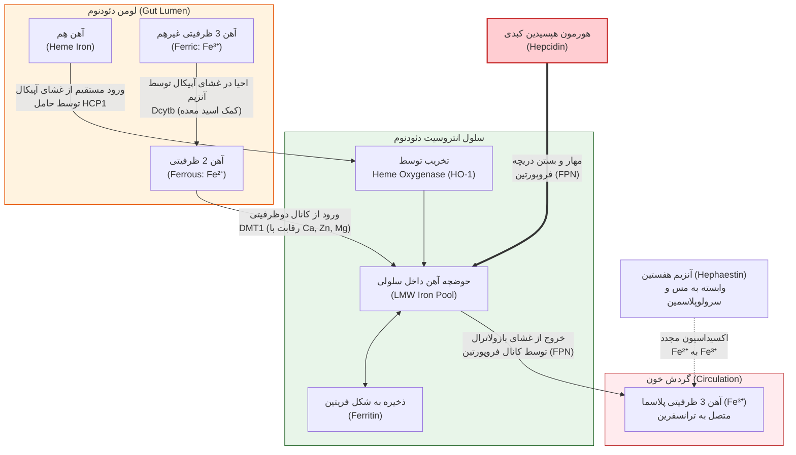
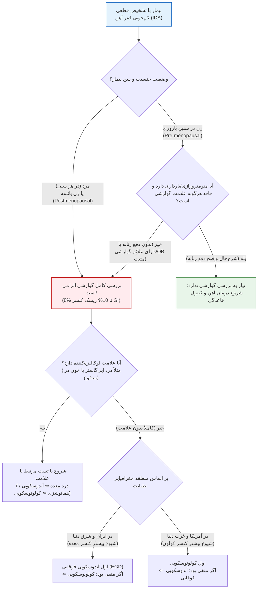

# کم‌خونی فقر آهن (Iron Deficiency Anemia)

## 1. اپیدمیولوژی، شیوع و اهمیت بهداشتی

**شیوع بسیار بالا و ملموس بودن بیماری:** فقر آهن خیلی به ما نزدیک‌تر از چیزی است که فکرش را بکنید (درست مثل نوشته روی آینه‌بغل ماشین‌ها!). اگر همین الان خانواده‌ها و فامیل‌های درجه یک و دو را بررسی کنیم، تقریباً خانواده‌ای پیدا نمی‌شود که دست‌کم *یک‌پنجم* افرادش یا 3 نفر در آن فقر آهن نداشته باشند؛ در حالی که مثلاً بیماری مثل لنفوم ممکن است تا آخر عمر در هیچ‌کدام از خانواده‌های ما اصلاً اتفاق نیفتد. در حال حاضر حدود **2 میلیارد نفر** در کل دنیا مبتلا به فقر آهن هستند و کم‌خونی فقر آهن (IDA)، **شایع‌ترین علت کم‌خونی در سراسر دنیا** به شمار می‌رود (اگر تمام کم‌خونی‌های دیگر مثل تالاسمی، سیکل‌سل، مالاریا، شیستوزومیازیس و کرم قلاب‌دار را روی هم بگذاریم، باز هم کفه ترازوی فقر آهن از مجموع همه آن‌ها سنگین‌تر و ستون آماری‌اش بلندتر است).

> [!note] طبقه‌بندی WHO برای اهمیت بهداشتی کم‌خونی در جوامع
> سازمان جهانی بهداشت بر اساس درصد شیوع کم‌خونی در یک جامعه، وضعیت را به 4 دسته تقسیم می‌کند:
> 1. **نرمال (Normal):** شیوع زیر 5% (از نظر بهداشتی خیلی مهم تلقی نمی‌شود).
> 2. **ملایم (Mild):** شیوع بین 5% تا 19.9% (یک مشکل بهداشتی-اجتماعی ملایم).
> 3. **متوسط (Moderate):** شیوع بین 20% تا 39.9% (یک مشکل جدی).
> 4. **شدید (Severe):** شیوع بالای 40% (یک معضل بسیار شدید).

**وضعیت ایران و جهان در نقشه‌های WHO:**
* **نقشه کلی دنیا:** مناطق با شیوع پایین بخش بسیار کمی از نقشه جهان را تشکیل می‌دهند و اکثر دنیا (3 کشور از هر 4 کشور جهان) با مشکل کم‌خونی در حد **متوسط (20% تا 40%)** و جدی مواجه هستند.
* **روند جهانی در مقابل روند ایران:** در آمارهای قدیمی‌تر (مثلاً مقایسه 1990 تا 2010)، به دلیل کار روی بهداشت و اقتصاد، روند کلی دنیا به سمت کاهش شیوع بود؛ اما در بازبینی‌های جدیدتر (بین سال‌های 2012 تا 2023)، با خراب شدن وضع اقتصادی دنیا، تعداد کشورهای گروه Mild کمتر شده و کشورهای گروه Moderate و Severe بیشتر شده‌اند (چون شیوع فقر آهن **ارتباط خطی با وضعیت اقتصادی-اجتماعی جوامع** دارد).
* **آمار سال 2025 سازمان جهانی بهداشت:** در بررسی مسیر کشورها برای بهبود فقر آهن طبق نقشه بهداشتی، تنها **1 کشور** دقیقاً در مسیر برنامه WHO قرار دارد، **18 کشور** کمی بهتر شده‌اند، **50 کشور** هیچ فرقی نکرده‌اند و **125 کشور** (از جمله ایران) وضعیتشان بدتر شده است!
* **وضعیت اختصاصی کشور ما (ایران):**
  * *زنان غیرباردار در سنین باروری (Reproductive / Childbearing age از 15 سال تا یائسگی):* در نقشه سال 2018 ما در منطقه Mild بودیم، در نقشه 2023 وارد منطقه **Moderate** شدیم و در برخی آمارهای جدید پس از 2020 حتی به سمت منطقه **Severe** رفته‌ایم (روند معکوس و رو به بدتر شدن).
  * *زنان باردار (Pregnant women):* چه در نقشه‌های قدیم و چه در نقشه‌های جدید، ایران در گروه **Severe (قرمز پررنگ)** قرار دارد و شیوع در بانوان باردار ما بسیار بالاست.
  * *کودکان سنین پیش از مدرسه (Preschool-age children):* کشور ما در گروه **Moderate** قرار می‌گیرد.

**تفاوت شیوع در گروه‌های مختلف و کشورهای جهان:** در تمام کشورها، شیوع در **مردان از همه کمتر** است (معمولاً زیر 10%)، پس از آن **زنان غیرباردار** قرار دارند (حدود 5 برابر مردان به دلیل خونریزی‌های ماهانه قاعدگی در طول سال‌های باروری) و گروهی که غوغا می‌کند **زنان باردار** هستند (چون علاوه بر خودشان، خروجی آهن به سمت جنین هم دارند). 
* *نکته آماری کشورها (طبق اسلایدها):* در شمال هند (زنان 64%، بارداران 80%)، جنوب هند (مردان 6%، زنان 35%، بارداران 56%)، آمریکای لاتین (مردان 4%، زنان 17%، بارداران 38%)، لهستان (بارداران 22%)، سوئد (زنان 7%) و آمریکا (مردان 1%، زنان 13%). یک استثنای عجیب در جدول اسلایدها مربوط به اسرائیل است که آمار مردان را **14%** (بالای 10%)، زنان را 29% و بارداران را 47% گزارش کرده‌اند!

> [!important] پدیده کوه یخ (Iceberg Phenomenon) در فقر آهن
> کم‌خونی فقر آهن درست مثل یک کوه یخ است که می‌تواند کشتی نظام سلامت را غرق کند! آن بخشی که ما به عنوان **کم‌خونی فقر آهن (IDA)** می‌شناسیم و بیمار با هموگلوبین پایین به درمانگاه می‌آید، فقط **نوکِ بیرون‌زده کوه یخ از آب** است. تنه اصلی و بزرگ‌تر کوه یخ در زیر آب قرار دارد و شامل افرادی است که **فقر آهن بدون کم‌خونی** (مراحل ابتدایی تخلیه ذخایر) دارند. این افراد در هیچ‌کدام از آن آمارهای 30% تا 60% که گفتیم حساب نشده‌اند و به ازای هر بیمار تشخیص داده‌شده، چندین بیمار تشخیص نداده‌شده در زیر آب داریم! *نکته بسیار مهم بالینی:* علائم بالینی افرادِ زیرِ کوه یخ (فقر آهن بدون آنمی) با افرادِ بالای کوه یخ (کم‌خونی فقر آهن) **کاملاً یکسان است** و هیچ فرقی نمی‌کند!

---

## 2. اهمیت بالینی، عوارض مادری-جنینی و بار بیماری

چرا این‌قدر برای یک کم‌خونی ساده حرص می‌خوریم؟ چون عوارض آن از یک خستگی ساده تا مرگ‌ومیر و عقب‌ماندگی دائمی یک جامعه پیش می‌رود (تمامی این عوارض در جلسه **گایدلاین سال 2024 گروه EHA / با اجماع و Consensus صددرصدی** تمامی هماتولوژیست‌ها بدون هیچ شکی تایید شده است):

1. **بار اقتصادی-اجتماعی و شاخص YLD (Years Lived with Disability):** کم‌خونی باعث به هم خوردن سلامت، شادابی (Well-being)، خلاقیت و بهره‌وری کاری (Productivity) افراد می‌شود. شاخص YLD نشان‌دهنده تعداد روز-سال‌هایی است که افراد جامعه به خاطر بیماری نمی‌توانند سر کار بروند، مرخصی استعلاجی می‌گیرند یا در محل کار درست کار نمی‌کنند. طبق آمار سال **2019**، کم‌خونی باعث از دست رفتن **50 میلیون سال زندگی سالم** در یک سال در دنیا شده است (انگار در یک روز، 50 میلیون نفر در دنیا با هم دست از کار بکشند!). بزرگ‌ترین علل آن به ترتیب **کمبود آهن تغذیه‌ای**، تالاسمی، سیکل‌سل تریت و مالاریا بوده‌اند. ایران از نظر شاخص YLD در **رنگ و جایگاه متوسط** دنیا قرار دارد.
2. **عوارض خطرناک در مادران باردار:**
   * افزایش ریسک **سزارین** (خانم کم‌خون ممکن است نتواند زایمان طبیعی کند و کارش به سزارین بکشد که خودِ سزارین خونریزی‌اش 2 برابر زایمان طبیعی است!).
   * افزایش ریسک **آنمی پس از زایمان (Postpartum anemia)** و افزایش نیاز به **تزریق خون (Transfusion)**.
   * افزایش **اختلالات تیروئیدی** در مادران دچار کمبود آهن.
   * افزایش ریسک جداشدگی جفت (Abruption)، **پره‌اکلامپسی و اکلامپسی**.
   * **افزایش مرگ‌ومیر مادران:** در مطالعات دیده شده ریسک مرگ‌ومیر مادرانی که دچار خونریزی‌های پس از زایمان می‌شوند، در صورتی که از ابتدا کم‌خونی داشته باشند نسبت به مادران غیرکم‌خون **6 تا 7 برابر** بیشتر است!
3. **عوارض در جنین، نوزاد و کودکان (چرخه معیوب فقر و عقب‌ماندگی):**
   * مادری که فقر آهن دارد، در بارداری فقر آهنش تشدید شده و نوزادش از همان بدو تولد با فقر آهن به دنیا می‌آید.
   * افزایش ریسک **تولد نوزاد نارس (Prematurity)** و **وزن کم هنگام تولد (Low Birth Weight)**.
   * **تاخیر رشد جسمی (Growth Retardation):** بچه‌ها کوچک‌تر به دنیا می‌آیند و ممکن است تا آخر عمر کوچک‌تر باقی بمانند (غیرقابل جبران).
   * **اختلال تکامل عصبی و عقلی (Impaired Neurologic & Cognitive Development):** در مطالعات حیوانی و انسانی ثابت شده که کمبود آهن باعث می‌شود اتصالات، پیچیدگی و تعاملات نورونی در **ماده خاکستری قشر مغز (Developing gray matter)** اندکی پس از تولد تکامل درستی پیدا نکند. این آسیب مغزی کاملاً **برگشت‌ناپذیر (Irreversible)** است! در نتیجه بچه نمی‌تواند از حداکثر پتانسیل IQ خدادادی‌اش استفاده کند ⇦ تبدیل به بزرگسال کم‌هوش‌تر با بهره‌وری پایین ⇦ جامعه توسعه‌نیافته و فقیرتر از نظر اقتصادی-اجتماعی ⇦ تغذیه بدتر و مادران باردارِ دچار فقر آهن ⇦ تکرار این سیکل معیوب و آخرالزمانی!
4. **عوارض غیرمنتظره و خاص (مقالات پژوهشی):**
   * **تشدید حملات میگرن:** طبق یک مطالعه Case-Control در دانشگاه علوم پزشکی تهران (TUMS)، کم‌خونی فقر آهن با افزایش حملات میگرن ارتباط دارد.
   * **ترومبوآمبولی وریدی مکرر:** کم‌خونی فقر آهن به عنوان یک ریسک‌فاکتور نادر برای **آمبولی ریه (PE) مکرر و ترومبوز ورید عمقی (DVT)** شناخته شده است که می‌تواند در عرض چند دقیقه کشنده باشد.

---

## 3. هموستاز آهن، توزیع در بدن و فیزیولوژی جذب

### توزیع آهن در بدن انسان سالم
کل آهن موجود در بدن یک انسان بالغ حدود **3 گرم در خانم‌ها** و **3.5 گرم در آقایان** است که در بخش‌های زیر توزیع شده است:
* **گلبول‌های قرمز و هموگلوبین (بزرگ‌ترین بخش):** حدود **1800 تا 2000 میلی‌گرم** (حدود 2 گرم؛ و در برخی منابع تا **2500 الی 3000 میلی‌گرم** یا 2.5 تا 3 گرم).
* **عضلات بدن (میوگلوبین و بافت‌ها):** حدود **300 تا 500 میلی‌گرم** (این آهن ثابت است و در کم‌خونی‌ها قابل استفاده نیست؛ چون بدن نمی‌تواند عضله را بشکند تا با آهنش خون بسازد!).
* **آهن در گردش پلاسما (Plasma Iron Pool):** تنها حدود **3 میلی‌گرم** (که در برابر 3 گرم کل بدن اصلاً به چشم نمی‌آید!). این آهن به صورت محلول و متصل به **ترانسفرین (Transferrin)** بین مغز استخوان، کبد و سیستم رتیکولواندوتلیال می‌چرخد. روزانه حدود **20 میلی‌گرم** آهن از تخریب گلبول‌های قرمز پیر توسط ماکروفاژها آزاد شده، وارد این حوضچه پلاسمایی می‌شود و دقیقاً همان 20 میلی‌گرم برای ساخت گلبول‌های قرمز جدید به مغز استخوان می‌رود.
* **ذخایر آهن (Iron Stores):** در **کبد (حدود 1 گرم)** و **ماکروفاژهای سیستم رتیکولواندوتلیال مغز استخوان و طحال** ذخیره می‌شود. میزان این ذخیره به جنسیت بستگی دارد:
  * در یک *خانمِ خیلی خوب و سالم*: حداکثر **500 میلی‌گرم**.
  * در یک *آقای خیلی خوب و سالم*: حداکثر **1000 میلی‌گرم (1 گرم)**.

> [!tip] فرمول طلایی ارتباط فریتین سرم با ذخایر آهن بدن
> برای فریتین سرم در محدوده **20 تا 300 نانوگرم بر میلی‌لیتر (ng/mL)**، در شرایط عادی و سلامت، یک **رابطه کمّی و خطی مستقیم** بین غلظت فریتین سرم و میزان ذخایر آهن بدن وجود دارد:
> **ذخایر آهن بر حسب میلی‌گرم = فریتین سرم (ng/mL) × (8 تا 10)**
> *(برای راحتی محاسبات در بالین و امتحان، همیشه عدد فریتین را در **10** ضرب یا تقسیم کنید!)*
> * **نتیجه‌گیری پاتوفیزیولوژیک بسیار مهم:** بدون توجه به رنج‌های مختلف و گیج‌کننده آزمایشگاه‌ها (که یکی می‌نویسد 15 تا 150 و دیگری 30 تا 300)، از نظر پاتوفیزیولوژیک یک خانم سالم که 500 میلی‌گرم ذخیره دارد باید فریتین سرمش حدود **50** باشد (یا حداقل 30 تا 50 بر اساس مکاتب مختلف) و یک آقای سالم که 1000 میلی‌گرم ذخیره دارد باید فریتین سرمش حدود **100** باشد! (در حالی که در جامعه ما 80% خانم‌ها فریتین 50 و 60% تا 70% آقایان فریتین 100 را ندارند!).

### نیاز روزانه به آهن در طول زندگی (ورودی و خروجی)
بدن ما روزانه تنها **1 تا 2 میلی‌گرم** آهن از طریق ریزش فیزیولوژیک سلول‌های اپی‌تلیال مخاط دستگاه گوارش و مقدار بسیار کمتری از طریق پوست دفع می‌کند؛ بنابراین روزانه فقط باید **1 تا 2 میلی‌گرم** آهن از دستگاه گوارش جذب شود تا تعادل (هموستاز) برقرار بماند. تغییرات نیاز روزانه در طول عمر به شرح زیر است:

```chart
{
  "type": "line",
  "data": {
    "labels": ["تولد", "2 سالگی", "10 سالگی", "14 سالگی (بلوغ)", "20 سالگی", "27 سالگی (بارداری 1)", "30 سالگی", "34 سالگی (بارداری 2)", "40 سالگی", "50 سالگی (یائسگی)", "65 سالگی"],
    "datasets": [
      {
        "label": "نیاز روزانه مردان (mg/day)",
        "data": [0.25, 0.5, 0.75, 1.5, 1.0, 1.0, 1.0, 1.0, 1.0, 1.0, 1.0],
        "borderColor": "#2ecc71",
        "backgroundColor": "rgba(46, 204, 113, 0.2)",
        "fill": true,
        "tension": 0.2
      },
      {
        "label": "نیاز روزانه زنان (mg/day)",
        "data": [0.25, 0.5, 0.75, 1.5, 1.5, 2.5, 1.5, 2.5, 1.5, 1.0, 1.0],
        "borderColor": "#3498db",
        "backgroundColor": "rgba(52, 152, 219, 0.2)",
        "fill": true,
        "tension": 0.2
      }
    ]
  }
}
```

* **نوزادی (بدو تولد):** نیاز حدود **0.25 میلی‌گرم در روز** است که از شیر مادر تامین می‌شود.
* **شیرخوارگی (1 تا 2 سالگی) و کودکی تا بلوغ:** به دلیل رشد فیزیکی سریع، ساخت عضلات و افزایش حجم خون، نیاز بالا می‌رود تا در نوجوانی و بلوغ (حدود 14 سالگی) به یک پیک (حدود **1.5 میلی‌گرم در روز**) می‌رسد.
* **بزرگسالی در مردان:** پس از بلوغ تا آخر عمر، نیاز روزانه آقایان ثابت و حدود **1 میلی‌گرم در روز** (در کل ماه حدود 30 میلی‌گرم) باقی می‌ماند.
* **بزرگسالی در زنان (سنین باروری 15 تا 50 سال):** به دلیل شروع قاعدگی (Menstruation) و دفع ماهانه خون، حدود 0.5 تا 1 میلی‌گرم به نیاز پایه آن‌ها اضافه شده و نیاز روزانه‌شان به **1.5 تا 2 میلی‌گرم در روز** (در کل ماه حدود 45 میلی‌گرم) می‌رسد. در طول این سال‌ها، با هر بار **بارداری**، نیاز روزانه پیک‌های شدیدی (تا حدود **2.5 میلی‌گرم در روز**) می‌زند. *(نکته بالینی: برای جبران این نیاز ماهانه، اصلاً الزامی ندارد خانم‌ها حتماً در روزهای بعد از پاک شدن از قاعدگی آهن مصرف کنند؛ بلکه می‌توانند این 45 میلی‌گرم را در هر روزی از ماه پخش کنند).*
* **زنان پس از یائسگی (Postmenopausal):** از حدود 50 سالگی به بعد، چون دیگر قاعدگی ندارند، نیاز روزانه و وضعیت آهن آن‌ها **دقیقاً مثل آقایان (1 میلی‌گرم در روز)** می‌شود.

### منابع آهن و فراهمی زیستی (Bioavailability) در تغذیه
* **غنی‌ترین منبع آهن در جهان:** بیشترین مقدار آهن در کل کره زمین در **خاک و پوسته زمین (Earth's crust)** وجود دارد! آهن **فراوان‌ترین عنصر در کل کره زمین** است (چون هسته داخلی و خارجی زمین عمدتاً از آلیاژ آهن-نیکل ساخته شده و 35% جرم کل زمین را می‌سازد) و در پوسته زمین نیز **5%** را تشکیل داده و پس از اکسیژن، سیلیکون و آلومینیوم، **چهارمین عنصر فراوان پوسته زمین** است. تمام گیاهان (مستقیم) و حیوانات (با یک واسطه) آهن خود را از خاک می‌گیرند.

| ویژگی مقایسه‌ای | آهن هِم (Heme Iron) | آهن غیرهِم (Non-heme Iron) |
| :--- | :--- | :--- |
| **سهم در رژیم غذایی روزانه** | حدود **10% تا 15%** کل آهن رژیم غذایی | حدود **85% تا 90%** (بخش عمده) کل آهن رژیم غذایی |
| **فراهمی زیستی (درصد جذب)** | بسیار خوب: **15% تا 25%** (بیشترین جذب در عضله گوساله تا حدود 22%) | بسیار ناچیز: **کمتر از 5%** (مثلاً اسفناج حدود 1.5% و برنج حدود 1%) |
| **منابع غذایی اصلی** | گوشت قرمز (کبد/جگر، گوساله، گوسفند)، مرغ، ماهی و غذاهای دریایی (صدف، ساردین، ماهی خال‌مخالی، اسکالوپ) | حبوبات (عدس، نخود، لوبیا، سویا)، سبزیجات برگ تیره (اسفناج، کاهو، کلم کیل)، غلات (جو دوسر، کینوا، گندم، ذرت)، مغزها و دانه‌ها (بادام، پسته، تخم کدو و کتان و چیا)، شکلات تلخ و میوه‌ها (توت‌فرنگی، هندوانه، انجیر، خرما، کشمش، زردآلو و آلو خشک) |
| **مسیر جذب سلولی و تداخلات** | جذب مستقیم کل مولکول هِم از طریق **HCP1**؛ تداخلات غذایی (مثل کلسیم و ماست) خیلی کمتر روی آن اثر می‌گذارند. | نیازمند احیا شدن از فرم 3 ظرفیتی به 2 ظرفیتی و عبور از **DMT1**؛ به شدت تحت تاثیر مهارکننده‌های غذایی و دارویی قرار می‌گیرد. |

> [!warning] تله بالینی و باورهای غلط اجتماعی درباره درمان با غذا!
> بیماران روزی 20 بار از شما می‌پرسند: *«آقای دکتر! من نمی‌خواهم قرص آهن بخورم؛ شوهرم خیلی به من می‌رسد، چقدر عدس، اسفناج، پسته یا گوشت کبابی بخورم تا کم‌خونی‌ام خوب شود؟!»*
> * **حقیقت علمی و ریاضی:** تغذیه خوب فقط برای **پیشگیری** و تامین آن 1 تا 2 میلی‌گرم نیاز روزانه به درد می‌خورد؛ اما وقتی بیمار دچار **فقر آهن** شد، **اصلاً و ابداً با تغذیه قابل درمان نیست و فقط باید دارو بخورد!**
> * **مثال عدس و اسفناج:** در هر 100 گرم عدس حدود 3.3 تا 7 میلی‌گرم آهن غیرهِم وجود دارد (علاوه بر 340 کالری، 25 گرم پروتئین، 80 میلی‌گرم کلسیم، 380 میلی‌گرم فسفر و حتی 1 میلی‌گرم آرسنیک!). چون جذب آهن عدس و اسفناج زیر 5% (مثلاً 2%) است، از یک کیلوگرم عدس (یک قابلمه بزرگ!) فقط حدود **1.4 میلی‌گرم** آهن جذب می‌شود؛ یعنی بیمار باید روزی یک قابلمه عدس یا یک وانت نیسان اسفناج بخورد و در بخش گوارش بستری شود تا فقط نیاز روزانه‌اش تامین شود!
> * **مثال استیک گوشت قرمز:** طبق یک مقاله آمریکایی، اگر شوهری بخواهد فقر آهن همسرش را فقط با استیک گوشت خالص درمان کند، آن خانم باید **روزی 4 تا 4.5 کیلوگرم استیک خالص** بخورد (که قبل از درمان کم‌خونی، از نقرس و عوارض دیگر نابود می‌شود!).

**عوامل موثر بر جذب آهن در دستگاه گوارش:**
* **مهارکننده‌های جذب آهن (Retardation):**
  1. **اگزالات‌ها (Oxalates)، فیتات‌ها (Phytates)، فسفات‌ها (Phosphates) و تانن‌ها (Tannates):** موجود در گیاهان، غلات و غذاها.
  2. **پلی‌فنول‌ها (Polyphenols):** موجود در سبزیجات، میوه‌ها، غلات، حبوبات، **قهوه**، شراب و **انواع چای**. *(نکته بسیار مهم: بین چای سیاه، چای سبز، چای سفید و انواع دمنوش‌های گیاهی عطاری‌ها هیچ فرقی وجود ندارد و همگی جذب آهن را به شدت مهار می‌کنند!).*
  3. **کلسیم و پروتئین‌های حیوانی خاص:** برخلاف بافت عضلانی گوشت که جذب را زیاد می‌کند، **شیر** (به دلیل فسفات، کلسیم و دو پروتئین اصلی شیر گاو یعنی **کازئین و پروتئین وِی / Whey** که ورزشکاران و سالمندان می‌خورند)، **سفیده تخم‌مرغ (Egg white)**، **آلبومین** و **پروتئین سویا** جذب آهن را در انسان مهار می‌کنند.
* **افزایش‌دهنده‌های جذب آهن (Enhancers):**
  1. **اسیدهای آلی و قندها:** آسکوربات (ویتامین C)، لاکتات، پیرووات، سوکسینات، فروکتوز و سوربیتول (موجود در میوه‌ها).
  2. **بافت عضلانی و گوشت (Muscle proteins):** وجود گوشت در غذا حتی جذب آهن غیرهِم (گیاهی) همراه غذا را هم زیاد می‌کند که احتمالاً به خاطر اسیدآمینه **سیستئین (Cysteine)** موجود در پروتئین عضلات است.

> [!info] قانون فیزیولوژیک فاصله چای و دارو با غذا
> بر اساس فیزیولوژی تخلیه معده، **90% مایعات در عرض 1 ساعت** و **80% تا 90% غذاهای جامد در عرض 2 تا 3 ساعت** از معده خارج می‌شوند. بنابراین:
> * برای پیشگیری از تداخل، بیمار باید از **1 ساعت قبل تا 2 ساعت بعد از غذا** چای و قهوه نخورد.
> * قرص آهن خوراکی را باید با معده خالی، یعنی **2 ساعت قبل یا 4 ساعت بعد از غذا (و آنتی‌اسیدها)** مصرف کرد.

### مکانیسم سلولی-مولکولی جذب آهن در انتروسیت دئودنوم
جذب آهن عمدتاً در **دئودنوم و ابتدای ژژنوم (پروگزیمال ژژنوم)** انجام می‌شود و از دو مسیر مجزا در غشای آپیکال (سمت لومن روده) وارد سلول انتروسیت می‌شود:



1. **مسیر آهن هِم:** کل مولکول هِم به صورت دست‌نخورده توسط پروتئین حامل **HCP1 (Heme Carrier Protein 1)** از غشای آپیکال وارد سیتوپلاسم انتروسیت می‌شود و در داخل سلول توسط آنزیم *هِم اکسیژناز (HO-1)* تجزیه شده و آهن آن وارد حوضچه آهن سلولی می‌شود (ادامه مسیرش در خروج از سلول دقیقاً مشابه آهن غیرهِم است).
2. **مسیر آهن غیرهِم (Non-heme):**
   * **آزادسازی و احیا در لومن:** ابتدا اسید معده کمک می‌کند آهن 3 ظرفیتی (Ferric یا Fe³⁺) از مواد غذایی جدا شود. سپس در حاشیه مسواکی آپیکال دئودنوم، آنزیم **دئودنال سیتوکروم b ردوکتاز (Dcytb)** این آهن 3 ظرفیتی را احیا کرده و به **آهن 2 ظرفیتی (Ferrous یا Fe²⁺)** تبدیل می‌کند.
   * **ورود به انتروسیت از طریق DMT1:** آهن 2 ظرفیتی توسط ترانسپورتر فلزات دوظرفیتی یعنی **DMT1 (Divalent Metal Transporter 1)** وارد سلول می‌شود.
     * *نکته بسیار مهم بالینی و دارویی:* کانال DMT1 مخصوص تمام فلزات دوظرفیتی (آهن Fe²⁺، کلسیم Ca²⁺، روی Zn²⁺، منیزیم Mg²⁺) است. به همین دلیل مصرف همزمان لبنیات (کلسیم) یا خریدن **کپسول‌های گران‌قیمت مولتی‌مینرال** (که داخلشان همزمان آهن، زینک، کلسیم و منیزیم ریخته‌اند) یک کلاهبرداری تبلیغاتی است؛ چون همه این یون‌ها برای عبور از یک سوراخ (DMT1) با هم رقابت می‌کنند و مانع جذب آهن می‌شوند!
   * **سرنوشت داخل سلولی و خروج از غشای بازولاترال:** آهن در سلول یا به صورت **فریتین** ذخیره می‌شود و یا برای ورود به خون، به سمت غشای بازولاترال (انتهایی) می‌رود. در آنجا از طریق دریچه و کانال پروتئینی **فروپورتین (Ferroportin / FPN)** از سلول خارج می‌شود.
   * **اکسیداسیون مجدد در خون:** هنگام خروج از فروپورتین، آهن 2 ظرفیتی باید دوباره به آهن 3 ظرفیتی (Fe³⁺) تبدیل شود تا بتواند سوار ترانسفرین پلاسما شود؛ این کار توسط آنزیم **هفستین (Hephaestin)** که از مس (Cu) و **سرولوپلاسمین** به عنوان کوفاکتور استفاده می‌کند، انجام می‌شود.
3. **نقش تنظیمی و کلیدی هپسیدین (Hepcidin):**
   * هپسیدین پپتیدی است که در **سلول‌های کبدی (هپاتوسیت‌ها)** با مشارکت پروتئین‌های تنظیم‌کننده مثل *هموژوولین (Hemojuvelin)*، *پروتئین HFE* و *رسپتورهای ترانسفرین (TfR1 و TfR2)* ساخته می‌شود.
   * **عملکرد هپسیدین:** هپسیدین نقش یک **پلیس مهارکننده (ترمز)** را دارد؛ یعنی به کانال‌های **فروپورتین (FPN)** در سطح *انتروسیت‌های دئودنوم*، *ماکروفاژهای طحالی* و *هپاتوسیت‌ها/سلول‌های کوپفر کبد* متصل شده و شیر فلکه خروج آهن به پلاسما را می‌بندد تا از اضافه‌بار آهن (Iron overload) جلوگیری کند!
   * **تنظیم هپسیدین:** در شرایط **فقر آهن** و یا افزایش نیاز اریتروپوئز، تولید هپسیدین در کبد به شدت **مهار می‌شود (پایین می‌آید)**؛ در نتیجه بیان DMT1 و فروپورتین زیاد شده و جذب روده‌ای آهن و آزادسازی آن از ماکروفاژها به حداکثر می‌رسد. برعکس، در حضور **التهاب (Inflammation)** و یا افزایش غلظت آهن، سطح هپسیدین به شدت **بالا می‌رود** و با بستن فروپورتین، مانع جذب آهن از روده و حبس شدن آهن در ماکروفاژها می‌شود (مکانیسم اصلی آنمی بیماری‌های مزمن). *(همچنین وقتی به بیمار قرص آهن می‌دهیم، بعد از مدتی هپسیدین بالا می‌رود و جذب آهن را کم می‌کند؛ به همین دلیل امروزه می‌گویند تجویز دوزهای کمتر یا یک‌روزدرمیان / Intermittent قرص آهن هم به همان اندازه موثر است و هم عوارض گوارشی کمتری دارد).*

---

## 4. اتیولوژی (علل فقر آهن) و گروه‌های پرخطر

از منظر پاتوفیزیولوژی، کمبود آهن در بدن (درست مثل بی‌پولی!) فقط از 3 مکانیسم اصلی ناشی می‌شود:

### 1. افزایش نیاز به آهن و خون‌سازی (Increased Demand)
* **شیرخوارگی (1 تا 2 سالگی) و نوجوانی (بلوغ):** به علت رشد سریع جسمی و عضلانی.
* **بارداری (Pregnancy) و شیردهی:**
  * *ترازنامه سود و زیان آهن در بارداری (بسیار مهم):* یک خانم باردار از نظر آهن فقط یک سود دارد و آن هم **قطع قاعدگی (Amenorrhea) به مدت حداقل 9 ماه** (و چند ماه در دوران شیردهی) است (و شاید کمی هم اطرافیان به عنوان نورچشمی بیشتر به خوردوخوراکش برسند!). اما ضررهای او شامل: انتقال آهن به جنین در حال رشد، افزایش حجم خون مادر، خونریزی حین زایمان (در **زایمان طبیعی حدود 0.5 لیتر** و در **سزارین حداقل 1 لیتر** خون، یعنی 2 برابر طبیعی!) و نهایتاً دفع آهن در شیر است.
  * **عدد طلایی بدهکاری در بارداری:** برآیند کل این سود و زیان‌ها در یک بارداری، حدود **900 میلی‌گرم ضرر (بدهکاری) خالص آهن** برای مادر است! از آنجا که یک خانم خیلی سالم در بهترین حالت فقط **500 میلی‌گرم** ذخیره آهن دارد، اولین بارداری مثل این است که کارت بانکی‌اش را هک کنند (500 تا داشته، 900 تا برداشته‌اند و 400 میلی‌گرم منفی شده است!). به همین دلیل هر خانمی با اولین بارداری‌اش (اگر آهن کمکی نگیرد) قطعاً به خاک سیاه فقر آهن می‌نشیند!
* **درمان با اریتروپوئیتین (EPO therapy):** مثلاً در بیماران نارسایی مزمن کلیه (CKD) که با شروع EPO ناگهان خون‌سازی شتاب می‌گیرد و ذخایر آهن مصرف می‌شود.
* **درمان کم‌خونی مگالوبلاستیک:** بیماری که کم‌خونی مگالوبلاستیک دارد، وقتی درمانش را شروع می‌کنیم، ناگهان خون‌سازی به شدت زیاد شده و ذخایر آهنش تمام می‌شود و 3 ماه بعد با تابلو کم‌خونی فقر آهن برمی‌گردد!

### 2. افزایش دفع آهن (Increased Iron Loss)
* **خونریزی‌های ماهانه زنانه (Menses / Menometrorrhagia):** شایع‌ترین علت در زنان سنین باروری.
* **خونریزی‌های حاد یا مزمن گوارشی و تروماها:** تصادفات، چاقوخوردگی، جراحی‌ها و ضایعات دستگاه گوارش.
* **اهدای خون مکرر (Multiple Blood Donation) و حجامت:** هر یک واحد (کیسه) خون اهدایی حاوی **250 میلی‌گرم آهن** است! بنابراین یک آقای کاملاً سالم که 1000 میلی‌گرم ذخیره دارد، بعد از اهدای **4 کیسه خون** ذخیره‌اش صفر می‌شود (و یک خانم بعد از همان کیسه اول یا دوم!). به همین دلیل سازمان انتقال خون به اهداکنندگان مستمر (که عمدتاً آقایان هستند) آهن می‌دهد یا موقتاً معافشان می‌کند. **حجامت‌های مکرر** از اهدای خون هم بدترند؛ چون بیماران به پزشک نمی‌گویند و نه حجم خون خروجی معلوم است و نه توالی آن!
* **فلبوتومی درمانی (Phlebotomy):** در بیماران مبتلا به **پلی‌سیتمی ورا (Polycythemia Vera)** که ما عمداً از بیمار خون می‌گیریم تا غلظت خونش را کم کنیم و پرخونی را با کم‌خونی فقر آهن جابه‌جا کنیم (نگه‌داشتن این بیماران روی لبه باریک تعادل، ظرافت زیادی می‌طلبد).
* **علل نادر دفع آهن:**
  * **همولیز داخل عروقی همراه با دفع ادراری آهن (هموگلوبینوری و هموسیدروری):** کلاسیک‌ترین مثال آن بیماری **PNH (هموگلوبینوری حمله‌ای شبانه)** است. *(نکته تستی طلایی: PNH تقریباً **تنها پان‌سیتوپنی همراه با MCV پایین** به علت فقر آهن است و اگر در بیماری کم‌خونی فقر آهن به همراه سایر سیتوپنی‌ها دیدید، همیشه به فکر **PNH و MDS** باشید!).*
  * **هموسیدروز ریوی (Pulmonary Hemosiderosis).**

### 3. کاهش دریافت یا اختلال در جذب آهن (Decreased Intake or Absorption)
* **رژیم غذایی ناکافی (Inadequate diet):** اگرچه در پس‌زمینه تقریباً تمام فقر آهن‌ها وجود دارد (Dual pathology).
* **سوءجذب ناشی از بیماری‌ها:** بیماری **سلیاک (Sprue)**، بیماری **کرون (IBD)**، **گاستریت آتروفیک (اتوایمیون)** و عفونت **هلیکوباکتر پیلوری (H. pylori)**.
* **سوءجذب ناشی از جراحی‌های معده (Post-gastrectomy / Bariatric surgery):** در قدیم شایع‌ترین علت جراحی معده، زخم پپتیک (PUD) بود که امروزه به لطف داروهای PPI تقریباً منسوخ شده است؛ اما امروزه جایش را **جراحی‌های چاقی و لاغری (مثل بای‌پس معده و اسلیو)** گرفته است که چون دئودنوم و ابتدای ژژنوم (محل اصلی جذب آهن) بای‌پس می‌شود، تقریباً همگی دچار فقر آهن می‌شوند.
* **التهاب حاد یا مزمن:** به واسطه افزایش هپسیدین.
* **مصرف داروهای ضداسید معده (PPI و H2-Blockerها):** این داروها که امروزه بدون نسخه (OTC) فراوان مصرف می‌شوند، در درازمدت با ایجاد آکلریدریا و کاهش اسید معده، جداسازی آهن از غذا و تبدیل فرم 3 ظرفیتی به 2 ظرفیتی را مختل می‌کنند *(هرچند در متون اشاره شده که مصرف PPI به تنهایی معمولاً باعث کم‌خونی فقر آهن بالینی واضح نمی‌شود و نباید فقر آهن بیمار را به گردن PPI انداخت!).*

> [!danger] دو قانون طلایی و خط قرمز در برخورد با علل فقر آهن
> 1. **ممنوعیت گذاشتن تشخیص «فقر آهن تغذیه‌ای» در طبابت فردی:** اگرچه فقر غذایی در دل تمام علل دیگر نهفته است و در *پزشکی جامعه‌نگر* مهم‌ترین علت است، اما در *طبابت فردی* (وقتی بیمار روبه‌روی شما نشسته)، ما به عنوان پزشک **حق نداریم فقر آهن را به حساب تغذیه بد یا مصرف قرص PPI بگذاریم!** فرض اول ما در برخورد با هر کم‌خونی فقر آهن، **خونریزی مخفی (Blood loss)** است تا زمانی که خلافش ثابت شود؛ وگرنه سرطان معده یا کولون بیمار را از دست می‌دهیم و 6 ماه بعد با متاستاز برمی‌گردد!
> 2. **توجه ویژه به سلیاک، H. pylori و گاستریت آتروفیک در موارد مقاوم:** سوءجذب گوارشی علت نسبتاً غیرشایعی برای فقر آهن است، اما در بیمارانی که **علت فقر آهنشان نامشخص است** یا **به درمان خوراکی آهن جواب نمی‌دهند (Refractory IDA)** یا فقر آهنشان مدام عود می‌کند، حتماً باید به فکر این سه بیماری باشید! **بیماری سلیاک** ممکن است بدون هیچ علامت گوارشی و اسهال چرب، فقط با یک **کم‌خونی فقر آهن ایزوله** تظاهر کند و مسئول **8.5% تا 10%** موارد کم‌خونی فقر آهن مقاوم به درمان خوراکی یا ارجاع‌شده به متخصص گوارش است!

**چک‌لیست افراد پرخطر (At-Risk) که به محض ورود به مطب باید به چشم فقر آهن به آن‌ها نگاه کنید:**
کودکان و نوجوانان در حال رشد، تمام دختران و زنان در سنین باروری، زنان باردار، **ورزشکاران**، **گیاهخواران (Vegetarians)**، اهداکنندگان مکرر خون و حجامت‌کنندگان، **سالمندان** (به‌ویژه آن‌هایی که تنها زندگی می‌کنند یا بیماری‌های همراه دارند)، بیماران دارای اختلالات انعقادی یا مصرف‌کنندگان مادام‌العمر **داروهای ضدانعقاد (مثل وارفارین و آپیکسابان)**، افراد با سابقه جراحی معده/بای‌پس و مبتلایان به عفونت‌های مزمن و انگلی.

---

## 5. تظاهرات بالینی (Symptoms & Signs)

بروز علائم در کم‌خونی فقر آهن به **شدت (درجه) کم‌خونی** و از آن مهم‌تر به **سرعت ایجاد آن** بستگی دارد:
* **تمثیل آسمان طوسی تهران:** اگر کسی امروز تصادف کند و 2 لیتر خون از دست بدهد، فردا از شدت ضعف نمی‌تواند از جایش بلند شود؛ اما اگر همین مقدار خون را ذره‌ذره (ماهی 5 میلی‌گرم آهن) در عرض 5 تا 10 سال از دست بدهد، بدنش به آن عادت می‌کند! درست مثل ما که در پاییز و زمستان هر روز به آسمان طوسی و آلوده تهران نگاه می‌کنیم و فکر می‌کنیم آسمان کلاً همین رنگی است! خانمِ مبتلا به فقر آهن مزمن هم با هموگلوبین 7 و فریتین 2 برای یک سرماخوردگی ساده می‌آید و وقتی می‌پرسیم ضعف و بی‌حالی نداری؟ می‌گوید: *«نه! خیلی هم خوبم!»* چون 40% خانم‌های اطرافش (مادر، خاله و دخترخاله‌اش) هم مثل خودش کم‌خون و بی‌حال هستند، فکر می‌کند توان طبیعی یک انسان همین‌قدر است! تنها وقتی درمانش می‌کنیم، برمی‌گردد و می‌گوید: *«آقای دکتر! اصلاً شارژ شدم و یک آدم دیگر شدم!»* بنابراین **بسیاری از بیماران در ظاهر بدون علامت (Asymptomatic) هستند**.

### علائم عمومی و اختصاصی کم‌خونی فقر آهن
1. **علائم مشترک تمام کم‌خونی‌ها (شایع‌ترین شکایات در بالغین):** ضعف (Weakness)، خستگی‌پذیری زودرس (Fatigue)، عدم تحمل ورزش و فعالیت‌های قبلی (Exercise intolerance؛ مثلاً قبلاً دو طبقه پله را یک‌نفس بالا می‌رفت و الان وسط راه دو بار می‌ایستد)، سردرد (Headache)، سرگیجه (Dizziness)، **کاهش تمرکز (Loss of concentration)** هنگام مطالعه و کار، و **تحریک‌پذیری و عصبانیت (Irritability)** که بیمار می‌گوید حوصله هیچ‌کس را ندارم و دوست دارم با همه دعوا کنم!
   * *تله تشخیصی بسیار مهم:* در بسیاری از موارد، این علائم (بی‌حالی، بی‌حوصلگی و عصبانیت) توسط پزشکان به غلط **افسردگی (Depression)** تشخیص داده می‌شود و به بیمارِ کم‌خون قرص ضدافسردگی می‌دهند!
2. **رو شدن بیماری‌های زمینه‌ای عروقی:** در بیماری که تنگی عروق کرونر دارد، اولین علامت فقر آهن ممکن است بروز درد قفسه سینه (**آنژین صدری / Angina pectoris** یا آنژین ناپایدار) باشد. در بیماری که آترواسکلروز عروق پا دارد، با **لنگش متناوب (Intermittent claudication)** و گرفتگی عضلات ساق پا هنگام پیاده‌روی مراجعه می‌کند و در بیمار دچار تنگی عروق مغزی ممکن است با **سکته مغزی (CVA)** تظاهر کند.
3. **علائم عصبی-عضلانی (Neuromuscular):**
   * در کودکان: اختلال تکامل شنوایی (Impaired auditory development) و شناختی.
   * در بالغین: حرکات غیرارادی پاها در خواب (Involuntary movements during sleep) و **سندرم پای بی‌قرار (Restless Leg Syndrome)** که بیمار می‌گوید شب‌ها پاهایم وول می‌زند و آرام نمی‌شود مگر اینکه کسی پاهایم را بمالد.

> [!abstract] تعریف و ویژگی‌های پیکا (Pica) - علامت اختصاصی فقر آهن
> **پیکا (Pica)** عبارت است از یک **ولع و اشتهای کنترل‌نشده و سیری‌ناپذیر (Perverted appetite)** برای خوردن موادی که به طور عادی غذا محسوب نمی‌شوند.
> * **چرا پیکا ایجاد می‌شود و ویژگی مشترک این مواد چیست؟** اولاً بدن به طور غریزی می‌فهمد که معدن آهن در خاک است و دنبال آن می‌گردد؛ ثانیاً برای جبران کلافگی مغزی، تمام موادی که در پیکا خورده می‌شوند یک ویژگی مشترک دارند و آن ایجاد **صدای «خرت‌وخرت» زیر دندان و در گوش هنگام جویدن** است که به بیمار آرامش موقت می‌دهد!
> * **انواع پیکا در طول تاریخ و فرهنگ‌ها:**
>   1. **ژئوفاژی (Geophagia - خاک‌خوری):** خوردن خاک، گِل و یا **مُهر نماز و تربت** در فرهنگ قدیم ما (که برای حفظ ظاهر اجتماعی می‌گفتند خوردن تربت ثواب هم دارد!).
>   2. **آمیلوفاژی (Amylophagia - نشاسته‌خوری):** در اروپای دو-سه قرن پیش که همه جا سرسبز بود و خاک دم دست نبود (و خاک خوردن را زشت می‌دانستند)، خانم‌ها از **نشاسته خشک** (که در همه خانه‌ها برای آهار زدن یقه‌های پیراهن مردانه وجود داشت و زیر دندان خرت‌وخرت صدا می‌داد) استفاده می‌کردند.
>   3. **پاگوفاژی (Pagophagia - یخ‌خوری):** از حدود 60 تا 70 سال پیش با آمدن برق و یخچال به خانه‌ها، جویدن یخ جای خاک و نشاسته را گرفت. **پاگوفاژی کاملاً اختصاصی (Quite specific) برای حالت فقر آهن است!**
>   4. **سایر موارد امروزی:** ولع شدید به جویدن هویج، چای خشک، لیموعمانی، قند، **چیپس و پفک** (صرفاً به خاطر صدای خرت‌وخرت آن!) و حتی جویدن **گچِ زاویه قائمه دیوارهای خانه** (مثال دختر نوجوانی که تمام لبه‌های دیوار خانه را جویده و دندان‌هایش مثل اره مضرس شده بود!).
> * **نکته طلایی تشخیصی و درمانی پیکا:** پیکا در کل علم پزشکی فقط دو تشخیص دارد: یا بیمار **فقر آهن** دارد و یا اگر فقر آهن نداشت، یک **بیماری روانی بسیار شدید** دارد و جایش در بیمارستان روانپزشکی است! پیکا حتی در بیماران دچار فقر آهن که هنوز کم‌خون نشده‌اند هم دیده می‌شود و با شروع درمان آهن، **بسیار سریع و اغلب قبل از هرگونه افزایش در هموگلوبین** به طور کامل برطرف می‌شود!

### یافته‌های معاینه فیزیکی (Signs)
1. **رنگ‌پریدگی (Pallor):** در معاینه باید کف دست‌ها (Palms)، بستر ناخن‌ها (Nail beds)، پوست صورت، ملتحمه چشم (Conjunctivae) و زیر زبان را نگاه کنیم.
   * **حساسیت و ویژگی معاینه رنگ‌پریدگی (عدد امتحانی):** حساسیت (Sensitivity) تشخیص رنگ‌پریدگی توسط پزشکان بسیار متغیر و پایین است و بین **19% تا 70%** می‌باشد (19% فاجعه است؛ یعنی از 5 بیمار با هموگلوبین 7، پزشک 4 نفرشان را سالم تشخیص می‌دهد!). اما ویژگی (Specificity) آن بسیار بالاست و بین **70% تا 100%** است (یعنی اگر تشخیص دادیم رنگ‌پریده است، دیگر ردخور ندارد!). برای اینکه حساسیتمان از 19% به 70% برسد، شماره عینک لازم نیست؛ بلکه باید **ذهنمان آماده باشد** و افراد پرخطر را از همان درِ ورودی به چشم فقر آهن نگاه کنیم!
2. **تغییرات دهان و زبان:** صاف شدن سطح زبان و از بین رفتن پرزهای آن (**آتروفی پاپی‌های زبان / Atrophic glossitis**) و ترک خوردن و زخم گوشه لب‌ها (**کیلوز زاویه‌ای / Angular cheilitis**).
3. **تغییرات ناخن (سیر 3 مرحله‌ای بسیار مهم):**
   * *مرحله اول (اولین علامت در ناخن):* برجسته و قابل لمس شدن خطوط طولی ناخن که به آن **تیغه‌دار شدن ناخن (Nail ridging)** می‌گویند.
   * *مرحله دوم:* صاف شدن تحدب طبیعی ناخن (**صاف شدن ناخن / Flattening**).
   * *مرحله سوم (پیشرفته):* مقعر شدن ناخن به سمت بالا یا **ناخن قاشقی (Spoon nail / Koilonychia)** که می‌تواند آن‌قدر شدید شود که ناخن از بسترش جدا شود.

---

## 6. مراحل کمبود آهن و یافته‌های آزمایشگاهی

### مراحل سه‌گانه ایجاد کم‌خونی فقر آهن (Stages of Iron Deficiency)
وقتی یک فرد دچار بی‌پولی می‌شود، اول حساب پس‌انداز بانکی‌اش را خرج می‌کند و در آخرین مرحله ماشین زیر پایش را می‌فروشد! در فقر آهن هم دقیقاً 3 مرحله پیاپی داریم:

| پارامتر آزمایشگاهی / مرحله | وضعیت نرمال (Normal) | مرحله 1: تخلیه ذخایر آهن (Iron Store Depletion) | مرحله 2: اریتروپوئز دچار کمبود آهن (Iron-Deficient Erythropoiesis) | مرحله 3: کم‌خونی فقر آهن (Iron Deficiency Anemia - IDA) |
| :--- | :--- | :--- | :--- | :--- |
| **ذخیره آهن مغز استخوان (Prussian Blue)** | طبیعی (**+2** تا +3) | کاهش یافته یا صفر | صفر (تخلیه کامل) | **صفر (0)** (هیچ رنگ آبی دیده نمی‌شود) |
| **فریتین سرم (Serum Ferritin)** | طبیعی (زنان ≈ **50**، مردان ≈ **100**) | **کاهش یافته (⇩)** (اولین و حساس‌ترین تست که تغییر می‌کند!) | **به شدت کاهش یافته (⇩⇩)** | **به شدت کاهش یافته (⇩⇩⇩)** |
| **آهن سرم (SI) و اشباع ترانسفرین (TSAT)** | طبیعی | طبیعی (گاه در اواخر مرحله کمی کم می‌شود) | **کاهش یافته (⇩)** (و افزایش TIBC) | **به شدت کاهش یافته (⇩⇩)** (و افزایش TIBC) |
| **حجم متوسط گلبول قرمز (MCV)** | طبیعی (**80 تا 100 fL**) | کاملاً طبیعی | طبیعی یا در مرز پایین نرمال (مثلاً 78 تا 80) | **کاهش یافته (< 80 fL)** (میکروسیتیک) |
| **غلظت هموگلوبین (Hb) و هماتوکریت** | طبیعی (زنان 12-14، مردان 14-16) | کاملاً طبیعی (بیمار آنمیک نیست) | طبیعی یا در مرز پایین (خون‌سازی با زور انجام می‌شود) | **کاهش یافته (⇩)** (بروز آنمی آشکار) |

> [!important] نکته کلیدی در تشخیص مراحل اولیه (زیر کوه یخ)
> در مرحله اول (Iron store depletion) و اغلب در مرحله دوم، اگر برای بیمارِ علامت‌دار فقط یک CBC ساده درخواست کنید، چون هموگلوبین و MCV نرمال هستند، بیماری را کاملاً از دست می‌دهید! در یک خانم پرخطر (مثلاً با سابقه دو بار زایمان و سزارین) که با ضعف و بی‌حالی مراجعه کرده، اکتفا کردن به CBC کافی نیست و برای کشف مراحل پنهان **حتماً باید فریتین سرم چک شود**.

### بررسی آزمایشگاهی گام‌به‌گام (Lab Workup)
روند تشخیص در دو گام خلاصه می‌شود: **گام اول اثبات کم‌خونی** و **گام دوم اثبات فقر آهن**.
1. **آزمایش کامل خون (CBC) و اندکس‌های گلبولی:**
   * شامل Hb، HCT، شمارش RBC، شمارش WBC، پلاکت و 3 اندکس گلبولی (**MCV، MCH و MCHC**).
   * از آنجا که MCH و MCHC تقریباً همیشه همسو و موازی با MCV تغییر می‌کنند، مهم‌ترین اندکسی که باید به آن بچسبید **MCV** است (رنج نرمال: **80 تا 100 فمتولیتر**). در کم‌خونی فقر آهن، **MCV و MCH پایین** هستند (آنمی میکروسیتیک هیپوکروم).
   * در کم‌خونی فقر آهن، اندکس **RDW بالا** می‌رود (معادل آزمایشگاهیِ *آنیزوسیتوز* یا تفاوت سایز گلبول‌ها در لام خون محیطی) و **شمارش پلاکت‌ها نیز می‌تواند بالا برود (ترومبوسیتوز واکنشی)**.
2. **لام خون محیطی (Peripheral Blood Smear - PBS):**
   * همیشه باید توسط فرد باتجربه دیده شود چون برخی تغییرات از چشم دستگاه‌های اتوماتیک دور می‌مانند.
   * **میکروسیتوز (Microcytosis):** در لام خون، سایز RBC طبیعی هم‌اندازه هسته یک لنفوسیت کوچک است؛ در فقر آهن گلبول‌ها **کوچک‌تر از هسته لنفوسیت کوچک** می‌شوند.
   * **هیپوکرومیا (Hypochromia):** در حالت عادی منطقه رنگ‌پریده مرکزی (Central pallor) حداکثر **یک‌سوم قطر گلبول قرمز** است؛ اما در فقر آهن این منطقه بسیار بزرگ شده و فقط یک حاشیه باریک از هموگلوبین در دور سلول باقی می‌ماند (سلول‌های حلقوی).
   * **آنیزوسیتوز (Anisocytosis)** و **پوئیکیلوسیتوز (Poikilocytosis):** گلبول‌ها از حالت گرد خارج شده و بیضوی می‌شوند و وقتی خیلی کشیده و استوانه‌ای شدند، به آن‌ها **سلول مدادی (Pencil cell) یا Cigar-shaped RBC** می‌گویند که در لام خون محیطی **تقریباً اختصاصی فقر آهن** است!
   * *سلول‌های اشکی (Teardrop cells):* گهگاه به مقدار کم دیده می‌شود (اما در تالاسمی‌ها بسیار بیشتر از فقر آهن است).
3. **پروفایل آهن سرم در مقابل فریتین (کدام را درخواست کنیم؟):**
   * **تله بزرگ نسخه‌نویسی:** اشباع ترانسفرین (**Transferrin Saturation = Serum Iron / TIBC**) یک فرمول محاسباتی است که خود پزشک باید با تقسیم کردن آهن سرم بر TIBC حساب کند، نه یک کیت آزمایشگاهی! اگر در نسخه بنویسید *«Transferrin Saturation»*، پرسنل پذیرش آزمایشگاه به شما می‌خندند!
   * **مقایسه هزینه و دقت:** مجموعه *Serum Iron + TIBC* **ارزان‌تر و ساده‌تر** است و برای مراکز بهداشتی اولیه (Primary health care) مناسب است؛ در حالی که **Ferritin گران‌تر اما بسیار دقیق‌تر** است و در مراکز ارجاعی و بیمارستانی (Tertiary center) انتخاب اول است. *(درخواست همزمان هر سه تای آن‌ها یعنی SI + TIBC + Ferritin با هم، کار اشتباهی است و نباید بی‌جهت به بیمار هزینه تحمیل کرد؛ یا فریتین تنهایی، یا SI و TIBC با هم!).*
   * **مقادیر تشخیصی فریتین:** فریتین **زیر 30 تا 50 در خانم‌ها** و **زیر 100 در آقایان** به طور قطعی نشان‌دهنده فقر آهن است.
   * **قانون تقسیم بر 3 در حضور التهاب (بسیار مهم):** فریتین یک **پروتئین فاز حاد (Acute Phase Reactant)** است و در حضور *التهاب، عفونت (مثل آبسه کبدی)، بیماری‌های روماتیسمی فعال (مثل آرتریت روماتوئید)، بیماری کبدی و بدخیمی‌ها (مثل کنسر متاستاتیک معده)* به طور کاذب حدود **3 برابر** بالا می‌رود! در این بیماران، برای یافتن فریتین واقعی، **عدد فریتین آزمایشگاه را تقسیم بر 3 کنید** و سپس با عدد پایه (50 در زنان و 100 در مردان) مقایسه نمایید (مثلاً آقایی با کنسر معده که فریتین 200 دارد: 200 ÷ 3 ≈ 66 که چون زیر 100 است، یعنی قطعاً فقر آهن دارد!).
4. **رنگ‌آمیزی آهن مغز استخوان با آبی پروس (Prussian Blue Stain):**
   * **دقیق‌ترین تست (Gold Standard)** برای تشخیص فقر آهن است که رسوبات آهن را در ماکروفاژهای مغز استخوان به رنگ آبی خوش‌رنگ نشان می‌دهد.
   * در سیستم درجه‌بندی چشمی 0 تا +4 (یا 0 تا +6)، مغز استخوان طبیعی **+2 تا +3** آهن دارد، در اضافه‌بار آهن **+4** (رسوبات گوله‌گوله سیاه یا بنفش پررنگ) می‌شود و در فقر آهن **صفر (0)** است (کاملاً صورتی و بدون هیچ لکه آبی).
   * *نکته بالینی:* از آنجا که فقر آهن بسیار شایع است، **هرگز برای تشخیص فقر آهن بیمار را آسپیراسیون مغز استخوان نمی‌کنیم**؛ مگر اینکه بیمار به علت دیگری (مثلاً شک به لوسمی یا MDS) تحت نمونه‌برداری مغز استخوان قرار گرفته باشد.

---

## 7. تشخیص‌های افتراقی کم‌خونی فقر آهن

تشخیص‌های افتراقی همان لیست معروف آنمی‌های میکروسیتیک هستند: **1. فقر آهن، 2. تالاسمی‌ها، 3. آنمی بیماری‌های مزمن (ACD)، 4. سندرم‌های میلودیسپلاستیک (MDS / آنمی سیدروبلاستیک)** و **5. هیپوتیروئیدی**.

| ویژگی مقایسه‌ای | کم‌خونی فقر آهن (IDA) | آنمی بیماری‌های مزمن / التهاب (ACD) | تالاسمی مینور (Minor Thalassemia) |
| :--- | :--- | :--- | :--- |
| **شمارش گلبول‌های قرمز (RBC Count)** | **کاهش یافته (< 5,000,000)** | کاهش یافته | **افزایش یافته (> 5,000,000)** (مهم‌ترین کلید افتراق سریع در مطب!) |
| **فریتین سرم (Serum Ferritin)** | **کاهش یافته (⇩)** | **افزایش یافته (⇧) یا طبیعی** (بهترین تست افتراق از IDA) | طبیعی یا افزایش یافته (مگر اینکه همزمان فقر آهن هم داشته باشد) |
| **آهن سرم (Serum Iron)** | **کاهش یافته (⇩)** | **کاهش یافته (⇩)** (مشابه با IDA) | طبیعی یا بالا |
| **اشباع ترانسفرین (Transferrin Sat)** | **کاهش یافته (⇩)** | **کاهش یافته (⇩)** (اما TIBC برخلاف فقر آهن پایین است) | طبیعی یا بالا |
| **نسبت sTfR / log Ferritin (اندکس TfR-F)** | **افزایش یافته (> 2.0)** (در ترکیب IDA + ACD هم بالای 2 است) | **عدم تغییر / پایین (< 1.0)** | متغیر |
| **آهن مغز استخوان (Marrow Iron)** | **صفر / غایب (⇩)** | **طبیعی یا افزایش یافته (No Δ / ⇧)** | طبیعی یا افزایش یافته |

### نکات تکمیلی و امتحانی تشخیص‌های افتراقی
* **افتراق فقر آهن از تالاسمی مینور (حلال‌ترین ویزیت پزشکی در مشاوره ازدواج!):** وقتی زوج جوانی با MCV پایین برای مشاوره ازدواج می‌آیند، چون در 20% تا 30% مواردِ تالاسمی (مثل آلفا تالاسمی یا تالاسمی همراه با فقر آهن) الکتروفورز هموگلوبین ممکن است کمک‌کننده نباشد، به جای درگیر شدن با فرمول‌های سخت ریاضی مثل **اندکس منتزر (Mentzer Index = MCV / RBC)** (که بالای 13 به نفع فقر آهن و زیر 13 به نفع تالاسمی است)، مستقیم به **RBC Count** در بالای برگه CBC نگاه کنید: اگر **زیر 5 میلیون** بود ⇦ **فقر آهن**؛ و اگر **بالای 5 میلیون** بود ⇦ **تالاسمی مینور**! *(یادتان باشد یک فرد ممکن است همزمان هم تالاسمی مینور داشته باشد و هم فقر آهن، که در اینجا فقط چک کردن فریتین گره‌گشاست).*
* **نکته آنمی بیماری‌های مزمن (ACD):** حدود **75%** بیماران ACD با آنمی **نرموسیتیک** و **25%** آن‌ها (معمولاً موارد طول‌کشیده) با آنمی **هیپوکروم میکروسیتیک** تظاهر می‌کنند.
* **سندرم میلودیسپلاستیک (MDS):** یک بیماری هزارچهره است که در لیست تمام آنمی‌ها (میکروسیتیک، نرموسیتیک، ماکروسیتیک و پان‌سیتوپنی) قرار دارد و حدود **25%** موارد آن (به‌ویژه نوع MDS-Sideroblastic anemia) می‌توانند میکروسیتیک باشند که با تغییرات مورفولوژیک و بررسی مغز استخوان تشخیص داده می‌شوند.

> [!tip] سیر سه‌مرحله‌ای و شگفت‌انگیز کم‌خونی در هیپوتیروئیدی (Hypothyroidism)
> تشخیص هیپوتیروئیدی از روی کم‌خونی، نشانه تیزهوشی بالای یک پزشک است!
> * **در مردان:** هیپوتیروئیدی فقط **یک نوع کم‌خونی** می‌دهد و آن هم **آنمی ماکروسیتیک غيرمگالوبلاستیک** (با MCV حدود 103 تا 105 به علت تغییرات چربی جدار RBC) است؛ چون آقایان قاعدگی و دفع آهن ندارند.
> * **در زنان (3 نوع کم‌خونی):** وقتی یک خانم دچار هیپوتیروئیدی می‌شود:
>   1. **مرحله اول (آنمی ماکروسیتیک):** در ابتدا به خاطر خودِ هیپوتیروئیدی، MCV بالا می‌رود (ماکروسیتیک).
>   2. **مرحله دوم (آنمی نرموسیتیک نرموکروم):** کمی بعد، هیپوتیروئیدی باعث ایجاد **منومتروراژی (خونریزی شدید قاعدگی)** و فقر آهن می‌شود. در این مرحله، زورِ ماکروسیتوزِ هیپوتیروئیدی از یک طرف و زورِ میکروسیتوزِ فقر آهن از طرف دیگر با هم برابر شده و همدیگر را خنثی می‌کنند و آنمیِ بیمار **نرموسیتیک** می‌شود!
>   3. **مرحله سوم (آنمی میکروسیتیک شدید):** با ادامه خونریزی‌ها، زورِ فقر آهن می‌چربد و بیمار با **آنمی میکروسیتیک فقر آهن شدید** مراجعه می‌کند که به درمان با آهن تنها **پاسخ نسبی (Partially responsive)** می‌دهد تا زمانی که هیپوتیروئیدی‌اش درمان شود!

---

## 8. کشف علت زمینه‌ای فقر آهن (Delineation of Cause)

وقتی کم‌خونی فقر آهن را اثبات کردید، کارتان تمام نشده بلکه تازه شروع شده است! باید علت دفع خون را پیدا کنید:

### 1. کشف منومتروراژی از زیر زبان خانم‌ها (2 سوال کلیدی)
مطالعات نشان می‌دهد **80% خانم‌هایی که خونریزی ماهانه بیش از حد دارند**، وقتی از آن‌ها می‌پرسید قاعدگی‌ات چطور است؟ می‌گویند: *«کاملاً نرمال است!»* (چون از اول بلوغ همین‌طوری بوده‌اند و مادر و خاله‌شان هم به صورت ارثی همین الگو را داشته‌اند). پس برای کشف خونریزی مستعدکننده به فقر آهن، باید **2 سوال کلیدی** بپرسید (پاسخ مثبت به هرکدام یعنی خونریزی بیش از 1.5 میلی‌گرم آهن در روز است و بیمار را کم‌خون می‌کند):
1. **آیا در خونریزی‌های ماهانه، دفع لخته (Clot) دارید؟**
2. **در هر دوره قاعدگی چند عدد نوار بهداشتی (Pad) مصرف می‌کنید؟** (در خانمی که وسواس ندارد، مصرف **بیش از 10 تا حداکثر 12 پد در هر سیکل ماهانه** به منزله منومتروراژی است).
* همچنین باید درباره تعداد بارداری‌ها، نوع زایمان (سزارین ریسک بسیار بیشتری نسبت به زایمان واژینال دارد) و سابقه شیردهی سوال کنید.

### 2. الگوریتم بررسی گوارشی (آندوسکوپی و کولونوسکوپی)
در تمام بیماران (زن و مرد) باید شرح‌حال علائم گوارشی فوقانی و تحتانی، کاهش وزن، تغییر اشتها، ملنا، هماتوشزی، تروما، جراحی و اهدای خون گرفته شود و **آزمایش خون مخفی در مدفوع (Stool OB / Hemoccult II card)** درخواست گردد *(هرچند کارت هموکالت حساسیت پایینی برای کشف کنسر کولون دارد و منفی شدن آن در آقایان یا زنان یائسه، نیاز به آندوسکوپی و کولونوسکوپی را رد نمی‌کند!).*



* **قانون طلایی در مردان و زنان یائسه:** **هر آقایی در هر سنی** و **هر خانم یائسه‌ای** (خانم یائسه در فقر آهن دقیقاً حکم آقا را دارد!) که با فقر آهن مراجعه کند، حتی اگر هیچ علامت گوارشی نداشته باشد و Stool OB او هم منفی باشد، **حتماً باید تحت بررسی آندوسکوپیک دستگاه گوارش قرار بگیرد!** (چون در **8% تا 10%** این افراد یک بدخیمی و کنسر دستگاه گوارش پیدا می‌شود؛ در حالی که این عدد در زنان سنین باروری تنها **1%** است).
* **نتایج مطالعه کلاسیک بررسی 100 بیمار با خونریزی مخفی گوارشی (تحت آندوسکوپی، کولونوسکوپی و گرافی روده باریک):**
  * در **62 بیمار (62%)** منبع خونریزی پیدا شد: در **36 نفر** ضایعه در دستگاه گوارش فوقانی (که شایع‌ترین یافته آن **زخم پپتیک / PUD** اعم از دئودنوم، معده یا محل آناستوموز بود)، در **25 نفر** ضایعه در کولونوسکوپی (که شایع‌ترین یافته آن **سرطان کولون در 11 بیمار** و سپس پولیپ‌ها بود) و در **1 نفر (بدشانس!)** همزمان ضایعه در هر دو قسمت بالا و پایین وجود داشت.
  * در **38 بیمار (38%)** هیچ ضایعه‌ای پیدا نشد و در **گرافی روده باریک این 38 نفر نیز هیچ ناهنجاری (0%) دیده نشد** (این 38 نفر باید فالوآپ شوند چون ممکن است 6 ماه بعد ضایعه‌شان خودش را نشان دهد و یا واقعاً جزو موارد تغذیه‌ای باشند).

---

## 9. اصول درمان، پیگیری و پیشگیری کم‌خونی فقر آهن

درمان شامل 3 رکن است: **1. درمان علت زمینه‌ای** (اگر منومتروراژی یا زخم معده درمان نشود، 6 ماه بعد بیمار دوباره کم‌خون است)، **2. درمان خوراکی آهن (اصل و پایه درمان)** و **3. در موارد بسیار استثنایی، آهن تزریقی یا تزریق خون**.

> [!danger] خط قرمز هماتولوژی: ممنوعیت تزریق خون (RBC Transfusion)
> در **کم‌خونی‌های تغذیه‌ای (Nutritional Anemias)** که شامل دو بیماری **کم‌خونی فقر آهن** و **کم‌خونی مگالوبلاستیک** هستند، تزریق خون (Packed RBC) **نزدیک به کنترااندیکاسیون مطلق** است! چون مغز استخوان سالم است و با یک قرص ساده، خودش ظرف چند هفته خون می‌سازد.
> * **تنها استثنائات مجاز برای تزریق خون:** اورژانس‌های پزشکی و جراحی! مثلاً بیماری که با هموگلوبین 5 یا 6 دچار **آنژین ناپایدار قلبی (در آستانه سکته و بستری در CCU)** شده و یا همین امشب باید به دلیل **آپاندیسیت حاد یا پرفوراسیون روده** اورژانسی عمل شود و نمی‌توانیم 2 هفته صبر کنیم تا قرص آهن اثر کند. *(نکته تاریخی: اولین تزریق خون‌های تاریخ بشر به دلیل عدم شناخت کراس‌مچ منجر به مرگ بیماران می‌شد و اولین تزریق خون موفق تاریخ توسط یک جراح انگلیسی انجام گرفت).*

### اصول طلایی درمان با آهن خوراکی (Oral Iron Therapy)
1. **انتخاب نوع دارو (چرا فروس سولفات بهترین است؟):** در بیماری شایعی که 3/4 کشورهای دنیا را درگیر کرده و بیمار ممکن است از 18 سالگی تا 50 سالگی سالی دو بار نیازمند درمان باشد، دارو باید **ارزان و کارآمد** باشد. بهترین، مطمئن‌ترین و ارزان‌ترین دارو در تمام دنیا **قرص فروس سولفات (Ferrous Sulfate)** است.
   * **دوز و محتوای فروس سولفات:** هر قرص فروس سولفات حاوی **325 میلی‌گرم ملح آهن** است که **65 میلی‌گرم آن آهن المنتال (خالص)** می‌باشد. برای درمان یک فرد بالغ، روزانه به حدود **200 میلی‌گرم آهن المنتال** (150 تا 210 میلی‌گرم) نیاز داریم که معادل **روزی 3 عدد قرص فروس سولفات (صبح، ظهر و شب)** است.
   * **مقایسه سایر املاح و قیمت‌ها (طبق جدول اسلایدها):** یک دوره یک‌ماهه (90 قرص) فروس سولفات زیر 1 دلار (0.63 تا 5.11 دلار، هر قرص 0.07 دلار) قیمت دارد؛ در حالی که *فروس فومارات* (قرص 300 میلی‌گرمی حاوی 99 میلی‌گرم آهن المنتال، روزی 2 بار)، *فروس گلوکونات* (قرص 325 میلی‌گرمی حاوی 36 میلی‌گرم آهن المنتال، روزی 3 بار)، *کمپلکس پلی‌ساکارید آهن (Niferex-150)*، *آهن کربونیل (Feosol)* و قرص‌های آهسته‌رهش (*Slow FE* یا *Ferro-Grad-500* با قیمت بیش از 31 دلار!) تا 7 الی 30 برابر گران‌تر هستند!
2. **ممنوعیت مصرف کپسول‌های آهسته‌رهش و پوشش‌دار (Enteric-coated / Sustained-release):** ویزیتورهای دارویی تبلیغ می‌کنند که این کپسول‌های گران‌قیمت (مثل Slow Fe) عوارض گوارشی و تهوع نمی‌دهند! چرا تهوع نمی‌دهند؟ چون پوشش آن‌ها طوری است که از دئودنوم و ابتدای ژژنوم (تنها محل جذب آهن) عبور کرده و در انتهای ژژنوم و ایلئوم باز می‌شوند؛ یعنی **اصلاً جذب نمی‌شوند و مستقیماً وارد فاضلاب می‌شوند** که بخواهند عارضه‌ای بدهند (Counterproductive)!
3. **زمان مصرف و مدیریت عوارض گوارشی:**
   * قرص آهن باید **2 ساعت قبل یا 4 ساعت بعد از آنتی‌اسیدها و غذا** خورده شود.
   * **عوارض شایع قرص آهن:** درد شکم، کرامپ، یبوست، اسهال، تهوع، استفراغ، طعم بد دهان و **سیاه شدن مدفوع (Black stools)**.
   * *تدبیر بالینی در عدم تحمل گوارشی:* اگر بیمار با معده خالی به شدت دچار تهوع و استفراغ می‌شود، به جای اجبار بی‌مورد، از خیر آن چند درصد کاهش جذب بگذرید و به او اجازه دهید **قرص را همراه با غذا بخورد** و یا دوز دارو را کمتر یا **یک‌روزدرمیان (Intermittent)** کنید تا بتواند درمان را ادامه دهد.

### پایش پاسخ به درمان و علل شکست درمان
وقتی به بیمار قرص آهن می‌دهیم، روند بهبودی در بدن به این ترتیب است (5 شاخص زمان‌بندی بسیار مهم امتحانی):
1. چک کردن رتیکولوسیت پایه (Baseline Retic count) قبل از شروع درمان (در کار روتین بالینی معمولاً انجام نمی‌شود).
2. **شروع رتیکولوسیتوز (Start of reticulocytosis):** روز **3 تا 4** پس از شروع درمان.
3. **اوج رتیکولوسیتوز (Max. reticulocytosis):** روز **7 تا 10** پس از شروع درمان.
4. **شروع افزایش هموگلوبین (Onset of Hb rise):** روز **14 (پایان هفته دوم)**؛ چون تبدیل پیش‌سازهای اریتروئید به RBC بالغ در مغز استخوان 2 هفته طول می‌کشد، بنابراین در 2 هفته اول هموگلوبین اصلاً تکان نمی‌خورد!
5. **سرعت افزایش هموگلوبین:** پس از هفته دوم، هموگلوبین به میزان **1 گرم بر دسی‌لیتر در هر هفته (1 g/dL/week)** بالا می‌رود (یعنی **2 گرم در ماه**).

* **کی به بیمار بگوییم با آزمایش CBC برگردد؟** گفتنِ 1 هفته یا 2 هفته دیگر کاملاً بی‌فایده است! زودترین و منطقی‌ترین زمان، **1 ماه (تا 1.5 ماه) بعد** است. مثلاً خانمی که با هموگلوبین 7 آمده، یک ماه دیگر که می‌آید (2 هفته اول هیچ + 2 هفته بعدی هفته‌ای 1 گرم)، هموگلوبینش باید حداقل 2 واحد بالا رفته و به **9** رسیده باشد (و اگر هموگلوبینش 8 بوده، 6 هفته بعد باید به 12 رسیده باشد).
* **مدت ادامه درمان پس از نرمال شدن هموگلوبین (برای پر کردن ذخایر):** وقتی هموگلوبین بیمار نرمال شد، فریتین و ذخایر او هنوز خالی است! برای ادامه درمان دو راه وجود دارد:
  1. *روش اول (ارزان و مناسب مراکز بهداشتی اولیه):* از زمان نرمال شدن هموگلوبین، **3 ماه (تا 6 ماه) دیگر** قرص آهن را ادامه داده و سپس قطع کنیم.
  2. *روش دوم (دقیق‌تر، گران‌تر و مناسب مراکز ارجاعی):* از زمان نرمال شدن هموگلوبین، درمان را ادامه دهیم و **هر 3 ماه یک‌بار فریتین را چک کنیم** تا زمانی که فریتین سرم کاملاً به حد نرمال برسد.

> [!warning] 6 علت شکست پاسخ به درمان خوراکی آهن (Failure to Respond)
> اگر بیمار سرِ یک ماه برگشت و هموگلوبین 7 او هنوز همان 7 بود، علل آن (که دو مورد ستاره‌دار اول از همه شایع‌ترند) عبارت‌اند از:
> 1. **عدم مصرف دارو توسط بیمار (Non-compliance - بسیار شایع):** بیمار به خاطر عوارض گوارشی قرص را نخورده اما از روی حجب و حیا و خجالت به شما نمی‌گوید! *(راه کشف در مطب: بگویید قوطی یا ورق قرص‌هایت را نشانم بده؛ می‌بینید از 90 قرص نسخه‌شده، هنوز 70 تایش دست‌نخورده مانده است!).*
> 2. **ادامه خونریزی شدیدتر از میزان آهن دریافتی (Ongoing blood loss - بسیار شایع):** یک خونریزی مخفی (مثل آن 1% کنسر کولون) وجود دارد که سرعت دفعش از سرعت جذب قرص بیشتر است.
> 3. **تشخیص اولیه کاملاً غلط (Incorrect diagnosis):** بیمار اصلاً فقر آهن نداشته، بلکه تالاسمی مینور یا MDS یا ACD داشته است (اگر در ابتدا فریتین را چک کرده باشیم، این گزینه حذف می‌شود).
> 4. **وجود یک بیماری همراه مهارکننده خون‌سازی (Coexisting disease):** بیمار واقعاً فقر آهن دارد، اما در کنارش **هیپوتیروئیدی** یا **نارسایی مزمن کلیه (CKD)** یا بیماری التهابی هم دارد که مانع پاسخ‌دهی مغز استخوان می‌شود.
> 5. **عدم جذب دارو به دلایل فیزیکی/دارویی:** مصرف قرص‌های آهسته‌رهش (Enteric-coated) یا مصرف همزمان با آنتی‌اسیدها.
> 6. **سوءجذب واقعی گوارشی (Malabsorption):** مثل سلیاک یا گاستریت آتروفیک *(توجه: سوءجذب ایزوله و خالص به خودِ مولکول آهن بدون بیماری دیگر، بی‌نهایت نادر است!).*

### اندیکاسیون‌ها و فرمول محاسبه آهن تزریقی (Parenteral / IV Iron)
درمان فقر آهن نزدیک به مطلق خوراکی است، اما در موارد زیر مجبور به تجویز **آهن وریدی (IV Iron)** (یا عضلانی) می‌شویم:
* کم‌خونی علامت‌دار شدید که نیازمند تسریع فوری اریتروپوئز است.
* **عدم تحمل واقعی و شدید گوارشی (GI intolerance)** به فرم‌های مختلف خوراکی.
* **اختلالات جذب گوارشی:** عفونت H. pylori، گاستریت اتوایمیون، سلیاک، بیماری‌های التهابی روده (IBD) و به‌ویژه **جراحی‌های بای‌پس معده (Gastric bypass)** که امروزه بسیار شایع شده و تجویز آهن خوراکی در آن‌ها کاملاً بی‌فایده است!
* کم‌خونی ناشی از **سرطان و شیمی‌درمانی (Chemotherapy-associated anemia)**.
* کم‌خونی بیماری مزمن کلیوی (**CKD** چه وابسته به دیالیز و چه غیروابسته به دیالیز).
* خونریزی شدید و مداوم گوارشی یا قاعدگی که با فرم خوراکی جبران نمی‌شود.

> [!tip] فرمول محاسبه دوز کل آهن تزریقی (Total Dose in mg)
> برای محاسبه کل میلی‌گرم آهن تزریقی مورد نیاز بیمار (که هم کمبود هموگلوبین را جبران کند و هم ذخایر را پر نماید) از فرمول زیر استفاده می‌کنیم:
> $$\text{Total Dose (mg)} = \left[ \text{Body Weight (lbs)} \times (\text{Target Hb} - \text{Patient's Hb}) \right] + \text{Iron Stores (500 or 1000 mg)}$$
> * **وزن به پوند (lbs):** اگر ترازو پوند نداشت، **وزن به کیلوگرم را ضربدر 2.3 (یا 2.2) کنید**.
> * **هموگلوبین هدف (Target Hb - خیرالامور اوسطها):** در آقایان (که نرمالشان 14 تا 16 است) عدد وسط یعنی **15**، و در خانم‌ها (که نرمالشان 12 تا 14 است) عدد وسط یعنی **13** را قرار می‌دهیم.
> * **ذخیره آهن (Iron Stores):** در انتها برای پر کردن ذخایر، اگر بیمار **خانم بود 500 میلی‌گرم** و اگر **آقا بود 1000 میلی‌گرم** به عدد حاصل اضافه می‌کنیم.

### پیشگیری و غربالگری (Prevention - گایدلاین CDC و WHO)
1. **دختران 12 تا 18 سال و زنان غیرباردار در سنین باروری:** غربالگری روتین کم‌خونی هر **5 تا 10 سال یک‌بار** در معاینات دوره‌ای.
2. **زنان دارای ریسک‌فاکتور برای فقر آهن (مثل خونریزی زیاد یا سابقه قبلی):** غربالگری **سالانه (Annual screening)**.
3. **زنان باردار (بسیار مهم):**
   * تمام زنان باردار باید در **اولین ویزیت پره‌ناتال (First prenatal visit - معمولاً حدود ماه سوم)** از نظر کم‌خونی فقر آهن **غربالگری شوند**.
   * همچنین تمام زنان باردار باید از همان **اولین ویزیت پره‌ناتال**، مصرف **دوز پایین آهن خوراکی (30 میلی‌گرم در روز)** را به عنوان پیشگیری اولیه (Primary prevention) آغاز کنند.
1. **زنان یائسه (Postmenopausal women):** نیازی به غربالگری روتین از نظر فقر آهن **ندارند**.