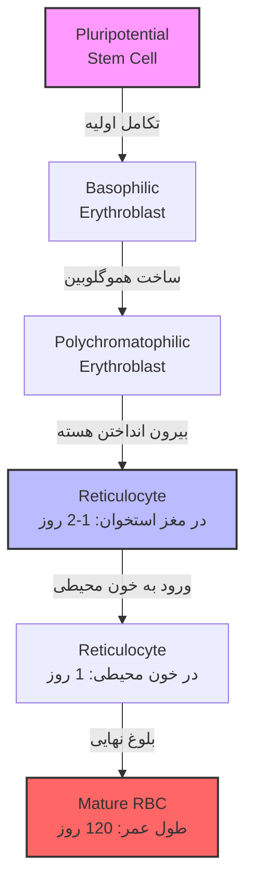
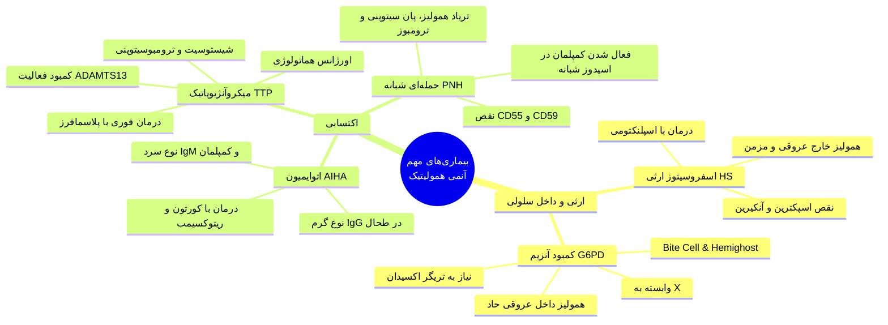
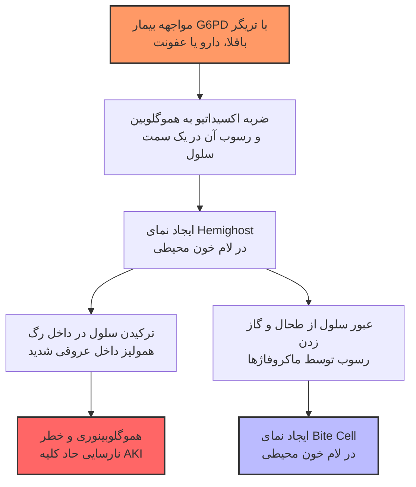
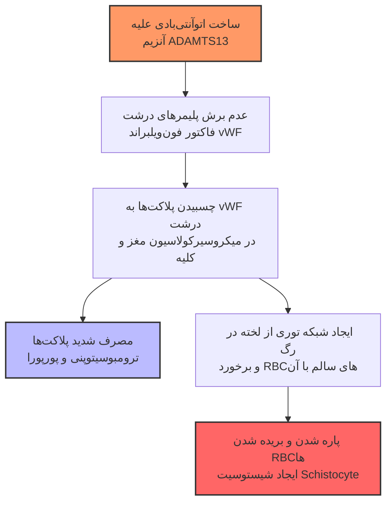

# آنمی‌های همولیتیک (Hemolytic Anemia)

## 1. کلیات هماتولوژی و فیزیولوژی گلبول قرمز (RBC)

در علم هماتولوژی، ما با **دو ارگان اصلی** سروکار داریم که درک ارتباط آن‌ها پایه و اساس فهم تمام بیماری‌های خونی است:

1. **مغز استخوان (Bone Marrow):** که حکم *کارخانه تولید سلول‌های خونی* (محل انجام فرآیند **Hematopoiesis**) را دارد.

2. **خون محیطی (Peripheral Blood):** که حکم *نمایشگاه* این کارخانه را دارد؛ سلول‌های تولیدشده در کارخانه به داخل این نمایشگاه ریخته می‌شوند.

> [!info] تعریف خون به عنوان یک ارگان فوق‌تخصصی
> خون یک بافت و ارگان کاملاً تخصصی است که سلول‌های متنوعی با عملکردهای متفاوت در آن حضور دارند. تفاوت کلیدی خون با سایر ارگان‌های بدن در این است که حالت **مایع (Liquid)** دارد و در یک **سیستم گردش خون بسته (Closed Circulation)** دائماً جریان (Flow) دارد تا وظایف خود را انجام دهد.

### فرآیند تکامل گلبول قرمز (Erythropoiesis)

در مغز استخوان، سلول مادر و جد تمامی سلول‌های خونی به نام **سلول بنیادی پرتوان (Pluripotential Stem Cell)** حضور دارد. این سلول قابلیت تبدیل شدن به هر نوع سلول خونی را دارد. حال فرض کنید سرنوشت این سلول بنیادی این است که به یک گلبول قرمز (RBC) تبدیل شود؛ این اتفاق یک‌شبه و ناگهانی رخ نمی‌دهد، بلکه طی یک **فرآیند تکاملی مرحله‌به‌مرحله** انجام می‌شود:

* **ویژگی‌های سلول بنیادی اولیه:** این سلول‌ها در ابتدا بسیار **بزرگ، نارس، نابالغ و ناکارآمد** هستند و هیچ کار تخصصی بلد نیستند انجام دهند.

* **تغییرات تکاملی در طول مسیر:** هرچه سلول به سمت بلوغ می‌رود و وظیفه‌اش مشخص می‌شود:

  1. اندازه سلول به تدریج **کوچک‌تر** می‌شود.

  2. هسته سلول به تدریج **فشرده و متراکم (Dense)** می‌شود.

  3. در سیتوپلاسم آن تغییراتی رخ می‌دهد که نشان‌دهنده وظیفه نهایی سلول (ساخت هموگلوبین) است.

#### مراحل اصلی بلوغ رده اریتروئید:

1. **اریتروبلاست (Erythroblast):** اولین مرحله‌ای که سلول وارد رده گلبول قرمز می‌شود. کلمه *بلاست (Blast)* یعنی جوان، نابالغ و سلولی که هنوز کار کردن بلد نیست. خود اریتروبلاست‌ها انواع مختلفی دارند (که نیازی به حفظ کردن تمام زیرگروه‌های آن نیست، اما منطق تغییر رنگشان بسیار مهم است):

   * در ابتدا **اریتروبلاست بازوفیلیک (Basophilic Erythroblast)** است؛ یعنی سیتوپلاسم آن کاملاً **آبی** است.

   * هرچه سلول بالغ‌تر می‌شود، یاد می‌گیرد که باید **هموگلوبین** بسازد (مانند مرحله *Polychromatophilic Erythroblast*). با افزایش مقدار هموگلوبین، رنگ سیتوپلاسم به تدریج از آبی به سمت **صورتی/قرمز (ائوزینوفیلیک)** تغییر می‌کند.

2. **رتیکولوسیت (Reticulocyte):** سلول می‌گوید چون من فقط می‌خواهم پر از هموگلوبین باشم، دیگر به هسته نیازی ندارم! بنابراین هسته آن به شدت متراکم (Dense) شده، به کنار سلول می‌رود و **به بیرون پرتاب می‌شود**. در این مرحله که سلول هسته ندارد، پر از هموگلوبین است اما هنوز **مقداری رشته‌های RNA** در سیتوپلاسم خود دارد، به آن *رتیکولوسیت* می‌گویند.

   * رتیکولوسیت حدود **1 تا 2 روز در مغز استخوان** می‌ماند.

   * سپس وارد **خون محیطی** شده و حدود **1 روز نیز در گردش خون** می‌چرخد و در نهایت به یک گلبول قرمز بالغ (Mature RBC) تبدیل می‌شود (رتیکولوسیت‌ها در حالت طبیعی حدود **1%** از RBCهای خون محیطی را تشکیل می‌دهند).

> [!important] روش ارزیابی مغز استخوان در برابر خون محیطی
>
> * **ارزیابی مغز استخوان (کارخانه):** از استخوان **ایلیاک کرست (Iliac Crest)** با سوزن مخصوص وارد شده و خون مغز استخوان را می‌کشیم (**Bone Marrow Aspiration**) یا یک تکه کوچک از استخوان را برمی‌داریم (**Biopsy**). *(نکته: در آنمی همولیتیک معمولاً نیازی به انجام آسپیراسیون و بیوپسی مغز استخوان نداریم).*
>
> * **ارزیابی خون محیطی (نمایشگاه):** یک قطره از خون بیمار را روی شیشه (لام) ریخته، پخش کرده و رنگ‌آمیزی می‌کنیم که به آن **لام خون محیطی (Peripheral Blood Smear - PBS)** می‌گویند.

## 2. آناتومی و اجزای گلبول قرمز و تعریف همولیز

طبقه‌بندی کلی علل آنمی (کم‌خونی) از نظر پاتوفیزیولوژی به **3 دسته اصلی** تقسیم می‌شود:

1. کارخانه (مغز استخوان) نمی‌تواند به خوبی سلول بسازد.

2. کارخانه خوب می‌سازد، سلول وارد خون محیطی می‌شود اما در آنجا زودتر از موعد تخریب می‌شود (**همولیز - Hemolysis**).

3. کارخانه خوب می‌سازد و تخریبی هم در کار نیست، اما بیمار دچار **خونریزی و دفع خون (Blood Loss)** از بدن است.

> [!info] تعریف همولیز (Hemolysis)
> گلبول قرمز طبیعی باید حدود **120 روز (3 تا 4 ماه)** عمر کند. هرگاه گلبول قرمز زودتر از موعد مقرر (مثلاً در عرض 1 ماه) از بین برود و لیز شود و طول عمرش کوتاه گردد، به این پدیده **همولیز** می‌گویند.

برای اینکه بفهمیم چرا یک گلبول قرمز دچار همولیز می‌شود، ابتدا باید اجزای تشکیل‌دهنده یک RBC سالم را بشناسیم:

### اجزای اصلی یک گلبول قرمز:

1. **دیواره و غشا (Membrane):** دیواره RBC خود یک دنیای پیچیده است که از یک **دولایه فسفولیپیدی** تشکیل شده است. پروتئین‌ها و گلیکوپروتئین‌هایی از آن عبور کرده‌اند (دارای دومین داخل سلولی و خارج سلولی) و کانال‌هایی برای عبور یون‌ها در سطح آن تعبیه شده است. در زیر این دولایه فسفولیپیدی، یک اسکلت پروتئینی توری‌مانند (حاوی پروتئین‌های مهمی مثل **اسپکترین - Spectrin** و **آنکیرین - Ankyrin**) قرار دارد که مثل یک طناب دور تا دور محیط داخلی RBC تابیده شده است. این اسکلت هم از محتویات سلول محافظت می‌کند و هم شکل هندسی خاص **مقعرالحرفین (Biconcave)** را به RBC می‌دهد تا بیشترین کارایی فضایی را داشته باشد.

2. **آنتی‌ژن‌های سطحی (Surface Antigens):** شاخک‌های گلیکوپروتئینی که از سطح غشا به بیرون زده‌اند، خاصیت آنتی‌ژنیک دارند (می‌توانند سیستم ایمنی را تحریک کنند) و **گروه‌های خونی** مختلف را می‌سازند.

3. **هموگلوبین (Hemoglobin):** در حالت طبیعی، **97%** هموگلوبین داخل RBCهای ما از نوع بزرگسال (HbA) است که از **2 زنجیره آلفا (α)**، **2 زنجیره بتا (β)** و یک بخش **هِم (Heme)** در وسط (که حاوی **آهن** است) تشکیل شده است *(زنجیره دلتا نیز در ساختار سایر هموگلوبین‌های فرعی مطرح است)*. وظیفه اصلی هموگلوبین و RBC این است که در محیط پرفشار اکسیژن (ریه‌ها) اکسیژن را بگیرد، در محیط کم‌فشار اکسیژن (گوشه‌وکنار سلول‌ها و بافت‌ها) تحویل دهد و دی‌اکسید کربن را برگرداند.

4. **آنزیم‌ها (Enzymes):** داخل RBC آنزیم‌های متعددی وجود دارد که دو وظیفه حیاتی دارند:

   * **تولید انرژی (سوخت‌رسانی):** مثل بنزین برای ماشین، انرژی لازم برای فعالیت‌های سلول را تامین می‌کنند.

   * **نقش نگهبان و حفاظتی (سپر بلا):** از RBC در برابر حمله رادیکال‌های آزاد و مواد اکسیدان (که به دلیل حضور مداوم RBC در محیط‌های پرفشار و کم‌فشار اکسیژن ایجاد می‌شوند) محافظت می‌کنند (مثل آنزیم **G6PD**).

## 3. پاتوفیزیولوژی و دسته‌بندی کلی علل همولیز

تخریب زودهنگام گلبول قرمز (همولیز) می‌تواند به دلیل نقص در هر یک از اجزای فوق یا محیط اطراف سلول رخ دهد:

### الف) اختلالات هموگلوبین (Hemoglobinopathies)

برای اینکه RBC شکل و عملکرد طبیعی داشته باشد، هموگلوبین باید به صورت کاملاً **محلول، هموژن و یکدست** در سیتوپلاسم پخش باشد. اختلال هموگلوبین به دو شکل باعث تخریب سلول می‌شود:

1. **اختلال کیفی (ساختاری) در زنجیره گلوبین (مثل کم‌خونی داسی‌شکل - Sickle Cell Anemia):** تغییر در یک آمینواسید باعث می‌شود ساختار هموگلوبین تغییر کرده و **میزان حلالیت آن کم شود**. در نتیجه، هموگلوبین رسوب کرده و شکل RBC را تغییر می‌دهد (مثلاً به شکل هلال یا داس درمی‌آورد). وقتی این RBC تغییرشکل‌یافته در جریان گردش مداوم خود وارد **طحال** می‌شود، طحال متوجه شکل غیرطبیعی آن شده، آن را به دام انداخته و تکه‌تکه (لیز) می‌کند.

2. **اختلال کمی در میزان ساخت زنجیره‌ها (مثل تالاسمی - Thalassemia):**

> [!warning] نکته بسیار مهم امتحانی: تفاوت تالاسمی با سایر هموگلوبینوپتی‌ها و مفهوم اریتروپوئز غیرموثر
> در تالاسمی، زنجیره هموگلوبین خراب یا معیوب **نیست**، بلکه **میزان سنتز یک زنجیره کم می‌شود** و تعادل (بالانس) مقدار زنجیره‌ها به هم می‌خورد!
>
> * **مثال (آلفا تالاسمی):** در این بیماری سنتز زنجیره α کاهش می‌یابد، اما زنجیره β به میزان طبیعی ساخته می‌شود. مقداری از α و β با هم ترکیب شده و هموگلوبین می‌سازند، اما به دلیل کمبود α، **مقدار زیادی زنجیره β اضافه می‌آید**.
>
> * **عامل ایجاد علائم:** آنچه باعث مشکل و علامت‌دار شدن بیمار می‌شود، همین **زنجیره‌های اضافی (مثلاً زیادیِ زنجیره β در آلفا تالاسمی)** است! این زنجیره‌های اضافه باعث می‌شوند RBC بسیار ناپایدار و حساس شود و در اثر مواد اکسیدان به راحتی تخریب گردد.
>
> * **اریتروپوئز غیرموثر (Ineffective Erythropoiesis):** در بیماران تالاسمی، بسیاری از این سلول‌های حساس **در داخل خودِ مغز استخوان** و قبل از اینکه اصلاً بتوانند از کارخانه خارج شده و وارد گردش خون شوند، تخریب می‌شوند. به تخریب سلول در داخل مغز استخوان، همولیز نمی‌گویند، بلکه **اریتروپوئز غیرموثر** می‌گویند (البته سلول‌هایی هم که وارد خون می‌شوند در معرض همولیز قرار می‌گیرند).

### ب) سایر مکانیسم‌های ایجاد همولیز

* **اختلال در دیواره و غشا:** مثل اسفروسیتوز ارثی.

* **اختلال در آنزیم‌های محافظتی:** مثل کمبود آنزیم G6PD.

* **مکانیسم ایمنی (Autoimmune Hemolytic Anemia):** سیستم ایمنی علیه آنتی‌ژن‌های سطحی RBC آنتی‌بادی می‌سازد و سلول را **نشان‌دار** می‌کند؛ سپس ماکروفاژهای طحال سریعاً آن را شناسایی کرده و می‌بلعند.

* **عوامل عفونی مستقیم:** انگل‌ها (مثل مالاریا) وارد محیط غنی از غذای RBC شده، رشد و تکثیر می‌یابند و سلول را می‌ترکانند؛ یا باکتری‌ها (مثل کلستریدیوم پرفرینجنس) غشای آن را سوراخ می‌کنند.

* **محیط سمی و آسیب مکانیکی عروق:** گلبول قرمز کاملاً سالم است، اما در یک شبکه توری از لخته‌ها و ترومبوزهای داخل عروقی (مثل TTP یا DIC) گیر افتاده و پاره می‌شود.

### جدول مقایسه‌ای سیستم‌های دسته‌بندی همولیز

پزشکان برای اینکه در بالین بتوانند در زمان کوتاه از بین صدها علت کم‌خونی، علت دقیق همولیز را به صورت الگوریتمی پیدا کنند، همولیز را به 4 روش مختلف دسته‌بندی می‌کنند:

| معیار دسته‌بندی          | زیرگروه اول (همراه با مثال بالینی)                                                        | زیرگروه دوم (همراه با مثال بالینی)                                                              | کاربرد بالینی و نکات کلیدی در افتراق                                                                                      |
| ------------------------ | ----------------------------------------------------------------------------------------- | ----------------------------------------------------------------------------------------------- | ------------------------------------------------------------------------------------------------------------------------- |
| **منشأ ژنتیکی یا محیطی** | **ارثی (Inherited):**  اسفروسیتوز ارثی (HS)، کم‌خونی داسی‌شکل، کمبود G6PD                 | **اکتسابی (Acquired):**  آنمی همولیتیک اتوایمیون (AIHA)، TTP، مالاریا، PNH                      | در موارد ارثی، **سابقه خانوادگی (Family History)** اغلب مثبت است و معمولاً در سنین کودکی بروز می‌کنند.                    |
| **محل تخریب گلبول قرمز** | **داخل عروقی (Intravascular):**  DIC، TTP، کمبود G6PD، PNH، بخشی از موارد AIHA (نوع IgM)  | **خارج عروقی (Extravascular):**  اسفروسیتوز ارثی، کم‌خونی داسی‌شکل، AIHA (نوع IgG)              | منظور از خارج عروقی، تخریب در **طحال** (و کبد) است که منجر به *اسپلنومگالی* می‌شود. نوع داخل عروقی خطر آسیب کلیوی دارد.   |
| **محل نقص اصلی**         | **داخل سلولی (Intrinsic):**  نقص در خود RBC است (غشا، آنزیم یا هموگلوبین؛ مثل HS یا G6PD) | **خارج سلولی (Extrinsic):**  خود RBC سالم است اما محیط سمی یا مخرب است (مثل TTP، AIHA، مالاریا) | در نوع Extrinsic، اگر RBC فرد سالم را هم وارد بدن بیمار کنیم، توسط محیط بیمار (مثلاً توری لخته در TTP) تخریب می‌شود.      |
| **سرعت بروز علائم**      | **حاد (Acute):**  کمبود آنزیم G6PD، آنمی همولیتیک اتوایمیون (AIHA)، TTP                   | **مزمن (Chronic):**  اسفروسیتوز ارثی (HS)، تالاسمی‌ها                                           | موارد حاد به صورت اورژانسی و با افت ناگهانی هموگلوبین مراجعه می‌کنند، اما موارد مزمن تغییرات اسکلتی و سنگ صفراوی می‌دهند. |

## 4. تظاهرات بالینی و یافته‌های آزمایشگاهی در همولیز

وقتی بیماری با همولیز مراجعه می‌کند، علائم او ترکیبی از علائم خودِ کم‌خونی و علائم ناشی از تخریب RBC و واکنش مغز استخوان است:

### الف) علائم و نشانه‌های بالینی (در شرح حال و معاینه)

1. **علائم عمومی کم‌خونی و کاهش اکسیژن‌رسانی (Hypoxia & Hypoperfusion):**

   * ضعف، خستگی، بی‌حالی، بی‌جانی و کم‌انرژی بودن.

   * تپش قلب (Palpitation) و تنگی نفس (Dyspnea).

   * علائم سیستم عصبی مرکزی (CNS) مثل **سردرد** و سرگیجه (در کم‌خونی‌های شدید به علت کاهش پرفیوژن و اکسیژن‌رسانی مغز).

   * **رنگ‌پریدگی (Pallor):** در معاینه چشم، هنگامی که پلک تحتانی را به پایین می‌کشیم، بستر **ملتحمه (Conjunctiva)** که در حالت طبیعی باید صورتی‌رنگ باشد، کاملاً بی‌رنگ و پریده (Pale) است. *(نکته: پورپورا و خونریزی‌های پوستی ربطی به همولیز ساده ندارند و مربوط به مباحث پلاکت، انعقاد و هموستاز هستند، مگر در بیماری خاصی مثل TTP).*

2. **زردی یا ایکتر (Icterus / Jaundice):**

   * وقتی RBC لیز می‌شود، **هِم (Heme)** بیرون می‌ریزد و به **بیلی‌روبین (غيرمستقیم)** تبدیل می‌شود که باعث **هایپربیلی‌روبینمی** می‌گردد.

   * در معاینه چشم، **صلبیه (Sclera)** در قسمت بالای چشم که باید کاملاً سفید باشد، زردرنگ (Icteric) می‌شود.

3. **بزرگی طحال (Splenomegaly):** به دلیل به دام افتادن و تخریب RBCها در طحال (به‌ویژه در همولیزهای خارج عروقی).

4. **تغییرات اسکلتی (Skeletal Changes):** در همولیزهای **مزمن و طولانی‌مدت (معمولاً ارثی)**، مغز استخوان برای جبران کم‌خونی به شدت پرکار می‌شود که به آن **هایپرپلازی رده اریتروئید (Erythroid Hyperplasia)** می‌گویند. این پرکاری مداوم باعث گسترش فضای مغز استخوان (**Marrow Expansion**) به‌خصوص در استخوان‌های پهن شده و تغییرات ظاهری و اسکلتی ایجاد می‌کند (دقیقاً مشابه آنچه در بیماران تالاسمی می‌بینیم که هرچه بزرگ‌تر می‌شوند، چهره‌هایشان بیشتر شبیه به هم می‌شود).

5. **سنگ‌های صفراوی پیگمانته (Pigmented Gallstones):** در همولیزهای مزمن (مثل اسفروسیتوز ارثی)، بیلی‌روبین زیادی که در طول سالیان متمادی تولید و وارد کبد می‌شود تا دفع گردد، تغییر غلظت داده و رسوب می‌کند و سنگ‌های صفراوی از جنس بیلی‌روبین می‌سازد.

### ب) یافته‌های آزمایشگاهی عمومی همولیز

* **کاهش هموگلوبین (Hb ⇩):** البته در موارد جبران‌شده می‌تواند تقریباً نرمال باشد.

* **افزایش حجم متوسط گلبول قرمز (MCV ⇧):** بسیار مهم! چرا در همولیز MCV بالا می‌رود؟ زیرا مغز استخوانِ سالم برای کمک به اکسیژن‌رسانی، رتیکولوسیت‌ها را زودتر از موعد (قبل از اینکه 2 روز در مغز استخوان بمانند) به داخل خون محیطی پرتاب می‌کند. از آنجا که **رتیکولوسیت‌ها سلول‌های بزرگ‌تری نسبت به RBC بالغ هستند**، حضور تعداد زیاد آن‌ها در خون (**رتیکولوسیتوز - Reticulocytosis**) باعث افزایش کاذب/واقعی میانگین اندازه سلول‌ها یعنی افزایش MCV می‌شود.

* **افزایش آنزیم LDH و بیلی‌روبین غیرمستقیم** در خون.

### ج) ویژگی‌های اختصاصی همولیز داخل عروقی (Intravascular Hemolysis)

وقتی RBC در داخل رگ و جریان خون می‌ترکد، **هموگلوبین آزاد** وارد پلاسما می‌شود. هموگلوبین آزاد یک ماده **بسیار خطرناک و سمی (Toxic)** است و اندازه مولکولی بزرگی دارد:

1. **هموگلوبینمی (Hemoglobinemia):** اگر خون یک فرد سالم را در لوله آزمایش بگذاریم تا RBCها ته‌نشین شوند، پلاسمای روی آن **زردرنگ** است؛ اما در همولیز داخل عروقی، به دلیل وجود هموگلوبین آزاد در پلاسما، رنگ پلاسما **قرمز** می‌شود.

2. **هموگلوبینوری (Hemoglobinuria):** هموگلوبین آزاد از گلومرول‌های کلیه فیلتر شده و وارد ادرار می‌شود و رنگ ادرار را **تیره یا قرمز (به رنگ نوشابه کوکاکولا - Cola-colored)** می‌کند.

   * *تله تستی مهم:* بیمار با ترس مراجعه می‌کند و می‌گوید «ادرارم خونی شده است!»، اما وقتی آزمایش ادرار (U/A) می‌گیریم، **هیچ گلبول قرمزی (RBC) در ادرار وجود ندارد** (یعنی بیمار **هماچوری ندارد**، بلکه هموگلوبینوری دارد).

3. **آسیب حاد کلیوی (Acute Kidney Injury - AKI):** اصلاً قرار نیست هموگلوبین با آن اندازه بزرگ به گلومرول‌های کلیه برسد؛ فیلتراسیون آن باعث آسیب جدی به گلومرول‌ها و توبول‌ها، **افزایش کراتینین (Cr ⇧)** و نارسایی حاد کلیه (Renal Failure) می‌شود.

## 5. مفهوم همولیز جبران‌شده (Compensated) و بحران آپلاستیک

اگر مغز استخوان سالم باشد و مواد اولیه کافی (آهن، اسید فولیک، ویتامین‌ها) به آن برسد، در پاسخ به همولیز، فعالیت خود را چندین برابر می‌کند (هایپرپلازی اریتروئید) تا تخریب سلول‌ها را جبران کند.

> [!info] تعریف همولیز جبران‌شده (Compensated Hemolysis)
> حالتی است که در آن بیمار همولیز دارد (زردی/ایکتر دارد، LDH بالاست، رتیکولوسیت بالاست و اسپلنومگالی دارد)، اما به قیمت پرکاری شدید مغز استخوان، **سطح هموگلوبین او تقریباً نرمال (یا مثلاً حدود 10) حفظ شده است** و در حالت پایدار قرار دارد.

### چه عواملی همولیز جبران‌شده را از حالت جبران خارج می‌کنند (Decompensated)؟

مغز استخوان تا یک سقف مشخصی می‌تواند این بار اضافه را تحمل کند. در شرایط زیر، تعادل به هم خورده و هموگلوبین به شدت سقوط می‌کند:

1. **افزایش نیاز بدن:** مثلاً فرد **باردار (Pregnant)** می‌شود.

2. **کمبود مواد اولیه خون‌سازی:** بیمار به دلیل مصرف بالا دچار **کمبود اسید فولیک (Folate Deficiency)** یا کمبود آهن می‌شود.

3. **عفونت‌های ویروسی خاص (بحران آپلاستیک):**

> [!important] سناریوی امتحانی: پاروویروس B19 (Parvovirus B19)
> **کیس بالینی:** بیماری مبتلا به یک کم‌خونی همولیتیک ارثی و مزمن که سال‌ها همولیز جبران‌شده داشته و هموگلوبین او روی عدد 10 پایدار بوده است، ناگهان با ضعف شدید و **افت ناگهانی هموگلوبین به عدد 4** توسط اورژانس (EMS) به بیمارستان آورده می‌شود. در شرح حال می‌گوید چند روز پیش علائم یک عفونت ویروسی (تب، بی‌حالی و ضایعات پوستی مشبک/رتیکولار مثل *Erythema infectiosum* یا *Livedo reticularis*) داشته است. علت چیست؟
>
> * **پاسخ:** عفونت با **Parvovirus B19**. این ویروس علاقه شدیدی (Tropism) به سلول‌های پیش‌ساز رده اریتروئید در مغز استخوان دارد و به آن‌ها حمله کرده و کارخانه را موقتاً تعطیل می‌کند؛ در نتیجه هموگلوبین بیمار به صورت ناگهانی سقوط (Drop) می‌کند.

## 6. بررسی اختصاصی بیماری‌های همولیتیک

در ادامه، 5 بیماری بسیار مهم و پرتکرار در امتحانات را با تمام جزئیات بررسی می‌کنیم:

### بیماری اول: اسفروسیتوز ارثی (Hereditary Spherocytosis - HS)

* **پاتوفیزیولوژی:** یک بیماری ارثی ناشی از موتاسیون‌های متعدد در پروتئین‌های اسکلت غشای گلبول قرمز، به‌ویژه **اسپکترین (Spectrin)** و **آنکیرین (Ankyrin)** است. در نتیجه این نقص، RBC شکل طبیعی مقعرالحرفین خود را از دست داده و به شکل **گرد و کروی (Spherocyte)** درمی‌آید. این سلول‌های کروی و غیرمنعطف، هنگام عبور از **طحال** گیر افتاده و تخریب می‌شوند (همولیز خارج عروقی).

* **الگوی توارث و شرح حال:** شایع‌ترین موتاسیون‌های آن به صورت **اتوزومال غالب (Autosomal Dominant)** به ارث می‌رسند، اما موارد **اتوزومال مغلوب (Autosomal Recessive)** نیز وجود دارد.

  * *نکته بالینی:* بنابراین در اکثر موارد سابقه خانوادگی مثبت است (مثلاً برادر یا والدین بیمار هم مشکل مشابه دارند)، اما اگر از نوع مغلوب باشد، ممکن است سابقه خانوادگی منفی باشد!

* **تظاهرات بالینی و سن بروز:** شدت بیماری بسیار متغیر است؛ از موارد بسیار خفیف (Mild) و جبران‌شده که تا دوران بزرگسالی (Young Adult) تشخیص داده نمی‌شوند، تا موارد شدید (Severe) که در همان دوران کودکی با کم‌خونی شدید تظاهر می‌یابند.

  * علائم کلاسیک: کم‌خونی، زردی (ایکتر)، **اسپلنومگالی** و **سنگ‌های صفراوی پیگمانته**.

> [!warning] قانون طلایی هاریسون در مورد سنگ صفراوی
> طبق کتاب هاریسون، **هرگاه فرد جوانی با سنگ صفراوی (به‌ویژه سنگ پیگمانته بیلی‌روبینی) مراجعه کرد، حتماً باید به فکر بیماری اسفروسیتوز ارثی (HS) باشید!**

#### یافته‌های لام خون محیطی (PBS) در اسفروسیتوز ارثی:

در لام خون محیطی که یک تصویر دوبعدی است، ما کروی بودن سلول را به صورت **حذف شدن رنگ‌پریدگی مرکزی (Loss of Central Pallor)** می‌بینیم:

* گلبول قرمز طبیعی در وسط خود یک ناحیه سفید و بی‌رنگ به نام **Central Pallor** دارد (جایی که دو طرف غشا به هم نزدیک شده و هموگلوبین کمتری دارد؛ در حالت *هایپوکرومیا* این ناحیه سفید بزرگ‌تر می‌شود).

* در **اسفروسیت (Spherocyte)**، سلول کاملاً توپُر، کوچک‌تر و پررنگ دیده می‌شود و هیچ Central Pallor ندارد. برای تشخیص HS باید تعداد قابل‌توجهی (مثلاً **بیش از 50% تا 75%** گلبول‌های قرمز) اسفروسیت باشند.

> [!important] سوال امتحانی لام خون محیطی (PBS) در اسفروسیتوز ارثی
> اگر در امتحان لامی به شما نشان دادند و پرسیدند: **«سه یافته مهم در این لام چیست و تشخیص احتمالی کدام است؟»**، شما باید این سه سلول را شناسایی کنید:
>
> 1. **اسفروسیت‌ها (Spherocytes):** سلول‌های قرمز کوچک و توپُر بدون Central Pallor.
>
> 2. **رتیکولوسیتوز (Reticulocytosis):** سلول‌های بدون هسته که نسبت به RBC معمولی **کمی بزرگ‌تر** هستند و سیتوپلاسم آن‌ها به دلیل داشتن بقایای RNA، **متمایل به آبی (پلی‌کروماتوفیلیک)** است.
>
> 3. **گلبول قرمز هسته‌دار (Nucleated RBC - NRBC):** سلول تک‌هسته‌ای که در حالت عادی فقط در مغز استخوان وجود دارد و نباید در خون محیطی دیده شود، اما به دلیل استرس و فشار شدید روی مغز استخوان، به داخل خون ریخته شده است.
>
>    * *چگونه در لام، NRBC را از لنفوسیت افتراق دهیم؟* اندازه RBCها را در لام با لنفوسیت می‌سنجیم (هم‌اندازه هستند و هر دو هسته دارند)؛ اما **لنفوسیت سیتوپلاسم آبی دارد**، در حالی که **NRBC دارای یک هسته بسیار متراکم (Dense) و سیتوپلاسم صورتی/قرمز (ائوزینوفیلیک، حاوی هموگلوبین)** است!
>
> * **تشخیص نهایی لام:** همولیز ناشی از **اسفروسیتوز ارثی (HS)**.

#### درمان اسفروسیتوز ارثی:

از آنجا که این یک بیماری ژنتیکی است، پیوند مغز استخوان (جایگزینی سلول بنیادی) برای بیماری‌ای با این طیف خفیف تا متوسط منطقی و مرسوم نیست. درمان بر دو پایه استوار است:

1. **درمان‌های حمایتی (Supportive Care):** تجویز مستمر **اسید فولیک (Folic Acid)** به دلیل فعالیت بالای مغز استخوان، و تزریق خون (Transfusion) در صورت بروز همولیز و کم‌خونی شدید.

2. **برداشتن طحال (Splenectomy):** چون محل اصلی تخریب این سلول‌های کروی در طحال است، با برداشتن طحال صورت‌مسئله تخریب را پاک می‌کنیم (هرچند نقص ژنتیکی غشا باقی می‌ماند، اما سلول‌ها دیگر تخریب نمی‌شوند).

> [!warning] نکات فوق‌العاده مهم امتحانی درباره اندیکاسیون و زمان انجام اسپلنکتومی در HS
> اگر از شما بپرسند «آیا بیمار مبتلا به HS را اسپلنکتومی می‌کنیم؟»، پاسخ شما باید با سوال همراه باشد: **«بستگی دارد به شدت بیماری و سن بیمار!»**
>
> * **در موارد خفیف (Mild):** در کودکی دست نگه می‌داریم و فقط درمان حمایتی (اسید فولیک) می‌دهیم تا دوران کودکی و **بلوغ** او تمام شود؛ پس از گذشتن از سن بلوغ در صورت نیاز اسپلنکتومی می‌کنیم.
>
> * **در موارد شدید (Severe):** نمی‌توانیم تا بلوغ صبر کنیم، اما در سال‌های اول نوزادی و طفولیت هم عمل نمی‌کنیم! صبر می‌کنیم تا کودک به سن **4 تا 6 سالگی (مثلاً 5 سالگی)** برسد و سپس اسپلنکتومی را انجام می‌دهیم.
>
> * **اقدام حیاتی قبل از اسپلنکتومی:** طحال محل استقرار تعداد زیادی از لنفوسیت‌های B (تولیدکننده آنتی‌بادی و ایمنی هومورال) و ماکروفاژهایی است که وظیفه بلعیدن **باکتری‌های کپسول‌دار (Encapsulated Bacteria)** را دارند. فرد بدون طحال نقص جدی در ایمنی هومورال دارد و یک باکتریمی ساده ممکن است او را بکشد؛ بنابراین **قبل از انجام اسپلنکتومی، تزریق واکسن پنوموکوک (Pneumococcal Vaccine) و سایر باکتری‌های کپسول‌دار الزامی است!**

### بیماری دوم: کمبود آنزیم G6PD (G6PD Deficiency)

* **پاتوفیزیولوژی و ژنتیک:** یک بیماری ارثی **وابسته به کروموزوم X (X-linked)** است. آنزیم G6PD سپر دفاعی گلبول قرمز در برابر استرس‌های اکسیداتیو است. در نبود یا کمبود این آنزیم، RBC در مواجهه با مواد اکسیدان بدون دفاع مانده و به سرعت تخریب می‌شود.

* **الگوی بروز بالینی:** برخلاف اسفروسیتوز که مزمن است، کمبود G6PD یک بیماری با تظاهر **بسیار حاد (Acute)** است! بیمار در حالت عادی کاملاً سالم است و زندگی طبیعی خود را دارد و حتی خودش هم نمی‌داند این بیماری ارثی را دارد؛ تا اینکه با یک **عامل محرک (Trigger)** مواجه می‌شود و ناگهان فردای آن روز با حال بسیار بد، زردی شدید، **هموگلوبین بسیار پایین (مثلاً 3 یا 4)**، ادرار تیره و **افزایش کراتینین (مثلاً Cr = 4)** به اورژانس آورده می‌شود.

* **محل همولیز:** در کمبود G6PD **هر دو نوع همولیز داخل عروقی و خارج عروقی** رخ می‌دهد، اما **بخش عمده و خطرناک آن همولیز داخل عروقی (Intravascular)** است که منجر به هموگلوبینمی، هموگلوبینوری و ترس اصلی ما یعنی **نارسایی حاد کلیه (Renal Failure)** می‌شود.

#### عوامل محرک (Triggers) در کمبود G6PD:

برای بروز حمله همولیز در این بیماری، وجود یک تریگر (عامل اکسیدان که مثل یک شلاق به RBC بدون محافظ ضربه می‌زند) **الزامی** است:

1. **مواد غذایی:** مصرف **باقلا (Fava beans)** چه به صورت پخته و چه خام.

2. **عفونت‌ها (Infections):** ابتلا به عفونت‌های باکتریال یا وایرال (مثل آنفولانزا یا کرونا). منظور از استرس در اینجا، استرس روحی نیست، بلکه **استرس فیزیکی** ناشی از ورود آنتی‌ژن‌ها و تحریک سیستم ایمنی است که محیطی سمی و اکسیداتیو در بدن ایجاد می‌کند.

3. **داروها (Drugs):** داروها از نظر ایجاد همولیز در G6PD دسته‌بندی دارند (برخی 100% ممنوع هستند، برخی محتمل و برخی کم‌خطر). هر پزشکی باید لیست داروهای قطعی ایجادکننده همولیز را حفظ باشد:

   * آنتی‌بیوتیک‌های خانواده سولفونامیدها مثل **کوتریموکسازول (Co-trimoxazole)**.

   * فلوروکینولون‌ها مثل **سیپروفلوکساسین (Ciprofloxacin)** و افلوکساسین و **نالیدیکسیک اسید (Nalidixic acid)**.

   * داروهای ضد مالاریا (**Antimalarials**).

   * داروی بی‌حس‌کننده مجاری ادراری یعنی **فنازوپیریدین (Phenazopyridine)**.

#### مکانیسم تغییرات ظاهری RBC و یافته‌های لام خون محیطی (PBS) در G6PD:

وقتی ماده اکسیدان (شلاق) به RBC فاقد G6PD برخورد می‌کند، هموگلوبینِ داخل سلول که باید محلول و یکدست باشد، ناگهان دناتوره شده و در یک گوشه از سلول **رسوب می‌کند**:

1. **سلول روح‌مانند یا همی‌گوست (Hemighost Cell):** در لام خون محیطی، گلبول قرمزی را می‌بینیم که کل هموگلوبین آن در یک طرف سلول جمع و فشرده شده و طرف دیگر سلول کاملاً خالی و بی‌رنگ (شبیه روح) است.

2. **سلول گاززده شده (Bite Cell):** وقتی این RBCهای حاوی هموگلوبینِ رسوب‌کرده وارد طحال می‌شوند، ماکروفاژهای طحال برای اینکه مشکل را حل کنند، آن تکه رسوب‌کرده را **گاز می‌زنند و می‌بلعند**! در نتیجه گلبول قرمزی به خون برمی‌گردد که یک طرف آن حالت نیم‌دایره گاززده شده دارد که به آن *Bite Cell* می‌گویند.

#### تشخیص و تله آزمایشگاهی در فاز حاد G6PD:

* **شرح حال:** پرسش درباره سابقه قبلی حملات مشابه و مصرف باقلا یا دارو.

* **اندازه‌گیری سطح آنزیم G6PD:**

> [!warning] تله بسیار مهم امتحانی در اندازه‌گیری سطح آنزیم G6PD
> در فاز حاد حمله همولیز، مغز استخوان به شدت پرکار شده و تعداد زیادی **رتیکولوسیت و RBCهای جوان** را وارد خون می‌کند. از آنجا که سلول‌های جوان‌تر به طور طبیعی مقدار آنزیم G6PD بیشتری نسبت به سلول‌های پیر دارند، اگر در همان فاز حاد آزمایش سطح آنزیم را بفرستیم، ممکن است آزمایشگاه سطح آن را **به‌طور کاذب نرمال و کافی (Sufficient)** گزارش کند!
>
> * **راه‌حل:** هرچند در فاز حاد هم آزمایش را می‌فرستیم، اما برای اطمینان قطعی باید **مدتی بعد از برطرف شدن فاز حاد همولیز و پایدار شدن بیمار، مجدداً سطح آنزیم G6PD را چک کنیم**.

#### درمان کمبود آنزیم G6PD:

*(نکته: در حال حاضر غربالگری روتین کشوری برای آن انجام نمی‌شود و هموگلوبین آزاد در خون نیز **قابل دیالیز کردن - Dialyzable نیست**؛ یعنی صافی دیالیز نمی‌تواند هموگلوبین آزاد را از خون خارج کند).*

1. **مایع‌درمانی تهاجمی و فراوان (Vigorous Hydration):** **اولین، دومین و سومین اقدام حیاتی در اورژانس!** برای اینکه جلوی رسوب هموگلوبین در کلیه و بروز نارسایی حاد کلیه (AKI) را بگیریم، بلافاصله بیمار را بستری کرده و حجم بالایی از سرم (مثلاً **4 لیتر سرم**) برایش تجویز می‌کنیم تا جریان ادرار (Diuresis) برقرار شود و گلومرول‌ها شسته شوند.

2. **تزریق خون (Transfusion):** در صورت کم‌خونی شدید (مثلاً هموگلوبین 3 یا 4).

3. **تجویز اسید فولیک (Folic Acid):** برای کمک به بازسازی خون در مغز استخوان.

4. **آموزش به بیمار:** پس از ترخیص و تایید تشخیص، **لیست داروهای ممنوعه** را به بیمار می‌دهیم تا به هر پزشکی که مراجعه کرد، ابتلای خود را اطلاع دهد. *(اسپلنکتومی در G6PD جایگاه روتینی ندارد و فقط در موارد بسیار نادر و خاص که حملات مکرر و آسیب‌زا دارند ممکن است مطرح شود).*

### بیماری سوم: آنمی همولیتیک اتوایمیون (Autoimmune Hemolytic Anemia - AIHA)

* **پاتوفیزیولوژی:** در این بیماری، خودِ گلبول قرمز و آنتی‌ژن‌های سطحی آن کاملاً طبیعی هستند و هیچ تغییری نکرده‌اند؛ مشکل از **سیستم ایمنی بدن** است! سیستم ایمنی که باید آنتی‌ژن‌های خودی (Self) را بشناسد و به آن‌ها حمله نکند، دچار اختلال در شناخت می‌شود (مثل سایر بیماری‌های روماتولوژیک نظیر لوپوس، آرتریت روماتوئید و شوگرن) و علیه آنتی‌ژن‌های سطح RBC آنتی‌بادی می‌سازد.

* **تست تشخیصی طلایی:** برای اثبات وجود آنتی‌بادی روی سطح RBCها از **تست کومبس (Coombs Test / Direct Antiglobulin Test)** استفاده می‌کنیم (که به صورت نمادین می‌توان گفت از سطح RBC عکس می‌گیریم و می‌بینیم پر از آنتی‌بادی است!).

#### انواع آنمی همولیتیک اتوایمیون بر اساس نوع آنتی‌بادی:

1. **نوع گرم (با واسطه آنتی‌بادی IgG):**

   * آنتی‌بادی از جنس **IgG** روی سطح RBC می‌نشیند و آن را نشان‌دار می‌کند.

   * هنگامی که این RBC وارد **طحال** می‌شود، ماکروفاژهای طحال (که به صورت منظم نشسته و گیرنده اختصاصی برای بخش Fc آنتی‌بادی IgG دارند) سریعاً آن را شناسایی کرده و می‌بلعند (یا بخش‌هایی از غشای آن را می‌کنند).

   * بنابراین همولیز از نوع **خارج عروقی** است و بیمار دچار **اسپلنومگالی** می‌شود.

2. **نوع سرد (با واسطه آنتی‌بادی IgM):**

   * آنتی‌بادی **IgM** یک مولکول بسیار درشت و **پنتامر (5 تایی)** است. ویژگی بسیار مهم IgM این است که به شدت توانایی تحریک و فعال کردن **سیستم کمپلمان (Complement System)** را دارد.

   * **سیستم کمپلمان چیست؟** مجموعه‌ای از پروتئین‌های نگهبان در پلاسما هستند که وقتی فعال می‌شوند، غشای سلول هدف را **سوراخ‌سوراخ** می‌کنند! بنابراین وقتی IgM کمپلمان را فعال کند، گلبول قرمز در همان داخل رگ می‌ترکد و یک **همولیز داخل عروقی بسیار شدید** ایجاد می‌شود.

   * **وابستگی به دما (Cold Agglutinin):** برخی از این آنتی‌بادی‌های IgM در دمای مرکزی بدن (37 درجه سانتی‌گراد) هیچ کاری به RBC ندارند، اما وقتی خون به نواحی محیطی و انتهایی بدن (مثل نوک انگشتان، نرمه گوش و نوک بینی) می‌رسد که دمای پایین‌تری دارند (مثلاً 30 درجه سانتی‌گراد)، فعال می‌شوند! در این مناطق هم کمپلمان را فعال کرده و همولیز می‌دهند، و هم باعث درگیری عروقی (واسکولیت/انسداد رگ‌های کوچک) و بروز **آکروسیانوز (Acrocyanosis - کبودی انتهاها در سرما)** می‌شوند.

> [!info] نکته بالینی: فرم خودمحدودشونده AIHA در کودکان
> در کودکان، بسیار شایع است که به دنبال یک **عفونت ویروسی**، بدن علیه ویروس آنتی‌بادی می‌سازد؛ اما به دلیل **شباهت ساختاری (Molecular Mimicry)** بین آنتی‌ژن ویروس و آنتی‌ژن‌های سطح RBC، این آنتی‌بادی‌ها به RBC هم حمله کرده و یک همولیز خفیف ایجاد می‌کنند. این حالت معمولاً **خودمحدودشونده (Self-limited)** است، خودبه‌خود بهبود می‌یابد (Resolve می‌شود) و نیازی به درمان خاصی یا حتی تزریق خون ندارد.

#### یافته‌های لام خون محیطی (PBS) در AIHA:

* **رتیکولوسیتوز** شدید.

* **اسفروسیتوز (Spherocytosis):** بسیار مهم! وقتی ماکروفاژهای طحال به RBCهای پوشیده‌شده با آنتی‌بادی حمله می‌کنند و تکه‌هایی از غشای آن‌ها را می‌کنند، و همچنین به دلیل تولید سریع در مغز استخوان، گلبول‌های قرمز کوچک‌تر شده و هموگلوبینشان فشرده‌تر می‌شود و Central Pallor خود را از دست می‌دهند.

> [!important] نکته طلایی امتحانی: دو بیماری مهم ایجادکننده اسفروسیت در لام خون محیطی
> اگر در امتحان پرسیدند در کدام بیماری‌ها در لام خون محیطی **اسفروسیت (Spherocyte)** می‌بینیم، دو تشخیص اصلی وجود دارد:
>
> 1. **اسفروسیتوز ارثی (Hereditary Spherocytosis)**
>
> 2. **آنمی همولیتیک اتوایمیون (AIHA)**
>    *(افتراق این دو با تست کومبس است که در AIHA مثبت و در HS منفی است).*

#### درمان آنمی همولیتیک اتوایمیون (AIHA):

چون ریشه بیماری فعالیت بیش‌ازحد و اشتباه سیستم ایمنی (لنفوسیت‌های B) است، درمان اصلی **سرکوب سیستم ایمنی (Immunosuppression)** است:

1. **خط اول درمان: کورتیکواستروئیدها (Corticosteroids):** تجویز **پردنیزولون (Prednisolone)** با دوز `1 mg/kg` به مدت حدود یک ماه؛ سپس زمانی که همولیز کنترل شد، دارو را به آرامی و به تدریج کم می‌کنیم (**Taper** می‌کنیم؛ مثلاً هر هفته 5 تا 10 میلی‌گرم از دوز آن کم می‌کنیم).

2. **آنتی‌بادی مونوکلونال: ریتوکسیمب (Rituximab):** (با نام تجاری ایرانی *Zytux*).

   * **مکانیسم اثر:** ریتوکسیمب یک آنتی‌بادی مونوکلونال علیه گیرنده **CD20** در سطح **لنفوسیت‌های B** است. این دارو لنفوسیت‌های B را قلع‌وقمع و نابود می‌کند تا دیگر نتوانند آنتی‌بادی جدید بسازند (آنتی‌بادی‌های قبلی موجود در خون هم به تدریج در طحال پاکسازی می‌شوند).

   * **مزایای اضافه کردن ریتوکسیمب:** در گذشته که فقط کورتون می‌دادند، به محض کم کردن دوز کورتون، بیماری به شدت عود (Flare) می‌کرد و مصرف طولانی کورتون هم عوارض زیادی داشت. با اضافه کردن ریتوکسیمب (که معمولاً به صورت هفتگی برای **4 هفته با دوز 375 میلی‌گرم بر مترمربع سطح بدن** تجویز می‌شود - *نیازی به حفظ کردن دوز دقیق نیست*)، هم می‌توانیم کورتون را زودتر Taper کنیم و هم شانس عود بیماری بسیار کمتر می‌شود.

3. **موارد مقاوم به درمان (Refractory):** در بیماری‌های چغر و مقاوم که با کورتون و ریتوکسیمب کنترل نمی‌شوند و حملات متعدد دارند، از سایر داروهای ایمونوساپرسیو مثل **آزاتیوپرین (Azathioprine)** یا **مایکوفنولات موفتیل (CellCept)** استفاده می‌کنیم.

### بیماری چهارم: پورپورای ترومبوتیک ترومبوسیتوپنیک (TTP)

**(Thrombotic Thrombocytopenic Purpura - یک اورژانس مطلق هماتولوژی!)**

برای درک TTP، ابتدا باید فیزیولوژی **هموستاز اولیه (Primary Hemostasis)** را مرور کنیم:

* در حالت عادی، خون در عروق جریان دارد و هرگز با لایه زیرین عروق یعنی **کلاژن ساب‌اندوتلیال (Subendothelial Collagen)** تماس ندارد.

* اگر رگی بریده شود و اندوتلیوم آسیب ببیند، خون با کلاژن ساب‌اندوتلیال تماس پیدا می‌کند و **دو اتفاق مهم** رخ می‌دهد تا **میخ پلاکتی (Platelet Plug)** تشکیل شود:

  1. سلول‌های اندوتلیوم بلافاصله فاکتور بسیار مهمی به نام **فاکتور فون‌ویلبراند (von Willebrand Factor - vWF)** ترشح می‌کنند. **نقش vWF چیست؟** *مانند پلی بین کلاژن ساب‌اندوتلیال و پلاکت‌ها عمل می‌کند!*

  2. پلاکت‌ها فعال می‌شوند (**Platelet Activation**) که منجر به چسبیدن پلاکت‌ها به اندوتلیوم (**Platelet Adhesion**) و چسبیدن پلاکت‌ها به یکدیگر (**Platelet Aggregation**) می‌شود.

#### پاتوفیزیولوژی TTP (داستان آنزیم ADAMTS13):

* سلول‌های اندوتلیوم وقتی vWF را می‌سازند، ابتدا به صورت مونومر، سپس دایمر و در نهایت به صورت **پلیمرهای بسیار درشت (Ultralarge Multimers)** وارد خون می‌کنند.

* این پلیمرهای غول‌پیکر برای اینکه بتوانند کار طبیعی خود را انجام دهند و بی‌خود لخته نسازند، باید توسط یک آنزیم قیچی‌کننده به نام **ADAMTS13** از جاهای خاصی بریده شده و به قطعات کوچک، متوسط و بزرگ طبیعی تبدیل شوند *(برای یادسپاری: آنزیمی که می‌خواهد vWF غول‌پیکر را «آدمش کنه»!)*.

* **در بیماری TTP چه اتفاقی می‌افتد؟** TTP یک **بیماری اتوایمیون** است که در آن سیستم ایمنی علیه آنزیم **ADAMTS13** آنتی‌بادی می‌سازد! (آنزیم وجود دارد، اما به دلیل مهار شدن توسط آنتی‌بادی، **فعالیت / Activity ندارد**).

* در غیاب فعالیت ADAMTS13، مولکول‌های غول‌پیکر vWF در جریان خون رها می‌شوند، در اثر تنش برشی جریان خون (Shear Stress) باز می‌شوند و پلاکت‌ها به شدت به آن‌ها می‌چسبند. در نتیجه، در **عروق ریز (Microcirculation)** ارگان‌های حیاتی مثل **مغز و کلیه و قلب**، لخته‌های فراوانی (غنی از پلاکت و vWF) تشکیل می‌شود.

> [!info] تفاوت لخته در TTP با لخته در DIC
> هر دو بیماری همولیز داخل عروقی مکانیکی می‌دهند، اما لخته در **TTP** ناشی از اختلال در *هموستاز اولیه* است (فقط متشکل از پلاکت و vWF است و فاکتورهای انعقادی در آن مصرف نمی‌شوند؛ لذا PT و PTT نرمال است)، در حالی که در **DIC** اختلال در *هموستاز ثانویه* و فعال شدن کل آبشار انعقادی و مصرف فاکتورهای انعقادی است.

#### تظاهرات بالینی و سناریوی کلاسیک امتحانی TTP:

* چون یک بیماری اتوایمیون است، بیشتر در **خانم‌های جوان** دیده می‌شود و اغلب یک تریگر مثل **بارداری یا دوران پس از زایمان (Postpartum)** دارد.

* مصرف شدن پلاکت‌ها در لخته‌ها باعث **ترومبوسیتوپنی شدید** و خونریزی‌های پوستی (**پورپورا - Purpura**) می‌شود.

* گیر افتادن لخته‌ها در عروق مغز باعث علائم نورولوژیک مثل **تشنج (Seizure)**، سردرد یا کاهش سطح هوشیاری می‌شود.

* برخورد گلبول‌های قرمز با این شبکه توری از لخته‌ها باعث پاره شدن آن‌ها و **همولیز داخل عروقی (Extrinsic)** می‌گردد.

> [!important] یافته‌های لام خون محیطی (PBS) در TTP
> اگر در امتحان کیس خانم جوانی (مثلاً پس از زایمان) را دادند که با پورپورا، تشنج، هموگلوبین 6 و **پلاکت 25,000** مراجعه کرده است، در لام خون محیطی او دو یافته کلیدی می‌بینید:
>
> 1. **نبودن پلاکت (Severe Thrombocytopenia):** وقتی به لام نگاه می‌کنید، تقریباً هیچ پلاکتی (نقاط ریز بنفش) در میدان دید وجود ندارد!
>
> 2. **شیستوسیت (Schistocyte):** گلبول‌های قرمزی که هنگام عبور به زور از لابه‌لای توری لخته‌ها، تکه‌ای از آن‌ها کنده شده و به شکل **گلبول‌های قرمز گوشه‌دار، کلاه‌خودی یا تکه‌تکه‌شده (Fragmented RBC)** درآمده‌اند.

#### درمان فوری و اورژانسی TTP:

بیماری TTP یک **اورژانس مطلق هماتولوژی** است و اگر تشخیص داده نشود (Miss شود)، مرگ‌ومیر (Mortality) بسیار بالایی دارد!

1. **پلاسمافرز فوری (Plasmapheresis / Plasma Exchange):** به محض شک به TTP باید در اسرع وقت شروع شود *(عدم شروع به موقع آن در صورت فوت بیمار، قصور پزشکی قانونی محسوب می‌شود!)*.

   * **پلاسمافرز چه کار می‌کند؟** خون بیمار وارد دستگاه شده، پلاسمای او (که حاوی **محور شرارت** یعنی *آنتی‌بادی‌های ضد ADAMTS13* و *پلیمرهای غول‌پیکر vWF* است) دور ریخته می‌شود و پلاسمای تازه جایگزین می‌گردد.

   * **اگر در بیمارستانی امکان انجام پلاسمافرز نبود چه کنیم؟** بلافاصله به بیمار **پلاسمای تازه منجمد (FFP)** تزریق می‌کنیم (تا آنزیم ADAMTS13 سالم به بدنش برسد) و بیمار را سریعاً به مرکز مجهز اعزام می‌کنیم.

2. **کورتیکواستروئیدها و ریتوکسیمب (Corticosteroids & Rituximab):** از آنجا که پایه بیماری اتوایمیون است، در کنار پلاسمافرز برای مهار تولید آنتی‌بادی تجویز می‌شوند.

### بیماری پنجم: هموگلوبینوری حمله‌ای شبانه (PNH)

**(Paroxysmal Nocturnal Hemoglobinuria)**

* **داستان بالینی بیماری:** بیماری به اورژانس مراجعه می‌کند و می‌گوید زمانی که **صبح‌ها از خواب بیدار می‌شود و ادرار می‌کند، ادرارش به شدت تیره و قرمز (هموگلوبینوری) است**، اما در طول روز که بیدار است و فعالیت می‌کند، رنگ ادرارش به تدریج روشن‌تر شده و هموگلوبینوری او کم می‌شود! (این حملات هر شب رخ نمی‌دهد، بلکه حمله‌ای یا *Paroxysmal* است).

* **چرا همولیز در شب و هنگام خواب رخ می‌دهد؟ (پاتوفیزیولوژی کامل):**

  1. هنگامی که ما در شب می‌خوابیم، سیستم پاراسمپاتیک فعال است، تنفس آرام و کند می‌شود (هایپوونتیلاسیون فیزیولوژیک) و در نتیجه گاز دی‌اکسید کربن در خون بالا می‌رود (**PCO₂ ⇧**) و بدن دچار درجاتی از **اسیدوز (Acidosis)** می‌شود.

  2. **اسیدوز باعث تحریک و فعال شدن سیستم کمپلمان در خون می‌شود!**

  3. چرا در افراد عادی با خوابیدن و اسیدوز، گلبول‌های قرمز توسط کمپلمان سوراخ نمی‌شوند؟ زیرا روی سطح سلول‌های خونی طبیعی، دو گیرنده و پروتئین محافظتی (سپر بلا) به نام‌های **CD55** و **CD59** وجود دارد *(رمز استاد برای حفظ کردن اعداد: **پنپ = پنجاه‌وپنج و پنجاه‌ونه**)* که جلوی حمله کمپلمان به سلول‌های خودی را می‌گیرند.

  4. در بیمار مبتلا به PNH (به دلیل یک جهش اکتسابی در سلول بنیادی)، سلول‌های خونی فاقد **CD55 و CD59** هستند؛ بنابراین به محض فعال شدن کمپلمان در محیط اسیدی شبانه، کمپلمان به همه سلول‌های خونی حمله کرده و آن‌ها را نابود می‌کند!

#### تریاد بالینی و عوارض مرگبار PNH:

از آنجا که کمپلمان در PNH هیچ تعارفی با هیچ سلولی ندارد و به همه رده‌های خونی (RBC، گلبول سفید و پلاکت) حمله می‌کند، بیمار با **سه ویژگی اصلی** مراجعه می‌کند:

1. **همولیز داخل عروقی حمله‌ای (به‌ویژه شبانه):** همراه با هموگلوبینوری صبحگاهی.

2. **پان‌سیتوپنی (Pancytopenia):** کاهش هر سه رده سلولی خون (کم‌خونی، لکوپنی و ترومبوسیتوپنی) به دلیل تخریب آن‌ها و ارتباط نزدیک این بیماری با نارسایی مغز استخوان.

3. **ترومبوزهای وریدی در محل‌های غیرمعمول (Thrombosis) و اسپلنومگالی:**

> [!warning] مکانیسم فوق‌العاده مهم ایجاد لخته (ترومبوز) و اسپلنومگالی در PNH
> چرا در PNH با وجود کاهش پلاکت، بیمار دچار لخته‌های خطرناک می‌شود؟
>
> * سلول‌های اندوتلیوم عروق در حالت طبیعی ماده‌ای به نام **نیتریک اکساید (Nitric Oxide - NO)** می‌سازند که باعث آرامش و گشادی عروق می‌شود.
>
> * در PNH، وقتی گلبول‌های قرمز در داخل رگ می‌ترکند، **هموگلوبین آزاد** در پلاسما به شدت **نیتریک اکساید (NO) را می‌بلعد و مصرف می‌کند**!
>
> * در نتیجه، بدن دچار **کمبود شدید NO** می‌شود. کمبود NO باعث می‌شود اندوتلیوم عروق آزرده و ملتهب شده، رگ‌ها دچار **انقباض شدید (Vasoconstriction)** شوند و زمینه برای تشکیل **لخته (ترومبوز)** فراهم گردد.
>
> * **محل شایع این لخته‌ها کجاست؟** وریدهای داخل شکمی مثل **ورید طحالی (Splenic Vein)** یا وریدهای کبدی. وقتی در ورید طحالی لخته ایجاد شود، خونی که وارد طحال می‌شود دیگر نمی‌تواند خارج گردد، در طحال جمع شده و باعث **بزرگی طحال (Splenomegaly)** می‌شود!

## 7. جمع‌بندی و مقایسه نهایی یافته‌های کلیدی (مخصوص مرور سریع شب امتحان)

در جدول زیر، تمام یافته‌های کلیدی ۵ بیماری اصلی تدریس‌شده را برای مقایسه و پاسخگویی سریع به سوالات تستی و کیس‌های امتحانی مشاهده می‌کنید:

| نام بیماری                         | علت و پاتوفیزیولوژی اصلی                                                                     | یافته‌های اختصاصی در لام خون محیطی (PBS)                                                       | نکات طلایی بالینی و درمانی                                                                                                                               |
| ---------------------------------- | -------------------------------------------------------------------------------------------- | ---------------------------------------------------------------------------------------------- | -------------------------------------------------------------------------------------------------------------------------------------------------------- |
| **اسفروسیتوز ارثی (HS)**           | نقص ارثی در پروتئین‌های غشا (**اسپکترین** و **آنکیرین**) ⇦ همولیز خارج عروقی در طحال         | **اسفروسیت** (حذف Central Pallor)، رتیکولوسیتوز، حضور **NRBC** (هسته متراکم و سیتوپلاسم صورتی) | ایجاد **سنگ صفراوی پیگمانته** در جوانی؛ درمان با اسید فولیک و **اسپلنکتومی** (در 4 تا 6 سالگی برای نوع شدید؛ همراه با **واکسن پنوموکوک** قبل از عمل).    |
| **کمبود آنزیم G6PD**               | نقص ارثی وابسته به X در آنزیم محافظتی G6PD ⇦ رسوب هموگلوبین در مواجهه با اکسیدان             | سلول‌های **Bite Cell** (گاززده توسط طحال) و **Hemighost** (جمع شدن هموگلوبین در یک سمت سلول)   | همولیز حاد داخل عروقی پس از مصرف **باقلا، کوتریموکسازول، سیپروفلوکساسین** یا عفونت؛ خطر AKI؛ درمان فوری با **مایع‌درمانی فراوان (Vigorous Hydration)**.  |
| **آنمی همولیتیک اتوایمیون (AIHA)** | ساخت اتوآنتی‌بادی علیه RBC (نوع گرم **IgG** در طحال؛ نوع سرد **IgM** با فعال‌سازی کمپلمان)   | **اسفروسیت**، رتیکولوسیتوز (تست کومبس مستقیم مثبت است)                                         | اسپلنومگالی در نوع IgG و آکروسیانوز در نوع IgM؛ درمان خط اول با **کورتیکواستروئید (پردنیزولون)** و خط بعدی **ریتوکسیمب (ضد CD20)**.                      |
| **پورپورای ترومبوتیک (TTP)**       | اتوآنتی‌بادی علیه آنزیم **ADAMTS13** ⇦ باقی ماندن پلیمرهای درشت vWF و تشکیل لخته پلاکتی      | **شیستوسیت** (RBCهای گوشه‌دار و تکه‌تکه شده) + **غيبت کامل پلاکت‌ها** در لام                   | **اورژانس هماتولوژی** (خانم جوان، پورپورا، تشنج، پلاکت بسیار پایین)؛ درمان فوری با **پلاسمافرز** (یا تزریق FFP در صورت عدم دسترسی) + کورتون و ریتوکسیمب. |
| **هموگلوبینوری شبانه (PNH)**       | نقص اکتسابی در گیرنده‌های محافظتی **CD55 و CD59** ⇦ لیز سلول‌ها توسط کمپلمان در اسیدوز شبانه | شواهد همولیز همراه با کاهش هر سه رده سلولی (**پان‌سیتوپنی**)                                   | **هموگلوبینوری صبحگاهی**، مصرف شدن **NO** توسط هموگلوبین آزاد، آسیب اندوتلیوم و **ترومبوز ورید طحالی** (منجر به اسپلنومگالی).                            |

> [!tip] چند نکته تکمیلی از سایر علل همولیز (عفونت‌ها و تله‌های لام خون محیطی)
>
> * **انگل مالاریا (Plasmodium falciparum / vivax):** یک علت *Extrinsic* همولیز است. انگل وارد RBC شده، از هموگلوبین تغذیه و تکثیر می‌کند و سلول را می‌ترکاند. در لام خون محیطی، **اشکال حلقوی (Ring forms) انگل را در داخل گلبول‌های قرمز** می‌بینیم.
>
> * **کلستریدیوم پرفرینجنس (Clostridium perfringens):** باکتری‌ای که در زخم‌های آلوده جنگی یا **سقط‌های غیرقانونی و عفونی (Septic Abortion)** وارد خون شده و با توکسین خود غشای RBCها را سوراخ‌سوراخ کرده و همولیز شدید داخل عروقی می‌دهد.
>
> * **سلول اشکی‌شکل (Teardrop Cell / Dacrocyte):** اگر در لام خون محیطی به صورت اتفاقی یک سلول شبیه قطره اشک دیدید، اهمیت زیادی ندارد؛ اما اگر **تعداد زیادی Teardrop Cell** در لام دیده شود، به نفع بیماری **میلوفیبروز (Myelofibrosis - فیبروز شدن مغز استخوان)** است، زیرا RBC برای اینکه از لابه‌لای کلاف‌های فیبروز مغز استخوان خود را بیرون بکشد، کش آمده و به شکل قطره اشک درمی‌آید!