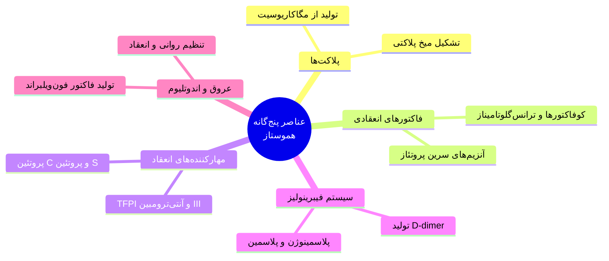
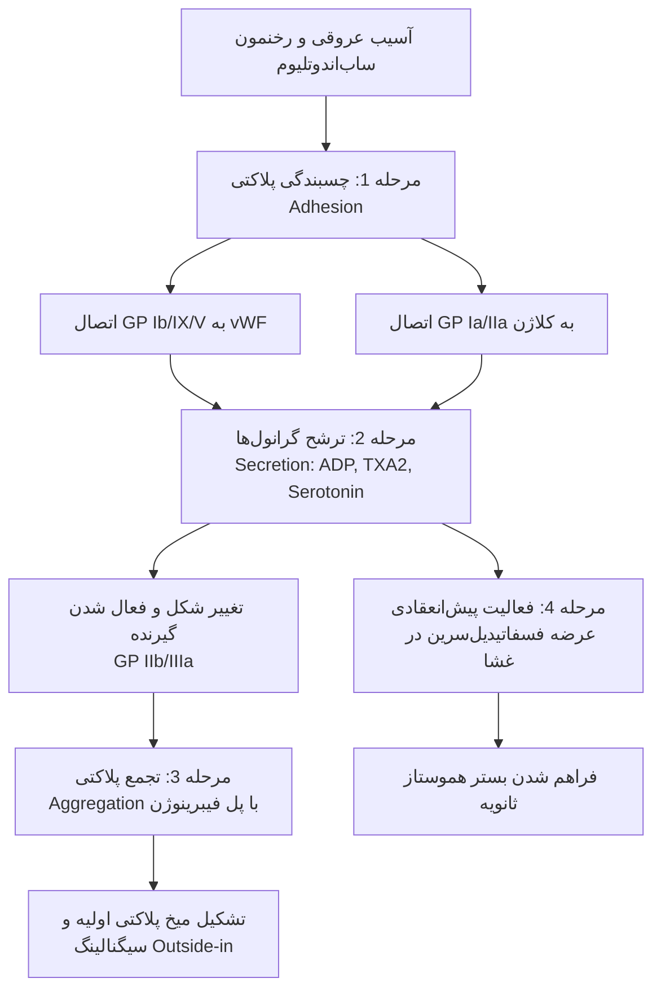
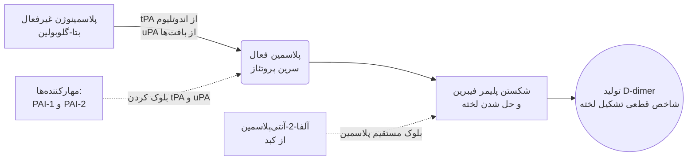

# هموستاز و انعقاد (Hemostasis & Coagulation)

## ۱. کلیات، تعاریف و اهمیت بالینی

> [!info] تعریف هموستاز (Hemostasis)
> در ساده‌ترین بیان، به مجموعه فرآیندهایی که منجر به **بند آمدن خون** در محل آسیب عروقی می‌شوند، هموستاز می‌گویند. اگر بخواهیم دقیق‌تر و بازتر نگاه کنیم، هموستاز مجموعه فرآیندهایی است که جریان خون درون رگ را کنترل می‌کند تا خون:
> 1. در حالت عادی **روان** و در جریان بماند (جلوگیری از بیش از حد روان شدن یا غلیظ شدن).
> 2. در زمان و مکان نیاز (آسیب عروقی)، **به‌جا و به‌موقع لخته شود** (تشکیل لخته یا Clot formation).
> 3. به صورت **نابجا و غیرفیزیولوژیک لخته نشود** (جلوگیری از ترومبوز نابجا).
> بنابراین، در هموستاز هم بُعد *لخته‌پذیری* مهم است و هم بُعد *روانی خون* در جریان.

**اهمیت بالینی و ژنتیکی هموستاز:**
* **اهمیت در تمامی فیلدهای پزشکی:** این مبحث کاملاً پایه و حیاتی است. فرقی نمی‌کند در آینده وارد چه رشته‌ای شوید (زنان، جراحی، داخلی و غیره)؛ قطعاً با بیمارانی مواجه خواهید شد که دچار اختلالات هموستاتیک (خونریزی غیرطبیعی یا ترومبوز) هستند و حتی ممکن است جان بیمار به دلیل همین عارضه به خطر بیفتد. درک مباحث تخصصی بالینی بدون یادگیری این اصول پایه غیرممکن است.
* **اهمیت ژنتیکی و جهش‌های تک‌گیر (پراکنده):** اگرچه بیماری‌های مادرزادی هموستاز و انعقاد جزو بیماری‌های نادر محسوب می‌شوند، اما در کشورهایی مثل ایران به دلیل رواج *ازدواج‌های فامیلی*، شیوع بالاتری دارند. 

> [!important] نکته بسیار مهم امتحانی و بالینی (تله تستی ژنتیک)
> حدود **25% تا 30%** از بیماران مبتلا به اختلالات انعقادی مادرزادی (مثل هموفیلی)، بیماری را به صورت **جهشی (De novo mutation)** پیدا می‌کنند! یعنی بدون هیچ‌گونه سابقه فامیلی قبلی، فرزندی متولد می‌شود که دچار اختلال انعقادی است. بنابراین، برخلاف بیماری‌هایی مثل تالاسمی، بررسی‌ها و غربالگری‌های قبل از ازدواج و بارداری نمی‌توانند 100% جلوی بروز این بیماری‌ها را بگیرند و این خطر ممکن است برای فرزند هر کسی رخ دهد.

### پنج عنصر و فرآیند اصلی در هموستاز نرمال
برای برقراری تعادل ظریف هموستاز (حرکت به‌موقع خون، لخته شدن به‌جا و جلوگیری از لخته نابجا)، **5 عنصر اصلی** در کنار هم فعالیت می‌کنند:
1. **پلاکت‌ها (Platelets):** خط مقدم دفاعی و تشکیل‌دهنده میخ پلاکتی.
2. **فاکتورهای انعقادی (Coagulation factors):** پروتئین‌ها و آنزیم‌های پلاسمایی مسئول تشکیل لخته پایدار فیبرینی.
3. **مهارکننده‌های انعقاد (Coagulation inhibitors):** پروتئین‌ها و عواملی که جلوی لخته‌سازی نابجا و بیش از حد را می‌گیرند.
4. **سیستم فیبرینولیز (Fibrinolysis):** عواملی که لخته تشکیل‌شده را پس از ترمیم، لیز (حل) می‌کنند تا رگ برای همیشه بسته نماند.
5. **عروق خونی و سلول‌های اندوتلیال (Blood vessels & Endothelium):** جنبه اصلی و تنظیم‌کننده که تولیدات آن هم باعث *روانی خون*، هم باعث *انعقاد خون* و هم باعث *جلوگیری از لخته نابجا* می‌شود.



---

## ۲. پلاکت‌ها (Platelets): از تولید تا عملکرد

### الف) تولید و چرخه حیات پلاکت (Platelet Production & Life Cycle)
* **منشأ و سلول مادر:** پلاکت‌ها ذرات سیتوپلاسمی **بدون هسته (Anucleate)** هستند که در مغز استخوان از قطعه قطعه شدن سیتوپلاسم سلول‌های بسیار بزرگی به نام **مگاکاریوسیت (Megakaryocyte)** تولید می‌شوند (درست مثل قیچی کردن یک پارچه).
* **ویژگی‌های مگاکاریوسیت:** مگاکاریوسیت *بزرگ‌ترین سلول مغز استخوان* است؛ به طوری که هنگام بررسی لام مغز استخوان زیر میکروسکوپ، با همان **عدسی شیئی 10** به راحتی قابل شناسایی، شمارش و ارزیابی است و نیازی به عدسی 100 ندارد.
* **پدیده اندومیتوز (Endomitosis):** مگاکاریوسیت دارای تقسیمات ویژه‌ای به نام *اندومیتوز* است؛ یعنی بدون اینکه سیتوپلاسم تقسیم شود، هسته سلول مرتباً تقسیم می‌شود و محتوای DNA هسته می‌تواند از **2n به 64n** برسد.
* **آمار تولید و تنظیم:**
  * زمان لازم از تمایز سلول بنیادی (Stem cell) انسان تا تولید پلاکت به طور متوسط حدود **10 روز** است.
  * هورمون **ترومبوپویتین (Thrombopoietin)** تنظیم‌کننده اصلی تولید پلاکت است که به صورت دائمی (Constitutively) توسط **کبد و کلیه‌ها** ساخته می‌شود.
  * هر یک مگاکاریوسیت در طول عمر خود قادر است حدود **4000 پلاکت** تولید کند.
  * برای حفظ شمارش نرمال پلاکت در خون (حدود 150,000 تا 450,000 در میکرولیتر یا $2 \text{ to } 3 \times 10^8/\text{mL}$)، روزانه باید حدود **$10^{11}$ پلاکت** در مغز استخوان ساخته و آزاد شود (یک کارخانه شبانه‌روزی بسیار فعال!).
* **طول عمر و پاکسازی:** از آنجا که پلاکت‌ها **هسته ندارند**، نمی‌توانند محتویات و آنزیم‌های خود را بازسازی (Renewal / Replace) کنند؛ یعنی با هر آنچه که از ابتدا دارند وارد خون می‌شوند و وقتی تمام شد، کارشان تمام است. طول عمر پلاکت در خون حدود **7 تا 10 روز (متوسط 8 روز)** است. پلاکت‌های پیر (Senescent) روزانه در عبورشون از **سیستم رتیکواندوتلیال (ماکروفاژهای طحال و کبد)** برداشت و تخریب می‌شوند.

### ب) نقش نگهبانی پلاکت و خونریزی خودبه‌خودی (Spontaneous Bleeding)
پلاکت‌ها پس از ورود به جریان خون، در **خارجی‌ترین لایه جریان خون** (در مجاورت مستقیم سلول‌های اندوتلیال دیواره رگ) حرکت می‌کنند و مثل یک نگهبان، تک‌تک سلول‌های اندوتلیال را رصد و بازدید می‌کنند.
* **وظیفه پایه:** در طول روز، سلول‌های اندوتلیال پیر شده و با سلول‌های جدید جایگزین می‌شوند یا دچار تخریب‌های میکروسکوپی می‌شوند. وظیفه پایه پلاکت این است که این خلل و فرج‌های موقتی را سریعاً با تشکیل *میخ پلاکتی (Platelet plug)* بپوشاند تا مانع نشت خون شود.
* **خونریزی خودبه‌خودی (Spontaneous Bleeding):** اگر پلاکت‌ها به دلیل *مشکلات کمّی (کاهش شدید تعداد)* یا *مشکلات کیفی (اختلال عملکرد)* نتوانند این خلل و فرج‌های روزمره را بپوشانند، رگ بدون اینکه هیچ ضربه، برش یا ترومایی به آن وارد شده باشد، شروع به خونریزی می‌کند که به آن **خونریزی خودبه‌خودی** می‌گویند.

> [!warning] نکته طلایی بالینی: شاخص‌ترین محل خونریزی خودبه‌خودی کجاست؟
> شاخص‌ترین و واضح‌ترین مصداق خونریزی خودبه‌خودی در بدن، **خونریزی ته چشم (شبکیه)** است! 
> چرا؟ چون بیمار ممکن است روی دست و پای خود کبودی (اکیموز) ببیند و بگوید «حتماً دستم به میز خورده و یادم نیست»، اما ته چشم جایی نیست که در معرض ترومای عادی روزمره باشد! بنابراین، مشاهده خونریزی در معاینه ته چشم، مصداق بارز *Spontaneous bleeding* (معمولاً به دلیل کمبود شدید پلاکت) است.

### ج) ساختار پلاکت (Platelet Structure)
در زیر میکروسکوپ الکترونی، پلاکت با وجود اندازه بسیار کوچکش، ساختاری فوق‌العاده پیچیده دارد:
1. **غشای پلاکتی (Platelet Membrane):** غشای پلاکت مثل یک بسته دستمال کاغذی، لایه‌لایه است و به داخل سیتوپلاسم فرورفتگی (Invagination) پیدا کرده است (سیستم کانالیکولار باز). اگر غشای یک پلاکتِ چند میکرونی را باز و پهن کنیم، مساحتی معادل **1 متر مربع** را می‌پوشاند! این سطح وسیع برای انجام عملکردهای پلاکت حیاتی است.
2. **گلیکوپروتئین‌های غشایی (Glycoproteins - GP):** مهم‌ترین اجزای غشا برای عملکرد پلاکت هستند که بخشی از آن‌ها داخل سیتوپلاسم و بخشی بیرون غشا قرار دارد. آن‌ها را با اعداد رومی (I, II, III, IV و ...) و زیرواحدهای حروفی (a, b, c) نام‌گذاری می‌کنند. این گلیکوپروتئین‌ها به صورت مجموعه‌های **دوتایی یا سه‌تایی** یک واحد عملکردی را تشکیل می‌دهند (مثلاً کمپلکس GP Ib/IX/V یا GP IIb/IIIa).
3. **گرانول‌های پلاکتی:** پلاکت‌ها منابع غنی از گرانول‌ها هستند که بر اساس نمای میکروسکوپ الکترونی به دو دسته تقسیم می‌شوند:
   * **گرانول‌های متراکم (Dense granules):** حاوی موادی هستند که *محرک پلاکت* بوده و پلاکت‌های غیرفعال را فعال می‌کنند؛ شامل: **کلسیم ($Ca^{2+}$)، ADP، ATP و سروتونین**.
   * **گرانول‌های الفا یا نرم (Alpha / Soft granules):** حاوی پروتئین‌ها و عواملی هستند که در *انعقاد خون، تشکیل کلاژن و ایجاد لخته پایدار* نقش دارند؛ شامل: **فاکتور فون‌ویلبراند (vWF)، فیبرینوژن، فاکتور 4 پلاکتی (PF4)، فاکتور رشد مشتق از پلاکت (PDGF)، فیبرونکتین و ترومبواسپوندین**.

### د) آنتی‌ژن‌های سطح پلاکت و اهمیت بالینی آن‌ها (سوال‌خیز!)
روی سطح پلاکت 3 دسته آنتی‌ژن بسیار مهم وجود دارد که درک آن‌ها برای پاسخ به سوالات امتحانی و مدیریت تزریق خون (Transfusion) ضروری است:

1. **آنتی‌ژن‌های اختصاصی پلاکتی انسان (HPA - Human Platelet Antigen):**
   * شامل سیستم $HPA (a/b)$ است که مشابه سیستم Rh در گلبول قرمز، حدود **80% تا 85%** افراد آن را دارند (مثبت) و **15%** افراد فاقد آن هستند (منفی). این آنتی‌ژن به طور روتین قبل از تزریق خون چک نمی‌شود.
   * **اهمیت بالینی ⇦ پورپورای پس از تزریق خون (PTP - Post-Transfusion Purpura):** اگر به فردی که از نظر این آنتی‌ژن منفی است، فرآورده خونی حاوی پلاکت مثبت تزریق شود (حتی فرآورده‌های دیگر آلوده به پلاکت)، سیستم ایمنی فرد گیرنده علیه آن آنتی‌بادی می‌سازد. نکته عجیب اینجاست که این آنتی‌بادی به گونه‌ای عمل می‌کند که **پلاکت‌های منفی خودِ بیمار را هم تخریب می‌کند!**
   * **تظاهر بالینی PTP:** بیماری که در هفته گذشته سابقه تزریق خون/فرآورده داشته، از **روز 5 به بعد** (هفته بعد) با افت شدید پلاکت، **پتشی و پورپورا** مراجعه می‌کند.

2. **آنتی‌ژن‌های گروه خونی (ABO و Rh):**
   * پلاکت در سطح خود **آنتی‌ژن‌های ABO را دارد**، اما **فاقد آنتی‌ژن Rh است**.
   * **نکته اورژانسی و امتحانی:** چون پلاکت Rh ندارد، تزریق پلاکتِ Rh مثبت به بیمار Rh منفی (یا برعکس) هیچ مشکلی از نظر خود پلاکت ایجاد نمی‌کند. از نظر ABO، ترجیح بر تزریق پلاکت هم‌گروه است؛ اما **در موارد اورژانس** که پلاکت هم‌گروه در دسترس نیست، **تجویز پلاکت غیرهم‌گروه (ABO ناسازگار) هیچ مانعی ندارد** و اتفاق عجیب و غریبی رخ نمی‌دهد.

3. **آنتی‌ژن‌های HLA کلاس I (HLA Class I):**
   * پلاکت‌ها در سطح خود **دارای HLA کلاس I** هستند، اما **فاقد HLA کلاس II** می‌باشند.
   * **اهمیت بالینی ⇦ آلوایمونیزاسیون پلاکتی (Platelet Alloimmunization / Refractoriness):** در بیمارانی که نیازمند تزریق مکرر پلاکت هستند، پس از مدتی سیستم ایمنی علیه آنتی‌ژن‌های HLA کلاس I پلاکت‌های تزریقی آنتی‌بادی می‌سازد. در نتیجه، هرچقدر پلاکت به بیمار تزریق می‌کنیم، بلافاصله تخریب شده و عدد پلاکت بالا نمی‌رود.
   * **درمان و پیشگیری:** اگر سوال شد برای درمان کمبود پلاکت در بیمار دچار آلوایمونیزاسیون چه می‌کنید؟ پاسخ این است که باید از **پلاکت‌های سازگار از نظر HLA کلاس I (HLA-matched platelets)** استفاده کنیم (اقدامی که اخیراً در سازمان انتقال خون نیز برای بیماران وابسته به تزریق مکرر آغاز شده است).

| ویژگی مقایسه‌ای | آنتی‌ژن اختصاصی پلاکت (HPA) | سیستم ABO و Rh در پلاکت | آنتی‌ژن HLA در پلاکت |
| :--- | :--- | :--- | :--- |
| **وضعیت حضور در غشا** | حضور در 80% تا 85% افراد (مشابه توزیع Rh در گلبول قرمز) | دارای آنتی‌ژن‌های ABO اما **فاقد آنتی‌ژن Rh** | دارای **HLA کلاس I** اما فاقد HLA کلاس II |
| **عارضه بالینی مرتبط** | ایجاد پورپورای پس از تزریق خون (**PTP**) حدود 5 تا 7 روز بعد از ترانسفوژن | عدم ایجاد مشکل خاص حتی در صورت ناسازگاری در شرایط اورژانس | ایجاد مقاومت به تزریق پلاکت (**Alloimmunization**) در تزریق‌های مکرر |
| **مکانیسم آسیب یا نکته بالینی** | آنتی‌بادی تولید شده پلاکت‌های خودی (HPA منفی) را نیز تخریب می‌کند | در مواقع اورژانسی تزریق پلاکت غیرهم‌گروه و با هر Rhی کاملاً مجاز است | تخریب سریع پلاکت‌های اهدایی توسط آنتی‌بادی‌های ضد HLA کلاس I |
| **رویکرد درمانی و مدیریتی** | شک بالینی با شرح حال پتشی و پورپورا یک هفته پس از تزریق فرآورده | اولویت با هم‌گروه بودن ABO در شرایط غیراورژانسی | تجویز پلاکت‌های هم‌خوان از نظر HLA کلاس I (**HLA-matched**) |

---

### هـ) عملکرد پلاکت و هموستاز اولیه (Platelet Function & Primary Hemostasis)
هموستاز به دو بخش **هموستاز اولیه** (توسط پلاکت‌ها ⇦ تشکیل میخ پلاکتی سریع اما ناپایدار و ضعیف) و **هموستاز ثانویه** (توسط فاکتورهای انعقادی ⇦ تشکیل لخته فیبرینی، گوشتی و پایدار) تقسیم می‌شود. 
از نظر آکادمیک و آموزشی، عملکرد پلاکت به **4 مرحله** تقسیم می‌شود (هرچند در واقعیت و درون رگ، این مراحل کاملاً همزمان و درهم‌تنیده رخ می‌دهند):

#### 1. چسبندگی پلاکتی (Platelet Adhesion)
وقتی پلاکت در حال گشت‌زنی به ناحیه آسیب‌دیده اندوتلیوم می‌رسد، تغییر شکل داده و پاهای کاذب کشیده‌ای (Pseudopods) ایجاد می‌کند و از طریق گیرنده‌های گلیکوپروتئینی خود (که از قبل فعال و آماده اتصال هستند) به ماتریکس زیر اندوتلیوم (Subendothelial matrix) می‌چسبد تا متوقف شود. این اتصال از دو طریق اصلی صورت می‌گیرد:
* **اتصال کمپلکس GP Ib/IX/V به فاکتور فون‌ویلبراند (vWF):** مهم‌ترین راه چسبندگی است (قبلاً آن را GP Ib می‌نامیدند اما مطالعات جدید نشان داد یک واحد عملکردی سه‌تایی شامل **GP Ib/IX/V** است).
* **اتصال کمپلکس GP Ia/IIa به کلاژن:** این گیرنده مستقیماً به رشته‌های کلاژن در ناحیه ساب‌اندوتلیال می‌چسبد.

> [!info] نکات طلایی فاکتور فون‌ویلبراند (vWF)
> * این پروتئین بسیار درشت به افتخار دانشمند سوئدی کاشف آن نام‌گذاری شده و توسط **سلول‌های اندوتلیال** (و مگاکاریوسیت‌ها) ساخته می‌شود.
> * پس از تولید، بخشی از آن به سمت پایین (ناحیه ساب‌اندوتلیال) و بخشی به داخل جریان خون ترشح می‌شود.
> * فرمی که ابتدا تولید می‌شود بسیار درشت است و به آن **اولترا لارج مالتیمر (Ultra-large vWF multimer)** می‌گویند. فرمی که وارد خون می‌شود توسط آنزیم‌های پلاسمایی شکسته شده و به راحتی به پلاکت نمی‌چسبد؛ اما فرمی که در **ناحیه ساب‌اندوتلیال** قرار دارد، به محض کنار رفتن اندوتلیوم، به راحتی و با قدرت به کمپلکس **GP Ib/IX/V** پلاکت متصل می‌شود.

#### 2. ترشح پلاکتی (Platelet Secretion / Release Reaction)
به دنبال چسبیدن و توقف پلاکت، پیام‌های داخل سلولی رد و بدل شده و پلاکت محتویات گرانول‌های متراکم و آلفای خود را به بیرون می‌ریزد؛ موادی شامل: **ADP، سروتونین، ترومبوکسان $A_2$ ($TXA_2$)، فیبرینوژن، فیبرونکتین، ترومبواسپوندین و فاکتورهای رشد مثل PDGF**. این مواد، پلاکت‌های بیشتری را به محل فراخوانده و فعال می‌کنند.

#### 3. تجمع پلاکتی (Platelet Aggregation)
پیام‌های داخل سلولی و مواد ترشح‌شده باعث می‌شوند یک کمپلکس گلیکوپروتئینی که در حالت عادی در سطح پلاکت **غیرفعال** است، تغییر شکل فضایی داده (باز شده) و **فعال** شود. این گیرنده، **کمپلکس GP IIb/IIIa** نام دارد.
* **نکته امتحانی:** کمپلکس **GP IIb/IIIa شایع‌ترین و فراوان‌ترین گیرنده گلیکوپروتئینی** در سطح پلاکت است!
* **مکانیسم تجمع:** با فعال شدن GP IIb/IIIa، پروتئین **فیبرینوژن** (که به طور عادی در خون گردش می‌کند) و همچنین vWF، مثل یک پل عمل می‌کنند؛ یعنی فیبرینوژن یک سر خود را به GP IIb/IIIa یک پلاکت و سر دیگرش را به GP IIb/IIIa پلاکت مجاور وصل می‌کند. به این ترتیب، پلاکت‌ها به هم چسبیده و **میخ پلاکتی (Platelet plug)** را می‌سازند.
* **سیگنالینگ Outside-in:** بخش سیتوزولی کمپلکس فعال‌شده GP IIb/IIIa به اسکلت سلولی (Cytoskeleton) پلاکت متصل شده و باعث گسترده شدن پلاکت (Spreading) و **انقباض لخته (Clot retraction)** می‌شود که به این فرآیند پیام‌رسانی اینتگرینی از بیرون به درون (*Outside-in signaling*) می‌گویند.

#### 4. فعالیت پیش‌انعقادی پلاکت (Platelet Procoagulant Activity)
میخ پلاکتی ضعیف است و باید با لخته فیبرینی (هموستاز ثانویه) جایگزین شود. تشکیل لخته ثانویه **روی سطح غشای پلاکت** رخ می‌دهد. در مرحله چهارم، غشای پلاکت دچار تغییرات فیزیکوشیمیایی و الکتریکی (مثبت و منفی) می‌شود؛ به این صورت که فسفولیپیدهای پیش‌انعقادی با بار منفی، به‌ویژه **فسفاتیدیل‌سرین (Phosphatidylserine)** از لایه داخلی به سطح خارجی غشای پلاکت می‌آیند (قبلاً به این وضعیت پلاکت در انتهای هموستاز اولیه، *فاکتور 3 پلاکتی یا PF3* هم می‌گفتند). این سطح فسفولیپیدی، بستر لازم برای سوار شدن کمپلکس‌های آنزیمی آبشار انعقاد و تولید انفجاری ترومبین را فراهم می‌کند.



---

## ۳. هموستاز ثانویه و فاکتورهای انعقادی (Coagulation Factors)

هدف نهایی هموستاز ثانویه، تبدیل پروتئین محلول **فیبرینوژن (فاکتور I)** به رشته‌های نامحلول و پایدار **فیبرین** است؛ بنابراین **فیبرین خشت اول و ماده ساختمانی اصلی لخته ثانویه است**.

### الف) دسته‌بندی ساختاری و عملکردی فاکتورهای انعقادی (بسیار مهم و امتحانی!)
فاکتورهای انعقادی در حالت عادی به صورت پیش‌سازهای غیرفعال (Zymogens) در خون گردش می‌کنند. اگر فیبرینوژن (فاکتور I که زیرواحد ساختمانی لخته است) و یون کلسیم (فاکتور IV) را کنار بگذاریم، سایر فاکتورهای انعقادی به دو دسته کلی تقسیم می‌شوند:

1. **کوفاکتورها (Cofactors):**
   * شامل **فاکتور V (Labile factor)**، **فاکتور VIII (Antihemophilic factor)**، **فاکتور بافتی (فاکتور III یا Tissue factor)** و **کینینوژن با وزن مولکولی بالا (HMWK یا فاکتور فیتزجرالد)**.
   * *نکته مهم:* در سوالات امتحانی معمولاً روی **فاکتور V و فاکتور VIII** به عنوان کوفاکتورهای کلاسیک پلاسمایی مانور می‌دهند. کوفاکتورها خودشان آنزیم نیستند و مستقیماً فاکتور بعدی را فعال نمی‌کنند، اما حضورشان برای عملکرد آنزیم‌ها ضروری است.
2. **آنزیم‌ها (Enzymes):**
   * **سرین پروتئازها (Serine Proteases):** **تمام آنزیم‌های آبشار انعقاد به جز فاکتور XIII، سرین پروتئاز هستند!** یعنی در جایگاه فعال خود دارای اسیدآمینه *سرین* بوده و پیوندهای پپتیدی فاکتور بعدی را هیدرولیز می‌کنند. این گروه شامل فاکتورهای **II (پروترومبین)، VII، IX، X، XI، XII و پره‌کالیکرئین (فاکتور فلچر)** می‌باشد.
   * **ترانس‌گلوتامیناز (Transglutaminase):** تنها استثنای آنزیمی، **فاکتور XIII (فاکتور پایدارکننده فیبرین)** است! این فاکتور سرین پروتئاز نیست و آنزیم بعدی را فعال نمی‌کند؛ بلکه یک *ترانس‌گلوتامیناز* است که بین رشته‌های فیبرین تشکیل‌شده **پیوندهای عرضی (Cross-linking)** ایجاد می‌کند تا لخته مستحکم شود.

> [!warning] دو تله تستی و نکته تاریخی در نام‌گذاری فاکتورها
> * **چرا فاکتور VI (شماره 6) نداریم؟** در گذشته پروتئینی را به عنوان فاکتور 6 نام‌گذاری کرده بودند، اما بعدها فهمیدند که در واقع شکل فعال فاکتور 5 است و فاکتور مستقلی نیست! برای اینکه شماره سایر فاکتورها به هم نخورد (7 را نکنند 6 و 8 را نکنند 7)، شماره 6 را برای همیشه حذف کردند.
> * **فاکتور III (فاکتور 3) چیست؟** در سیستم نام‌گذاری به **فاکتور بافتی (Tissue Factor / Thromboplastin)** فاکتور III می‌گویند (البته گاهی در منابع قدیمی به وضعیت فسفولیپیدی غشای پلاکت در انتهای هموستاز اولیه هم فاکتور 3 پلاکتی گفته می‌شد).

### ب) ویژگی تقویت آبشاری (Cascade Amplification)
چرا به سیستم انعقاد «آبشار انعقادی» می‌گویند؟ چون واکنش‌ها یک‌به‌یک نیستند (این‌طور نیست که یک مولکول، فقط یک مولکول بعدی را فعال کند)، بلکه یک سیستم تقویت بیولوژیک (Amplification) عظیم است!
* **مثال آماری خیره‌کننده:** فعال شدن تنها **1 مول از فاکتور XIa** (از طریق فعال‌سازی متوالی فاکتورهای IX، X و پروترومبین) در انتها منجر به **تولید $2 \times 10^8$ مول (200 میلیون مول) فیبرین** می‌شود!

### ج) نیمه‌عمر فاکتورهای انعقادی و اهمیت اقتصادی-بالینی آن
نیمه‌عمر فاکتورهای انعقادی در پلاسما بسیار متفاوت است و این موضوع در بالین (فواصل تزریق فاکتور به بیمار) و اقتصاد درمان اهمیت حیاتی دارد:
* **کوتاه‌ترین نیمه‌عمر ⇦ فاکتور VII (Proconvertin):** در اسلاید 5 ساعت و در بسیاری از منابع **2 تا 5 ساعت** ذکر شده است. اگر بیماری کمبود فاکتور 7 داشته باشد و بخواهیم آن را با فاکتور 7 نوترکمبینانت (Recombinant) جبران کنیم، باید هر 2 تا 5 ساعت به او تزریق کنیم! هزینه این کار برای دو هفته، معادل صادر کردن یک نفتکش نفت است!
* **بلندترین نیمه‌عمر ⇦ فاکتور XIII (Fibrin-stabilizing factor):** نیمه‌عمر آن حدود **2 هفته** است! بنابراین در کمبود فاکتور 13، تنها یک بار تزریق فاکتور می‌تواند بیمار را برای هفته‌ها پوشش دهد.

| شماره فاکتور | نام توصیفی (Descriptive Name) | شکل فعال و نقش بیوشیمیایی | نیمه‌عمر پلاسمایی |
| :--- | :--- | :--- | :--- |
| **فاکتور I** | فیبرینوژن (Fibrinogen) | زیرواحد ساختمانی لخته فیبرین (Fibrin subunit) | 90 ساعت |
| **فاکتور II** | پروترومبین (Prothrombin) | سرین پروتئاز (تولید ترومبین) | 65 ساعت |
| **فاکتور III** | فاکتور بافتی (Tissue factor) | رسپتور / کوفاکتور (عدم گردش در خون عادی) | — |
| **فاکتور V** | فاکتور لابایل (Labile factor) | کوفاکتور (در کمپلکس پروترومبیناز) | 15 ساعت |
| **فاکتور VII** | پروکانورتین (Proconvertin) | سرین پروتئاز (مسیر خارجی) | **5 ساعت (2 تا 5 ساعت)** |
| **فاکتور VIII** | فاکتور آنتی‌هموفیلیک (Antihemophilic) | کوفاکتور (در کمپلکس تناز داخلی) | 10 ساعت |
| **فاکتور IX** | فاکتور کریسمس (Christmas factor) | سرین پروتئاز (مسیر داخلی) | 25 ساعت |
| **فاکتور X** | فاکتور استوارت-پاور (Stuart-Power) | سرین پروتئاز (نقطه کلیدی مسیر مشترک) | 40 ساعت |
| **فاکتور XI** | پیش‌ساز ترومبوپلاستین پلاسما (PTA) | سرین پروتئاز (مسیر داخلی) | 45 ساعت |
| **فاکتور XII** | فاکتور هاگمن یا تماس (Hageman) | سرین پروتئاز (شروع مسیر داخلی در لوله) | 50 ساعت |
| **فاکتور XIII** | فاکتور پایدارکننده فیبرین | **ترانس‌گلوتامیناز** (ایجاد پیوند عرضی) | **حدود 2 هفته** |

> [!note] سایر فاکتورهای مسیر تماسی (خارج از جدول شماره‌گذاری رومی)
> * **پره‌کالیکرئین (Prekallikrein) یا فاکتور فلچر (Fletcher factor):** نقش آنزیمی از نوع **سرین پروتئاز** دارد.
> * **کینینوژن با وزن مولکولی بالا (HMWK) یا فاکتور فیتزجرالد (Fitzgerald factor):** نقش **کوفاکتور** دارد.
> * **فاکتور IV:** همان **یون کلسیم ($Ca^{2+}$)** است که برای سوار شدن فاکتورها روی فسفولیپید غشای پلاکت ضروری است.

---

## ۴. تکامل تئوری‌های انعقاد و مسیرهای آبشار انعقادی

### الف) سیر تاریخی تئوری‌های انعقاد
1. **تئوری افلاطون (تا اوایل قرن 19 و 20):** بر اساس نوشته‌های افلاطون، تصور می‌شد فیبرین ماده‌ای در حال گردش است که به محض خروج خون از بدن و **تغییر دما (سرد شدن)** خودبه‌خود می‌بندد (درست مثل ژله که در یخچال می‌بندد یا سفیده تخم‌مرغ که با تغییر دما سفت می‌شود). در اواسط دهه 1800 میلادی مشخص شد که خون در دمای فیزیولوژیک هم لخته می‌شود و ناشی از اثر ترومبین بر فیبرینوژن است.
2. **تئوری موراویتز (Morawitz - سال 1905):** اولین گام علمی مدرن بود. او بیان کرد که در اثر آسیب بافتی، ماده‌ای به نام **ترومبوپلاستین بافتی (Tissue thromboplastin)** آزاد می‌شود که به کمک **کلسیم**، پروتئین پیش‌ساز *پروترومبین* را به *ترومبین* تبدیل می‌کند و ترومبین نیز *فیبرینوژن* را به *فیبرین* تبدیل می‌نماید. (امروز می‌دانیم ترومبوپلاستین بافتی در واقع ملغمه‌ای از فسفولیپیدهای آنیونی و گلیکوپروتئین غشایی یعنی همان *فاکتور بافتی یا فاکتور III* است که فرمول شیمیایی ثابتی هم ندارد؛ درست مثل سلول بنیادی اولیه خونساز که ماهیت دقیقش کاملاً مشخص نیست و در پیوند مغز استخوان باید $10^{12}$ سلول به ازای هر کیلوگرم وزن گیرنده جدا کنند تا شانس موفقیت به 100% برسد!).
3. **مدل آبشاری کلاسیک (Waterfall / Cascade - سال 1964):** انعقاد را به دو مسیر مجزای **داخلی (Intrinsic)** و **خارجی (Extrinsic)** تقسیم کردند که در نهایت در **فاکتور X** به هم رسیده و **مسیر مشترک (Common pathway)** را می‌سازند. سمبل این مدل قدیمی، حرف **Y انگلیسی** بود.

### ب) مقایسه مسیر خارجی، داخلی و مشترک (مدل Y)
* **مسیر خارجی (Extrinsic Pathway):** چرا به آن خارجی می‌گویند؟ چون برای شروع آن، عاملی که به طور عادی درون جریان خون نیست (**فاکتور بافتی یا Tissue Factor / فاکتور III**) باید از بافت آسیب‌دیده خارجِ رگ وارد خون شود. فاکتور بافتی به سرعت **فاکتور VII** را به **VIIa** تبدیل می‌کند و این کمپلکس (**Extrinsic X-ase**)، فاکتور X را فعال می‌کند.
* **مسیر داخلی (Intrinsic Pathway):** چرا به آن داخلی می‌گویند؟ چون تمام فاکتورهای لازم برای آن از قبل درون خون موجودند! فقط کافی است خون با یک سطح غیرعادی (غیر از اندوتلیوم سالم، مثل کلاژن زیر اندوتلیوم یا شیشه لوله آزمایش) تماس پیدا کند. با تماس با سطح، **HMWK و پره‌کالیکرئین** کمک می‌کنند تا **فاکتور XII** به XIIa تبدیل شود ⇦ سپس **فاکتور XI** فعال می‌شود (XIa) ⇦ سپس **فاکتور IX** فعال می‌شود (IXa). فاکتور IXa به کمک کوفاکتور خود یعنی **فاکتور VIIIa** (کمپلکس **Intrinsic X-ase**)، فاکتور X را فعال می‌کند.
* **مسیر مشترک (Common Pathway):** **فاکتور X نقطه کلیدی و مشترک انعقاد است!** فرقی نمی‌کند فاکتور X از مسیر خارجی فعال شده باشد یا داخلی؛ **فاکتور Xa** به کمک کوفاکتور خود یعنی **فاکتور Va**، یون کلسیم و فسفولیپید پلاکتی (کمپلکس **پروترومبیناز / Prothrombinase**)، **پروترومبین (فاکتور II)** را به **ترومبین (IIa)** تبدیل می‌کند. ترومبین نیز **فیبرینوژن (I)** را به **فیبرین (Ia)** تبدیل کرده و در نهایت **فاکتور XIIIa** پیوندهای عرضی ایجاد می‌کند.

> [!question] سوال کلاسی استاد: اگر چند قطره خون روی زمین، روی لام یا داخل لوله آزمایش ریخته شود، از کدام مسیر لخته می‌شود؟
> **پاسخ: از مسیر داخلی (Intrinsic)!** 
> چون در لوله آزمایش یا روی شیشه لام، آسیب بافتی و آزاد شدن فاکتور بافتی (فاکتور III) نداریم؛ بلکه صرفاً تماس خون با یک سطح غیراندوتلیال رخ داده است که فاکتور XII و مسیر داخلی را فعال می‌کند.

### ج) کانسپت جدید انعقاد در دنیای واقعی (In Vivo): تغییر سمبل از Y به T!
مشاهدات بالینی نشان داد که مدل Y در بدن انسان (Real world / In vivo) دقیق نیست و تعامل تنگاتنگی (Crossover) بین دو مسیر وجود دارد:
1. **شروع‌کننده (Initiator) ⇦ مسیر خارجی:** در بدن، به دنبال آسیب عروقی، **مسیر خارجی** به دلیل آزاد شدن فاکتور بافتی، **فوق‌العاده سریع و پرقدرت** انعقاد را شروع می‌کند. این مسیر آن‌قدر قوی است که اگر مهار نشود، **در عرض 15 تا 20 ثانیه تمام فاکتورهای انعقادی بدن را مصرف می‌کند!** بنابراین بلافاصله توسط پروتئین مهارکننده خود (TFPI) خاموش می‌شود.
2. **ادامه‌دهنده (Propagator) ⇦ مسیر داخلی:** قبل از اینکه مسیر خارجی خاموش شود، کمپلکس **فاکتور بافتی-فاکتور VIIa** یک میان‌بر می‌زند! یعنی علاوه بر فاکتور X، مستقیماً **فاکتور IX** در مسیر داخلی را هم فعال می‌کند! به این ترتیب، مراحل اولیه مسیر داخلی (فاکتورهای XII و XI) دور زده می‌شوند (Bypass) و ادامه کار لخته‌سازی به عهده مسیر داخلی (فاکتور IXa و VIIIa) گذاشته می‌شود.
* **نتیجه‌گیری امتحانی:** در دنیای واقعی درون بدن، مسیر خارجی *شروع‌کننده* و مسیر داخلی *ادامه‌دهنده* انعقاد است؛ بنابراین سمبل هموستاز ثانویه به جای حرف Y، به **حرف T انگلیسی** تغییر یافته است!

```mermaid
flowchart TD
    subgraph مسیر خارجی - شروع‌کننده سریع
    TF[آسیب بافتی: Tissue Factor] --> F7[فعال شدن فاکتور VII به VIIa]
    end
    
    subgraph مسیر داخلی - ادامه‌دهنده
    F12[تماس با سطح: فاکتور XII و HMWK و PK] --> F11[فعال شدن فاکتور XI به XIa]
    F11 --> F9[فعال شدن فاکتور IX به IXa]
    F8[کوفاکتور VIIIa] --- F9
    end

    F7 -->|میانبر حیاتی در بدن<br>Crossover| F9
    F7 -->|Extrinsic X-ase| FX[نقطه کلیدی: فعال شدن فاکتور X به Xa]
    F9 -->|Intrinsic X-ase| FX

    subgraph مسیر مشترک
    FX --> Pro[کمپلکس پروترومبیناز:<br>فاکتور Xa + کوفاکتور Va + Ca]
    Pro --> F2[تبدیل پروترومبین II به ترومبین IIa]
    F2 --> F1[تبدیل فیبرینوژن I به مونومر فیبرین]
    F1 --> F13[فاکتور XIIIa: ایجاد پیوند عرضی<br>و لخته فیبرینی پایدار]
    end
```

---

## ۵. مهارکننده‌های انعقاد (Coagulation Inhibitors)

برای اینکه لخته شدن خون از کنترل خارج نشود و در عروق سالم ترومبوز رخ ندهد، بدن دارای ایستگاه‌های بازرسی (Checkpoints) و مهارکننده‌های قدرتمندی است (علاوه بر خودِ *جریان خون / Blood flow* که فاکتورهای فعال را رقیق و پاکسازی می‌کند):

### 1. مهارکننده مسیر فاکتور بافتی (TFPI - Tissue Factor Pathway Inhibitor)
* همان‌طور که گفتیم، مسیر خارجی آن‌قدر سریع و قوی است که اگر رها شود در **15 تا 20 ثانیه** کل فاکتورهای انعقادی بدن را مصرف می‌کند. پروتئین **TFPI** سریعاً وارد عمل شده و مسیر خارجی (فاکتور VIIa و Xa) را مهار و متوقف می‌کند تا ادامه کار به شکل کنترل‌شده از مسیر داخلی پیش برود.

### 2. سیستم پروتئین C و پروتئین S (به همراه ترومبومودولین)
* **هدف:** این سیستم، **کوفاکتورهای انعقادی یعنی فاکتور V و فاکتور VIII** را می‌شکند (Split) و از کار می‌اندازد و بدین ترتیب، هم مسیر داخلی و هم مسیر مشترک را مهار می‌کند (که در آن، **پروتئین C آنزیم** و **پروتئین S کوفاکتور** آن است).
* **مکانیسم شگفت‌انگیز ترومبومودولین (Thrombomodulin):** 
  * می‌دانیم که **ترومبین (فاکتور IIa)** در انعقاد مثل یک *جرقه انفجاری* عمل می‌کند؛ یعنی به محض تولید ترومبین، کل سیستم لخته‌سازی با قدرت چند برابر منفجر و فعال می‌شود.
  * حالا وقتی همین ترومبین در جریان خون حرکت می‌کند و به اندوتلیوم سالم می‌رسد، به پروتئینی روی سطح سلول‌های اندوتلیال به نام **ترومبومودولین** متصل می‌شود.
  * **چرخش 180 درجه‌ای:** ترومبومودولین ماهیت عملکردی ترومبین را **180 درجه می‌چرخاند**! یعنی ترومبین که قوی‌ترین عامل لخته‌ساز بود، به محض اتصال به ترومبومودولین تبدیل به یک **عامل ضدلخته** می‌شود؛ به این صورت که **پروتئین C** را فعال می‌کند و پروتئین C فعال به کمک کوفاکتورش (**پروتئین S**)، فاکتورهای **V و VIII** را تخریب می‌کند!

### 3. آنتی‌ترومبین III (Antithrombin III) و فارماکولوژی هپارین‌ها
* **تله تاریخی نام‌گذاری (Misnomer):** قبلاً تصور می‌کردند چند نوع آنتی‌ترومبین (1 و 2 و 3) در خون وجود دارد و شماره 3 مانع انعقاد است؛ بعدها مشخص شد 1 و 2 اشتباه آزمایشگاهی بوده‌اند و اصلاً یک نوع آنتی‌ترومبین بیشتر نداریم، اما نام **آنتی‌ترومبین III** روی آن باقی ماند!
* **مکانیسم عمل:** آنتی‌ترومبین III به طور اصلی در مسیر مشترک، **فاکتور X فعال (Xa) و فاکتور II فعال (ترومبین / IIa)** را مهار و غیرفعال می‌کند.
* **رابطه حیاتی با هپارین:** فعالیت آنتی‌ترومبین به شدت وابسته به **هپارین** است. در حضور هپارین، قدرت آنتی‌ترومبین **1000 برابر** می‌شود (و برعکس: اگر بیماری کمبود آنتی‌ترومبین داشته باشد، اثربخشی داروی هپارین به **یک‌هزارم** کاهش می‌یابد و عملاً بی‌اثر می‌شود!).

> [!important] مقایسه امتحانی هپارین معمولی (UFH) و هپارین با وزن مولکولی پایین (LMWH)
> * **هپارین معمولی (Unfractionated Heparin):** یک مولکول درشت و بلند است؛ بنابراین وقتی به آنتی‌ترومبین متصل می‌شود، قادر است مثل یک پوشش بزرگ، **هم فاکتور Xa و هم ترومبین (فاکتور IIa)** را در بر بگیرد و هر دو را مهار کند.
> * **هپارین با وزن مولکولی پایین (LMWH):** مولکول کوچک‌تری است که بخشی از زنجیره آن حذف شده است؛ به همین دلیل زنجیره آن به اندازه کافی بلند نیست که ترومبین (فاکتور IIa) را بپوشاند و **فقط فاکتور Xa را مهار می‌کند**. در نتیجه، LMWH یک داروی ضد انعقاد ملایم‌تر و خفیف‌تر نسبت به هپارین معمولی محسوب می‌شود.

---

## ۶. سیستم فیبرینولیز و حذف لخته (Clot Elimination & Fibrinolysis)

پس از اینکه لخته کارش را انجام داد و زخم ترمیم شد (یا حتی اگر لخته به صورت نابجا تشکیل شد)، رگ نباید برای همیشه بسته بماند؛ بلکه لخته باید توسط آنزیم پروتئولیتیک **پلاسمین (Plasmin)** حل و پاکسازی شود تا جریان خون برقرار گردد.

### الف) مسیر فعال‌سازی فیبرینولیز
* **پلاسمینوژن (Plasminogen):** یک پروآنزیم از دسته **بتا-گلوبولین‌ها ($\beta$-globulin)** در خون و مایعات بافتی است که توسط اندوتلیوم و کبد ساخته می‌شود. پلاسمینوژن غیرفعال است و باید به آنزیم سرین پروتئاز فعال یعنی **پلاسمین** تبدیل شود.
* **فعال‌کننده‌های پلاسمینوژن (Plasminogen Activators):** دو سرین پروتئاز اصلی این کار را انجام می‌دهند:
  1. **فعال‌کننده پلاسمینوژن نوع بافتی (tPA - Tissue-type plasminogen activator):** از **سلول‌های اندوتلیال** دیواره رگ آزاد می‌شود (مسیر داخلی فیبرینولیز). *نکته مهم:* عملکرد tPA به شدت **وابسته به فیبرین** است؛ یعنی به رشته‌های فیبرین در لخته می‌چسبد و پلاسمینوژن را دقیقاً در همان موضعِ لخته به پلاسمین تبدیل می‌کند.
  2. **فعال‌کننده پلاسمینوژن نوع اوروکیناز (uPA - Urokinase-type plasminogen activator):** از **بافت‌های اطراف** محل انعقاد آزاد می‌شود (مسیر خارجی فیبرینولیز).
* **عملکرد پلاسمین:** پلاسمین تشکیل‌شده، هم **فیبرین** (لخته) و هم **فیبرینوژن** را می‌شکند و محصولات تخریب فیبرین (Fibrin split products / FDP) را تولید می‌کند.

### ب) اهمیت بالینی D-dimer (مهندسی معکوس در تشخیص ترومبوز!)
یکی از محصولات خاص حاصل از شکسته شدن لخته توسط پلاسمین، پروتئینی به نام **دی‌-دایمر (D-dimer)** است که در تشخیص آمبولی ریه (PTE) و ترومبوز ورید عمقی (DVT) کاربرد حیاتی دارد.

> [!tip] چرا D-dimer این‌قدر در بالین حساس و ارزشمند است؟
> پلاسمین می‌تواند فیبرینوژن آزاد یا مونومرهای فیبرین را هم بشکند؛ اما **تنها زمانی در بدن D-dimer تولید می‌شود که فیبرینوژن به فیبرین تبدیل شده باشد، فیبرین‌ها پلیمر شده و با فاکتور XIIIa به هم متصل شده باشند (یعنی لخته واقعی تشکیل شده باشد) و حالا پلاسمین بیاید این فیبرینِ پلیمریزه را بشکند!**
> بنابراین، بالا رفتن D-dimer در خون مثل **دیدن دود** است که با استدلال و مهندسی معکوس به ما اثبات می‌کند در جایی از بدن یک **آتش‌سوزی (تشکیل لخته فیبرینی)** رخ داده است!

### ج) مهارکننده‌های فیبرینولیز (کنترل ترازوی لیز لخته)
اگر لخته خیلی سریع لیز شود و دوام نداشته باشد، بیمار دچار خونریزی می‌شود (برخی بیماران مستعد خونریزی، مشکلشان در تشکیل لخته نیست، بلکه لخته‌شان به دلیل بیش‌فعالی فیبرینولیز سریع حل می‌شود!). برای جلوگیری از این اتفاق، دو مهارکننده اصلی وجود دارد:
1. **مهارکننده‌های فعال‌کننده پلاسمینوژن (PAI-1 و PAI-2):** به‌ویژه **PAI-1** که از سلول‌های اندوتلیال عروق ترشح شده و مستقیماً عملکرد **tPA و uPA** را بلوک می‌کند.
2. **آلفا-2-آنتی‌پلاسمین ($\alpha_2$-antiplasmin):** از **کبد** تولید شده و مستقیماً پلاسمینِ تشکیل‌شده را مهار می‌کند تا نتواند فیبرین و فیبرینوژن را بشکند.

* **کفه ترازو:** ماندن یا رفتن لخته به تعادل بین کفه فعال‌کننده‌ها (tPA, uPA) و کفه مهارکننده‌ها (PAI-1, $\alpha_2$-antiplasmin) بستگی دارد. به هم خوردن این تعادل در بالین یا به *خونریزی غیرطبیعی* ختم می‌شود و یا به *ترومبوز*.



---

## ۷. رویکرد بالینی و تست‌های آزمایشگاهی هموستاز

> [!danger] قانون طلایی و وصیت استاد برای تمام عمر طبابت!
> **«تست‌های آزمایشگاهی را همیشه، همیشه و همیشه بر بالین بیمار تفسیر کنید!»**
> آزمایش در خدمت طبیب است، نه اینکه طبیب اسیر دست آزمایش شود! شرح حال، معاینه فیزیکی و تست‌های غربالگری سه ضلع مکمل هم هستند و هر کدام به تنهایی گمراه‌کننده‌اند.
> * **مثال ۱ (نوار قلب):** اگر نوار قلبی با ST-Elevation و T-tall به شما بدهند، اولین و مهم‌ترین سوال قبل از هر چیز چیست؟ **سن بیمار!** اگر پیرمرد 70 ساله باشد اورژانس قلبی است، اما در یک کودک 2 ساله می‌تواند کاملاً طبیعی باشد!
> * **مثال ۲ (الکتروفورز هموگلوبین):** در فرد عادی بیش از 90% هموگلوبین از نوع $HbA_1$ است و مجموع $HbA_2$ و $HbF$ حدود 5% تا 6% است. اگر در یک جوان 20 یا 30 ساله، الکتروفورز برعکس باشد (90% از نوع $HbF$ و 3% تا 5% از نوع $HbA_1$)، مهم‌ترین سوالی که باید بپرسید چیست؟ **عددِ خودِ هموگلوبین (Hb) چند است؟**
>   * اگر Hb حدود 5 تا 6 باشد ⇦ **تالاسمی ماژور** است.
>   * اگر Hb حدود 8 تا 9 باشد ⇦ **تالاسمی اینترمدیا** است.
>   * اگر Hb نرمال (مثلاً 15) باشد ⇦ یک وضعیت خوش‌خیم به نام **HPFH (بقای ارثی هموگلوبین جنینی)** است! (چون خودِ HbF که بد نیست؛ مشکل در تالاسمی ماژور این است که کلیت هموگلوبین ساخته نمی‌شود، وگرنه امروزه در ژن‌درمانی تالاسمی تلاش می‌کنند تولید HbF را بالا ببرند!).

### الف) تست‌های ارزیابی هموستاز اولیه (پلاکتی)

#### 1. شمارش پلاکت (Platelet Count)
* **محدوده نرمال:** در منابع غربی **150,000 تا 450,000 در میکرولیتر** ذکر می‌شود؛ اما طبق رفرنس (Blood, Handin 2003) در جمعیت‌های شرقی و مدیترانه‌ای، حداقلِ نرمال می‌تواند پایین‌تر باشد و عدد **125,000 تا 300,000** نیز کاملاً قابل قبول و نرمال تلقی می‌شود.
* **روش شمارش چشمی (لام خون محیطی):** لام خون محیطی را زیر میکروسکوپ با **عدسی شیئی 100** نگاه می‌کنند؛ تعداد پلاکت‌های دیده‌شده در میدان دید را شمرده و **ضربدر 15,000** می‌کنند تا تعداد پلاکت در هر میکرولیتر به دست آید (مثلاً اگر 8 پلاکت در فیلد دیده شود: $8 \times 15,000 = 120,000/\mu L$).
* **روش شمارش دستگاهی و تله‌های تشخیصی آن (Pitfalls):**
  دستگاه شمارشگر (Cell counter) هوشمند نیست و فقط **بر اساس اندازه (سایز) ذره‌ای** که از جلوی چشم الکترونی رد می‌شود، پلاکت را می‌شمارد! این موضوع دو خطای بزرگ در بالین ایجاد می‌کند:
  1. **عدد پلاکت کاذب بالا/نرمال:** بیمار علائم خونریزی پلاکتی دارد اما دستگاه پلاکت را نرمال گزارش می‌کند! چرا؟ چون ممکن است گلبول‌های قرمز یا سفید تکه تکه شده (شیستوسیت‌ها یا فرگمنت‌های سلولی) یا آرتیفکت‌ها به اندازه پلاکت درآمده باشند و دستگاه آن‌ها را به جای پلاکت شمرده باشد!
  2. **عدد پلاکت کاذب پایین (Pseudothrombocytopenia):** بیمار هیچ علامت خونریزی ندارد اما دستگاه پلاکت را بسیار پایین گزارش می‌کند! چرا؟ چون پلاکت‌ها در لوله آزمایش به هم چسبیده‌اند (**تجمع پلاکتی / Aggregation**، مثلاً4 یا 5 پلاکت به هم چسبیده‌اند) و وقتی این توده از جلوی چشم الکترونی رد می‌شود، دستگاه به دلیل سایز بزرگ‌تر، آن را **یک گلبول سفید (WBC)** می‌خواند!
  * **راهکار طلایی:** هرگاه عدد پلاکت دستگاه با حال بالینی بیمار نخواند، قبل از هر اقدامی **حتماً لام خون محیطی را با چشم ببینید!**

#### 2. زمان سیلان (Bleeding Time - BT)
* بهترین تست غربالگری *In vivo* برای سنجش **عملکرد (Function) پلاکت** در هموستاز اولیه است (ممکن است تعداد پلاکت نرمال باشد اما عملکردش مختل باشد).
* **روش استاندارد آیوی (Ivy Method):** (دقت کنید Ivy نام یک شخص است و ربطی به تزریق داخل وریدی یا IV ندارد!).
  1. کاف فشارسنج را روی بازوی بیمار بسته و روی فشار **40 میلی‌متر جیوه** باد و ثابت می‌کنند.
  2. با یک لانست در سطح ولار (داخلی) ساعد، **3 پانکچر (خراش استاندارد)** ایجاد می‌کنند.
  3. **هر 30 ثانیه**، یک کاغذ صافی خشک را به آرامی به قطره خونِ پانکچر اول نزدیک می‌کنند (بدون فشار دادن زخم) تا جایی که دیگر لکه خونی روی کاغذ نیفتد؛ این زمان را ثبت می‌کنند.
  4. **چرا 3 پانکچر می‌زنند؟** چون خودِ تماس مکرر کاغذ خشک با زخم، سیستم انعقاد را به صورت مصنوعی تحریک می‌کند! بنابراین پس از بند آمدن پانکچر اول، سراغ پانکچر دوم و سوم می‌روند تا ببینند آیا آن‌ها هم بند آمده‌اند یا نه. در نهایت **میانگین زمان این 3 نقطه** به عنوان زمان سیلان (BT) واقعی فرد ثبت می‌شود.

---

### ب) تست‌های ارزیابی هموستاز ثانویه (PT و aPTT)

در هر دو تست، ابتدا خون بیمار را گرفته و به آن **سیترات (Citrate)** اضافه می‌کنند. سیترات، **کلسیم (فاکتور IV)** را مهار (کلاته) می‌کند تا خون در مسیر انتقال به آزمایشگاه در اثر تماس با لوله از مسیر داخلی لخته نشود. در آزمایشگاه، مجدداً به پلاسما کلسیم اضافه کرده و زمان تشکیل لخته را با کرنومتر می‌سنجند.

#### 1. زمان پروترومبین (Prothrombin Time - PT) و INR
* **مسیر مورد ارزیابی:** مسیر **خارجی و مشترک** (فاکتورهای **VII, X, V, II, I**).
* **روش انجام و زمان نرمال:** در آزمایشگاه علاوه بر کلسیم، ماده‌ای به نام **ترومبوپلاستین بافتی (فاکتور بافتی / ملغمه‌ای از چربی و پروتئین)** به لوله اضافه می‌کنند. ترومبوپلاستین مثل یک کاتالیزور ضروری، به سرعت **فاکتور VII** را فعال می‌کند (قبل از اینکه مسیر داخلی فرصت فعال شدن پیدا کند). زمان نرمال آن **10 تا 12 ثانیه** است.
* **چرا اسمش را گذاشتند Prothrombin Time؟ (یک Misnomer تاریخی دیگر!):** این تست که در واقع فاکتور 7 و مسیر خارجی را می‌سنجد، پس چرا اسمش زمان پروترومبین است؟ به خاطر **تئوری موراویتز (1905)**! در آن زمان که فاکتورهای 7 و 10 و 5 کشف نشده بودند، فکر می‌کردند ترومبوپلاستین مستقیماً پروترومبین را به ترومبین تبدیل می‌کند؛ لذا اسم تست را گذاشتند PT و این نام تاریخی باقی ماند!
* **چرا از INR (International Normalized Ratio) استفاده می‌کنیم؟**
  ترومبوپلاستین‌هایی که شرکت‌های مختلف می‌سازند (مثلاً تهیه‌شده از مغز انسان در برابر مغز خرگوش)، حساسیت‌های بسیار متفاوتی دارند (ترومبوپلاستین مغز انسان نسبت به کاهش فاکتورها حساس‌تر از مغز خرگوش است). در نتیجه، خون یک بیمارِ واحد در یک آزمایشگاه PT = 14 و در آزمایشگاه دیگر PT = 18 می‌دهد! برای یکسان‌سازی گزارش‌ها در سراسر دنیا (به‌ویژه در بیماران مصرف‌کننده ضد انعقادهای خوراکی مثل وارفارین)، فرمول **INR** ابداع شد:
  $$INR = \left( \frac{PT_{\text{patient}}}{PT_{\text{normal}}} \right)^{ISI}$$
  که در آن، نسبت PT بیمار به PT نرمال (یا تفاضل و نسبت استاندارد آن طبق کیت) را به توان ضریب حساسیت کارخانه سازنده (ISI) می‌رسانند. عدد نرمال INR در افراد عادی بین **1 تا 2 (حدود 1)** است و دیگر به برند کیت آزمایشگاه وابسته نیست.

#### 2. زمان ترومبوپلاستین نسبی فعال‌شده (aPTT - Activated Partial Thromboplastin Time)
* **مسیر مورد ارزیابی:** مسیر **داخلی و مشترک** (تمام فاکتورهای انعقادی **به جز فاکتور VII**؛ به‌ویژه فاکتورهای **XII, XI, IX, VIII**).
* **روش انجام و زمان نرمال:** در این تست می‌خواهیم مسیر داخلی را بسنجیم. اگر پلاسمای سیتراته را فقط با کلسیم در لوله شیشه‌ای بریزیم، خودش از مسیر داخلی لخته می‌شود اما چندین دقیقه طول می‌کشد! بنابراین در آزمایشگاه یک **ماده محرک سطح و تسریع‌کننده (Activator)** به همراه فسفولیپید به لوله اضافه می‌کنند تا زمان تست از چند دقیقه به حدود **30 تا 40 ثانیه (در اسلاید حدود 34 ثانیه)** کاهش یابد. (توجه کنید که در aPTT، ماده اضافه‌شده فقط *تسریع‌کننده* است، نه *ایجادکننده*؛ برخلاف PT که ترومبوپلاستین *ایجادکننده* مسیر خارجی بود).
* **داستان جذاب نام‌گذاری PTT (چرا Partial Thromboplastin؟):**
  در گذشته برای انجام تست PT از عصاره مغز حیوانات (روباه، گاو، اسب، خرگوش) به عنوان ترومبوپلاستین کامل استفاده می‌کردند که بسیار گران بود. عده‌ای پیشنهاد دادند از ملغمه‌های ارزان‌تر چربی (فاقد بخش پروتئینی فاکتور بافتی) استفاده کنند. وقتی آن را به لوله اضافه کردند، دیدند خون لخته می‌شود اما خیلی طولانی‌تر! بنابراین به جای ترومبوپلاستین کامل، نام این معرف ضعیف و ناقص را گذاشتند **ترومبوپلاستین نسبی یا ناقص (Partial Thromboplastin)**!
  این تستِ به ظاهر ناموفق داشت به کلی کنار گذاشته می‌شد تا اینکه یک کشف بزرگ رخ داد: دیدند بیمارانی که **هموفیلی (کمبود فاکتور VIII یا IX)** دارند، تست PT کاملاً نرمالی دارند و با PT شناسایی نمی‌شوند، اما این تست جدید (PTT) در آن‌ها طولانی می‌شود! چرا؟ چون فاکتور 8 و 9 در مسیر داخلی هستند و این معرفِ ناقص چون فاکتور بافتی نداشت، ناخودآگاه فقط مسیر داخلی را می‌سنجید! به این ترتیب، تست PTT ماندگار شد و کمک بزرگی به علم انعقاد کرد. (واکنش‌گرهای aPTT نیز در پاسخ به هپارین بین کارخانه‌های مختلف تفاوت دارند و هر آزمایشگاه باید رنج استاندارد و مطالعات مخلوط کردن یا Mixing studies خود را تعیین کند).

| ویژگی مقایسه‌ای | تست زمان پروترومبین (PT / INR) | تست زمان ترومبوپلاستین نسبی (aPTT) |
| :--- | :--- | :--- |
| **مسیر انعقادی مورد سنجش** | مسیر **خارجی و مشترک** | مسیر **داخلی و مشترک** |
| **فاکتورهای انعقادی وابسته** | فاکتورهای **VII**، X، V، II و فیبرینوژن (I) | تمامی فاکتورها **به جز فاکتور VII** (به‌ویژه VIII, IX, XI, XII) |
| **معرف اضافه‌شده در آزمایشگاه** | کلسیم + **ترومبوپلاستین کامل (فاکتور بافتی)** به عنوان ایجادکننده مسیر | کلسیم + فسفولیپید (ترومبوپلاستین ناقص) + **محرک سطح (تسریع‌کننده)** |
| **زمان نرمال تشکیل لخته** | حدود **10 تا 12 ثانیه** (INR نرمال حدود 1 تا 2) | حدود **30 تا 40 ثانیه** (متوسط 34 ثانیه) |
| **ریشه تاریخی نام‌گذاری (Misnomer)** | برگرفته از تئوری قدیمی موراویتز (تصور اثر مستقیم بر پروترومبین) | استفاده از عصاره‌های چربی ارزان‌تر و ناقص بدون بخش پروتئینی فاکتور بافتی |

---

### ج) مهم‌ترین تله بالینی در تفسیر PT و aPTT (حساسیت پایین در In Vitro!)

> [!danger] تله مرگبار بالینی: چرا بیمار جلوی چشم ما خونریزی می‌کند اما PT و aPTT کاملاً نرمال است؟
> همیشه به یاد داشته باشید که انعقاد درون بدن (**In vivo**) با انعقاد درون لوله آزمایش (**In vitro**) تفاوت دارد!
> * **آستانه مختل شدن تست در لوله آزمایش:** تست‌های PT و aPTT در لوله آزمایش تنها زمانی مختل و طولانی می‌شوند که سطح فاکتورهای انعقادی به **کمتر از 30%** (و برای فاکتور VII در تست PT به **کمتر از 50%**) برسد!
> * **معنای بالینی:** یعنی اگر **50% تا 70%** از فاکتورهای انعقادی یک بیمار از بین برود و سطح فاکتورش به 35% یا 40% برسد، وقتی خونش را به آزمایشگاه می‌فرستید، **PT و aPTT کاملاً نرمال گزارش می‌شود!**
> * **فاجعه در بالین:** بدن انسان در شرایط استرس، جراحی یا زایمان با 30% فاکتور کار نمی‌کند، بلکه به **50% تا 70% و حتی 100%** فاکتور نیاز دارد! مثال بارز آن در اورژانس زنان است: خانمی پس از زایمان دچار خونریزی شدید پس از زایمان (Postpartum hemorrhage) شده، از محل رگ‌گیری و پانکچرش خون نشت می‌کند (Oozing) و بدنش کبود است، اما آزمایشگاه PT و PTT را نرمال گزارش می‌کند! اگر پزشک اسیر برگه آزمایش شود و به بالین توجه نکند، بیمار را از دست خواهد داد. پس بدانید که این تست‌ها خوب هستند، اما **حساسیت بالایی ندارند** و در کاهش‌های خفیف تا متوسط فاکتورها، نرمال باقی می‌مانند!