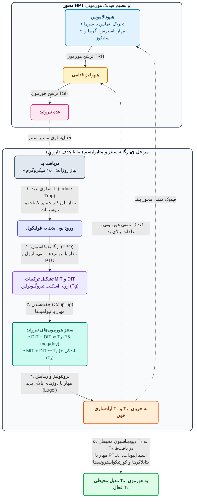
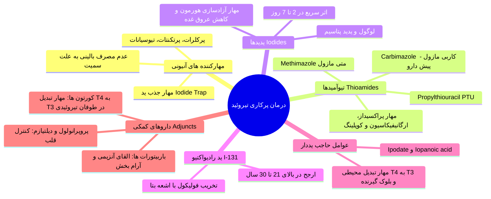

# 1. فیزیولوژی، بیوسنتز، فارماکوکینتیک و مکانیسم اثر هورمون‌های تیروئید

> [!info] آناتومی، ماهیت شیمیایی و محور تنظیمی (HPT Axis)
> * **جایگاه آناتومیک:** غده تیروئید روی تراشه (نای) و پایین‌تر از حنجره (*Inferior to larynx*) قرار دارد؛ به دلیل موقعیت سطحی و واضح در ایجاد **گواتر**، از اولین غدد شناخته‌شده بدن است.
> * **ساختار شیمیایی (ترکیب بخش آلی و معدنی):** شامل بخش آلی (**اسیدآمینه تیروزین**) و بخش معدنی (**اتم‌های ید**).
>   1. **تیروکسین (T4):** دارای 4 اتم ید؛ **هورمون اصلی و غالب ترشح‌شده** از تیروئید (نسبت ترشح T4 به T3 حدود **5 به 1** است).
>   2. **تری‌یدوتیرونین (T3):** دارای 3 اتم ید؛ **3 تا 4 برابر فعال‌تر و قوی‌تر** از T4 (تمایل اتصال T4 به گیرنده حدود **10 برابر کمتر** از T3 است). عمده T3 بدن نه از ترشح مستقیم تیروئید، بلکه از **دیودیناسیون محیطی T4 به T3** در بافت‌ها حاصل می‌شود.
>   3. **ریورس T3 (rT3):** دارای 3 اتم ید با چیدمان فضایی متفاوت؛ از نظر بیولوژیک **کاملاً غیرفعال** (اثبات اهمیت چیدمان فضایی اتم‌های ید).

* **فارماکوکینتیک هورمون‌های تیروئید (بسیار مهم و امتحانی):**
  * **جذب خوراکی:** محل اصلی جذب T4 در **دئودنوم و ایلئوم** است. فراهمی زیستی خوراکی T4 حدود **80%** و T3 حدود **95%** است.
  * **عوامل داخل لومن روده (کاهنده جذب T4):** مصرف همزمان **آنتی‌اسیدهای حاوی آلومینیوم (آلومینیوم ام‌جی)**، **املاح آهن (فروس سولفات)**، رزین **کلستیرامین** و تغییرات **فلور میکروبی روده** جذب لووتیروکسین را مختل می‌کنند.
  * **اتصال به پروتئین پلاسما (TBG / Thyroxine-Binding Globulin):** هر دو هورمون (به‌ویژه T4) اتصال بالایی به TBG (و آلبومین) دارند.
  * **نیمه‌عمر:** T4 دارای نیمه‌عمر طولانی (حدود **1 هفته** تا 1 ماه در بافت) و T3 دارای نیمه‌عمر کوتاه (**24 ساعت** تا 1 هفته) است.

> [!important] تله تستی و آزمایشگاهی: تغییر سطح TBG در بارداری و مصرف استروژن‌ها (OCP)
> در دوران **بارداری**، **استروژن‌درمانی**، مصرف **قرص‌های ضدبارداری (OCP)** و مصرف **گلوکوکورتیکوئیدها/هورمون‌های جنسی**، جایگاه‌های اتصال روی **TBG افزایش** می‌یابد:
> * در نتیجه، غلظت **توتال و متصل (Total & Bound) هورمون تیروئید بالا می‌رود** (پزشک نباید با دیدن T4 توتال بالا در خانم باردار به اشتباه تشخیص هایپرتیروئیدی بدهد!).
> * غلظت **هورمون آزاد (Free TH)** و دفع در حالت پایدار (Steady state) **نرمال باقی می‌ماند**؛ با این حال در بیماران کم‌کار تحت درمان با لووتیروکسین، در دوران بارداری ممکن است **نیاز به افزایش دوز T4** وجود داشته باشد.

* **مکانیسم اثر سلولی و اهداف بافتی:**
  * هورمون‌های تیروئید **محلول در چربی (Lipid soluble)** بوده و گیرنده‌هایشان (مشابه کورتون‌ها و ویتامین‌های A و D) روی **غشای هسته، داخل هسته و میتوکندری** قرار دارد (تراکم بالا در بافت‌های پاسخ‌دهنده مثل کبد و عضلات؛ تعداد اندک در بافت‌های غیرپاسخ‌دهنده؛ تعداد گیرنده‌ها برای حفظ هموستاز بدن تغییر می‌کند).
  * **1. مسیر هسته‌ای (مسیر اصلی اثرات متابولیک؛ زمان‌بر):** اتصال به گیرنده هسته ⇦ **⇧ فعالیت RNA پلیمراز** و رونویسی از DNA ⇦ ⇧ سنتز mRNA ⇦ **⇧ سنتز پروتئین‌ها و آنزیم‌ها**.
  * **2. مسیر میتوکندری:** تنظیم **مستقیم متابولیسم انرژی (تولید ATP)** و تنظیم غیرمستقیم سنتز پروتئین.
  * **3. مسیر غشایی:** تحریک مستقیم پمپ **$Na^+/K^+-ATPase$** (پمپ سدیم؛ مورد تاکید مرحوم دکتر شادان مترجم گایتون) ⇦ ⇧ انتقال یون‌های سدیم و پتاسیم، **⇧ مصرف اکسیژن ($O_2$)** و **⇧ تولید حرارت (Body temp)**.
  * **وظایف فیزیولوژیک کلی:** رشد و نمو طبیعی (*Growth & Development*) استخوان‌ها، عضلات و **سیستم عصبی (به‌ویژه مغز جنین)**، تنظیم متابولیسم پایه و دما، و واکنش به محیط. (*نکته بالینی:* در بیماران مراجعه‌کننده به **روان‌پزشکی/سایکولوژی**، یکی از اولین آزمایشات ضروری، چک کردن هورمون‌های تیروئیدی است!).

---

# 2. مقایسه بالینی و پاتوفیزیولوژی کم‌کاری و پرکاری تیروئید

| ویژگی و ارگان هدف | پرکاری تیروئید (Hyperthyroidism) | کم‌کاری تیروئید (Hypothyroidism) |
| :--- | :--- | :--- |
| **شایع‌ترین علت (هر دو اتوایمیون)** | **بیماری گریوز (Graves / گواتر سمی منتشر):** تولید آنتی‌بادی محرک گیرنده TSH (**TSH-RS Abs** یا *TSH کاذب*). *آزمایشگاه گریوز:* **T4 و T3 بالا، TSH واقعی پایین**، اما **TSH کاذب (آنتی‌بادی) بالا**! *سایر علل:* آدنوم سمی، گواتر مولتی‌ندولار سمی، تیروئیدیت تحت‌حاد یا بدون درد، آدنوم هیپوفیزی مترشحه TSH، تومورهای مترشحه **hCG**، مصرف هورمون خارجی. | **تیروئیدیت هاشیموتو (Hashimoto):** تخریب اتوایمیون و التهابی فولیکول‌های غده (شایع‌تر در **زنان**؛ گاهی همراه سایر نقایص اندوکرین). *در نوزادان:* **کرتینیسم (Cretinism):** عقب‌ماندگی ذهنی/شناختی شدید و نقص رشد اسکلتی-فیزیکی (اهمیت غربالگری بدو تولد). *در دامپزشکی:* مصرف علوفه حاوی **تیوسیانات** (شلغم، ترب، انواع کلم). |
| **پوست، مو و دما** | پوست **گرم و مرطوب** (تعریق زیاد)، **عدم تحمل گرما**، موهای نازک، ظریف، براق (*Brilliant*) و افراشته. | پوست **سرد، خشک و چروکیده**، **عدم تحمل سرما**، موهای خشک، شکننده و افتاده/ریزش مو. |
| **چشم‌ها** | بیرون‌زدگی چشم (**Prominent / اگزوفتالمی**). | **پتوز** (افتادگی پلک) و **ادماتو** (پف‌آلود). |
| **گوارش، وزن و اشتها** | **⇧ اشتها** (چند بار غذا خوردن در روز) اما **⇩ وزن (لاغری)**؛ افزایش حرکات روده، صدای شکمی واضح و **اسهال**. | **⇩ اشتها** اما **⇧ وزن (چاقی)** به علت کم‌تحرکی؛ کاهش حرکات روده و **یبوست**. |
| **اعصاب و روان (CNS)** | عصبی، تحریک‌پذیر (*Irritable*)، پرخاشگر (*Aggressive*)، واکنش سریع به محیط، لرزش دست (**Tremor**) و **بی‌خوابی**. | بی‌حال (*Lethargic*)، کم‌تحرک، گوشه‌گیر، **افسرده** و **خواب‌آلودگی شدید**. |
| **خون و کم‌خونی (نکته تستی!)** | **آنمی خفیف** به دلیل **افزایش متابولیسم و تخریب زودرس RBCها**. | **آنمی خفیف** به دلیل **کاهش سنتز و تولید RBCها**. |

---

# 3. فارماکولوژی درمان کم‌کاری تیروئید (Hypothyroidism) و کمای میکس‌ادم

| نام دارو (فرآورده تیروئیدی) | ویژگی‌های فارماکولوژیک، اشکال دارویی و جایگاه درمانی |
| :--- | :--- |
| **Levothyroxine Sodium** *(L-T4 سنتتیک چپ‌گرد)* برندها: *Euthyrox, Synthroid* | **داروی انتخابی (Drug of Choice) در تمام اشکال کم‌کاری تیروئید و کمای میکس‌ادم!** *اشکال دارویی در ایران:* قرص‌های **50، 75 و 100 میکروگرمی** (معمولاً شروع با نصف تا 1 قرص در روز). *چرا با وجود قدرت کمتر نسبت به T3، داروی انتخابی T4 است؟ (سوال قطعی امتحانی!):* 1. با تجویز T4، در داخل سلول به T3 تبدیل می‌شود؛ بنابراین **بیمار هر دو هورمون T4 و T3 را با هم خواهد داشت** (اما اگر T3 بدهیم، بیمار فاقد T4 خواهد بود). 2. نیمه‌عمر طولانی (1 هفته)، اتصال بالای TBG، غلظت پلاسمایی یکنواخت و **عوارض قلبی بسیار کمتر**. |
| **Liothyronine** *(L-T3 سنتتیک)* برند: *Cytomel* | *اشکال دارویی:* قرص **25 میکروگرمی**. اتصال ضعیف به TBG، نیمه‌عمر کوتاه (**24 ساعت**)، ایجاد **نوسانات شدید پلاسمایی** بین دوزها، پایش آزمایشگاهی دشوار، و **خطر بالای عوارض قلبی** به علت فعالیت هورمونی شدید (3 تا 4 برابر قوی‌تر از T4). *کاربرد محدود:* فقط در موارد خاص و ابتدای کم‌کاری‌های بسیار شدید که نیاز به شروع اثر سریع و قوی داریم (و سپس ادامه درمان با لووتیروکسین). |
| **Liotrix** *(مخلوط T4 و T3 به نسبت 4 به 1)* برندها: *Euthyroid, Thyrolar* | در دوز هم‌وزن، برند *Euthyroid* حدود **20% قوی‌تر** از *Thyrolar* است. گاهی در ابتدای کم‌کاری‌های شدید/اورژانسی به کار می‌رود، اما چون بدن خودش T4 را به T3 تبدیل می‌کند، نیاز چندانی به آن نیست. |
| **Thyroid USP** *(Desiccated gland / قرص تیروئید حیوانی)* | استخراج‌شده از غده تیروئید خشک‌شده گاو یا خوک. **منسوخ‌شده** به دلیل: خاصیت آنتی‌ژنیک پروتئینی (ایجاد **واکنش‌های آلرژیک**)، ناپایداری فرآورده، پاسخ متغیر از برندی به برند دیگر و دشواری پایش آزمایشگاهی. |

> [!warning] عوارض جانبی و تداخلات دارویی لووتیروکسین (در مصرف مادام‌العمر)
> * **عوارض جانبی (ناشی از دوز بیش از حد / تقلید علائم هایپرتیروئیدی):** کاهش وزن، تپش قلب (*Palpitation*)، تاکی‌کاردی، **آنژین صدری**، نارسایی احتقانی قلب (CHF)، ترمور، بی‌قراری، سردرد، بی‌خوابی، اسهال، اختلالات سیکل قاعدگی، **ناتوانی جنسی (Impotence) و ناباروری**.
>   * **نکته حیاتی:** در صورت بروز **آنژین صدری یا آریتمی قلبی** حین مصرف لووتیروکسین، باید دارو را **فوراً قطع کرد**!
> * **تداخلات دارویی مهم لووتیروکسین:**
>   1. **تقویت اثر ضد انعقادهای خوراکی (مثل وارفارین):** افزایش خطر خونریزی.
>   2. **داروهای ضددیابت:** **افزایش نیاز به انسولین** و داروهای کاهنده قند خون.
>   3. **کاهنده‌های جذب و غلظت لووتیروکسین:** رزین **کلستیرامین** (اتصال در روده و مهار جذب)، **فروس سولفات (آهن)**، آنتی‌اسیدهای آلومینیوم، **داروهای ضدصرع** و **NSAIDs** باعث کاهش غلظت T4 می‌شوند.
> * **درمان اورژانس کمای میکس‌ادم (Myxedema Coma):** در کم‌کاری بسیار شدید همراه با کما، برادی‌کاردی، افت فشار و **هایپوترمی شدید**: 1) لوله‌گذاری تراشه (Intubation) و تهویه مکانیکی؛ 2) کنترل هایپوترمی (گرم کردن)؛ 3) افزایش حجم خون و تنظیم آب و الکترولیت؛ 4) تجویز **دوز بالای (Loading dose) لووتیروکسین** (وریدی یا از طریق گاواژ معده؛ گاهی لیوتیرونین/لیوتریکس در ابتدا) و سپس ادامه با دوز روزانه؛ 5) در صورت بارداری در بیمار کم‌کار، تامین دوز کافی لووتیروکسین برای **تکامل اولیه مغز جنین** حیاتی است.

---

# 4. فارماکولوژی داروهای ضدتیروئید (درمان Hyperthyroidism)

### الف) مهارکننده‌های آنیونی (Monovalent Anion Inhibitors)
* شامل **پرکلرات ($ClO_4^-$)**، **پرتکنتات ($TcO_4^-$)** و **تیوسیانات ($SCN^-$)** (موجود در شلغم، ترب و کلم).
* **مکانیسم:** مهار رقابتی پمپ جذب ید (**Iodide trap**). به دلیل **سمیت بالا**، امروزه در کلینیک استفاده نمی‌شوند.

### ب) تیوآمیدها (Thioamides): خط اول دارودرمانی پرکاری تیروئید
* **مکانیسم اثر:** مهار واکنش‌های کاتالیزشده با آنزیم **تیروئید پراکسیداز (TPO)** ⇦ 1) مهار **ارگانیفیکاسیون** یدوتیروزین‌ها؛ 2) مهار **کوپلینگ (جفت شدن)** MIT و DIT. (*نکته:* فقط **PTU** علاوه بر این‌ها، **دیودیناسیون محیطی T4 به T3 را نیز مهار می‌کند**).

> [!important] سه شاه‌نکته امتحانی تیوآمیدها (تاکید مستقیم استاد!)
> 1. **چرا شروع اثر تیوآمیدها کند است و 3 تا 4 هفته (1 تا 6 ماه برای یوتیروئید شدن کامل) طول می‌کشد؟**
>    زیرا تیوآمیدها **جذب ید (Iodide uptake) و آزادسازی (Release) هورمون‌های از پیش ساخته‌شده را مهار نمی‌کنند!** غده تیروئید پرکار ذخیره عظیمی از هورمون دارد و تا زمانی که این ذخایر مصرف و تخلیه نشوند، اثر بالینی دارو ظاهر نمی‌شود.
> 2. **چرا نیمه‌عمر کوتاه پلاسمایی تیوآمیدها تاثیری بر طول اثر و فواصل دوز آن‌ها ندارد؟**
>    زیرا این داروها در داخل غده تیروئید **تجمع (Accumulate)** پیدا می‌کنند.
> 3. **مقایسه Methimazole و PTU و انتخاب دارو در بارداری و شیردهی:**
>    * **در افراد عادی:** **متی‌مازول ارجح است**؛ زیرا قوی‌تر است، **یک بار در روز (Once daily)** مصرف می‌شود (پذیرش بهتر بیمار)، ارزان‌تر است و عوارض کمتری دارد.
>    * **در بارداری و شیردهی:** هر دو دارو از جفت رد شده و در تیروئید جنین تجمع می‌یابند، اما **پروپیل‌تیواوراسیل (PTU) اکیداً داروی ارجح است!** زیرا PTU **اتصال به پروتئین پلاسمایی بسیار بالاتری** دارد، کمتر به فرم آزاد در خون است، کمتر از جفت عبور می‌کند و کمتر وارد شیر مادر می‌شود (مانع شیردهی نمی‌شود). (*در صورت بروز تیروتوکسیکوز شدید در بارداری، پس از کنترل با PTU می‌توان تیروئیدکتومی ساب‌توتال الکتیو انجام داد*).

| ویژگی مقایسه‌ای | متی‌مازول (Methimazole) | پروپیل‌تیواوراسیل (PTU) | کاربی‌مازول (Carbimazole) |
| :--- | :--- | :--- | :--- |
| **اشکال و دوز مصرفی** | قرص **5 میلی‌گرمی**؛ دوز شروع: 10mg هر 8 تا 12 ساعت، یا **تک‌دوز 20 تا 40 میلی‌گرم یک بار در روز**. | قرص 50mg؛ دوز شروع: **100 میلی‌گرم هر 8 ساعت** (نیاز به مصرف چند بار در روز به علت قدرت و نیمه‌عمر کمتر). | **پیش‌دارو (Prodrug)**؛ مصرف رایج در اروپا و ایران؛ خودش فاقد اثر است و در کبد به **متی‌مازول** تبدیل می‌شود. |
| **تداخلات دارویی (PTU)** | تداخل با ضدانعقادها، لیتیوم، سولفونامیدها و سالیسیلات‌ها. | 1. تقویت اثر **ضدانعقادهای خوراکی** (خطر خونریزی) 2. اثر سینرژیسم با **لیتیوم** (افزایش اثر لیتیوم) 3. افزایش اثر با **سولفونامیدها و سالیسیلات‌ها (آسپرین)**. | مشابه متی‌مازول. |

* **عوارض جانبی تیوآمیدها (عموماً آلرژیک و گوارشی؛ برگشت‌پذیر با قطع فوری دارو):**
  1. عوارض گوارشی (شایع در ابتدای درمان که بیمار به مرور عادت می‌کند)، واکنش‌های پوستی خفیف تا شدید (راش)، آرترالژی (درد مفاصل) و به ندرت **هپاتیت**.
  2. **آگرانولوسیتوز (Agranulocytosis):** عارضه‌ای نادر اما **بسیار خطرناک و کشنده** (کاهش شدید گلبول‌های سفید). بیشتر در افراد **بالای 40 سال** که روزانه **بیش از 30 میلی‌گرم متی‌مازول** مصرف می‌کنند رخ می‌دهد.
     * *هشدار بالینی به بیمار:* به بیمار تاکید می‌شود در صورت بروز **تب، گلودرد یا علائم شبیه سرماخوردگی** در هفته‌های اول، فوراً دارو را قطع کرده و به پزشک مراجعه کند (با قطع فوری دارو و تغییر رژیم، عارضه خودبه‌خود برطرف می‌شود).

### ج) عوامل حاجب یددار رادیولوژی (Iodinated Contrast Agents)
* شامل **آیپونیک اسید (Iopanoic acid / کپسول 500 میلی‌گرمی سدیم آیپونات)** و **Ipodate**.
* **مکانیسم:** **مهار قوی تبدیل محیطی T4 به T3** و بلوک اثر T3 در سطح گیرنده سلولی. به عنوان داروی کمکی عالی در **طوفان تیروئیدی** و یا در بیمارانی که به متی‌مازول واکنش نشان داده‌اند کاربرد دارد.

### د) یدیدها (Iodides - دوز فارماکولوژیک ید معمولی)
* **مکانیسم (فیدبک منفی درون‌غده‌ای):** در دوزهای بالا، **آزادسازی (پروتئولیز و Release) هورمون‌های تیروئید را مهار کرده** و سایز و عروق غده را کم می‌کند.
* **مزیت و کاربرد:** **سریع‌ترین شروع اثر** (بهبود علائم تیروتوکسیکوز ظرف **2 تا 7 روز**)؛ کاربرد به عنوان آخرین خط درمان و یا در **طوفان تیروئیدی** (البته باید پس از تیوآمیدها تجویز شود تا ید اضافی باعث ساخت هورمون جدید نشود).
* **عوارض و معایب:** طعم فلزی در دهان، رنگین کردن مخاط، آسیب و التهاب **غدد بزاقی**، توانایی القای کم‌کاری یا پرکاری تیروئید (**پدیده Jod-Basedow**)، و **منع مصرف مطلق در بارداری** (عبور از جفت و ایجاد **گواتر جنینی**). *(حاشیه استاد: بتادین همان ید کمپلکس‌شده برای مصرف موضعی است، اما ید خوراکی به شکل قطره یا قرص است).*

### هـ) ید رادیواکتیو (Radioactive Iodine - $I^{131}$)
* **مکانیسم:** تجویز خوراکی ایزوتوپ $I^{131}$ (دوز تجربی حدود 200 مگابکرل بر اساس اسکن و وزن غده) ⇦ جذب کاملاً انتخابی توسط غده تیروئید ⇦ ساطع کردن **اشعه بتا ($\beta$)** با برد کوتاه ⇦ تخریب موضعی سلول‌های فولیکولی بدون آسیب به سایر بافت‌ها (شروع اثر کامل **چند ماه** طول می‌کشد و گاهی نیاز به تکرار دوز برای بار دوم دارد).
* **اندیکاسیون‌ها و قوانین تجویز:** درمان ارجح در بیماران **بالای 21 تا 30 سال** و زنان در سنین باروری **پیش از اقدام به بارداری** (به جای جراحی تیروئیدکتومی که در غده پرعروق تیروئید خطر خونریزی کشنده دارد).
  * **نکته طلایی آماده‌سازی:** پیش از تجویز ید رادیواکتیو، بیمار باید با تیوآمیدها **یوتیروئید (Euthyroid)** شود و سپس **داروهای ضدتیروئید 4 روز قبل از تجویز $I^{131}$ قطع شوند** تا غده تیروئید ید رادیواکتیو را به حداکثر جذب کند!
* **عوارض و کنتراایندیکاسیون‌ها:** ناراحتی اولیه گردن، تشدید گذرای علائم در ابتدا، و در **80% بیماران باعث بروز کم‌کاری تیروئید (Hypothyroidism)** می‌شود (که یک پیامد مطلوب محسوب می‌شود؛ زیرا به راحتی با روزی نصف یا یک قرص لووتیروکسین کنترل می‌گردد!). **موارد منع مصرف مطلق:** **کودکان و جوانان**، **زنان باردار** و **مادران شیرده**.

---

# 5. داروهای کمکی (Adjuncts) و مدیریت اورژانس طوفان تیروئیدی (Thyroid Storm)

* **داروهای کمکی در پرکاری تیروئید (به دلیل شباهت علائم به بیش‌فعالی سمپاتیک):**
  1. **پروپرانولول ($\beta$-blocker):** کنترل تاکی‌کاردی، پرفشاری خون، لرزش و فیبریلاسیون دهلیزی (AF) + **مهار تبدیل محیطی T4 به T3**.
  2. **دیلتیازم (بلوکر کانال کلسیم):** کنترل تاکی‌کاردی و پیشگیری از آریتمی در بیمارانی که بتابلاکرها منع مصرف دارند (مثل آسم).
  3. **باربیتورات‌ها (مثل فنوباربیتال) و ضد اضطراب‌ها:** دارای **دو مزیت همزمان**: الف) اثر آرام‌بخش و ضد اضطراب (*Sedative*)؛ ب) **القای آنزیم‌های کبدی (Enzyme induction)** و تسریع تجزیه و متابولیسم T4!

> [!danger] اورژانس پزشکی: طوفان تیروئیدی (Thyroid Storm) و پروتکل درمان
> * **تعریف و علائم:** تیروتوکسیکوز بسیار شدید و تهدیدکننده حیات با تشدید افراطی علائم: **تاکی‌کاردی شدید (ضربان قلب بالای 140)**، آریتمی، نارسایی قلبی (CHF)، **تب بالا**، اسهال و استفراغ و درد شکم، **نارسایی کبدی و یرقان**، و تغییر سطح هوشیاری (**دلیریوم، سایکوز، استوپور، کما و خطر سکته مغزی**).
> * **پروتکل درمانی اورژانسی (به ترتیب منطق بالینی):**
>   1. **اقدامات حمایتی و تب‌بر:** قرار دادن در محیط سرد، مایع‌درمانی وریدی (**IV Fluids**)، کنترل فشار خون و تجویز **استامینوفن** برای کنترل تب (*هرگز آسپرین ندهید چون T4 آزاد را بالا می‌برد!*).
>   2. **بتابلاکر (پروپرانولول):** کنترل سریع علائم آدرنرژیک و قلبی.
>   3. **تیوآمید با دوز بالا (PTU یا متی‌مازول):** مهار ساخت هورمون جدید. *(نکته بالینی استاد: چون بیمار در کماست و تیوآمیدها فرم تزریقی/IV ندارند، توسط بخش فارماسی بالینی از طریق **گاواژ معده (NG tube)** یا به صورت **رکتال** تجویز می‌شوند!)*.
>   4. **محلول ید (Iodine solution):** جهت توقف فوری آزادسازی هورمون از غده.
>   5. **ماده حاجب یددار (Iopanoic acid / Ipodate):** مهار سریع تبدیل محیطی T4 به T3.
>   6. **گلوکوکورتیکوئیدها (کورتون وریدی):** با دو هدف: **مهار تبدیل محیطی T4 به T3** + پوشش و درمان **نارسایی احتمالی و همزمان غده آدرنال**.

