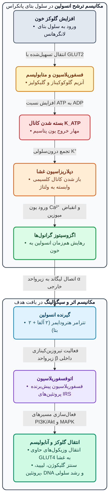
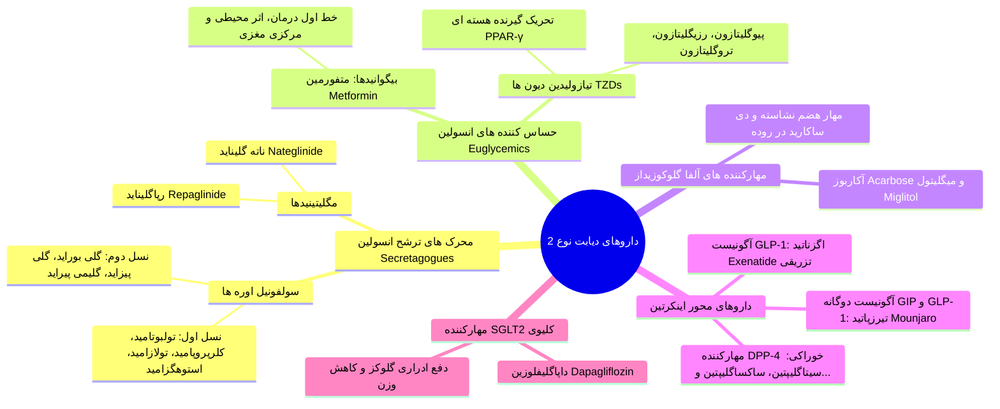

# 1. فیزیولوژی درون‌ریز پانکراس، گلوکاگون و پاتوفیزیولوژی دیابت

> [!info] هورمون‌های بخش درون‌ریز پانکراس و تعریف دیابت ملیتوس
> * **هورمون‌های جزایر لانگرهانس:** 1) **انسولین** (هورمون آنابولیک بدن؛ ترشح از سلول‌های بتا)؛ 2) **گلوکاگون** (فاکتور هایپرگلیسمیک با عملکرد کاملاً عکس انسولین)؛ 3) **سوماتواستاتین** (مهارکننده عمومی سلول‌های ترشحی)؛ 4) **پلی‌پپتید آمیلوئید جزایر (IAPP یا Amylin)**؛ 5) **پپتید پانکراسی** (تسهیل فرآیندهای گوارشی).
> * **دیابت ملیتوس (Diabetes Mellitus):** عدم تناسب بین ترشح انسولین و غلظت گلوکز خون ناشی از ترشح ناکافی انسولین، با یا بدون اختلال همزمان در عملکرد انسولین (مقاومت به انسولین). *(حاشیه استاد: شیوع در ایران بالای 10% است؛ اساتید برجسته دیابت کشور در دانشگاه تهران شامل دکتر استقامتی، دکتر لاریجانی و دکتر نخجوانی و انجمن خیریه آموزشی **گابریک** هستند).*

* **فارماکولوژی گلوکاگون (Glucagon):**
  * **مکانیسم اثر:** اتصال به گیرنده اختصاصی ⇦ **⇧ cAMP** (مکانیسم مشابه بتا-آگونیست‌ها اما **بدون نیاز به گیرنده‌های بتای فعال!**).
  * **اثرات فیزیولوژیک:** 1) تجزیه گلیکوژن کبدی و **⇧ قند خون**؛ 2) اثر **اینوتروپیک و کرونوتروپیک مثبت قوی** روی قلب؛ 3) شل‌کننده عضلات صاف گوارش.
  * **کاربردهای بالینی:** 1) **درمان اورژانسی هایپوگلیسمی شدید** (آمپول لیوفیلیزه **1 میلی‌گرم** به صورت **زیرجلدی/SC یا عضلانی/IM**؛ شروع اثر ظرف **15 دقیقه**)؛ 2) پادزهر **مسمومیت با بتابلاکرها** (مثل پروپرانولول؛ کاربرد قدیمی‌تر)؛ 3) فلج موقت و بی‌حرکت کردن گوارش در رادیوگرافی (امروزه جایگزین شده).

| ویژگی و دسته‌بندی | جزئیات پاتوفیزیولوژی و نکات بالینی |
| :--- | :--- |
| **دیابت نوع 1 (IDDM)**<br>*(وابسته به انسولین)* | تخریب انتخابی سلول‌های بتا و کمبود شدید انسولین؛ نیازمند مطلق به تزریق انسولین. دو زیرگروه: **ایمنی (شایع‌ترین)** و ایدیوپاتیک (نقش ژنتیک، ایمنی و عوامل محیطی تسریع‌کننده). اغلب در جوانان **زیر 30 سال** و نوجوانان. |
| **دیابت نوع 2 (NIDDM)**<br>*(غیروابسته به انسولین)* | مقاومت بافتی به اثر انسولین (کاهش تعداد گیرنده‌ها در چاقی، نقص دایمر $\alpha\beta$ گیرنده یا اختلال ترنسپورترهای گلوکز) همراه با کمبود نسبی ترشح انسولین (یا تغییر ساختار مولکول انسولین). اغلب در افراد **مسن و چاق**. برای بقا نیاز فوری به انسولین ندارند، اما **30%** از انسولین سود می‌برند و **15%** (مبتلا به نوع 1 و 2 همزمان یا نوع 1 پیشرونده کند) نهایتاً نیازمند جایگزینی کامل انسولین می‌شوند. |
| **دیابت نوع 3**<br>*(علل اختصاصی)* | ناشی از بیماری‌های غیرپانکراسی، داروها (مثل کورتون‌ها)، سموم و مواد شیمیایی تخریب‌کننده سلول‌های بتا (کاربرد در مدل‌های حیوانی آزمایشگاهی فارماکولوژی). |
| **دیابت نوع 4 (GDM)**<br>*(دیابت بارداری)* | هرگونه اختلال سطح گلوکز که برای اولین بار در بارداری تشخیص داده شود (در **4%** بارداری‌ها). علت: ایجاد مقاومت به انسولین توسط هورمون‌های جفتی (مثل **hCG**) به‌ویژه در **سه‌ماهه آخر (سوم)**. نیازمند تنظیم دقیق قند جهت حفظ سلامت مادر و جنین. |

> [!warning] عوارض میکروواسکولار و ماکروواسکولار دیابت (بیماری ناتوان‌کننده از فرق سر تا نوک پا!)
> بسیاری از بیماران تا بروز عوارض جدی مراجعه نمی‌کنند و با پایش **HbA1c** و معاینه تشخیص داده می‌شوند؛ بیماران دیابتی جزو گروه **High-risk** در عفونت‌ها (مثل کووید و زخم‌های عفونی) هستند:
> * **عوارض میکروواسکولار در زمان تشخیص:** رتینوپاتی (**21%**؛ تاری دید و آسیب شبکیه)، نفروپاتی (**18.1%**؛ شب‌ادراری و بیدار شدن مکرر در شب)، اختلال نعوظ و عملکرد جنسی (**20%**؛ *Erectile dysfunction*)، و نوروپاتی محیطی و پای دیابتی (عدم لمس نبض پا **13%**، آستانه ارتعاش غیرطبیعی پا **7%**، تغییرات ایسکمیک پوست پا **6%**، گزگز و سوزن‌سوزن شدن پوست و زخم مقاوم به درمان).
> * **عوارض ماکروواسکولار در دیابت نوع 2 (در مقایسه با جمعیت عادی):** پرفشاری خون (**35%**)، نوار قلب غیرطبیعی (**18%**؛ افزایش **2 تا 4 برابری** ریسک بیماری قلبی کشنده)، بیماری عروق مغزی (**7%**؛ افزایش **2 تا 3 برابری** ریسک سکته مغزی کشنده)، و لنگش متناوب (**4.5%**؛ افزایش **15 برابری** ریسک قطع عضو/آمپوتاسیون ناشی از گانگرن).

---

# 2. فیزیولوژی، ساختار، گیرنده و انواع فرآورده‌های انسولین

* **ساختار شیمیایی و استاندارد انسولین:**
  * پیش‌ساز: **پروانسولین** که با جدا شدن قطعه **C-peptide** به انسولین تبدیل می‌شود (*سنجش C-peptide شاخص عالی برای ارزیابی میزان ترشح انسولین درون‌زاست*).
  * ساختار: پلی‌پپتید دارای **51 اسیدآمینه** در دو زنجیره **A (دارای 21 اسیدآمینه)** و **B (دارای 30 اسیدآمینه)** متصل با **2 پل دی‌سولفیدی**. هر میلی‌گرم انسولین استاندارد معادل **28 واحد (Units)** است.
  * **مقایسه انسولین انسانی و حیوانی (سوال امتحانی و رزیدنتی):** انسولین رایج فعلی در بازار **انسولین انسانی نوترکیب (Recombinant Human Insulin)** است (تولید با مهندسی ژنتیک در باکتری *E. coli* و مخمر). انسولین گاوی در **3 اسیدآمینه** و انسولین خوکی تنها در **1 اسیدآمینه** (در جایگاه **B30**: آلانین در خوک به جای ترئونین در انسان) با انسولین انسانی تفاوت دارند.
  * *معایب انسولین‌های حیوانی قدیمی:* واکنش‌های آلرژیک، دشواری تنظیم دوز، و **لیپودیستروفی** (**لیپوهایپرتروفی یا لیپوآتروفی** چربی در محل تزریق که با انسولین انسانی بسیار کم شده است).



* **اثرات اندوکرین انسولین در بافت‌ها:**
  1. **کبد:** مهار گلیکوژنولیز، مهار گلوکونئوژنز (تبدیل اسیدهای آمینه به گلوکز)، مهار کتوژنز (تبدیل اسیدهای چرب و آمینواسیدها به کتواسید)، تحریک ذخیره گلوکز به شکل گلیکوژن، و افزایش سنتز تری‌گلیسرید و تشکیل **VLDL**.
  2. **عضله:** افزایش سنتز پروتئین و افزایش سنتز گلیکوژن.
  3. **بافت چربی:** افزایش ذخیره تری‌گلیسرید و هیدرولیز تری‌گلیسریدها از لیپوپروتئین‌ها.
  * **نکته امتحانی کورتون‌ها:** هورمون‌هایی مثل **گلوکوکورتیکوئیدها** تمایل اتصال (Affinity) گیرنده‌های انسولین به انسولین را **کاهش** داده و به عنوان **آنتاگونیست فیزیولوژیک انسولین** عمل می‌کنند.

| دسته و نام انسولین | تغییرات ساختاری اسیدآمینه | ظاهر ویال و راه تزریق | شروع اثر | پیک اثر | طول اثر | نکات طلایی بالینی و امتحانی |
| :--- | :--- | :--- | :--- | :--- | :--- | :--- |
| **سریع‌الاثر (Rapid-acting):**<br>• **Lispro** *(Humalog)*<br>• **Aspart** *(NovoRapid)*<br>• **Glulisine** | • *لیسپرو:* جابجایی **Pro(B28) و Lys(B29)**<br>• *آسپارت:* جایگزینی Pro(B28) با **Aspartic acid**<br>• *گلولیزین:* Asn(B3) به **Lys** و Lys(B29) به **Glu** | **شفاف (Clear)**<br>زیرجلدی (SC) | **5 تا 15 دقیقه** | **1 ساعت**<br>*(در لیسپرو زمان پیک مستقل از دوز و ثابت است)* | **3 تا 5 ساعت** | تزریق **بلافاصله قبل از غذا**؛ کاهش قند 1 و 2 ساعته پس از غذا به ترتیب **30% و 53%**؛ **کمترین تغییرپذیری جذب (5%** در مقابل 50% سایرین) و کمترین ریسک هایپوگلیسمی شبانه/دیررس. |
| **کوتاه‌اثر (Short-acting):**<br>• **Regular** *(Lansulin R)*<br>*(دقیقاً مشابه انسولین انسانی)* | بدون تغییر: A21(Asn), B3(Asn), B28(Pro), B29(Lys), B30(Thr) | **شفاف (Clear)**<br>SC و **وریدی (IV)** | **30 دقیقه** (15-30 دقیقه) | **2 تا 3 ساعت** | **5 تا 8 ساعت** | در زیرجلد به دلیل تشکیل **هگزامر** حول اتم روی، شروع اثر تاخیری دارد (تزریق 30 دقیقه قبل غذا). **تنها انسولین قابل تزریق وریدی (IV)** در اورژانس‌ها! |
| **متوسط‌الاثر (Intermediate):**<br>• **NPH / Isophane**<br>*(Lansulin N)*<br>• **Lente** | کمپلکس انسولین با پروتئین **پروتامین** (استخراج از اسپرم ماهی قزل‌آلا)؛ *لنت* مخلوط کوتاه‌اثر و طولانی‌اثر است. | **کدر / شیری (Turbid)**<br>فقط SC | 1 تا 2 ساعت | 4 تا 10 ساعت | 10 تا 18 ساعت | به دلیل رسوب کمپلکس، رهایش تدریجی دارد. قابل اختلاط با انسولین‌های سریع/کوتاه‌اثر (مثل **Humalog Mix 75/25 و 50/50** یا **NovoMix 30**). |
| **طولانی‌اثر (Long-acting):**<br>• **Glargine** *(Lantus)*<br>• **Detemir** *(Levemir)*<br>• **Ultralente** | • *گلارژین:* جایگزینی Asn(A21) با **Gly** + افزودن **2 آرژنین به B31 و B32**<br>• *دتemir:* حذف Thr(B30) و اتصال اسید چرب **Myristic acid** به Lys(B29) | *گلارژین و دتمیر:* **شفاف (Clear)**<br>*اولترالنت:* **کدر**<br>فقط SC | **1 ساعت** *(گلارژین)* | **4 تا 5 ساعت** *(گلارژین عملاً **Peakless / بدون پیک** است)* | **24 ساعت یا بیشتر** (بیش از 20 ساعت) | **گلارژین:** محلول **اسیدی (pH = 4.0)**؛ پس از تزریق در بافت زیرجلدی (**pH = 7.4**) دچار **میکروپرسیپیتاسیون** شده و هگزامرها به آهستگی آزاد می‌شوند. **اختلاط آن با هر انسولین دیگری در یک سرنگ اکیداً ممنوع است!** |

```chart
{
  "type": "line",
  "data": {
    "labels": ["0", "1", "2", "3", "4", "5", "6", "8", "10", "12", "14", "16", "18", "20", "24"],
    "datasets": [
      {
        "label": "Rapid-acting (Lispro / Aspart)",
        "data": [0, 7, 5, 2.5, 0.5, 0, 0, 0, 0, 0, 0, 0, 0, 0, 0],
        "borderColor": "#0288d1",
        "tension": 0.3
      },
      {
        "label": "Short-acting (Regular)",
        "data": [0, 2.5, 5, 5.7, 4.8, 3.5, 2.2, 0.8, 0, 0, 0, 0, 0, 0, 0],
        "borderColor": "#2e7d32",
        "borderDash": [5, 5],
        "tension": 0.3
      },
      {
        "label": "Intermediate (NPH)",
        "data": [0, 0.2, 1, 2.5, 3.8, 3.7, 3.5, 3, 2, 1, 0.3, 0, 0, 0, 0],
        "borderColor": "#f57c00",
        "tension": 0.3
      },
      {
        "label": "Long-acting (Glargine - Peakless)",
        "data": [0, 0.2, 0.3, 0.3, 0.4, 0.5, 1.2, 1.2, 1.2, 1.1, 1.1, 1.0, 1.0, 0.9, 0.9],
        "borderColor": "#c62828",
        "fill": true,
        "backgroundColor": "rgba(198, 40, 40, 0.1)",
        "tension": 0.2
      }
    ]
  },
  "options": {
    "responsive": true,
    "plugins": {
      "title": {
        "display": true,
        "text": "پروفایل زمانی اثر انواع انسولین (بر حسب ساعت پس از تزریق زیرجلدی)"
      }
    }
  }
}
```

> [!important] نکات طلایی امتحانی انسولین‌درمانی، سیستم‌های تزریق و اورژانس هایپوگلیسمی
> * **چرا فقط انسولین Regular را می‌توان وریدی (IV) تزریق کرد؟** در تزریق وریدی، رقت خون باعث شکسته شدن فوری هگزامرها به مونومر می‌شود؛ کاربرد حیاتی در **کتواسیدوز دیابتی (DKA)** و شرایط تغییر سریع نیاز به انسولین (**پس از جراحی یا عفونت‌های حاد**). *(هشدار: به دلیل ریسک خودکشی با تزریق وریدی انسولین در نوجوانان مبتلا به دیابت نوع 1، کل دارو نباید در اختیار بیمار باشد).*
> * **سیستم‌های نوین تجویز انسولین:**
>   1. **پمپ‌های هوشمند انسولین (CSII):** فیزیولوژیک‌ترین روش جایگزینی (شامل مخزن، تراشه برنامه، صفحه‌کلید و نمایشگر به اندازه پیجر)؛ کاتتر زیرجلدی ترجیحاً در **شکم (Abdomen)** کار گذاشته شده و انسولین پایه (Basal) و بولوس را بر اساس قند خون تزریق می‌کند.
>   2. **قلم‌های انسولین (Pen injectors):** مثل *OptiPen* و *FlexPen*؛ راحت‌تر اما گران‌تر از ویال و سرنگ 100 واحدی.
>   3. **انسولین استنشاقی ریوی (Inhaled insulin / Exubera):** هنوز کاربرد بالینی وسیع نیافته است.
> * **عارضه شایع هایپوگلیسمی (Hypoglycemia) و پدیده Unawareness:**
>   * *علائم هشداردهنده اولیه:* فعالیت **سمپاتیک** (تاکی‌کاردی، تپش قلب، تعریق، ترمور/لرزش) + فعالیت **پاراسمپاتیک** (تهوع، گرسنگی) ⇦ در صورت عدم درمان: تشنج و کما.
>   * **عدم آگاهی از هایپوگلیسمی (Hypoglycemic unawareness):** در حملات مکرر هایپوگلیسمی، علائم هشداردهنده اتونوم از بین رفته و بیمار مستقیماً با ضعف، رفتارهای عجیب، تشنج و کما تظاهر می‌کند!
>   * **پروتکل درمان هایپوگلیسمی:** 1) بیمار **هوشیار**: مایعات قندی یا شکلات خوراکی؛ 2) بیمار **بیهوش** (*تغذیه خوراکی اکیداً ممنوع!*): خط اول در بیمارستان انفوزیون وریدی **20 تا 50 میلی‌لیتر محلول گلوکز 50% (دکستروز) طی 2 تا 3 دقیقه**؛ در صورت عدم دسترسی به رگ، تزریق **1 میلی‌گرم گلوکاگون زیرجلدی یا عضلانی**؛ در صورت عدم دسترسی به گلوکاگون، مالیدن مقدار کمی **عسل یا شربت غلیظ در کیسه بوکال (مخاط دهان)**.

---

# 3. داروهای خوراکی و تزریقی غیرانسولینی در درمان دیابت نوع 2



### الف) محرک‌های ترشح انسولین (Insulin Secretagogues): سولفونیل‌اوره‌ها و مگلیتینیدها
* **مکانیسم مشترک:** اتصال به کانال پتاسیمی حساس به ATP در سلول‌های بتا و **مهار خروج یون $K^+$** ⇦ دپلاریزاسیون غشا ⇦ باز شدن کانال کلسیمی وابسته به ولتاژ و ورود $Ca^{2+}$ ⇦ **رهایش انسولین**. (*نکته:* مصرف مزمن سولفونیل‌اوره‌ها **سطح گلوکاگون سرم را نیز کاهش می‌دهد**).
* **ویژگی‌های کلی سولفونیل‌اوره‌ها:** شروع با دوز پایین و تیتراسیون؛ شایع‌ترین عارضه **هایپوگلیسمی** و **افزایش وزن (Weight gain)**؛ عدم کاهش معنادار حوادث ماکروواسکولار و از دست رفتن کنترل قند در درازمدت؛ متابولیسم کبدی و دفع کلیوی (احتیاط شدید/منع مصرف در **سالمندان و نارسایی شدید کبدی، کلیوی و قلبی**).

| دسته و نام دارو | نیمه‌عمر / زمان اثر | ویژگی‌های اختصاصی و نکات طلایی امتحانی |
| :--- | :--- | :--- |
| **سولفونیل‌اوره نسل اول:**<br>• **Tolbutamide** *(Orinase)* | **5 ساعت** (کوتاه‌اثر) | **ایمن‌ترین سولفونیل‌اوره برای مصرف در سالمندان!** (نیازمند مصرف 2 تا 3 بار در روز). |
| • **Chlorpropamide** *(Diabinese)* | **32 ساعت** (طولانی‌اثرترین) | مصرف یک بار در روز (نصف تا 1 قرص)؛ به دلیل نیمه‌عمر طولانی و ریسک بالای هایپوگلیسمی کشنده، **در سالمندان اکیداً کنتراایندیکه است!** (سوال رزیدنتی). |
| • **Tolazamide** *(Tolinase)*<br>• **Acetohexamide** *(Dymelor)* | **7 ساعت** | قدرت مشابه کلرپروپامید اما کوتاه‌اثرتر. |
| **سولفونیل‌اوره نسل دوم:**<br>• **Glyburide / Glibenclamide** *(Micronase)* | متوسط تا طولانی | بسیار پرمصرف؛ عوارض جانبی اندک به جز هایپوگلیسمی؛ موجود به صورت قرص 5mg و فرم ترکیبی با متفورمین (**500/5**). |
| • **Glipizide** *(Glucotrol)* | **3 ساعت** (کوتاه‌ترین نیمه‌عمر) | به دلیل کوتاه‌ترین نیمه‌عمر، **کمترین احتمال ایجاد هایپوگلیسمی شدید** را در بین سولفونیل‌اوره‌ها دارد. |
| • **Glimepiride** *(Amaryl)* | طولانی‌اثر | **دارای کمترین دوز مصرفی در بین تمام سولفونیل‌اوره‌ها** (تک‌دوز روزانه **1 میلی‌گرم**). |
| **مگلیتینیدها (Meglitinides):**<br>• **Repaglinide** *(Novonorm, Newbet)* | شروع بسیار سریع (10-15 دقیقه)، پیک **1 ساعت**، طول اثر **5 تا 8 ساعت** | قرص‌های **0.5، 1 و 2 میلی‌گرم**؛ مصرف قبل از هر وعده غذایی (3 بار در روز) جهت کنترل نوسانات قند پس از غذا (*Postprandial*). ریسک هایپوگلیسمی دارد. |
| • **Nateglinide** | جذب ظرف **20 دقیقه**، پیک **زیر 1 ساعت**، طول اثر کوتاه | مصرف درست قبل از غذا؛ **نیازی به تیتراسیون دوز ندارد!** عالی برای هایپرگلیسمی ایزوله پس از غذا؛ **کمترین ریسک هایپوگلیسمی در بین تمام ترشح‌کننده‌های انسولین** و **ایمن در بیماران با کاهش شدید عملکرد کلیه!** |

### ب) حساس‌کننده‌های بافت به انسولین (Euglycemics): بیگوانیدها و تیازولیدین‌دیون‌ها
* **چرا به آن‌ها Euglycemic می‌گویند؟** زیرا قند خون بالا را به حد طبیعی برمی‌گردانند اما در فرد عادی یا دیابتی **ایجاد هایپوگلیسمی نمی‌کنند!**
* **1. متفورمین (Metformin - دسته بیگوانیدها):**
  * **جایگاه و اشکال:** **خط اول درمان دیابت نوع 2** (به‌ویژه در افراد چاق دچار سندروم مقاومت به انسولین). قرص‌های **500، 750 و 1000 میلی‌گرم** (معمولی و آهسته‌رهش؛ برندهای *Glucophage, Hexal, Brot*).
  * **مکانیسم اثر (محیطی + مکانیسم جدید مرکزی مغزی مورد تاکید استاد!):**
    1. *محیطی (خارج پانکراسی):* بدون اثر مستقیم بر ترشح انسولین؛ بهبود عملکرد گیرنده‌های انسولین و کاهش تولید گلوکز کبدی (گلوکونئوژنز).
    2. *مرکزی (مغزی):* اثر بر نورون‌های **SF-1** در مغز (موثر در تنظیم گلوکز) و اثر بر پروتئین **Rap1** (درگیر در عملکرد و تمایز سلول‌های بتا).
  * **عوارض جانبی و کنتراایندیکاسیون‌ها:**
    * *گوارشی (شایع؛ در **20%** بیماران):* بی‌اشتهایی، تهوع، استفراغ، ناراحتی شکمی و اسهال (به مرور بیمار عادت می‌کند) + کاهش وزن ملایم (مصرف آن صرفاً برای لاغری افراد غیردیابتی سوءمصرف است) + **کاهش جذب ویتامین B12** (توصیه به تجویز مکمل B12 جهت پیشگیری از تشدید نوروپاتی).
    * **اسیدوز لاکتیک (Lactic acidosis):** عارضه نادر اما کشنده (که باعث جمع شدن داروی قدیمی *فن‌فورمین* از بازار شد)؛ بنابراین متفورمین در **الکلیسم شدید** و **شرایط آنوکسیک/هیپوکسیک (نارسایی قلبی-ریوی، نارسایی کلیوی و کبدی)** اکیداً **ممنوع (Contraindicated)** است!
* **2. تیازولیدین‌دیون‌ها (TZDs / گلیتازون‌ها):**
  * **داروها و دوز (خط دوم درمان؛ یک بار در روز):** **Pioglitazone** (*Actos, Glutazone, Pitoze*؛ قرص **15، 30 و 45 میلی‌گرم**)، **Rosiglitazone** (*Avandia*؛ **2 تا 8 میلی‌گرم** روزانه) و **Troglitazone** (*Rezulin*؛ **200 تا 600 میلی‌گرم** روزانه با غذا).
  * **مکانیسم اثر (سوال امتحانی):** فعال‌سازی گیرنده‌های هسته‌ای **PPAR-$\gamma$ (Peroxisome Proliferator-Activated Receptor-gamma)** ⇦ تغییر بیان ژن‌های تنظیم‌کننده متابولیسم گلوکز و چربی ⇦ **کاهش مقاومت به انسولین** (شروع و پایان اثر بسیار کند است و **چند هفته تا چند ماه** طول می‌کشد).
  * **نکات بالینی و عوارض تیازولیدین‌دیون‌ها:**
    1. **خطر سمیت کبدی** و عوارض قلبی (نیازمند احتیاط و پایش).
    2. **منع مصرف در بارداری**.
    3. **دونکته امتحانی حاملگی ناخواسته (Unwanted pregnancy):** الف) پیوگلیتازون متابولیسم استروئیدها و **قرص‌های ضدبارداری حاوی استروژن (OCP) را افزایش داده** و اثر آن‌ها را کم می‌کند؛ ب) در زنان مبتلا به عدم تخمک‌گذاری (مثل PCOS)، باعث **برقراری مجدد تخمک‌گذاری (Ovulation)** می‌شود!

### ج) مهارکننده‌های آلفا-گلوکوزیداز (Alpha-Glucosidase Inhibitors)
* **داروها:** **Acarbose (آکاربوز)** و **Miglitol (میگلیتول)** (داروهای **کمکی** همراه با سایر داروها).
* **مکانیسم اثر:** مهار آنزیم آلفا-گلوکوزیداز در حاشیه مسواکی روده ⇦ کاهش هضم و جذب نشاسته، سلولز، پلی‌ساکاریدها و دی‌ساکاریدها.
* **عوارض و منع مصرف:** کربوهیدرات‌های هضم‌نشده در کولون توسط فلور میکروبی تخمیر شده و گاز آزاد می‌کنند ⇦ **نفخ شدید (Flatulence)، اسهال و درد/اسپاسم شکمی**. **موارد منع مصرف:** **بیماری‌های التهابی روده (IBD)**، سندروم روده تحریک‌پذیر (IBS) و انسداد روده.

> [!danger] شاه‌نکته امتحانی درمان هایپوگلیسمی در مصرف‌کنندگان آکاربوز و میگلیتول!
> اگر بیماری که آکاربوز یا میگلیتول را (همراه سایر داروها) مصرف می‌کند دچار هایپوگلیسمی شود، باید **فقط با گلوکز خالص (دکستروز) درمان شود و نه با ساکارز (قند و شکر معمولی)!** زیرا آنزیم تجزیه‌کننده دی‌ساکارید (ساکارز) در روده مهار شده است و شکر معمولی جذب نمی‌شود!

### د) داروهای محور اینکرتین (GLP-1، DPP-4 و تیرزپاتید) و مهارکننده‌های SGLT2

| دسته و نام دارو | راه تجویز و اشکال | مکانیسم اثر دقیق | مزایا، عوارض و نکات بالینی |
| :--- | :--- | :--- | :--- |
| **آگونیست گیرنده GLP-1:**<br>• **Exenatide** *(Byetta)* | **تزریقی** (سنتتیک؛ مشتق *Exendin-4*) | تقلید اثر اینکرتین **GLP-1** (هورمون روده‌ای ترشح‌شده در پاسخ به غذا) ⇦ **⇧ ترشح انسولین، ⇩ ترشح گلوکاگون** و **کاهش از دست رفتن سلول‌های بتا**. | مصرف ترکیبی با متفورمین، سولفونیل‌اوره یا TZD در موارد مقاوم. عارضه شایع: تهوع و استفراغ (که به مرور تحمل می‌شود). |
| **مهارکننده‌های DPP-4:**<br>• **Sitagliptin** *(Januvia; 25, 50, 100mg)*<br>• **Saxagliptin** *(Onglyza; 2.5, 5mg)*<br>• **Linagliptin, Alogliptin, Vildagliptin** | **خوراکی** (یک بار در روز؛ به تنهایی یا ترکیبی با متفورمین مثل *Janumet* و *Kombiglyze XR*) | مهار انتخابی آنزیم **دی‌پپتیدیل پپتیداز-4 (DPP-4)** (مسئول تخریب اینکرتین‌ها) ⇦ افزایش سطح **GLP-1 و GIP** درون‌زا ⇦ **⇧ انسولین وابسته به گلوکز، ⇩ گلوکاگون و ⇩ تولید گلوکز کبدی**. | چون اینکرتین‌ها به صورت **وابسته به گلوکز** (پس از غذا) عمل می‌کنند، **ایجاد هایپوگلیسمی نمی‌کنند!** بدون اثر محسوس بر وزن بدن؛ بسیار پرمصرف و خوش‌تحمل. |
| **مهارکننده SGLT2:**<br>• **Dapagliflozin** | **خوراکی** (تکی یا همراه متفورمین) | مهار هم‌انتقال‌دهنده سدیم-گلوکز نوع 2 (**SGLT2**) در توبول کلیه ⇦ **مهار بازجذب گلوکز از ادرار** و دفع گلوکز. | کنترل عالی قند خون + **کاهش وزن** (نسل جدید داروهای دیابت و کاهش وزن). |
| **آگونیست دوگانه GIP و GLP-1:**<br>• **Tirzepatide** *(Mounjaro / مانجارو)* | **تزریقی** (تولید در ایران توسط 3 شرکت از جمله از ماده اولیه/Base) | تحریک همزمان گیرنده‌های اینکرتینی **GIP و GLP-1**. | معرفی اولیه برای دیابت، اما دارای اثر فوق‌العاده در **کاهش وزن** (کاهش وزن تا **15% یا بیشتر**). *هشدار استاد:* بسیار گران‌قیمت؛ سوءمصرف خودسرانه آن برای لاغری خطر **آسیب‌های کبدی درازمدت** دارد و فقط باید در چاقی‌های مفرط (BMI بسیار بالا) تحت نظر متخصص تجویز شود. |
