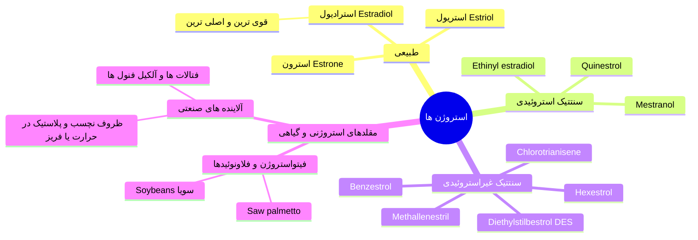
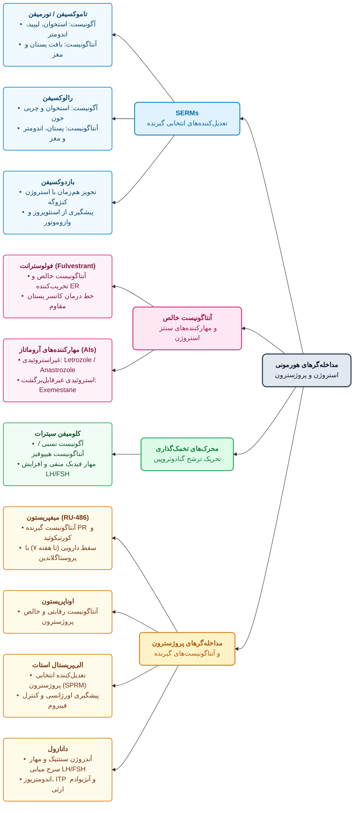
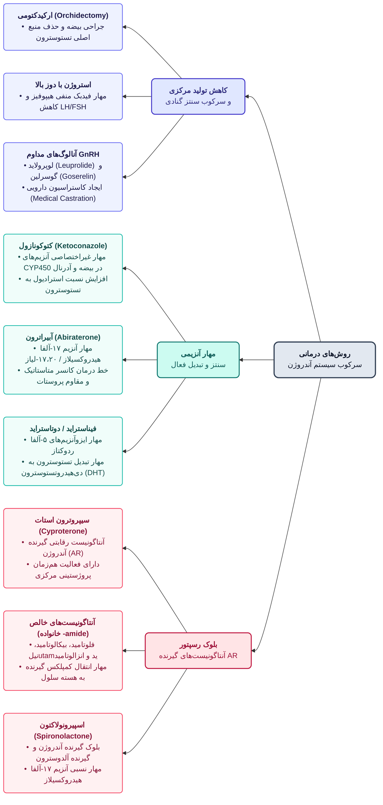

# ۱. فیزیولوژی تخمدان، بلوغ و اختلالات سیکل

> [!info] محور هیپوتالاموس-هیپوفیز-گناد (HPG) و شبکه KNDy
> در کودکی، فعالیت گنادها به دلیل مکانیسم‌های مهاری بر هسته آرکوئیت (Arcuate) هیپوتالاموس سرکوب است. شبکه نورونی **KNDy** (ترشح‌کننده *Kisspeptin*، *Neurokinin B* و *Dynorphin*) در هیپوتالاموس که پیش از بلوغ خاموش است، هم در شروع بلوغ و هم در **مرکز تنظیم دما (Thermoregulatory)** نقش کلیدی دارد. **هیپوتالاموس** بخش غالب (Dominant) این محور است؛ زیرا تجویز پالسی GnRH در دختران نابالغ نیز ترشح گنادوتروپین‌ها را آغاز می‌کند.

* **شروع بلوغ (Gonadarche) تا یائسگی:**
  1. حذف مهار کودکی و فعال شدن مسیر KNDy ⇦ شروع ترشح ضربان‌دار (Pulsatile) هورمون **GnRH (LHRH)** ⇦ ترشح **FSH و LH** از هیپوفیز قدامی (ابتدا فقط **شبانه**، سپس در کل شبانه‌روز).
  2. ترشح مقادیر کم استرادیول ⇦ رشد استرومای پستان، رسوب چربی و صفات ثانویه جنسی (در طول ۱ سال اول).
  3. افزایش بیشتر FSH/LH و ضخامت اندومتر ⇦ شروع سیکل‌های قاعدگی (Menstrual cycle) به مدت **۳۰ تا ۴۰ سال** ⇦ کاهش تدریجی پاسخ‌دهی تخمدان و قطع سیکل (**Menopause**).
* **مرور سیکل قاعدگی:**
  1. **فاز فولیکولار:** ترشح FSH ⇦ رشد فولیکول‌ها ⇦ تولید استرادیول (توسط سلول‌های گرانولوزا و تکا) ⇦ پرولیفراسیون اندومتر + **فیدبک منفی** بر FSH ⇦ آترزی سایر فولیکول‌ها و باقی ماندن **یک فولیکول غالب (Dominant)**.
  2. **میانه سیکل (Midcycle) و فاز لوتئال:** پیک LH و FSH (تسهیل با پروژسترون) ⇦ **تخمک‌گذاری (Ovulation)** ⇦ تشکیل *Corpus hemorrhagicum* و سپس **جسم زرد (Corpus luteum)** (ترشح استرادیول و پروژسترون). در صورت عدم بارداری، تبدیل به *Corpus albicans* ⇦ افت هورمون‌ها و ریزش اندومتر (Menses).
* **سایر هورمون‌های تخمدانی:**
  * **Inhibin:** مهار ترشح FSH.
  * **Activin:** تحریک ترشح FSH. همراهی با FSH ⇦ ⇧ فعالیت آروماتاز، ⇧ ساخت پروژسترون و استروژن در سلول‌های گرانولوزا. همراهی با LH ⇦ ⇧ فعالیت آروماتاز، اما **مهار پاسخ پروژسترونی القاشده با LH** و ⇩ استروژن.
  * **Relaxin:** پلی‌پپتید با ساختار دو زنجیره‌ای متصل به باند دی‌سولفیدی **شبیه انسولین**؛ ⇧ سنتز گلیکوژن، ⇧ جذب آب و **⇩ انقباضات رحم و اندومتر**.
  * **آندروژن‌های تخمدانی:** DHEA و آندروستن‌دیون.

> [!warning] علل اختلال عملکرد تخمدان، عدم تخمک‌گذاری (Anovulation) و آمنوره
> * **استرس‌های روحی/هیجانی شدید** (مثل فوت همسر ⇦ مهار ترشح GnRH؛ قابل درمان دارویی) و **ورزش‌های سنگین هوازی** (قهرمانان ماراتن، شناگران استقامتی).
> * **اختلالات تغذیه‌ای:** *Anorexia nervosa* و *Bulimia*.
> * **فرآیندهای التهابی شدید** یا **نئوپلاسم‌ها** (تومورهای آدرنال، تومورهای مترشحه آندروژن، یا تومور سلول‌های لاکتوتروف هیپوفیز).
> * **هایپرپرولاکتینمی (مهار محور جنسی):** ناشی از تومور، شیردهی کامل، یا داروها: آنتاگونیست‌های دوپامین (مثل **کلرپرومازین**؛ زیرا دوپامین همان فاکتور مهارکننده پرولاکتین یا PIF است) و دوز بالای **متیل‌دوپا** (تولید متیل‌دوپامین و عدم توانایی مهار پرولاکتین).

---

# ۲. استروژن‌ها (Estrogens)

* **بیوسنتز و فارماکوکینتیک:**
  * استرادیول مستقیم از گرانولوزا ترشح می‌شود. استرون و استریول در کبد از استرادیول و یا در بافت‌های محیطی (به‌ویژه **بافت چربی**) از آندروستن‌دیون و تستوسترون توسط آنزیم **آروماتاز** ساخته می‌شوند.
  * در خون به **SHBG (α₂-globulin)** متصل می‌شوند.
  * **سیکل انتروهپاتیک (Enterohepatic):** استروژن‌ها در کبد کنژوگه شده ⇦ دفع در صفرا ⇦ ورود به روده ⇦ **دکنژوگاسیون توسط فلور میکروبی روده** ⇦ بازجذب به خون.

> [!important] دو نکته طلایی و امتحانی فارماکوکینتیک استروژن‌ها
> 1. **تداخل دارویی با آنتی‌بیوتیک‌های وسیع‌الطیف:** با از بین بردن فلور نرمال روده، سیکل انتروهپاتیک شکسته شده ⇦ ⇩ غلظت پلاسمایی استروژن ⇦ **شکست قرص‌های ضدبارداری و ریسک حاملگی ناخواسته**.
> 2. **مزیت اشکال غیرخوراکی (پچ پوستی، کرم واژینال):** به دلیل حذف عبور اول کبدی و سیکل انتروهپاتیک، مواجهه کبد با دوز بالای استروژن کم شده و **عوارض انعقادی (ترومبوآمبولی) و افزایش سوبسترای رنین (فشار خون) بسیار کمتری** نسبت به اشکال خوراکی دارند.

* **مکانیسم اثر:**
  1. **اثرات ژنومیک (عمده اثرات، رشد و سنتز پروتئین):** اتصال به گیرنده هسته‌ای (**ERα** فعال فیزیولوژیک، و **ERβ**) ⇦ جدایی پروتئین پایدارکننده **HSP90** ⇦ دایمریزاسیون (تشکیل همودایمر αα یا هترودایمر αβ؛ **حضور زیرواحد β مانع رونویسی و اکتیویشن می‌شود**) ⇦ اتصال به ناحیه **ERE** روی پروموتر DNA. اتصال فاکتورهای رونویسی، سایتوکاین‌ها و کورگولاتورهای مختلف در بافت‌های متفاوت، اثر دارو را تغییر می‌دهد (اساس ساخت داروهای SERM).
  2. **اثرات غیرمستقیم (پاراکراین/اتوکراین):** رهایش فاکتورهای رشد، لیپیدها، گلیکولیپیدها و سایتوکاین‌ها.
  3. **اثرات سریع و غیرژنومیک:** ⇧ برداشت کلسیم ($Ca^{2+}$) توسط سلول‌های گرانولوزا و ⇧ جریان خون رحم.

* **اثرات فیزیولوژیک:**
  * **بلوغ زنانه:** رشد واژن، رحم، لوله‌های رحمی، رشد استروما و مجاری (**Ductal**) پستان، رشد طولی استخوان و **بسته شدن اپی‌فیز استخوان‌های دراز**، رشد موی نواحی جنسی، و **افزایش پیگمنتیشن پوست** (نیپل، ناحیه تناسلی و ایجاد **ملاسما/کلوآسما** در بارداری یا مصرف OCP که با نور تشدید شده و نیازمند ضدآفتاب است).
  * **اندومتر:** رشد لایه اندومتر؛ مواجهه مداوم بدون پروژسترون ⇦ **هایپرپلازی اندومتر**.
  * **انعقاد خون:** **⇧ فاکتورهای II، VII، IX، X** و پلاسمینوژن؛ **⇩ آنتی‌ترومبین III** و ⇩ چسبندگی پلاکتی (افزایش ریسک ترومبوآمبولی).
  * **متابولیک و استخوان:** القای **آپوپتوز استئوکلاست‌ها** و مهار اثر پاراتورمون (PTH) در تبدیل پیش‌سازها به استئوکلاست (⇩ تحلیل استخوان)؛ بهبود پروفایل لیپیدی (**⇧ HDL و ⇧ TG**، **⇩ LDL و کلسترول** ⇦ ⇩ نسبت LDL/HDL و اثر ضد آتروژنیک).
  * **سایر اثرات:** **Up-regulation گیرنده‌های پروژسترون**، ⇧ لیبیدو، ⇧ تولید **CRF (CRH)**، کورتیزول و کاتکول‌آمین‌ها، ⇧ تحریک‌پذیری CNS و حس خوب (Well-being؛ *افت ناگهانی استرادیول پس از زایمان عامل افسردگی پس از زایمان یا Post-gestational depression است*)، **⇧ سوبسترای رنین (آنژیوتانسینوژن)** + نشت مایع و سدیم از عروق به فضای خارج سلولی ⇦ فعال شدن محور RAAS ⇦ **احتباس آب و نمک و ادم** (عامل اضافه وزن کاذب با OCP).

* **کاربردهای بالینی:**
  1. **هیپوگنادیسم اولیه (Primary Hypogonadism):** شروع از ۱۱ تا ۱۳ سالگی با دوز پایین (*اتینیل‌استرادیول* ۵ تا ۱۰ میکروگرم/روز یا *استروژن کنژوگه/Premarin* ۰.۶۲۵ تا ۱.۲۵ میلی‌گرم/روز در روزهای ۱ تا ۲۵ ماه) جهت تقلید بلوغ؛ پس از بلوغ و شروع سیکل، اضافه کردن **مدروکسی‌پروژسترون** (از روز ۱۵ به مدت ۱۰ تا ۱۴ روز) جهت ایجاد خونریزی طبیعی.
  2. **هورمون‌درمانی در یائسگی (HRT):**
     * *علائم یائسگی:* علائم وازوموتور (**گرگرفتگی/Hot flashes** و تعریق شبانه/غروب به علت حذف فیدبک منفی استروژن بر شبکه KNDy در مرکز تنظیم دما)، اختلال خواب، نوسان خلق، آتروفی تناسلی/واژن، و **استئوپروز** (بیماری خاموش؛ شکستگی مهره، فمور و مچ دست).
     * *رژیم‌های درمانی:* در صورت **هیسترکتومی** (عدم وجود رحم) ⇦ استروژن به تنهایی (مثلاً ۵ روز در هفته). در صورت **وجود رحم** ⇦ رژیم چرخه‌ای (استروژن روزهای ۱ تا ۲۵ + مدروکسی‌پروژسترون ۱۰ میلی‌گرم در ۱۰ تا ۱۴ روز آخر) یا رژیم مداوم (Continuous).
     * *نکات HRT:* در حضور بیماری زمینه‌ای قلبی-عروقی (آترواسکلروز، فشار خون) یا سابقه فامیلی سرطان پستان، HRT توصیه نمی‌شود. اگر صرفاً علائم وازوموتور یا آتروفی واژن مطرح باشد، اشکال موضعی (**کرم واژینال استروژن کنژوگه** ۳ بار در هفته) ارجح است. علائم وازوموتور موقتی بوده و به مرور رفع می‌شوند، اما آتروفی واژن و استئوپروز نیازمند درمان مداوم‌اند (در استئوپروز بیس‌فسفونات‌ها مثل آلندرونات خط اول‌اند).
     * *درمان‌های غیرهورمونی گرگرفتگی:* **کلونیدین** (ضدفشار خون با دوز پایین؛ مهار بیش‌فعالی سمپاتیک و کاتکول‌استروژن‌ها؛ شایع‌ترین عارضه در این خانم‌ها: **خشکی دهان** و افت فشار خون) و **Fezolinetant** (آنتاگونیست انتخابی گیرنده **NK3**؛ مهار مستقیم نوروکینین B در مسیر KNDy هیپوتالاموس).

* **عوارض جانبی و کنتراایندیکاسیون‌ها:**
  * **خونریزی رحمی:** نوسان غلظت استروژن باعث لکه‌بینی می‌شود. در خانم یائسه تحت HRT، خونریزی می‌تواند ناشی از دارو یا **سرطان اندومتر** باشد (گمراه‌کننده برای پزشک ⇦ لزوم استفاده از **حداقل دوز موثر**).
  * **سرطان پستان:** مصرف کوتاه‌مدت یا پالسی با دوز پایین ریسک را بالا نمی‌برد، اما دوز بالا و طولانی‌مدت ریسک را افزایش می‌دهد (شروع بلافاصله HRT تا ۷ سال در افراد فاقد سابقه فامیلی ریسک را بالا نمی‌برد). **اضافه کردن پروژستین ریسک سرطان پستان را کم نمی‌کند** (بلکه با ⇧ پرولیفراسیون و تراکم اپی‌تلیوم پستان، ریسک را **افزایش** می‌دهد).
  * **سرطان اندومتر:** ارتباط مستقیم با استروژن تنها (مصرف > ۵ سال دوز بالا ⇦ **۱۵ برابر**، دوز پایین ⇦ ۲ تا ۴ برابر افزایش ریسک). **اضافه کردن پروژستین این ریسک را به شدت کاهش می‌دهد** (زیرا پروژستین باعث **Down-regulation گیرنده‌های استروژن** و ریزش اندومتر می‌شود).
  * **آدنوکارسینوم واژن/سرویکس:** مصرف **Diethylstilbestrol (DES)** در مادر باردار ⇦ بروز سرطان در جنین دختر در سنین بلوغ.
  * **سایر عوارض:** تهوع (درمان با **ویتامین B6**؛ در تهوع بارداری زنجبیل/Ginger نیز موثر است؛ *تاکید استاد بر پدیده Nocebo effect در تلقین عوارض گوارشی با خواندن بروشور دارو*)، حساسیت پستان (Breast tenderness)، هایپرپیگمنتیشن، **افزایش فرکانس سردردهای میگرنی** (به‌ویژه در زمان قطع دارو و نوسان/Fluctuation سطح هورمون)، **کلستاز و بیماری کیسه صفرا**، و هایپرتنشن.
  * **موارد منع مصرف (Contraindications):** نئوپلاسم‌های وابسته به استروژن، **خونریزی تناسلی با علت نامشخص** (اگر خونریزی فانکشنال/DUB باشد منع مصرف ندارد و درمان هم هست)، بیماری کبدی، اختلالات ترومبوآمبولیک (DVT)، و احتیاط شدید/منع در **سیگاری‌های قهار (Heavy smokers)** و افراد با **گروه خونی O** (ریسک بالاتر ترومبوآمبولی).

---

# ۳. پروژستین‌ها (Progestins)

| نسل و دسته دارویی            | داروهای شاخص                                                                                                      | ویژگی‌ها و نکات اختصاصی                                                                                                                                                                                                                                                |
| :--------------------------- | :---------------------------------------------------------------------------------------------------------------- | :--------------------------------------------------------------------------------------------------------------------------------------------------------------------------------------------------------------------------------------------------------------------- |
| **طبیعی**                    | Progesterone                                                                                                      | ترشح از گرانولوزا، تکا، جسم زرد و جفت؛ پیش‌ساز آندروژن، استروژن و استروئیدهای آدرنال؛ **متابولیسم عبور اول کبدی بسیار بالا** (نیمه‌عمر کوتاه، غیرقابل مصرف خوراکی به شکل ساده) ⇦ تبدیل به *Pregnanediol* و کنژوگاسیون با اسید گلوکورونیک (*Pregnanediol glucuronide*). |
| **سنتتیک قدیمی / نسل ۱ و ۲** | Medroxyprogesterone, Dydrogesterone (Dufaston), Megestrol, Lynestrenol, Norethindrone, Levonorgestrel, Norgestrel | مشتقات ۱۹-نور تستوسترون (مثل نوراتیندرون و لوونورژسترل) دارای **خواص آندروژنیک بالا** هستند ⇦ ایجاد **هیرسوتیسم، آکنه، پوست چرب و کاهش HDL**. **لاینسترنول** قرص انتخابی در **دوران شیردهی** است (برخلاف استروژن، شیر را کم نمی‌کند).                                  |
| **نسل سوم**                  | Desogestrel, Gestodene, Norgestimate                                                                              | دارای **حداقل اثرات آندروژنیک** (عدم ایجاد هیرسوتیسم و عدم کاهش HDL).                                                                                                                                                                                                  |
| **نسل چهارم**                | Drospirenone, Nomegestrol, Nestorone                                                                              | فاقد اثر آندروژنیک، خواص استروژنی کم، مهارکننده آنزیم *3β-hydroxysteroid dehydrogenase*. **دروسپیرنون** (موجود در قرص‌های **Yas و Yasmin** همراه با اتینیل‌استرادیول) دارای **اثر آنتاگونیستی گیرنده آلدوسترون** است ⇦ **کاهش احتباس آب و نمک**.                       |

* **اثرات فیزیولوژیک (آماده‌سازی برای لانه‌گزینی و آرام‌سازی):**
  * **متابولیک:** تحریک **لیپوپروتئین لیپاز (LPL)** و رسوب چربی (Fat deposition)، **⇧ انسولین پایه و ⇧ پاسخ انسولین به گلوکز**، ⇧ سنتز گلیکوژن در کبد و فعال‌سازی کتوژنز.
  * **کلیوی:** رقابت با آلدوسترون در توبول کلیه (⇩ بازجذب سدیم در ابتدا، اما به دلیل عدم قدرت آنتاگونیستی بالا، ممکن است با فعال‌سازی رفلکسی سیستم RAAS در نهایت احتباس آب و نمک بدهد؛ به جز دروسپیرنون).
  * **CNS و دما:** اثرات **ترمژنیک** (افزایش دما حدود نیم تا یک درجه در میانه سیکل)، کاهش تحریک‌پذیری CNS و اثرات **خواب‌آور (Hypnotic)** (برخلاف استروژن).
  * **پستان و رحم:** رشد بخش ترشحی (آسینار/گلندولار) پستان، و **Down-regulation گیرنده‌های استروژن** در اندومتر.

* **کاربردهای بالینی و عوارض:**
  1. **درمانی:** همراهی با استروژن در HRT، اندومتریوز، خونریزی‌های فانکشنال رحمی (مثلاً لکه‌بینی فاز لوتئال/نیمه دوم سیکل ⇦ تجویز **دیدروژسترون/دوفاستون**؛ *اگر لکه‌بینی در فاز فولیکولار/روز ۱ تا ۱۴ باشد استروژن می‌دهیم*)، **سقط عادتی (Habitual abortion)** (شیاف واژینال پروژسترون با برند **Cyclogest**؛ هرچند مطالعات بزرگتر اثر آن را نزدیک به عدم درمان و حدود ۸۰-۹۰٪ بقا نشان دادند)، و **دیسمنوره مقاوم به درمان (Intractable)**.
  2. **تشخیصی (تست ترشح استروژن و درمان تاخیر قاعدگی):** تجویز مدروکسی‌پروژسترون (۵ میلی‌گرم دوبار در روز برای ۷ روز) یا آمپول پروژسترون (۲ عدد ۵۰ میلی‌گرم)؛ اگر اندومتر قبلاً با استروژن پرولیفره شده باشد، پس از قطع پروژسترون دچار ریزش و خونریزی (Withdrawal bleeding) می‌شود.
  3. **عوارض جانبی:** افزایش فشار خون، و **کاهش HDL پلاسما** (مربوط به پروژستین‌های دارای خاصیت آندروژنیک).

> [!tip] مدیریت دارویی دیسمنوره (درد قاعدگی) و منوراژی (خونریزی شدید)
> * **خط اول دیسمنوره و منوراژی:** تجویز **NSAIDs** (مفنامیک اسید با دوز بارگیری ۵۰۰mg و سپس ۲۵۰mg هر ۶ ساعت، ناپروکسن، دیکلوفناک، ملوکسیکام؛ پاسخ کاملاً **فردی/Individualized** است). دارو باید **بلافاصله پیش از شروع خونریزی** مصرف شود تا از سنتز پروستاگلندین‌های **$PGF_{2\alpha}$ و $PGE_2$** و کرامپ رحمی جلوگیری کند.
> * **خط دوم منوراژی:** **ترانگزامیک اسید (Transamin)** جهت کاهش خونریزی.
> * **خط دوم دیسمنوره مقاوم:** قرص‌های ضدبارداری (OCP) جهت مهار کامل سیکل.
> * **نکته داروهای آنتی‌کولینرژیک:** به دلیل کمبود گیرنده موسکارینی در رحم بی‌تاثیرند، به جز **دی‌سیکلومین** که اثر آنتی‌اسپاسمودیک مستقیم بر عضلات صاف رحم دارد.

---

# ۴. داروهای ضدبارداری هورمونی (Hormonal Contraception)

* **اشکال دارویی:**
  1. **خوراکی ترکیبی (COCs):** حاوی استروژن + پروژستین؛ در سه فرم **مونوفازیک** (دوز ثابت در تمام ۲۱ قرص)، **دی‌فازیک و تری‌فازیک** (تغییر دوز در ۱ یا ۲ فاز مشابه الگوی فیزیولوژیک بدن ⇦ تحمل بهتر و **لکه‌بینی کمتر**).
  2. **فقط پروژستین (Progestin-only):** قرص خوراکی (لاینسترنول در شیردهی)، تزریقی آهسته‌رهش (**Depo-Provera** یا مدروکسی‌پروژسترون استات عضلانی؛ اثر ۳ تا ۹ ماه)، و کاشتنی زیرپوستی (**Norplant** حاوی لوونورژسترل).
* **مکانیسم اثر:**
  * *ترکیبی (عمدتاً جزء استروژنی):* مهار فیدبکی هیپوفیز (⇩ FSH و LH) و **مهار تخمک‌گذاری**.
  * *جزء پروژستینی (مکانیسم اصلی در قرص‌های فقط پروژستین):* ضخیم و چسبنده کردن موکوس سرویکس، تغییر اندومتر، و کاهش حرکات و ترشحات لوله‌های فالوپ ⇦ **کاهش احتمال لانه‌گزینی (Implantation)**.

| دسته‌بندی عوارض و اثرات OCP | جزئیات و مثال‌های بالینی |
| :--- | :--- |
| **عوارض خفیف (Mild)** | تهوع، ماستالژی (درد و حساسیت پستان)، ادم، و لکه‌بینی (**Breakthrough bleeding**؛ در دی/تری‌فازیک کمتر است). |
| **عوارض متوسط (Moderate)** | ادامه لکه‌بینی، افزایش وزن، افزایش پیگمنتیشن پوست (ملاسما)، آکنه و هیرسوتیسم (در پروژستین‌های آندروژنیک). |
| **عوارض شدید (Severe)** | اختلالات عروقی (**ترومبوآمبولی وریدی/VTE، انفارکتوس میوکارد/MI، سکته مغزی/Stroke**)، اختلالات گوارشی (**یرقان کلستاتیک**)، **افسردگی (Depression)**، و سرطان. |
| **موارد منع مصرف** | ترومبوفلبیت و حوادث ترومبوآمبولیک، تومورهای وابسته به استروژن، بیماری کبدی، میگرن، **فیبروم رحمی (مصرف استروژن ممنوع)**، و **نوجوانان قبل از بسته شدن صفحه رشد استخوانی**. |
| **اثرات سودمند (غیر از ضدبارداری)** | **⇩ حاملگی خارج رحمی (Ectopic pregnancy)**، **⇩ کیست‌های تخمدانی و PCOS**، **⇩ سرطان تخمدان و اندومتر**، بهبود آرتریت روماتوئید، اندومتریوز، دیسمنوره و PMS. |

* **ضدبارداری اورژانسی (Postcoital / Morning After Pills):**
  * **لوونورژسترل:** تک‌دوز یا ۲ قرص به فاصله ۱۲ ساعت (رایج‌ترین در ایران).
  * **قرص‌های ترکیبی:** قرص **LD** (۴ عدد و ۱۲ ساعت بعد ۴ عدد دیگر)؛ قرص **HD** (۲ عدد و ۱۲ ساعت بعد ۲ عدد دیگر).
  * **استروژن با دوز بالا** به تنهایی.
  * **Ulipristal** و **Mifepristone (RU-486)** (میفپریستون حتی پس از لقاح نیز موثر است).

---

# ۵. تعدیل‌کننده‌ها و مهارکننده‌های استروژن و پروژسترون ( و درمان PCOS و PMS)

* **نکات تکمیلی جدول و نمودار مهارکننده‌ها:**
  * **Tamoxifen:** دارای متابولیت فعال کبدی به نام **Endoxifen**. کاربرد در درمان و پیشگیری از سرطان پستان گیرنده مثبت (ER+)؛ در جراحی یک‌طرفه پستان (Unilateral excision)، مصرف ۵ ساله تاموکسیفن ریسک سرطان در **پستان مقابل (Contralateral) را تا ۳۵٪ کاهش می‌دهد**. به دلیل اثر آگونیستی بر اندومتر، **ریسک سرطان اندومتر را بالا می‌برد**.
  * **Raloxifene:** تاییدیه FDA برای **استئوپروز**؛ برخلاف تاموکسیفن، در اندومتر آنتاگونیست است (بدون ریسک سرطان اندومتر).
  * **Bazedoxifene:** همراه با استروژن کنژوگه داده می‌شود تا اثر استروژن را بر استخوان حفظ کند اما مانع اثر استروژن بر پستان و اندومتر شود. *عارضه مشترک SERMها:* **گرگرفتگی (Flushes)** (به دلیل اثر آنتاگونیستی در CNS)، تهوع و استفراغ.
  * **مهارکننده‌های آروماتاز:** جلوگیری از تبدیل آندروژن به استروژن؛ خط درمان در **سرطان پیشرفته پستان** و درمان کمکی (همراه آنتی‌آندروژن‌ها) در **بلوغ زودرس (Precocious puberty)** (*خط اول و انتخابی توقف بلوغ زودرس، آنالوگ‌های پیوسته‌رهش GnRH مثل **تریپتورلین و گوسرلین** هستند*).
  * **Mifepristone (RU-486):** کاربرد در **سقط جنین در سه ماهه اول (تا هفته ۷)** همراه با آنالوگ پروستاگلندین ($PGE_1$ یا دینوپروستون/میزوپروستول)، ضدبارداری اورژانسی (تایید در چین و فرانسه)، **سندروم کوشینگ** (به علت مهار گیرنده گلوکوکورتیکوئید) و سرطان پستان.
  * **Danazol:** دارای اثرات ضعیف پروژسترونی، آندروژنی و گلوکوکورتیکوئیدی؛ مهارکننده آنزیم‌های استروئیدوژنز ($17\alpha$-hydroxylase, $11\beta$-hydroxylase, $21$-hydroxylase, $3\beta$-HSD) و **⇧ کلیرانس پروژسترون**. کاربرد در **اندومتریوز**، بیماری فیبروکیستیک پستان، **هموفیلی، بیماری کریسمس (هموفیلی B)، پورپورای ترومبوسیتوپنیک ایدیوپاتیک (ITP) و ادم آنژیونوروتیک**. عوارض: افزایش وزن، ادم، آکنه، پوست چرب و هیرسوتیسم.
  * **Clomiphene:** تجویز ۱۰۰ میلی‌گرم برای ۵ روز جهت تحریک تخمک‌گذاری در آمنوره، الیگومنوره، PCOS و سیکل‌های IVF. **سوءمصرف در مردان بدنساز:** افزایش LH ⇦ ⇧ تستوسترون درون‌زا (دارای عوارض کبدی در مصرف مداوم). عوارض در زنان: گرگرفتگی، سردرد، یبوست، **بزرگی تخمدان (Ovarian enlargement)** و اختلال بینایی به صورت **تشدید و طولانی شدن پس‌تصویر (Afterimages)**.

> [!important] سندروم تخمدان پلی‌کیستیک (PCOS) و نقش متفورمین
> در PCOS (شیوع ۴ تا ۷٪)، افزایش LH منجر به **هایپرآندروژنیسم وابسته به گنادوتروپین**، عدم تخمک‌گذاری، ناباروری، سندروم متابولیک و مقاومت به انسولین می‌شود.
> * **متفورمین (بیگوانید):** با کاهش مقاومت به انسولین و تسهیل پاسخ تخمدان به گنادوتروپین‌ها، تخمک‌گذاری را برقرار می‌کند (اثربخشی مشابه کلومیفن اما **بسیار ایمن‌تر در مصرف طولانی‌مدت**).
> * **عوارض متفورمین:** گوارشی (شایع‌ترین: تهوع، دیس‌پپسی)، **کاهش جذب ویتامین B12**، و عارضه خطرناک **اسیدوز لاکتیک** (به علت مهار گلوکونئوژنز و تجمع لاکتات؛ **منع مصرف در نارسایی کلیوی و کبدی**).

> [!info] سندروم پیش از قاعدگی (PMS / Late Luteal Phase Dysphoric Disorder)
> بروز علائم روانی (تحریک‌پذیری شدید، افسردگی، انزوای اجتماعی، نوسان خلق) و جسمانی (نفخ و درد شکم، حساسیت پستان، آکنه) در **فاز لوتئال** که پس از شروع قاعدگی رفع می‌شوند (**عدم وجود علائم در روزهای ۴ تا ۱۲ سیکل**).
> * **خط اول درمان:** داروهای **SSRI** (سرتالین و **فلوکستین**؛ برخلاف افسردگی که ۳ هفته طول می‌کشد، در PMS **اثر سریع** دارند؛ فرم کپسول آهسته‌رهش **۹۰ میلی‌گرم هفتگی فلوکستین** اختصاصی برای پوشش فاز لوتئال PMS ساخته شده است).
> * **سایر درمان‌ها:** آلپرازولام، کلسیم، آگونیست‌های GnRH (لوپرولاید)، دانازول، بروموکریپتین (آگونیست دوپامین)، اسپیرونولاکتون و مسکن‌ها (NSAIDs).

---

# ۶. آندروژن‌ها و استروئیدهای آنابولیک (Androgens)

* **فیزیولوژی و دسته‌بندی:**
  * ۹۵٪ تستوسترون توسط **سلول‌های لایدیگ بیضه** و ۵٪ در آدرنال ساخته می‌شود. تستوسترون توسط آنزیم **$5\alpha$-reductase** به فرم فعال‌تر خود یعنی **دی‌هیدروتستوسترون (DHT)** در بافت‌های هدف (پروستات و فولیکول مو) تبدیل می‌شود.
  * **تستوسترون خالص خوراکی** جذب سریع دارد اما به دلیل متابولیسم عبور اول کبدی شدید، به متابولیت‌های غیرفعال تبدیل شده و بی‌اثر است.
  1. **استرهای تزریقی تستوسترون:** *Propionate, Enanthate, Cypionate, Undecanoate* (جذب آهسته‌تر و طول اثر طولانی‌تر).
  2. **مشتقات $17\alpha$-alkylated (قابل مصرف خوراکی):** *Methyltestosterone, Fluoxymesterone, Oxandrolone, Oxymetholone, Stanozolol, Ethylestrenol*.
  3. **سایر آندروژن‌ها:** *Nandrolone decanoate, Nandrolone phenpropionate, Danazol, Testolactone*.

| نام دارو | نسبت اثر آندروژنیک به آنابولیک (Androgenic : Anabolic) | نکات بالینی و سمیت اختصاصی |
| :--- | :--- | :--- |
| **Testosterone / Methyltestosterone / Fluoxymesterone** | $1 : 1$ | اثرات برابر جنسی و عضله‌سازی. |
| **Oxymetholone** | $1 : 3$ | آنابولیک قوی؛ مشتق ۱۷-آلکیله. |
| **Nandrolone decanoate** | $1 : 2.5$ تا $1 : 4$ | تزریقی؛ پرمصرف در سوءمصرف ورزشی. |
| **Nandrolone phenpropionate / Stanozolol** | $1 : 3$ تا $1 : 6$ | **استانوزولول** دارای فرم‌های انسانی و دامی (سوءمصرف شدید در باشگاه‌ها). |
| **Ethylestrenol** | $1 : 4$ تا $1 : 8$ | کاربرد در بیماران End-stage و کاشکتیک. |
| **Oxandrolone** | **$1 : 3$ تا $1 : 13$** | **بالاترین نسبت آنابولیک به آندروژنیک**. |

* **مکانیسم و اثرات فیزیولوژیک:**
  * اتصال به گیرنده هسته‌ای آندروژن ⇦ دایمریزاسیون و اتصال به **ARE** روی DNA ⇦ رونویسی ژن.
  * **اثرات آندروژنیک:** رشد آلت تناسلی و اسکروتوم، صفات ثانویه مردانه، بم شدن صدا، ترشح سبوم و چرب شدن پوست، رشد مو در کل بدن اما **ریزش مو در ناحیه ورتکس سر (طاسی با الگوی مردانه / Androgenic alopecia)** (وابسته به DHT؛ در زنان نیز افزایش آندروژن یا حساسیت گیرنده‌ها باعث این نوع ریزش مو می‌شود).
  * **اثرات آنابولیک (مایوژنیک):** سنتز پروتئین، هایپرتروفی عضلانی، و ایجاد **تعادل مثبت نیتروژن** (⇩ دفع نیتروژن).
  * **سایر اثرات:** ⇧ سنتز فاکتورهای انعقادی و **تری‌گلیسرید لیپاز** در کبد، **⇩ سطح HDL**، و **تحریک ترشح اریتروپویتین (EPO)** (⇧ گلبول قرمز).

> [!warning] نکات امتحانی سوءمصرف ورزشی، دوپینگ و سمیت کبدی
> * **سمیت کبدی مشتقات $17\alpha$-alkylated:** این ترکیبات به دلیل تجمع در کبد باعث اختلال عملکرد کبد، **یرقان کلستاتیک** و در مصرف طولانی‌مدت باعث **کارسینوم هپاتوسلولار (HCC / سرطان کبد)** می‌شوند (سوال پرتکرار پره‌انترنی و رزیدنتی!).
> * **وابستگی و رفتار:** سوءمصرف استروئیدهای آنابولیک باعث **وابستگی روانی و رفتاری**، افزایش حس رقابت‌جویی و **پرخاشگری شدید (Aggression)** می‌شود. همچنین با مهار فیدبکی FSH/LH باعث **الیگواسپرمی و آزواسپرمی** در ورزشکاران می‌شوند.
> * **حاشیه دوپینگ استقامتی:** افزایش EPO باعث پلی‌سیتمی و ⇧ اکسیژن‌رسانی می‌شود (دوپینگ). برخی مربیان در ارتفاعات (مثل مکزیک) برای دور زدن تست دوپینگ EPO، از **سیلدنافیل/تادالافیل** (مهارکننده PDE5، داروی فشار خون ریوی) جهت اتساع عروق ریه و افزایش اکسیژن‌رسانی استفاده کرده‌اند!

* **کاربردهای بالینی، عوارض و منع مصرف:**
  * **کاربردها:** ۱. **جایگزینی هورمونی (ART) در مردان** مبتلا به هیپوگنادیسم (اگر ناشی از کم‌کاری هیپوفیز/Hypopituitarism باشد، درمان را تا رسیدن به **سن بلوغ** به تاخیر می‌اندازیم؛ سپس تجویز تستوسترون سیپیونات/انانتات و کاهش تدریجی دوز)؛ ۲. **اختلالات ژنیکولوژیک:** کاهش احتقان و بزرگی پستان پس از زایمان، اضافه شدن به HRT در یائسگی جهت ⇧ لیبیدو و ⇩ خونریزی؛ ۳. **بیماران End-stage و سرطانی دچار کاشکسی** (جهت تقویت عضلات و اشتها)؛ ۴. **سالمندی (Aging):** جهت ⇧ توده عضلانی و لیبیدو (**فاقد تاییدیه FDA**؛ زیرا در مردان سالمند خطر **تشدید BPH و سرطان پروستات** را دارد)؛ ۵. *کاربردهای منسوخ:* آنمی‌ها (همولیتیک، داسی‌شکل، فانکونی ⇦ امروزه جایگزین با **اپویتین آلفا و داربپویتین آلفا**) و استئوپروز (امروزه جایگزین با **بیس‌فسفونات‌ها**).
  * **عوارض جانبی:** در زنان باعث **مردانه‌سازی (Masculinization)** شامل هیرسوتیسم، آکنه، آمنوره، **بزرگی کلیتوریس** و کلفت شدن صدا می‌شود. احتباس سدیم و آب، کلستاز، HCC، و وابستگی رفتاری.
  * **موارد منع مصرف:** بارداری، **کارسینوم پروستات** (و پستان در مردان)، **کودکان** (بسته شدن زودرس اپی‌فیز و توقف رشد قدی)، و کارسینوم هپاتوسلولار.

---

# ۷. سرکوب آندروژن، آنتی‌آندروژن‌ها و ضدبارداری مردانه

* **جزئیات داروهای آنتی‌آندروژن:**
  1. **آنالوگ‌های GnRH (Leuprolide, Goserelin, Triptorelin):** تجویز **پالسی** ⇦ تحریک محور؛ تجویز **مداوم (Continuous) یا آهسته‌رهش** ⇦ سرکوب کامل FSH/LH و ایجاد **اختگی دارویی (Medical castration)** در سرطان پروستات.
  2. **کتوکونازول:** ضدقارچ آزولی؛ در دوز بالا (۳۰۰ تا ۴۰۰ میلی‌گرم/روز) مهارکننده سنتز استروئیدهای آدرنال و گناد؛ با **افزایش نسبت استرادیول به تستوسترون** باعث عارضه **ژنیکوماستی** می‌شود (کاربرد در سرطان پروستات).
  3. **مهارکننده‌های $5\alpha$-reductase (فیناستراید و دوتاستراید):** کاربرد در **BPH**، سرطان پروستات و **طاسی با الگوی مردانه** (دوز خوراکی ۱ میلی‌گرم/روز یا موضعی). عوارض: ژنیکوماستی و کاهش لیبیدو.
     * *نکته بسیار مهم بالینی:* در مردانی که قصد فرزندآوری دارند، **فیناستراید باید حتماً قطع شود** (به دلیل ورود به مایع منی/اسپرم و خطر تراتوژنیک بر جنین).
     * *تفاوت رویکرد در ریزش موی زنان:* اگر سطح آندروژن خون (DHEA، آندروستن‌دیون) بالا باشد (مثل PCOS) ⇦ مهارکننده ۵-آلفا ردوکتاز می‌دهیم؛ اما اگر سطح آندروژن خون نرمال باشد و ریزش مو به علت **تراکم بالای گیرنده آندروژن در فولیکول مو** باشد ⇦ باید **بلاکر گیرنده آندروژن** (مثل سیپروترون یا اسپیرونولاکتون) تجویز شود.
  4. **سیپروترون استات (Cyproterone Acetate):** مهارکننده گیرنده آندروژن + دارای **اثرات پروژسترونی** که باعث مهار فیدبکی LH و FSH نیز می‌شود. به شکل تکی یا ترکیبی با اتینیل‌استرادیول (به عنوان OCP و ضد هیرسوتیسم) موجود است. کاربردها: **هیرسوتیسم در زنان**، و **کاهش میل جنسی مفرط و غیرقابل کنترل در مردان (Excessive sexual drive / Hypersexuality)** (مثلاً در بیماران دچار فاز مانیا).
  5. **آنتاگونیست‌های غیراستروئیدی و خالص گیرنده آندروژن (-amides):** شامل **Flutamide, Bicalutamide, Nilutamide, Enzalutamide**؛ کاربرد اصلی در **سرطان متاستاتیک پروستات**.
  6. **اسپیرونولاکتون:** دیورتیک نگهدارنده پتاسیم (آنتاگونیست آلدوسترون)؛ با دو مکانیسم (**مهار گیرنده آندروژن + مهار آنزیم $17\alpha$-hydroxylase و کاهش سنتز آندروژن**) در درمان **هیرسوتیسم، آکنه و ریزش موی آندروژنیک زنان** بسیار پرکاربرد و کم‌عارضه است. (**نکته تستی:** سایر داروهای هم‌خانواده مثل *Eplerenone, Canrenone, Finerenone* فاقد این اثر آنتی‌آندروژنی هستند و فقط اسپیرونولاکتون این خاصیت را دارد!).

* **ضدبارداری شیمیایی در مردان (Chemical Contraception in Men):**
  1. **تستوسترون انانتات** (۱۰۰ میلی‌گرم هفتگی) همراه با **لوونورژسترل** (۵۰۰ میکروگرم/میلی‌گرم روزانه) ⇦ مهار FSH/LH و ایجاد آزواسپرمی.
  2. **سیپروترون استات**.
  3. **Gossypol:** مشتق گیاهی از **دانه پنبه (Cottonseed)** (استفاده در چین با دوز ۲۰ میلی‌گرم روزانه برای ۲ ماه)؛ مکانیسم: **تخریب سلول‌های اپی‌تلیوم لوله‌های سمینیفروس** و ایجاد ناباروری/آزواسپرمی (معمولاً برگشت‌پذیر پس از قطع، اما زمان بازگشت دقیقاً مشخص نیست).