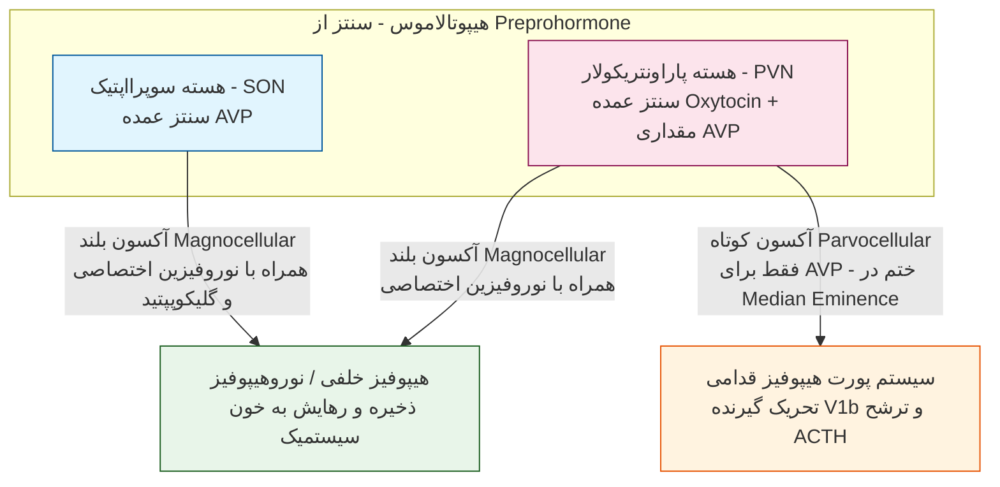
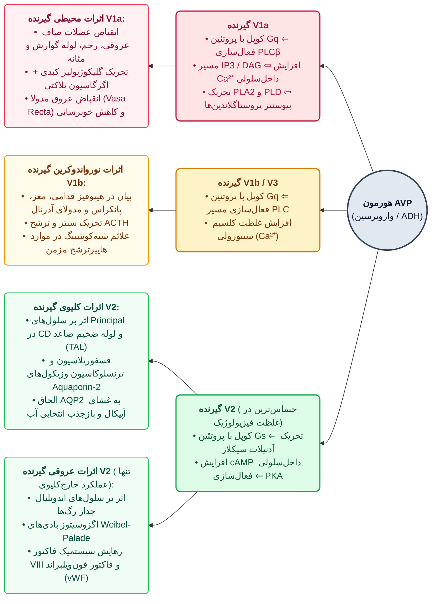
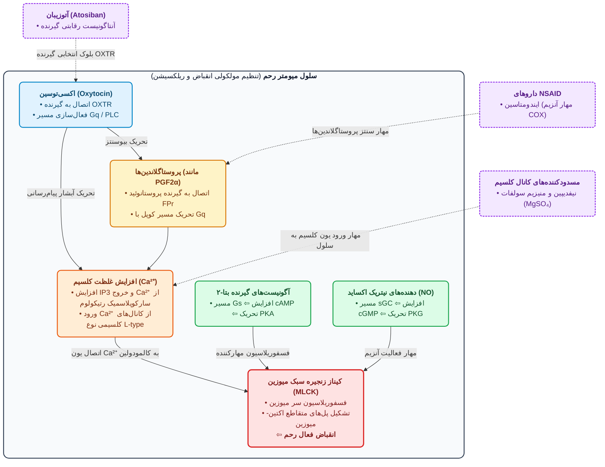

# 1. آناتومی، بیوسنتز، ساختار شیمیایی و فارماکوکینتیک نوروهیپوفیز

> [!info] بازتعریف هورمون‌های نوروهیپوفیز (فراتر از تعریف کلاسیک)
> **آرژنین وازوپرسین (AVP / ADH)** و **اکسی‌توسین (Oxytocin)** هورمون‌های هیپوتالاموسی هستند که در هیپوفیز خلفی آزاد می‌شوند. برخلاف تعریف قدیمی هورمون‌ها، این دو پپتید در سرتاسر CNS (از ساقه مغز تا کورتکس) به‌عنوان **نوروترانسمیتر** عمل کرده و در رفتارهای اجتماعی (*Social & emotional behaviors*) و تنظیم اتونوم نقش دارند (به اکسی‌توسین لقب *Passion hormone* یا هورمون عشق و اعتماد داده‌اند).



* **نکات طلایی آناتومی و سنتز (سیستم هیپوتالامو-نوروهیپوفیزیال):**
  1. **تخصصی بودن نورون‌ها:** هر دو هسته **SON** و **PVN** توانایی ساخت هر دو هورمون را دارند، اما **یک نورون واحد هرگز نمی‌تواند هر دو هورمون را همزمان بسازد** (نورون‌های سازنده AVP و اکسی‌توسین کاملاً مجزا هستند).
  2. **مسیر Parvocellular (اختصاصی AVP):** برخلاف اکسی‌توسین که همیشه به هیپوفیز خلفی می‌رود، برخی نورون‌های سازنده AVP در PVN آکسون کوتاه (*Parvocellular*) داشته و به ناحیه *External zone of Median Eminence* و سیستم پورت هیپوفیز قدامی ختم می‌شوند تا ترشح **ACTH** را تحریک کنند.
  3. **سنتز خارج مغزی (Non-CNS):**
     * **AVP:** در **قلب** (بافت اطراف عروق در پاسخ به *Elevated wall stress* ⇦ اختلال شل شدن بطن و انقباض عروق کرونر)، **غده آدرنال** (در مدولا باعث تحریک ترشح کاتکول‌آمین/آدرنالین از سلول‌های کرومافین؛ در کورتکس باعث رشد قشر و سنتز آلدوسترون)، و **ترشح اکتوپیک** در برخی تومورها (به‌ویژه **سرطان ریه**). همچنین در **گرانول‌های متراکم (Dense granules) پلاکت‌ها** (در کنار سروتونین/5-HT و ADP و ترومبوکسان A2) ذخیره می‌شود.
     * **اکسی‌توسین:** در جسم زرد تخمدان (*Luteal cells*)، اندومتر، جفت، **سلول‌های لایدیگ بیضه** (در مردان باعث تنظیم تحرک اسپرم و ⇧ تولید تستوسترون می‌شود) و بافت‌های غیرتولیدمثلی.

| ویژگی مقایسه‌ای | آرژنین وازوپرسین (AVP / ADH) | اکسی‌توسین (Oxytocin) | دسموپرسین (Desmopressin / DDAVP) |
| :--- | :--- | :--- | :--- |
| **ماهیت و ساختار پایه** | نوناپپتید حلقوی طبیعی در تمام پستانداران (*به جز خوک که در جایگاه 8 لیزین دارد: LVP*)؛ حلقه 6 آمینواسیدی (پل دی‌سولفیدی بین **Cys1 و Cys6**) + دنباله 3 آمینواسیدی | نوناپپتید حلقوی طبیعی؛ حلقه 6 آمینواسیدی (پل دی‌سولفیدی Cys1-Cys6) + دنباله 3 آمینواسیدی | آنالوگ سنتتیک و تغییریافته AVP (*Deamino D-Arginine Vasopressin*) |
| **تفاوت آمینواسیدی** | جایگاه 3: **فنیل‌آلانین (Phe)**<br>جایگاه 8: **L-آرژنین (L-Arg)** | جایگاه 3: **ایزولوسین (Ile)**<br>جایگاه 8: **لوسین (Leu)** | **دآمیناسیون سیستئین شماره 1** + تبدیل L-Arg به **D-Arg (راست‌بر) در جایگاه 8** |
| **فارماکوکینتیک و نیمه‌عمر** | غیرقابل مصرف خوراکی (تخریب با پپتیدازهای معده)؛ تجویز تزریقی یا اسپری نازال؛ نیمه‌عمر کوتاه (**20 تا 30 دقیقه**)؛ تخریب با *وازوپرسیناز* | غیرقابل مصرف خوراکی؛ تجویز تزریقی یا اسپری نازال؛ نیمه‌عمر کوتاه؛ تخریب پلاسمایی با *اکسی‌توسیناز* | مقاوم به پپتیداز؛ **قابل مصرف خوراکی**، اسپری نازال و تزریقی؛ **طولانی‌اثر (Long-acting)** (تجویز 1 تا 2 بار در روز) |
| **اختصاصیت گیرنده** | غیراختصاصی (تحریک V1a, V1b, V2) ⇦ عوارض عروقی و کرونری بالا | اختصاصی گیرنده اکسی‌توسین (OXTR) (*در دوز بسیار بالا تقلید اثر ADH و احتباس آب*) | **بسیار اختصاصی برای گیرنده V2 کلیوی** (حداقل اثر عروقی و اکسترارنال؛ ایمن در بیماران قلبی) |

> [!warning] دیابت بی‌مزه بارداری (Gestational DI)
> در برخی زنان باردار، فعالیت آنزیم **وازوپرسیناز (Vasopressinase)** جفتی به شدت افزایش یافته و با تخریب سریع AVP مادر، باعث بروز **دیابت بی‌مزه (پلی‌اوری)** می‌شود (با وجود اینکه حساسیت کلیه به AVP در بارداری افزایش می‌یابد).

---

# 2. تنظیم فیزیولوژیک و فارماکولوژیک ترشح وازوپرسین (AVP)

* **محرک‌های اصلی فیزیولوژیک ترشح AVP:**
  1. **هایپراسمولالیته پلاسما (حساس‌ترین محرک):**
     * آستانه (Threshold) شروع ترشح: **280 mOsm/kg**. با افزایش تنها **2%** اسمولالیته (رسیدن از 280 به **290 mOsm/kg**)، ترشح AVP به صورت **خطی (Linear)** حدود **3 تا 5 برابر** شده (به **5 pg/mL یا 5 pM** می‌رسد) و اسمولالیته ادرار به حداکثر توانایی تغلیظ کلیه یعنی **1200 mOsm/kg** می‌رسد.
     * در اسمولالیته **بالای 290 mOsm/kg**، مرکز **تشنگی (Thirst)** فعال می‌شود؛ زیرا کلیه بیش از 1200 قادر به تغلیظ ادرار نیست و بقای فرد وابسته به نوشیدن آب است (*در بادیه‌نشینان و یا در بیماری هیدروپس، Up-regulation کانال‌های آکواپورین-2 رخ می‌دهد؛ در هیدروپس باید مصرف آب محدود شود*).
     * **اسمورسپتورها:** عمدتاً در **CNS** هستند، اما در **گردش خون پورت کبدی (Hepatic portal)** نیز وجود دارند؛ به همین دلیل **بلع بار نمک خوراکی** حتی پیش از آنکه اسمولالیته پلاسما را بالا ببرد، از طریق اسمورسپتورهای پورت و اعصاب آوران **واگ و گلوسوفارنژیال**، هسته‌های SON و PVN را دپلاریزه کرده و AVP را آزاد می‌کند! (سوال امتحانی).
  2. **هایپوولمی و هایپوتنشن (قوی‌ترین محرک از نظر مقدار ترشح):**
     * کاهش حجم خون کمتر از 5% تا 10% اثر محسوسی ندارد؛ اما **کاهش حجم خون بیش از 10%** باعث افزایش **نمایی/لگاریتمی (Exponential)** ترشح AVP تا **20 الی 30 برابر** (20 تا 30 pg/mL) می‌شود! در این غلظت‌های بالا، علاوه بر اثر کلیوی، **اثرات غیرکلیوی (انقباض عروقی V1a)** نیز ظاهر می‌شوند.
     * **بارورسپتورها (محیطی):** گیرنده‌های حجمی/فشار پرشدگی در **دهلیز چپ، بطن چپ و وریدهای ریوی** و گیرنده‌های فشاری شریانی در **قوس آئورت و سینوس کاروتید**؛ پیام‌ها از طریق اعصاب **واگ و گلوسوفارنژیال** به ساقه مغز و سپس SON/PVN می‌رسند. (*علل کاهش حجم موثر خون:* خونریزی، مصرف دیورتیک‌ها، CHF، سیروز همراه آسیت، نارسایی آدرنال و هایپوتیروئیدی).
  3. **سایر محرک‌ها:** درد، تهوع و هایپوکسی.

```chart
{
  "type": "line",
  "data": {
    "labels": ["0%", "-5%", "-10%", "-15%", "-20%"],
    "datasets": [
      {
        "label": "ترشح نمایی AVP در کاهش حجم خون (هایپوولمی)",
        "data": [1, 2, 5, 15, 30],
        "borderColor": "#d32f2f",
        "backgroundColor": "rgba(211, 47, 47, 0.1)",
        "fill": true,
        "tension": 0.4
      },
      {
        "label": "ترشح خطی AVP در افزایش اسمولالیته (280 تا 300)",
        "data": [1, 3, 5, 8, 12],
        "borderColor": "#1976d2",
        "borderDash": [5, 5],
        "fill": false,
        "tension": 0.1
      }
    ]
  },
  "options": {
    "responsive": true,
    "plugins": {
      "title": {
        "display": true,
        "text": "مقایسه الگوی خطی (اسمولالیته) و نمایی (کاهش حجم خون) ترشح وازوپرسین (pg/mL)"
      }
    }
  }
}
```

> [!important] عوامل درون‌زا و داروهای موثر بر ترشح مرکزی AVP (بسیار مهم و امتحانی)
> * **تنظیم‌کننده‌های درون‌زا (Endogenous):**
>   * **محرک‌ها (+):** **آنژیوتانسین II** (نوروهیپوفیز فاقد سد خونی-مغزی/BBB است؛ آنژیوتانسین II خون محیطی باعث تشنگی شده و پس از تبدیل به **آنژیوتانسین III** ترشح AVP را تحریک می‌کند!)، استیل‌کولین (گیرنده نیکوتینی *nAChR*)، هیستامین (*H1*)، گلوتامین، آسپارتات، پروستاگلندین‌ها، CCK، NPY، ماده P و VIP.
>   * **مهارکننده‌ها (-):** **پپتید ناتریورتیک دهلیزی (ANP)**، **GABA**، دوپامین (گیرنده‌های *D1 و D2*) و اپیوئیدها.
> * **داروهای محرک ترشح AVP (ریسک ایجاد SIADH و مسمومیت با آب):**
>   1. **وین‌کریستین (Vincristine):** ضدسرطان وسیع‌الطیف؛ فاقد سرکوب مغز استخوان (*Bone marrow sparing*) اما دارای عارضه **نوروپاتی محیطی** و تحریک ترشح AVP.
>   2. **سیکلوفسفامید (Cyclophosphamide):** ضدسرطان آلکیله‌کننده؛ متابولیت آن باعث **سیستیت هموراژیک (هماچوری)** می‌شود. *تله بالینی:* برای پیشگیری از آسیب مثانه به بیمار مایعات و سرم فراوان می‌دهند، اما چون خود دارو ترشح AVP را تحریک می‌کند، تجویز مایعات زیاد خطر **مسمومیت کشنده با آب (Water intoxication) و هایپوناترمی** را به شدت بالا می‌برد!
>   3. **ضدافسردگی‌های سه‌حلقه‌ای (TCAs)** و **SSRIs:** به دلیل تحریک ملایم ترشح AVP، گاهی TCAs در **شب‌ادراری کودکان** کاربرد دارند.
>   4. **سایر محرک‌های دارویی:** نیکوتین، اپی‌نفرین، لیتیوم (بر ترشح مرکزی) و **مورفین با دوز بالا (HD)**.
> * **داروهای مهارکننده ترشح AVP (ایجاد دیورز):**
>   1. **اتانول (الکل):** مهارکننده مشترک ترشح **AVP و اکسی‌توسین**؛ مصرف مشروبات الکلی به دو علت دیورز می‌دهد: مهار ترشح AVP + بار بالای آب موجود در مشروب (*قدیم از اتانول 5% وریدی به عنوان توکولیتیک در زایمان زودرس استفاده می‌شد که منسوخ شده است*).
>   2. **سایر مهارکننده‌های دارویی:** **فنی‌توئین**، **مورفین با دوز پایین (LD)**، فلوفنازین، هالوپريدول، پرومتازین و کاربامازپین (*نکته: کاربامازپین ترشح مرکزی را کم می‌کند اما حساسیت کلیه به AVP را بالا می‌برد!*).

---

# 3. گیرنده‌ها، مکانیسم اثر سلولی و فارماکودینامیک وازوپرسین



* **جزئیات مکانیسم‌های نگهداری آب در کلیه (توسط V2 و V1a):**
  * **گیرنده V2 (در غشای بازولاترال سلول‌های Principal مجاری جمع‌کننده):** فعال‌سازی PKA ⇦ فسفوریلاسیون پروتئین‌ها ⇦ **اگزوسیتوز وزیکول‌های حاوی کانال آب (WCVs / Aquaporin-2)** به غشای آپیکال و مهار اندوسیتوز آن‌ها + افزایش بیان ژن آکواپورین-2 در درازمدت.
  * **سایر مکانیسم‌های کمکی تغلیظ ادرار در کلیه:** 1) تحریک V2 در بخش ضخیم بالارونده قوس هنله (**TAL**) ⇦ فعال‌سازی، جابجایی به غشا و افزایش بیان سیمپورتر **Na⁺-K⁺-2Cl⁻** (افزایش اسمولالیته مدولا)؛ 2) تحریک V2 در مجاری جمع‌کننده مدولاری داخلی (**IMCD**) ⇦ فعال‌سازی سریع ترنسپورتر اوره (**VRUT**) در غشای آپیکال؛ 3) تحریک **V1a** در عروق *Vasa recta* ⇦ کاهش سریع جریان خون مدولای داخلی جهت حفظ گرادیان اسمزی.
* **پراکندگی بافتی گیرنده V1a (وسیع‌ترین ساب‌تایپ):** عضله صاف عروق، غده آدرنال، میومتر رحم، مثانه، آدیپوسیت‌ها، هپاتوسیت‌ها (گلیکوژنولیز)، پلاکت‌ها، سلول‌های بینابینی مدولای کلیه، Vasa recta، طحال، بیضه و CNS. (تحریک V1a از طریق افزایش $Ca^{2+}$ و پروتئین کیناز C، فاکتور رونویسی **AP-1** و رشد سلولی را نیز تحریک می‌کند).

> [!important] تداخلات دارویی در سطح کلیه (تغییر حساسیت کلیه به AVP) - فوق‌العاده مهم!
> **الف) عوامل افزایش‌دهنده حساسیت کلیه به AVP (تشدید اثر ضدادراری؛ مفید در پارشیال DI):**
> 1. **داروهای NSAIDs (به‌ویژه ایندومتاسین):** پروستاگلندین‌های کلیوی، **آنتاگونیست فیزیولوژیک AVP** هستند (اثر AVP را مهار کرده و دیورز می‌دهند). مصرف NSAIDs با مهار سنتز پروستاگلندین‌ها، حساسیت کلیه به AVP را بالا می‌برد.
>    * *نکته بالینی بسیار مهم در بیماران هایپوولمیک/قلبی:* در افراد سالم NSAIDs سمیت کلیوی ندارند؛ اما در شرایط کاهش حجم موثر خون (**CHF، سیروز همراه آسیت، سندروم نفروتیک، هایپرتنشن کنترل‌نشده**)، کلیه برای حفظ جریان خون خود به پروستاگلندین‌های گشادکننده عروق وابسته است. تجویز طولانی NSAIDs (مثل ژلوفن، دیکلوفناک) در این بیماران باعث **احتباس آب، ادم، خارج شدن فشار خون از کنترل (مقاومت به داروهای ضدفشار خون) و نارسایی حاد کلیه (دیالیز)** می‌شود!
> 2. **کاربامازپین (Carbamazepine):** داروی ضدصرع؛ حساسیت کلیه به AVP را بالا می‌برد (کاربرد در DI مرکزی در بیمارانی که به علت بیماری کرونری تحمل AVP را ندارند).
> 3. **کلرپروپامید (Chlorpropamide):** داروی ضددیابت قدیمی (امروزه کم‌مصرف).
>
> **ب) عوامل کاهش‌دهنده حساسیت کلیه به AVP (ایجاد دیابت بی‌مزه نفروژنیک؛ کاربرد در درمان SIADH):**
> 4. **لیتیوم (Lithium):** داروی تثبیت‌کننده خلق در فاز نگهدارنده اختلال دوقطبی (*در فاز حاد مانیا از نورولپتیک‌ها و در افسردگی از آنتی‌دپرسانت استفاده می‌شود*). **یک‌سوم (1/3)** بیماران مصرف‌کننده لیتیوم دچار **دیابت بی‌مزه نفروژنیک** می‌شوند (که در صورت عدم پایش می‌تواند **برگشت‌ناپذیر** باشد). *مکانیسم:* لیتیوم در مصرف طولانی‌مدت سطح **پاراتورمون (PTH)** خون را بالا می‌برد و PTH به عنوان آنتاگونیست فیزیولوژیک، اثر AVP بر کلیه را مهار می‌کند.
> 5. **دمکلوسایکلین (Demeclocycline / دی‌متیل کلرتتراسایکلین):** آنتی‌بیوتیک تتراسایکلینی؛ مهار اثر AVP در کلیه (کاربرد در SIADH، اما دارای سمیت کبدی و نفروتوکسیسیتی در بیماران سیروزی).
> 6. **واپتان‌ها (Vaptans):** آنتاگونیست‌های مستقیم گیرنده V2.
> 7. **اختلالات الکترولیتی:** **هایپرکلسمی** و **هایپوکالمی** کلیه را به AVP غیرحساس می‌کنند.

---

# 4. آگونیست‌ها، آنتاگونیست‌ها (Vaptans) و کاربردهای بالینی سیستم وازوپرسین

| دسته و نام دارو | کاربردهای بالینی (FDA و پتانسیل‌های درمانی) | نکات طلایی، عوارض و کنتراایندیکاسیون‌ها |
| :--- | :--- | :--- |
| **AVP (آرژنین وازوپرسین)**<br>*(آگونیست غیراختصاصی V1/V2)* | 1. **دیابت بی‌مزه مرکزی گذرا (Transient Central DI):** ناشی از ترومای سر (*Head injury*) یا جراحی هیپوفیز.<br>2. **تست تشخیصی محرومیت از آب:** افتراق DI مرکزی (پاسخ به AVP و تغلیظ ادرار) از DI نفروژنیک (عدم پاسخ). | **مهم‌ترین و خطرناک‌ترین عارضه: اسپاسم عروق کرونر و آنژین صدری!** (منع مصرف یا احتیاط شدید در بیماری ایسکمیک قلب/CAD). سایر عوارض: رنگ‌پریدگی شدید صورت (*Facial pallor*)، کرامپ و افزایش حرکات گوارشی، هایپرتنشن، مسمومیت با آب. |
| **Desmopressin (DDAVP)**<br>*(آگونیست انتخابی V2)* | 1. **درمان انتخابی DI مرکزی دائمی (Permanent)**.<br>2. **شب‌ادراری اولیه کودکان (Nocturnal enuresis)** و پلی‌اوری شبانه.<br>3. **اختلالات انعقادی (به واسطه V2 اندوتلیال):** هموفیلی A (کمبود فاکتور VIII)، **بیماری فون‌ویلبراند نوع I و نوع IIn**، و خونریزی ناشی از اورمی یا سیروز.<br>4. بهبود سردرد ناشی از پونکسیون کمری (*Post-lumbar puncture headache*). | فاقد عوارض انقباض عروقی؛ اما **پیش از تجویز باید الکترولیت‌ها چک شوند** (در حضور **هایپوناترمی** یا پلی‌دیپسی سایکوژنیک اولیه کنتراایندیکه و خطرناک است).<br>**کنتراایندیکاسیون مطلق امتحانی:** در **فون‌ویلبراند نوع IIb (Type IIb vWD)** اکیداً ممنوع است؛ زیرا باعث **ترومبوسیتوپنی گذرا اما شدید** می‌شود! |
| **Terlipressin (Glypressin)** و **Felypressin**<br>*(آگونیست‌های انتخابی V1a)* | 1. **خونریزی واریس‌های مری** و پرفشاری پورت.<br>2. گاستریت هموراژیک حاد و **سیستیت هموراژیک ناشی از سیکلوفسفامید**.<br>3. کاهش خونریزی حین جراحی (برداشتن زخم سوختگی، پیوند کبد، سزارین، رزکسیون میوم رحم).<br>4. **ایلئوس پس از جراحی** و **دفع گاز روده** پیش از رادیوگرافی (*Dispel intestinal gas* جهت حذف سایه گاز).<br>5. شوک وازودیلاتوری و آسیستول. | در خونریزی واریس مری، معمولاً **همراه با نیتروگلیسرین (GTN)** تجویز می‌شوند تا عوارض انقباض عروق کرونر کاهش یافته و تحمل قلبی بیمار بالا برود. |
| **واپتان‌ها (Vaptans):**<br>**Tolvaptan, Mozavaptan** *(آنتاگونیست خوراکی V2)*<br>**Conivaptan** *(آنتاگونیست غیراختصاصی V1a/V2)* | درمان **SIADH**، **نارسایی احتقانی قلب (CHF)**، **هایپوناترمی**، سیروز، ادم مغزی، سندروم نفروتیک، نفروپاتی دیابتی و گلوکوم. | با بلوک گیرنده V2 در کلیه، دفع آب خالص (*Aquaresis*) را افزایش داده و هایپوناترمی و احتباس آب را بدون نیاز به داروهای سمی قدیمی (مثل لیتیوم یا دمکلوسایکلین) اصلاح می‌کنند. |
| **آنتاگونیست‌های آینده:**<br>**V1a بلاکر** / **V1b بلاکر** | *آنتاگونیست V1a:* **دیسمنوره، زایمان زودرس** (شل کردن رحم) و **پدیده رینود**.<br>*آنتاگونیست V1b:* اختلالات استرس، **اضطراب، افسردگی**، و **سندروم کوشینگ (تومورهای مترشحه ACTH)**. | در مرحله تحقیقات و توسعه برای کاربردهای اختصاصی غیرکلیوی. |

> [!tip] شاه‌نکته امتحانی: درمان پارادوکسیکال دیابت بی‌مزه نفروژنیک (Nephrogenic DI) با تیازیدها!
> در DI نفروژنیک، کلیه به AVP و دسموپرسین پاسخ نمی‌دهد. خط اول درمان (علاوه بر محدودیت مصرف نمک)، تجویز **دیورتیک‌های تیازیدی** (با همان دوز معمولی دیورتیکی) است!
> * **مکانیسم:** تیازیدها با دفع سدیم و کاهش خفیف حجم مایع خارج سلولی (ECF)، به صورت جبرانی **بازجذب سدیم و آب را در توبول پروگزیمال افزایش می‌دهند**؛ در نتیجه، حجم مایع بسیار کمتری به توبول‌های دیستال و مجاری جمع‌کننده رسیده و حجم ادرار روزانه به شدت کاهش می‌یابد!

---

# 5. فیزیولوژی و فارماکولوژی اکسی‌توسین (Oxytocin) و توکولیتیک‌ها

* **تنظیم ترشح اکسی‌توسین:**
  * **محرک‌های اصلی (عصبی-حسی):** 1) **اتساع سرویکس و واژن** (*مهم‌ترین محرک ترشح اکسی‌توسین*؛ به‌ویژه در مرحله دوم زایمان قابل ردیابی است، هرچند به دلیل ترشح پالسی و وجود آنزیم *اکسی‌توسیناز* سنجش دقیق آن در خون دشوار است)؛ 2) **مکیدن پستان (Suckling)** یا دستکاری مکانیکی آن؛ 3) صدای گریه نوزاد (*Infant crying*).
  * **محرک‌های مشترک با AVP:** درد، دهیدراتاسیون (افزایش اسمولالیته)، خونریزی (Hemorrhage) و هایپوولمی.
  * **تنظیم هورمونی و دارویی:** **استرادیول (استروژن)** ترشح و پاسخ‌دهی به اکسی‌توسین را **تحریک** می‌کند؛ اما **پروژسترون** (در شرایط آزمایشگاهی/In vitro؛ مقاومت به پروژسترون در اواخر بارداری به شروع زایمان کمک می‌کند)، پلی‌پپتید تخمدانی **ریلکسین (Relaxin)** (با اثر مستقیم و غیرمستقیم از طریق **اپیوئیدهای درون‌زا**) و **اتانول (الکل)** ترشح آن را **مهار** می‌کنند.



* **محل‌های اثر اکسی‌توسین:**
  1. **رحم (Uterus):** رحم یک عضله صاف است که برخلاف عروق (فاقد خودکاری) و گوارش (دارای خودکاری دائمی)، تنها در شرایط خاص (مشابه *Vas deferens* در مردان) **فعالیت ریتمیک (Rhythmic activity)** پیدا می‌کند.
     * *رحم غیرباردار به اکسی‌توسین پاسخ نمی‌دهد!* در نیمه دوم بارداری (به‌ویژه اواخر سه ماهه سوم)، به دلیل افزایش استروژن، **تعداد گیرنده‌های اکسی‌توسین (OXTR) در میومتر 20 تا 30 برابر (Up-regulation)** شده و **حساسیت رحم به اکسی‌توسین 8 برابر** می‌شود.
     * اکسی‌توسین هم **فرکانس (ریتم)** و هم **قدرت (تونوس)** انقباضات رحم را بالا برده و به نرم شدن سرویکس (*Cervix ripening*) کمک می‌کند.
  2. **پستان (Breast):** انقباض سلول‌های **میواپی‌تلیوم (Myoepithelium)** احاطه‌کننده مجاری آلوئولی ⇦ راندن شیر به سینوس‌های جمع‌کننده بزرگ و ایجاد **رفلکس فوران شیر (Milk ejection / Let-down reflex)**.
  3. **مغز (CNS) و فرضیه برجستگی اجتماعی (Social Salience Hypothesis):** نورون‌های اکسی‌توسینرژیک به آمیگدال، هیپوتالاموس، هیپوکامپ، مغز میانی، سیستم لیمبیک، مخچه و نخاع می‌روند و با تعامل با **نورون‌های دوپامینرژیک**، باعث تقویت رفتارهای اجتماعی مثبت (اعتماد، پیوند عاطفی، همکاری)، کاهش استرس، ترس و اضطراب می‌شوند (پتانسیل درمانی در **فوبیای اجتماعی، اعتیاد و اوتیسم**).

> [!important] مقایسه طلایی داروهای محرک رحم (اکسی‌توسین، پروستاگلندین‌ها و مترژن) و عوارض
> 1. **کاربردهای اکسی‌توسین:** القای زایمان (*Induction of labor*)، تقویت زایمان اختلال‌یافته (*Augmentation*)، مرحله سوم زایمان و **پیشگیری و درمان خونریزی پس از زایمان (Postpartum hemorrhage)** ناشی از آتونی رحم.
> 2. **چرا پروستاگلندین‌ها در القای زایمان جایگزین اکسی‌توسین شده‌اند؟** پروستاگلندین‌ها پپتید نیستند، ارزان‌ترند، نگهداری آسان‌تری دارند و تمام خواص اکسی‌توسین (افزایش فعالیت ریتمیک، افزایش تونوس و **Cervix ripening عالی**) را راحت‌تر و موثرتر انجام می‌دهند.
> 3. **تفاوت حیاتی با متیل‌ارگونوین (Methylergonovine / Methergine):** اکسی‌توسین و پروستاگلندین‌ها انقباضات ریتمیک ایجاد می‌کنند (مناسب برای خروج جنین)؛ اما **مترژن** تونوس عضله رحم را به قدری بالا می‌برد که انقباضات ریتمیک متوقف شده، رحم به حالت **اسپاسم تتانیک (Tetanus)** می‌رود و سرویکس بسته می‌شود! بنابراین مترژن **فقط پس از خروج جفت و جنین برای کنترل خونریزی پس از زایمان (PPH)** کاربرد دارد.
> 4. **عوارض اوردوز اکسی‌توسین:** تحریک بیش از حد رحم (انقباض تتانیک) و **پارگی رحم (Uterine rupture)**، احتباس آب و مسمومیت با آب (تقلید اثر ADH در دوز بالا)، و در تزریق بیش از حد باعث **پرفشاری خون (Hypertension) و انواع آریتمی‌های قلبی (PVC، تاکی‌کاردی سینوسی)** می‌شود.

* **درمان توکولیتیک (Tocolytic Therapy) برای مهار زایمان زودرس (Preterm Labor):**
  * **داروهای کلاسیک (اثربخشی بالینی محدود و ناکامل):**
    1. **آتوزیبان (Atosiban):** آنتاگونیست رقابتی گیرنده اکسی‌توسین (مورد استفاده در اروپا؛ **عدم تایید FDA در آمریکا** به دلیل اثربخشی ناکافی).
    2. **آگونیست‌های گیرنده $\beta_2$ آدرنرژیک** (افزایش cAMP و مهار MLCK).
    3. **مهارکننده‌های کانال کلسیم (CCB)** و **سولفات منیزیم ($MgSO_4$)** (مهار ورود کلسیم از کانال‌های L-type و Ligand-gated).
    4. **دهنده‌های نیتریک اکساید (NO donors)** (افزایش cGMP) و **مهارکننده‌های COX (NSAIDs)**.
  * **نکته پژوهشی استاد (دکتر دهپور):** در مطالعات تجربی، موثرترین ترکیب در آرام کردن انقباضات رحم، مواد موثره حشیش (**کانابینوئیدها / Cannabinoids و کانابیدیول**) بوده‌اند (علاوه بر کاربرد در تهوع شیمی‌درمانی، صرع، درد و اشتها).