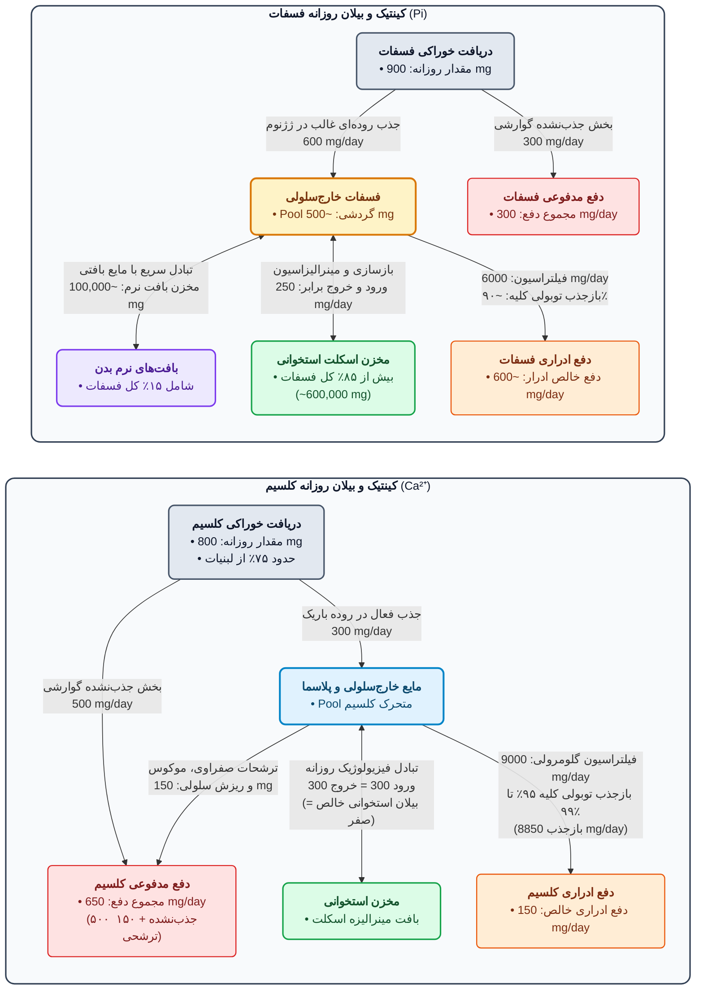
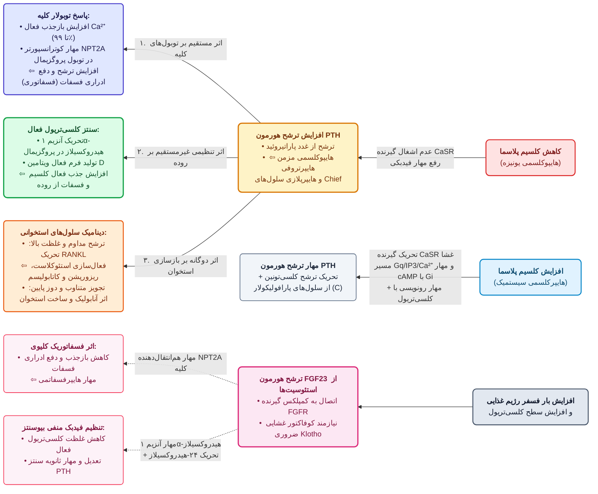
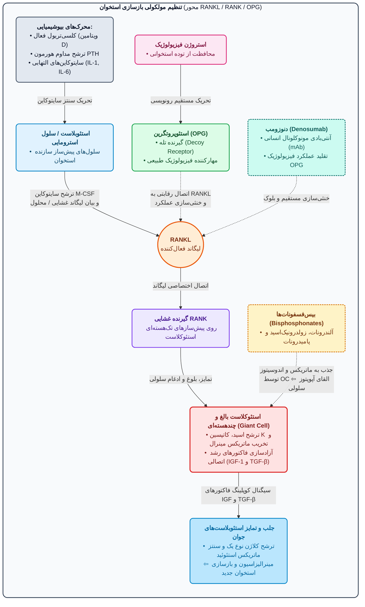

# 1. فیزیولوژی، توزیع و کینتیک کلسیم و فسفات

> [!info] نقش فیزیولوژیک، شیب غلظتی و توزیع کلسیم در بدن
> کلسیم کاتیونی حیاتی است که بیشترین **شیب غلظتی (ده‌ها هزار برابر)** را بین خارج و داخل سلول دارد (بیشتر از سدیم، پتاسیم و منیزیم):
> * **کلسیم داخل سلولی (< 1 µM؛ ساب‌میکرومولار):** نقش *پیام‌رسان ثانویه (Second messenger)*؛ اتصال به **کالمودولین (Calmodulin)** و فعال‌سازی آنزیم‌ها، انقباض عضله صاف و اگزوسیتوز/فیوژن وزیکول‌های ترشحی. افزایش طولانی‌مدت آن به میتوکندری (تولید انرژی) آسیب زده و سلول را می‌کشد؛ تنظیم از طریق رهایش از شبکه اندوپلاسمی، ورود از کانال‌ها و خروج خلاف شیب غلظت توسط پمپ حیاتی **PMCA (Plasma membrane Ca²⁺-ATPase)**.
> * **کلسیم خارج سلولی (~mM):** ضروری برای جریان الکتریکی غشاهای تحریک‌پذیر، انقباض عضلات، **انعقاد خون** و استخوان‌سازی. اصطلاحات بالینی **هایپوکلسمی و هایپرکلسمی صرفاً به کلسیم خارج سلولی اشاره دارند** (بی‌ارتباط با داخل سلول!).
> * **ذخیره کل بدن:** در مردان **1300 گرم** و در زنان **1000 گرم**؛ بیش از **99%** در استخوان‌ها و دندان‌ها متمرکز است و تنها **1%** در مایعات خارج سلولی حضور دارد.

* **فرکشن‌های سه‌گانه کلسیم سرم (توتال: 8.5 تا 10.4 mg/dL معادل 4.25 تا 5.2 mEq/L یا 2.1 تا 2.6 mM؛ میانگین 2.5 mM):**
  1. **یونیزه (Ionized - 50%؛ معادل 1.2 mM):** **تنها فرم فعال فیزیولوژیک و بیولوژیک!** تغییر آن علائم هایپو/هایپرکلسمی را ایجاد می‌کند.
  2. **کمپلکس با آنیون‌های کوچک چندظرفیتی (10%):** متصل به **فسفات و سیترات**. (*نکته تستی:* مجموع فرم یونیزه و کمپلکس یعنی **60% کلسیم سرم معادل 1.5 mM، قابل انتشار/Diffusible بوده** و از غشاها عبور می‌کنند).
  3. **متصل به پروتئین (Protein-bound - 40%):** **غیرقابل انتشار و غیرفعال** (مشابه داروهای باندشده). **90% به آلبومین** و بقیه به گلوبولین‌های α₁، α₂، β و γ متصل است.



* **جزئیات جذب گوارشی کلسیم و عوامل موثر بر آن:**
  * **مقدار نیاز روزانه (Adequate Intake):** نوجوانان **1300 mg**، بزرگسالان **1000 mg**، بالای 50 سال **1200 mg** (*میانگین دریافت در پسران و دختران 9 ساله به ترتیب 865 و 625 mg و در زنان بالای 50 سال 517 mg است*).
  * **دو مسیر جذب در روده باریک (مجموعاً 300 mg از 800 mg):**
    1. **جذب فعال و اختصاصی در دئودنوم (و ابتدای ژژنوم):** **وابسته به ویتامین D3 (کلسی‌تریول)**. ورود کلسیم از غشای لومینال توسط کانال **TRPV6** ⇦ انتقال در سیتوپلاسم با پروتئین **Calbindin D9K** ⇦ خروج از غشای بازولاترال توسط مبدل **NCX1 (Na⁺/Ca²⁺ exchanger)** و پمپ **PMCA1b** (*ویتامین D بیان TRPV6، کالبایندین و PMCA1b را بالا می‌برد*).
       * *نکته طلایی:* راندمان جذب روده‌ای کلسیم با میزان کلسیم رژیم **رابطه معکوس** دارد! در شرایط نرمال سهم دئودنوم کمتر است، اما در **کمبود کلسیم رژیم یا افزایش نیاز بدن**، مسیر فعال دئودنوم به شدت فعال می‌شود. این مسیر در **سالمندان** ضعیف عمل می‌کند.
    2. **انتشار غیرفعال (Passive diffusion) در ژژنوم و ایلئوم:** وابسته به کلسی‌تریول نیست، اما در شرایط عادی **بیشترین مقدار جذب کلسیم** را انجام می‌دهد!
  * **عوامل مختل‌کننده جذب و دفع کلسیم:**
    * *کاهش جذب روده‌ای:* بیماری‌های گوارشی (**استئاتوره، اسهال مزمن، سوءجذب**، رزکسیون روده) و مصرف طولانی‌مدت **گلوکوکورتیکوئیدها** و **فنی‌توئین**.
    * *تغییر دفع کلیوی با دیورتیک‌ها:* **دیورتیک‌های لوپ (فوروزماید)** دفع ادراری کلسیم را **زیاد** می‌کنند (نامناسب در استئوپروز)؛ برعکس، **تیازیدها** با دفع بیشتر سدیم، بازجذب توبولی کلسیم را **افزایش** می‌دهند (مفید و محافظت‌کننده در بیماران مستعد استئوپروز).
* **ویژگی‌های بیولوژیک فسفات (Phosphate):**
  * **اشکال:** 1) *آلی:* فسفولیپیدهای غشا و استرهای آلی؛ 2) *معدنی (Pi):* در مایع خارج سلولی عمدتاً به فرم $NaH_2PO_4$ و $Na_2HPO_4$. در pH 7.4 نسبت فرم دی‌سدیم به مونوسدیم **4 به 1** است (ظرفیت میانی پلاسما: **1.8**). به علت غلظت کم در ECF نقش بافری ناچیزی در خون دارد، اما در **دفع کلیوی $H^+$** و تعدیل کلسیم بافتی نقش کلیدی دارد. در استخوان با کلسیم به شکل کریستال‌های **هیدروکسی‌آپاتیت** با فرمول $Ca_{10}(PO_4)_6(OH)_2$ و کلسیم فسفات رسوب می‌کند.
  * **جذب روده‌ای فسفات:** عمدتاً در **ژژنوم** (کمی پاراسلولار غیرفعال، اما عمدتاً ترنس‌سلولار فعال توسط کوترنسپورتر لومینال **NPT2b** که بیان و فعالیت آن توسط **ویتامین D تحریک** می‌شود).

---

# 2. تنظیم هورمونی هموستاز کلسیم و فسفات (PTH، ویتامین D، کلسی‌تونین و FGF23)



* **نکات تکمیلی هورمون پاراتیروئید (PTH):**
  * **سنتز و فارماکوکینتیک:** سنتز به صورت *Preproparathyroid hormone* (115 آمینواسید) ⇦ *Pro-PTH* (هر دو غیرفعال) ⇦ **PTH فعال (84 آمینواسید)**؛ توالی آمینواسیدهای **1 تا 27** برای اتصال به گیرنده و فعالیت هورمون ضروری است. نیمه‌عمر پلاسمایی حدود **4 دقیقه**؛ کلیرانس **90% توسط کبد و کلیه**.
  * *نکته نارسایی کلیه:* در نارسایی کلیوی، قطعه **PTH(7-84)** در خون تجمع یافته و با فرم فعال PTH(1-84) رقابت می‌کند! همچنین در نارسایی مزمن کلیه (CRF)، **هایپرفسفاتمی** باعث افت کلسیم سرم ⇦ تحریک پاراتیروئید و افزایش PTH (هایپرپاراتیروئیدیسم ثانویه) و تشدید بیماری استخوانی می‌شود.
  * **گیرنده‌های PTH و پپتیدهای وابسته (PTHrP):**
    * **گیرنده نوع 1 (PTH1R):** مسئول هموستاز کلسیم؛ دارای تمایل اتصال به **هم PTH و هم PTHrP**. (*نکته بالینی:* سلول‌های بدخیم سرطانی با ترشح اکتوپیک **PTHrP** و تحریک این گیرنده، باعث **هایپرکلسمی ناشی از بدخیمی** می‌شوند!).
    * **گیرنده نوع 2 (PTH2R):** **فقط به خود PTH** پاسخ می‌دهد (به PTHrP پاسخ نمی‌دهد). گیرنده *CPTH* نیز برای قطعات کربوکسیل انتهایی وجود دارد.
    * *بافت‌های هدف غیرمعدنی PTH:* غضروف، عضله صاف عروق (VSM)، جفت، کبد، جزایر پانکراس، مغز، فیبروبلاست‌های پوست و لنفوسیت‌ها.
  * **پارادوکس گیرنده حساس به کلسیم (CaSR):** برخلاف سایر سلول‌های غدد درون‌ریز که افزایش کلسیم داخل سلولی باعث اگزوسیتوز هورمون می‌شود، در **سلول‌های پاراتیروئید** و **سلول‌های ژوگستاگلومرولار کلیه (ترشح‌کننده رنین)**، تحریک CaSR با کلسیم بالا (از طریق فعال‌سازی **Gq ⇦ PLC ⇦ IP3 ⇦ افزایش کلسیم درون‌سلولی** و فعال‌سازی **Gi ⇦ کاهش cAMP**) باعث **مهار رهایش PTH (و رنین)** می‌شود!

| ویژگی مقایسه‌ای | هورمون پاراتیروئید (PTH) | ویتامین D فعال (Calcitriol) | کلسی‌تونین (Calcitonin) | فاکتور FGF23 (همراه Klotho) |
| :--- | :--- | :--- | :--- | :--- |
| **محرک اصلی ترشح/سنتز** | **هایپوکلسمی** (عدم اشغال CaSR) | **PTH بالا**، **هایپوکلسمی**، **هایپوفسفاتمی** *(استروژن و پرولاکتین نیز محرک‌اند)* | **هایپرکلسمی** (ترشح از سلول‌های پارافولیکولار C تیروئید) | **بار بالای فسفر رژیم** و کلسی‌تریول بالا (ترشح از استخوان) |
| **اثر بر کلسیم و فسفات خون** | **⇧ کلسیم** / **⇩ فسفات** | **⇧ کلسیم** / **⇧ فسفات** *(تفاوت کلیدی با PTH!)* | **⇩ کلسیم** / **⇩ فسفات** (هورمون هایپوکلسمیک و هایپوفسفاتمیک) | **⇩ فسفات** (بی‌تاثیر مستقیم بر کلسیم؛ موازی با PTH در دفع فسفات) |
| **مکانیسم در کلیه و روده** | *کلیه:* ⇧ بازجذب کلسیم، **⇧ دفع فسفات**، تحریک سنتز کلسی‌تریول.<br>*روده:* افزایش جذب کلسیم (غیرمستقیم با ویتامین D). | *روده:* **⇧ مستقیم جذب فعال کلسیم و فسفات**.<br>*کلیه:* ⇧ بازجذب کلسیم و فسفات. | *کلیه:* **⇧ دفع ادراری کلسیم و فسفات** (مهار بازجذب در توبول پروگزیمال). | *کلیه:* **⇧ دفع ادراری فسفات** + **مهار 1α-hydroxylase** و تحریک 24-hydroxylase (⇩ کلسی‌تریول). |
| **مکانیسم در استخوان** | *مداوم:* ⇧ Resorption.<br>*متناوب (Low dose):* **تحریک استئوبلاست و ساخت استخوان**. | ⇧ بلوغ استئوکلاست (همراه PTH برای بسیج کلسیم) + ⇩ ساخت کلاژن توسط استئوبلاست + معدنی‌سازی مستقیم. | **مهار مستقیم استئوکلاست** (کاهش سریع *Ruffled border* یا غشای مضرس و عدم اتصال به استخوان قشری). | مهار غیرمستقیم از طریق کاهش کلسی‌تریول و مهار PTH. |

* **جزئیات مسیر بیوسنتز، اثرات و اختلالات ویتامین D (یک پروهورمون):**
  * **منابع:** 1) **ویتامین D2 (Ergocalciferol):** منشا **گیاهی/خوراکی**؛ 2) **ویتامین D3 (Cholecalciferol):** منشا **حیوانی** و سنتز در **پوست** از پیش‌ساز *7-dehydrocholesterol* در اثر تابش **UV**. (*متابولیت نهایی منبع حیوانی حدود 10 برابر قوی‌تر است، اما در درمان با تنظیم دوز تفاوتی ندارند*).
  * **دو مرحله هیدروکسیلاسیون برای فعال‌سازی:**
    1. **در کبد:** تبدیل به **25(OH)D3 (Calcifediol / Calcidiol)** توسط آنزیم *25-hydroxylase (CYP27A1)*. (*داروی Alfacalcidol نیز در کبد به کلسی‌فدیول تبدیل می‌شود*).
    2. **در کلیه (توبول پروگزیمال):** تبدیل به فرم نهایی و بسیار فعال **1,25(OH)2D3 (Calcitriol)** توسط آنزیم کلیدی **1α-hydroxylase (CYP27B1)**. (*آنزیم 24-hydroxylase یا CYP24A1 فرم‌های غیرفعال 24,25 و 1,24,25 را می‌سازد*).
  * **گیرنده‌های خارج اسکلتی ویتامین D (VDR) و اثرات غیرمعدنی:** بیان در سلول‌های خونساز (بلوغ و تمایز تک‌هسته‌ای‌ها)، لنفوسیت‌ها (تعدیل سایتوکاین و ایمنی)، اپیدرم پوست و فولیکول مو (**کاربرد در درمان پسوریازیس**)، بافت چربی، جزایر پانکراس، عضله اسکلتی، نورون‌های مغز، تنظیم فشار خون و **درمان سرطان**. (*نکته تستی:* در **لنفوم‌ها**، بیان نابجای گیرنده و آنزیم فعال‌کننده ویتامین D باعث **هایپرکلسمی بدخیمی** می‌شود!).
  * **اختلالات و کاربردهای بالینی ویتامین D:**
    * *کمبود:* راشیتیسم (**Rickets** در کودکان) و استئومالاسی (**Osteomalacia** در بزرگسالان).
    * *مسمومیت (Hypervitaminosis D):* **هایپرکلسمی و هایپرفسفاتمی**، یبوست، افسردگی، خستگی، پلی‌اوری، سنگ کلیه، **مسمومیت با دیگوکسین**، و در جنین باعث **تنگی مادرزادی فوق دریچه‌ای آئورت (Congenital supravalvular aortic stenosis)**.
    * *چهار کاربرد درمانی اصلی:* 1) پیشگیری و درمان راشیتیسم تغذیه‌ای؛ 2) درمان راشیتیسم متابولیک و استئومالاسی (**به‌ویژه در نارسایی مزمن کلیه/CRF** که آنزیم 1-آلفا هیدروکسیلاز مختل است)؛ 3) درمان **هایپوپاراتیروئیدیسم**؛ 4) پیشگیری و درمان **استئوپروز**.

---

# 3. فیزیولوژی استخوان، بازسازی (Remodeling) و پاتوفیزیولوژی استئوپروز

* **ساختار اسکلت (محوری/Axial و ضمیمه‌ای/Appendicular):**
  1. **استخوان قشری (Cortical - 80% اسکلت):** تنه استخوان‌های دراز (*Shaft of long bones*).
  2. **استخوان اسفنجی/ترابکولار (Trabecular / Vertebral - 20% اسکلت):** مهره‌ها، اپی‌فیز استخوان‌های دراز و ستیغ ایلیاک. به دلیل **فعالیت متابولیک بسیار بالاتر**، در افزایش سن و یائسگی **اولین استخوانی است که دچار تحلیل و پوکی می‌شود!**
* **ترکیب ماتریکس استخوان (Osteoid) و سلول‌ها:**
  * نیمی از توده استخوان مینرال (**هیدروکسی‌آپاتیت** و بی‌کربنات کلسیم) و نیمی ماتریکس آلی است که جزء اصلی آن **کلاژن** است؛ در کنار آن پروتئوگلیکان‌ها، **استئوکلسین** و فسفوپروتئین کلیدی **استئونکتین (Osteonectin)** (مسئول **اتصال کلاژن به کلسیم** و استحکام استخوان) قرار دارند.
  * **سلول‌ها:** 1) **استئوبلاست (OB):** مشتق از مغز استخوان؛ ترشح استئوئید (کلاژن) و فعال‌سازی استئوکلاست‌ها؛ 2) **استئوسیت:** مشتق از استئوبلاست‌های محبوس‌شده در استئوئید حین استخوان‌سازی؛ 3) **استئوکلاست (OC):** مشتق از رده **مونوسیت/ماکروفاژ**؛ تبدیل به سلول‌های چند هسته‌ای غول‌پیکر (**Giant cells**) و جذب استخوان (*Resorption*) در حفره جذبی (*Resorptive pit*) با ترشح **یون $H^+$**، آنزیم **Cathepsin K** و **TRAP** از غشای مضرس (*Ruffled border*) (اتصال به سطح استخوان در ناحیه *Sealing zone* به کمک **Osteopontin**)؛ 4) سلول‌های کمکی (ماکروفاژ، لنفوسیت، اندوتلیال) که سایتوکاین ترشح می‌کنند.



> [!warning] اپیدمیولوژی و روند تحلیل استخوان در استئوپروز (Osteoporosis)
> از سن **35 تا 40 سالگی** سالانه **0.5% تا 1%** توده استخوانی کاسته می‌شود. پس از **یائسگی در زنان** (و *Castration* در مردان)، این سرعت **10 برابر شده و به 10% در سال** می‌رسد (سپس به مرور به 3% می‌رسد). در آمارها **1 نفر از هر 4 زن** به علت استئوپروز دچار شکستگی با حداقل تروما می‌شود.
> * **نقش دوگانه گلوکوکورتیکوئیدها:** در **دوز فیزیولوژیک** به تمایز استئوبلاست‌ها کمک می‌کنند؛ اما در **دوزهای بالای درمانی** با مهار IGF، به تاخیر انداختن تمایز استئوبلاست‌ها و فعال کردن استئوکلاست‌ها، استئوپروز شدید ایجاد می‌کنند.

---

# 4. مدیریت اورژانسی اختلالات کلسیم (هایپرکلسمی و هایپوکلسمی)

* **الف) هایپرکلسمی (Hypercalcemia):**
  * **اتیولوژی امتحانی:** شایع‌ترین علت در بیماران **سرپایی (Outpatient): هایپرپاراتیروئیدیسم اولیه**؛ شایع‌ترین علت در بیماران **بستری (Hospitalized): بدخیمی‌های سیستمیک** (با یا بدون متاستاز استخوانی).
  * **علائم:** خستگی، ضعف عضلانی، بی‌اشتهایی، افسردگی، درد منتشر شکمی، **یبوست**، و **پلی‌اوری شدید** (کاهش حجم موثر داخل عروقی/دهیدراتاسیون).
  * **پروتکل درمانی به ترتیب اولویت:**
    1. **احیای مایعات با نرمال سالین وریدی (Fluid resuscitation - 6 تا 8 لیتر!):** **اولین و حیاتی‌ترین اقدام** جهت جبران دهیدراتاسیون ناشی از پلی‌اوری و افزایش دفع کلیوی کلسیم.
    2. **دیورتیک‌های لوپ (فوروزماید):** افزایش دفع کلسیم و جلوگیری از اورلود حجمی. (**شرط حیاتی:** حتماً باید **پس از اصلاح کامل حجم داخل عروقی** تجویز شود، وگرنه دهیدراتاسیون و هایپرکلسمی را بدتر می‌کند!).
    3. **بیس‌فسفونات‌های تزریقی (Zoledronate و Pamidronate):** **بهترین و قوی‌ترین داروها** برای کنترل هایپرکلسمی (به‌ویژه در بدخیمی‌ها)؛ زولدرونات از پامیدرونات بسیار قوی‌تر است.
    4. **کلسی‌تونین:** شروع اثر **سریع** دارد، اما عیب بزرگ آن بروز سریع **تحمل (Tolerance / Tachyphylaxis)** پس از چند روز مصرف است.
    5. **کورتیکواستروئیدها (مثلاً 60 تا 80 میلی‌گرم پردنیزولون):** موثر (به‌ویژه در مسمومیت ویتامین D و لنفوم)، اما عیب آن‌ها **شروع اثر بسیار کند (7 تا 10 روز)** است.
* **ب) هایپوکلسمی (Hypocalcemia):**
  * **علائم:** افزایش تحریک‌پذیری عصبی-عضلانی، **تتانی**، پارستزی، کرامپ عضلانی، **لارنگواسپاسم** و تشنج تونیک-کلونیک.
  * **درمان و نکات طلایی املاح کلسیم:**
    * *اورژانسی/تزریقی (IV):* **کلسیم کلراید** و **کلسیم گلوکونات**.
    * *خوراکی:* **کلسیم کربنات**.
    * **دو هشدار مرگبار در تجویز کلسیم (سوال قطعی امتحان):**
      1. املاح تزریقی کلسیم **هرگز نباید عضلانی (IM) تزریق شوند**؛ زیرا باعث **نکروز شدید موضعی بافت** می‌شوند! (از دیگر عوارض مصرف طولانی کلسیم: *کلسیفیکاسیون شریانی*).
      2. در بیماران مبتلا به **نارسایی احتقانی قلب (CHF) که گلیکوزیدهای قلبی (دیگوکسین) مصرف می‌کنند**، تجویز کلسیم (و هایپرکلسمی) **بسیار خطرناک و ممنوع** است (تشدید شدید سمیت و آریتمی دیگوکسین؛ این بیماران نیازمند **پتاسیم** هستند نه کلسیم!).

---

# 5. فارماکولوژی جامع داروهای استئوپروز و اختلالات استخوانی

| دسته و نام دارو | مکانیسم اثر دقیق | کاربردها، نحوه مصرف، عوارض و نکات طلایی امتحانی |
| :--- | :--- | :--- |
| **بیس‌فسفونات‌ها (Bisphosphonates):**<br>*خوراکی:* **Alendronate, Risedronate, Etidronate**<br>*تزریقی:* **Zoledronate (Zoledronic acid), Pamidronate**<br>*(Medronate)* | آنالوگ‌های مقاوم به آنزیم **پیروفسفات**؛ تشکیل کمپلکس با کلسیم و تمرکز در مناطق بازسازی استخوان ⇦ بلعیده شدن توسط استئوکلاست‌ها حین Resorption ⇦ **القای آپوپتوز (مرگ) استئوکلاست‌ها**. نسل 2 و 3 دارای اثرات **ضدسرطان مستقیم و ضد رگ‌زایی (Anti-angiogenic)**. | **پنج کاربرد اصلی:** 1) استئوپروز پس از یائسگی؛ 2) پیشگیری و درمان **استئوپروز ناشی از کورتون (GC)**؛ 3) **بیماری پاژه (Paget's disease)**؛ 4) **هایپرکلسمی بدخیمی**؛ 5) **متاستاز استخوانی سرطان پستان و پروستات** (زولدرونات و پامیدرونات).<br>**اشکال:** آلندرونات و ریزدرونات (قرص **هفته‌ای یک‌بار**)؛ زولدرونیک اسید (تزریق وریدی **سالی یک‌بار** یا دو بار).<br>**عوارض:** **ازوفاژیت شدید (Esophagitis)**، زخم پپتیک، درد استخوانی، **سمیت کلیوی** (لزوم **چک کردن کراتینین** در مصرف طولانی). *نکته:* **اتیدرونات** در مصرف بیش از حد به طور متناقض باعث **افزایش شکستگی استخوان** می‌شود! |
| **Denosumab (دنوزومب)** و **r-OPG** | **آنتی‌بادی مونوکلونال انسانی علیه RANKL** (تقلید اثر OPG) ⇦ خنثی‌سازی RANKL در خون و سطح استئوبلاست ⇦ عدم اتصال به RANK و مهار تشکیل Giant cell. | درمان بسیار اختصاصی و قوی استئوپروز؛ **تزریق زیرجلدی هر 6 ماه یک‌بار** (بسیار گران‌قیمت). (*r-OPG نیز استئوپروتگرین نوترکیب با مکانیسم مشابه است*). |
| **Teriparatide (تری‌پاراتاید)** | قطعه نوترکیب **34 آمینواسیدی** (در برخی متون 24) از PTH؛ در تجویز **متناوب و دوز کم (Low-dose intermittent)** باعث **افزایش تعداد و فعالیت استئوبلاست‌ها و کاهش آپوپتوز آن‌ها** می‌شود. | **تنها داروی آنابولیک (استخوان‌ساز) واقعی** در لیست کلاسیک؛ افزایش شدید تراکم استخوان (BMD) و کاهش شکستگی مهره‌ای و غیرمهره‌ای در زنان یائسه.<br>**عوارض:** **افت فشار خون وضعیتی خفیف (Orthostatic hypotension)**، هایپرکلسمی، تهوع و کرامپ عضلانی. |
| **تعدیل‌کننده‌های گیرنده استروژن (SERMs):**<br>**Raloxifene, Tamoxifen** | **آگونیست استروژن در استخوان و سیستم قلبی-عروقی/کبد** (افزایش تولید OPG و مهار استئوکلاست)؛ **آنتاگونیست در پستان** (و عدم تحریک رحم در رالوکسیفن). | جایگزین استروژن طبیعی (HRT) برای حذف ریسک سرطان پستان و رحم. *عیب در مصرف طولانی:* تحمل دشوار به دلیل ایجاد **گرگرفتگی (Flushing)** و عوارض عروقی/ترومبوآمبولی. |
| **کلسی‌تونین نوترکیب:**<br>**Salcatonin** *(از ماهی سالمون)* | مهار مستقیم استئوکلاست و غشای مضرس آن. | مصرف به صورت **اسپری نازال (Nasal spray)** یا تزریقی در استئوپروز و هایپرکلسمی.<br>**عوارض:** تهوع و استفراغ، **گرگرفتگی صورت (Facial flushing)** و **طعم بد دهان**. |
| **Cinacalcet (سیناکلست)**<br>*(Calcimimetic)* | داروی **مقلد کلسیم (کلسیمیمتیک)**؛ اتصال به گیرنده **CaSR** در پاراتیروئید و **افزایش حساسیت آن به کلسیم خارج سلولی** ⇦ مهار ترشح PTH در غلظت‌های پایین‌تر کلسیم. | درمان **هایپرپاراتیروئیدیسم ثانویه (ناشی از نارسایی مزمن کلیه/CRF)** و هایپرکلسمی ناشی از **کارسینوم پاراتیروئید**. |
| **سایر عوامل موثر بر استخوان:**<br>**Strontium**, **Statins**, **IGF-1**, **Thiazides** | *استرانسیم:* عنصر معدنی با گردش مشابه کلسیم؛ **مهار همزمان Resorption و تحریک Formation**.<br>*استاتین‌ها:* تحریک استخوان‌سازی + موثر در **بیماری‌های نورودژنراتیو و بهبود اختلالات حافظه**. | تیازیدها، ویتامین D و مکمل کلسیم به عنوان درمان‌های پایه و کمکی در مدیریت یکپارچه استئوپروز به کار می‌روند. |

> [!important] دو نکته طلایی و فوق‌العاده امتحانی (دستور مصرف آلندرونات و تفاوت Calcimimetics با Ca Sensitizers)
> 1. **قانون سخت‌گیرانه مصرف بیس‌فسفونات‌های خوراکی (آلندرونات):** جذب خوراکی بیس‌فسفونات‌ها **بسیار ناچیز (حدود 1%)** است و در حضور غذا، کلسیم، آهن، آنتی‌اسیدها و هرگونه کاتیون دوظرفیتی کاملاً مختل می‌شود. همچنین به دلیل ریسک بالای **ازوفاژیت**، بیمار باید قرص را **صبح ناشتا (1 ساعت قبل از صبحانه)**، فقط با یک لیوان **آب ساده (ترجیحاً آب دمینرالیزه/فاقد املاح و نه آب معدنی!)** ببلعد و تا **1 ساعت کاملاً سرپا یا نشسته (Upright) بماند** و دراز نکشد!
> 2. **تفاوت مفهومی Calcimimetics با Calcium Sensitizers (تله تستی دکتر دهپور):**
>    * **کلسیمیمتیک‌ها (مثل Cinacalcet):** روی گیرنده غشایی **CaSR در غده پاراتیروئید** اثر کرده و ترشح PTH را مهار می‌کنند.
>    * **حساس‌کننده‌های کلسیم (Calcium Sensitizers):** داروهایی هستند که در **نارسایی احتقانی قلب (CHF)** کاربرد دارند؛ این داروها **سلول میوکارد قلب را به مقادیر کم و فیزیولوژیک کلسیم داخل سلولی حساس می‌کنند** تا تعامل اکتین و میوزین (قدرت انقباضی قلب) بدون نیاز به افزایش خطرناک غلظت کلسیم درون‌سلولی تقویت شود!

```chart
{
  "type": "line",
  "data": {
    "labels": ["0", "6", "12", "18", "24", "30", "36"],
    "datasets": [
      {
        "label": "Teriparatide (بیشترین افزایش تراکم استخوان)",
        "data": [0, 4.5, 9, 13.8, null, null, null],
        "borderColor": "#8e24aa",
        "backgroundColor": "rgba(142, 36, 170, 0.1)",
        "tension": 0.2
      },
      {
        "label": "PTH + Estradiol",
        "data": [0, 4, 5.2, 8.6, 10.3, 11.6, 13.1],
        "borderColor": "#1e88e5",
        "tension": 0.2
      },
      {
        "label": "Alendronate",
        "data": [0, 4, 5.2, 6, 7, 7.6, 8],
        "borderColor": "#43a047",
        "tension": 0.2
      },
      {
        "label": "Estradiol",
        "data": [0, 1.8, 3.2, 3.8, 4.2, 4.6, 5.1],
        "borderColor": "#fb8c00",
        "tension": 0.2
      },
      {
        "label": "Raloxifene",
        "data": [0, 1.5, 2.7, 2.8, 3, 3.1, 3.2],
        "borderColor": "#e53935",
        "tension": 0.2
      },
      {
        "label": "Calcitonin",
        "data": [0, 2.4, 1.8, 1.9, 2, null, null],
        "borderColor": "#00acc1",
        "tension": 0.2
      },
      {
        "label": "Placebo (پلاسبو)",
        "data": [0, -0.3, -0.7, -0.6, -0.6, -0.6, -0.7],
        "borderColor": "#757575",
        "borderDash": [5, 5],
        "tension": 0.1
      }
    ]
  },
  "options": {
    "responsive": true,
    "plugins": {
      "title": {
        "display": true,
        "text": "مقایسه درصد افزایش تراکم استخوان مهره ای (% Change Lumbar Spine BMD) در طول 36 ماه درمان"
      }
    }
  }
}
```