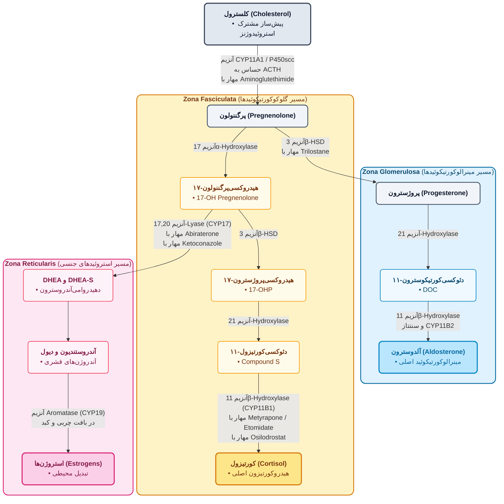
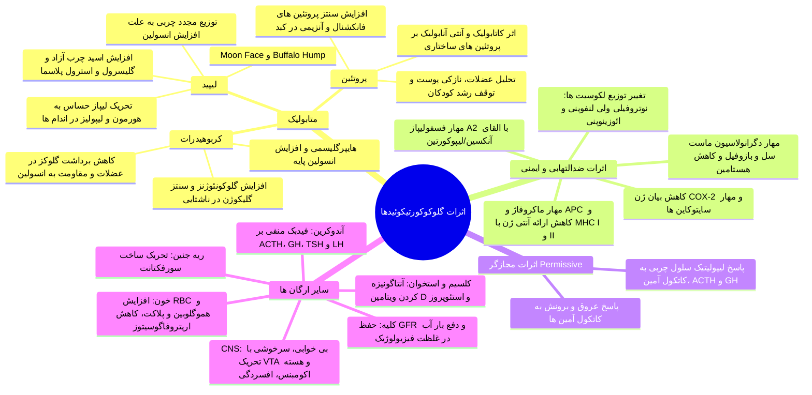
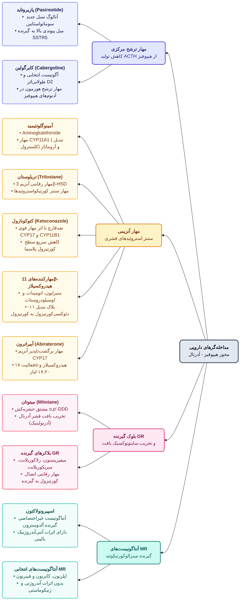

# 1. آناتومی، بیوسنتز و فیزیولوژی غده آدرنال

* **بخش‌های غده فوق کلیوی (Adrenal):**
  1. **مدولا (مرکزی):** ترشح کاتکول‌آمین‌ها (**اپی‌نفرین/آدرنالین** و **نوراپی‌نفرین/نورآدرنالین**).
  2. **کورتکس (قشری):** سنتز استروئیدهای آدرنال از کلسترول (ضروری برای بقا/Survival؛ کشف بیماری آدیسون در 1855 و ضرورت کورتکس در 1856).

* **جزئیات نواحی سه‌گانه کورتکس و هورمون‌ها:**
  1. **ناحیه گلومرولوزا (Glomerulosa):** فاقد 17α-hydroxylase؛ دارای آنزیم کلیدی **21-hydroxylase** و آلدوسترون سنتاز (CYP11B2) ⇦ ترشح **آلدوسترون** و **DOC**.
     * *تنظیم ترشح:* محرک اصلی آلدوسترون **آنژیوتانسین II** (متعاقب افت سدیم) و پتاسیم است؛ اثر ACTH روی آلدوسترون **نسبی** است (در غیاب ACTH، ترشح آلدوسترون **نصف (1/2)** می‌شود). اما ترشح پیش‌ساز آن یعنی **DOC (11-deoxycorticosterone) کاملاً وابسته به ACTH** است!
  2. **ناحیه فاسیکولاتا (Fasciculata):** ترشح عمده **کورتیزول (هیدروکورتیزون)** (10 تا 20 میلی‌گرم در روز در شرایط بدون استرس) + مقادیر کم آندروژن. آنزیم کلیدی نهایی: **11β-hydroxylase (CYP11B1)**.
  3. **ناحیه رتیکولاریس (Reticularis):** فعالیت بالای **17α-hydroxylase** ⇦ ترشح آندروژن‌های آدرنال: **DHEA**، **DHEA-sulfate**، **آندروستن‌دیون** و **آندروستن‌دیول** (*آندروستن‌دیول اثر استروژنی قوی‌تری دارد*). این آندروژن‌ها در بافت چربی و کبد توسط *آروماتاز* به استروژن تبدیل می‌شوند.

> [!info] تنظیم محور HPA و عوامل موثر بر ترشح CRH (CRF)
> هیپوتالاموس با ترشح **CRH (CRF)** بر هیپوفیز قدامی اثر گذاشته و پیش‌ساز **پرو-اوپیوملانوکورتین (POMC)** را به سه ترکیب تجزیه می‌کند: **ACTH**، **α-MSH** (محرک ملانوسیت و پیگمانتاسیون) و **β-endorphin**.
> * **محرک‌های ترشح CRH (+):** استرس فیزیکی و هیجانی (تروما، جراحی)، هیپوگلیسمی، مواجهه با سرما، درد شدید، سایتوکاین‌های پیش‌التهابی (**IL-1, IL-2, IL-6, TNF-α**)، **استیل‌کولین** و **سروتونین**.
> * **مهارکننده‌های ترشح CRH (-):** فیدبک منفی **کورتیزول** (بر هیپوفیز و هیپوتالاموس)، فیدبک منفی **ACTH** (بر هیپوتالاموس)، و نوروترانسمیتر **GABA**.
> * **اثر دوگانه:** **نوراپی‌نفرین** بر ترشح CRH اثر دوگانه (تحریکی/مهاری) دارد.

---

# 2. فارماکوکینتیک، ریتم شبانه‌روزی و مکانیسم اثر

* **پروتئین‌های حامل پلاسمایی و دفع:**
  * **90%** متصل به **CBG (Corticosteroid-Binding Globulin / α₂-globulin):** دارای **تمایل (Affinity) بالا اما ظرفیت اتصال کل پایین**. سطح CBG در **بارداری** و **هایپرتیروئیدی** تغییر کرده و کورتیزول آزاد (Free) را متاثر می‌کند.
  * **5%** متصل به **آلبومین:** دارای **تمایل پایین اما ظرفیت اتصال بسیار بالا**.
  * **5%** به فرم آزاد و فعال. نیمه‌عمر پلاسمایی کورتیزول کوتاه است (حدود **90 دقیقه**). متابولیسم اصلی در **کبد** بوده و حدود **1%** بدون تغییر از ادرار دفع می‌شود.

> [!important] نکته طلایی آنزیم 11β-HSD و تداخل خطرناک شیرین‌بیان (Licorice)
> کورتیزول علاوه بر گیرنده گلوکوکورتیکوئیدی (GR)، توانایی اتصال به گیرنده مینرالوکورتیکوئیدی (MR) را نیز دارد.
> * **آنزیم 11β-HSD نوع 2:** موجود در بافت‌های هدف آلدوسترون (**کلیه، کولون و غدد بزاقی**)؛ حدود 20% کورتیزول را به فرم غیرفعال **کورتیزون (Cortisone)** (فاقد اثر روی GR و MR) تبدیل می‌کند تا از احتباس شدید آب و نمک توسط کورتیزول جلوگیری شود. (*نوع 1 این آنزیم در کبد برعکس عمل کرده و کورتیزون را به کورتیزول فعال تبدیل می‌کند*).
> * **تداخل با شیرین‌بیان (Glycyrrhiza glabra / Licorice):** مصرف پودر یا قرص شیرین‌بیان (مورد استفاده در زخم معده و رفلاکس) هر دو آنزیم **11β-HSD نوع 1 و 2 را مهار می‌کند** ⇦ عدم تبدیل کورتیزول به کورتیزون در کلیه ⇦ تجمع کورتیزول و تحریک شدید گیرنده‌های مینرالوکورتیکوئیدی ⇦ **احتباس شدید آب و سدیم، ادم و هایپرتنشن** (بسیار خطرناک و کنتراایندیکه در بیماران مبتلا به **نارسایی احتقانی قلب (CHF)** و **فشار خون بالا**!).

* **ریتم شبانه‌روزی (Circadian Rhythm) و مفهوم آکروفاز:**
  * **سطح پلاسمایی کورتیزول:** حداکثر (پیک) در **8 صبح** و حداقل در **8 شب (غروب)**.
  * **حساسیت (Affinity) گیرنده‌های گلوکوکورتیکوئید:** **رابطه معکوس با غلظت کورتیزول دارد!** در ساعت 8 صبح به دلیل حداکثر فعالیت آنزیم **استیلاز (Acetylase)** و استیله شدن گیرنده GR، تمایل اتصال کورتیزول به گیرنده در **حداقل** است؛ اما در ساعت 8 شب (غروب) استیلاسیون کم شده و حساسیت گیرنده در **حداکثر** است.
  * **کاربرد بالینی در تجویز کورتون:** به دلیل حساسیت بالای گیرنده‌های هیپوفیز در غروب، تجویز کورتون در غروب/شب باعث **شدیدترین سرکوب محور آدرنال (Adrenal suppression)** می‌شود؛ لذا کورتون‌ها باید **اول صبح** (یا صبح و ظهر/ساعت 2) تجویز شوند و اعمال جراحی غیراورژانسی نیز جهت تحمل بهتر استرس، اول صبح انجام می‌شوند.

> [!tip] مفهوم آکروفاز (Acrophase) و زمان‌بندی تجویز داروها (Chronopharmacology)
> **آکروفاز** یعنی ساعتی از شبانه‌روز که علائم یک بیماری یا پروسه فیزیولوژیک به حداکثر شدت خود می‌رسد؛ دارو باید طوری تجویز شود که پیک اثرش با آکروفاز بیماری منطبق گردد:
> * **رینیت آلرژیک:** آکروفاز اول صبح (گرفتگی بینی صبحگاهی) ⇦ تجویز آنتی‌هیستامین در **شب هنگام خواب**.
> * **زخم پپتیک (PUD):** آکروفاز ترشح اسید ساعت **2 تا 3 بامداد** ⇦ تجویز **H2-blocker در شب** (و PPI مثل امپرازول در صبح).
> * **حملات آسم:** آکروفاز ساعت **3 تا 4 بامداد** ⇦ تجویز تئوفیلین در **آخر شب**.
> * **پرفشاری خون:** آکروفاز **اول صبح** (پیک کاتکول‌آمین‌ها).

* **مکانیسم اثر سلولی:**
  * برخلاف استروئیدهای جنسی، ویتامین D، رتینوئیک اسید و تیروئید که گیرنده‌شان در هسته است، گیرنده گلوکوکورتیکوئید (**hGRα** فعال و **hGRβ**) در حالت غیرفعال در **سیتوپلاسم** بوده و متصل به پروتئین‌های پایدارکننده (Chaperones) شامل **HSP90، HSP70 و HSP40 (یا FKBP/ایمونوفیلین)** است.
  * ورود دارو به سلول ⇦ اتصال به لیگاند باندینگ دومین ⇦ جدایی HSPها ⇦ تشکیل همودایمر یا هترودایمر ⇦ ورود به هسته و اتصال به پروموتر **GRE (Glucocorticoid Response Element)** روی DNA ⇦ تغییر رونویسی ژن.
  * *مکانیسم‌های مستقل از دایمریزاسیون و تفاوت بافتی:* کمپلکس هورمون-گیرنده می‌تواند بدون دایمریزاسیون، مستقیماً به فاکتورهای رونویسی پیش‌التهابی مثل **AP-1** و **NF-κB** متصل شده و مانع رونویسی ژن‌های التهابی شود. همچنین اتصال کورگولاتورها (*Coactivators / Corepressors*) به گیرنده، جایگاه اتصال به GRE را تغییر داده و باعث پاسخ‌های متفاوت در بافت‌های مختلف می‌شود.

---

# 3. اثرات فیزیولوژیک و فارماکولوژیک بر ارگان‌ها

> [!important] مکانیسم‌های ضدالتهابی، ایمونوساپرسیو و تغییرات سلول‌های خونی (بسیار مهم!)
> 1. **مهار آبشار آراشیدونیک اسید:** القای سنتز پروتئین مهارکننده **فسفولیپاز A2** ⇦ عدم جدایی آراشیدونیک اسید از فسفولیپید غشا ⇦ کاهش تولید پروستاگلندین‌ها (مسیر COX؛ مثل PGE2 که عامل وازودیلاتاسیون و نشت عروقی است)، لوکوترین‌ها (مسیر LOX؛ عامل مهاجرت لکوسیت‌ها) و اندوپراکسیدها + **کاهش بیان ژن COX-2**. (*نکته: کورتون‌ها 100% التهاب را مهار نمی‌کنند، زیرا برخی مدیاتورهای آراشیدونیک اسید بدون نیاز به فسفولیپاز A2 تولید می‌شوند*).
> 2. **اثر بر گلبول‌های سفید (سوال پرتکرار امتحانی):**
>    * **افزایش نوتروفیل‌های خون (Neutrophilia):** به دلیل **افزایش ورود از مغز استخوان به خون** + **کاهش چسبندگی به اندوتلیوم و کاهش مهاجرت (Migration) به خارج عروق**؛ در نتیجه، تعداد نوتروفیل در خون بالا می‌رود اما **در محل التهاب به شدت کم می‌شود!**
>    * **کاهش لنفوسیت‌ها (T و B)، مونوسیت‌ها، ائوزینوفیل‌ها و بازوفیل‌ها در خون:** به دلیل **حرکت و بازتوزیع آن‌ها از بستر عروقی به سمت بافت‌های لنفوئیدی** + اثرات لنفولیتیک (تحلیل بافت لنفاوی، کاهش تکثیر و تمایز لنفوسیت‌ها و کاهش تولید آنتی‌بادی در دوزهای بسیار بالا).
> 3. **مهار APCها و ماست‌سل‌ها:** مهار عملکرد ماکروفاژها و سلول‌های دندریتیک (APC) در ارائه آنتیژن روی مولکول‌های **MHC کلاس I و II** به سلول‌های T-helper. کاهش رهایش هیستامین از بازوفیل و ماست‌سل ⇦ کاهش نفوذپذیری مویرگی.
> 4. **انقباض عروقی (Vasoconstriction) موضعی:** کورتون‌ها با **مهار ترنسپورترهای خارج‌نورونی (Extraneuronal transporters)**، مانع برداشت کاتکول‌آمین‌ها شده و غلظت آن‌ها را در مجاورت گیرنده‌های **α₁ عروقی** بالا می‌برند ⇦ تنگی عروق و کاهش اگزودا.

* **نکات تکمیلی اثرات فیزیولوژیک:**
  * **اثر بر کلیه و آب:** در غیاب مقادیر فیزیولوژیک کورتیزول، عملکرد کلیه (به‌ویژه **GFR**) مختل شده، ترشح **وازوپرسین (ADH) افزایش** یافته و بدن توانایی دفع نرمال بار آب (Water load) را از دست می‌دهد.
  * **هموستاز کلسیم:** آنتاگونیزه کردن ویتامین D ⇦ **⇩ جذب روده‌ای کلسیم** و **⇧ دفع کلیوی کلسیم** ⇦ برداشت کلسیم از استخوان‌های اسفنجی (مهره‌ها، دنده‌ها) و ایجاد **استئوپروز** (به‌ویژه تشدید در زنان یائسه).
  * **سیستم پاداش مغز (Reward System):** کورتون‌ها با تحریک مسیر مزوکورتیکولیمبیک (افزایش رهایش **دوپامین** از **VTA** در **هسته اکومبنس/Nucleus accumbens**، سیستم لیمبیک و قشر پره‌فرونتال؛ مشابه الکل و مواد مخدر) باعث ایجاد **سرخوشی (Euphoria)** و **وابستگی روانی** در مصرف مزمن می‌شوند. دوزهای بالا باعث **افزایش فشار داخل جمجمه (ICP)** نیز می‌شوند.

---

# 4. طبقه‌بندی، فارماکولوژی مقایسه‌ای و اشکال دارویی

| دسته و نام دارو | قدرت ضدالتهابی (Anti-inflammatory) | قدرت احتباس آب و نمک (Salt-retaining) | قدرت موضعی (Topical) | دوز معادل خوراکی (Equivalent Dose) |
| :--- | :---: | :---: | :---: | :---: |
| **کوتاه‌اثر تا متوسط‌اثر (گلوکوکورتیکوئید)** | | | | |
| **Hydrocortisone (Cortisol)** | 1 | 1 | 1 | **20 mg** |
| **Cortisone** | 0.8 | 0.8 | 0 | **25 mg** |
| **Prednisone** | 4 | 0.3 | 0 | **5 mg** |
| **Prednisolone** | 5 | 0.3 | 4 | **5 mg** |
| **Methylprednisolone** | 5 | 0.25 | 5 | **4 mg** |
| **متوسط‌اثر (Intermediate-acting)** | | | | |
| **Triamcinolone** | 5 | **0** | 5 (فرم استوناید: **100**) | **4 mg** |
| **Paramethasone** | 10 | **0** | - | **2 mg** |
| **Fluprednisolone** | 15 | **0** | 7 | **1.5 mg** |
| **طولانی‌اثر (Long-acting)** | | | | |
| **Betamethasone** | 25 - 40 | **0** | 10 | **0.6 mg** |
| **Dexamethasone** | 30 | **0** | 10 | **0.75 mg** |
| **مینرالوکورتیکوئیدها** | | | | |
| **Fludrocortisone** | 10 | **250** | 10 | **2 mg** |
| **Deoxycorticosterone acetate (DOCA)** | **0** | **20** | 0 | تزریقی |

> [!tip] نکات بالینی اشکال دارویی (Dosage Forms) و نحوه انتخاب آن‌ها
> * **اهمیت جدول هم‌ارزی (Potency):** هنگام تغییر داروی بیمار (مثلاً در آرتریت روماتوئید)، دوز باید بر اساس جدول تنظیم شود (مثلاً 20mg پردنیزولون معادل 3mg دگزامتازون یا 80mg هیدروکورتیزون است). همچنین در بیماران مبتلا به فشار خون یا CHF، باید از داروهای **فاقد احتباس آب و نمک** (مثل دگزامتازون، بتامتازون یا تریامسینولون) استفاده کرد.
> * **اشکال تزریقی:** در شرایط اورژانسی که نیاز به **شروع اثر سریع** داریم، **هیدروکورتیزون وریدی** (پودر لیوفیلیزه) ارجح است؛ **دگزامتازون** با وجود قدرت بالا، **شروع اثر کندتری** دارد. فرم‌های **سوسپانسیون/دپو (آهسته‌رهش)** مثل *متیل‌پردنیزولون استات* یا *بتامتازون ال‌آ* (مایع شیری‌رنگ که باید قبل از تزریق عضلانی تکان داده شود) شروع اثر کندی دارند اما **3 تا 4 روز** غلظت ضدالتهابی ایجاد می‌کنند. تزریق **داخل مفصلی (Intra-articular)** جهت به دام افتادن دارو در کپسول مفصلی (مثل زانو) و اثر موضعی قوی کاربرد دارد.
> * **اشکال موضعی پوستی:** پمادها (Ointment) ماندگاری بیشتری نسبت به کرم‌ها روی پوست دارند. **کلوبتازول (Clobetasol)** بالاترین قدرت موضعی را دارد و *تریامسینولون استوناید* جذب پوستی بسیار خوبی دارد. **نکته مهم:** در پوست‌های نازک مثل **کودکان** و **صورت/دور چشم**، مصرف کورتون‌های قوی (مثل کلوبتازول) اکیداً ممنوع است (خطر آتروفی پوست، کاتاراکت و گلوکوم). بستن روی موضع با پانسمان انسدادی (**Occlusive dressing**) جذب دارو از لایه شاخدار (*Stratum corneum*) را به شدت **افزایش** می‌دهد.
> * **اشکال استنشاقی و نازال:** شامل *Beclomethasone, Budesonide, Fluticasone, Flunisolide, Mometasone, Ciclesonide, Triamcinolone*. در آسم، COPD و رینیت آلرژیک کاربرد دارند؛ به دلیل اثر موضعی و نداشتن متابولیت فعال سیستمیک، ریسک سرکوب آدرنال با آن‌ها بسیار کمتر است.

---

# 5. کاربردهای بالینی (درمانی و تشخیصی)

* **الف) اختلالات آدرنال و جایگزینی هورمونی:**
  1. **نارسایی حاد آدرنال (Acute Adrenal Insufficiency / بحران آدرنال):**
     * *علت:* اختلال حاد غده یا شایع‌تر به علت **قطع ناگهانی (Abrupt withdrawal)** کورتون پس از مصرف دوز بالا یا طولانی‌مدت (حتی مصرف دوز بالا به مدت **2 هفته** محور را سرکوب می‌کند).
     * *علائم:* علائم گوارشی (تهوع، استفراغ، بی‌اشتهایی)، **هیپوناترمی، هایپرکالمی**، ضعف شدید، لتارژی و **افت شدید فشار خون (Hypotension)**.
     * *درمان اورژانسی:* تجویز **هیدروکورتیزون وریدی 100 میلی‌گرم هر 8 ساعت** + جایگزینی مایعات و الکترولیت؛ سپس کاهش تدریجی دوز (Taper) تا رسیدن به دوز نگهدارنده (حدود 50mg و کمتر).
  2. **نارسایی مزمن آدرنال (بیماری آدیسون / Primary Adrenal Insufficiency):**
     * *علت:* تخریب قشر آدرنال (مثلاً ناشی از سل/توبرکلوز یا اتوایمیون).
     * *علائم:* ضعف، کاهش توده عضلانی، کاهش وزن، افت فشار خون، عدم توانایی حفظ قند خون ناشتا، و **هایپرپیگمانتاسیون پوست و مخاط** (به علت حذف فیدبک منفی کورتیزول ⇦ افزایش CRH و تجزیه POMC به **α-MSH**).
     * *درمان:* **هیدروکورتیزون 20 تا 30 میلی‌گرم روزانه**؛ از آنجا که اثر مینرالوکورتیکوئیدی هیدروکورتیزون در این دوز کافی نیست، **حتماً باید یک مینرالوکورتیکوئید خالص مثل فلودروکورتیزون (خوراکی) یا DOCA (تزریقی) به رژیم اضافه شود**.
  3. **هایپرپلازی مادرزادی آدرنال (CAH):**
     * *پاتوفیزیولوژی:* نقص مادرزادی آنزیم‌های سنتز کورتیزول (شایع‌ترین: کمبود **21-hydroxylase**؛ سایر موارد: کمبود **11β-hydroxylase** یا **17α-hydroxylase**) ⇦ کاهش کورتیزول ⇦ افزایش جبرانی و شدید **ACTH** در دوران جنینی ⇦ هایپرپلازی غده آدرنال و انحراف مسیر به سمت تولید بیش از حد آندروژن‌ها یا پیش‌سازهای مینرالوکورتیکوئیدی.
     * *تظاهرات بر اساس نوع نقص:* در کمبود 21 و 11-هیدروکسیلاز، افزایش آندروژن در جنین دختر باعث **ابهام تناسلی و مردانه‌سازی (Virilization)** می‌شود. در کمبود **11β-hydroxylase** و **17α-hydroxylase** به دلیل تجمع **DOC (11-deoxycorticosterone)**، بیمار دچار **هایپرتنشن (پرفشاری خون)** می‌شود.
  4. **بلوغ ریه جنین (Lung Maturation):** در زایمان‌های زودرس (**زیر هفته 34 بارداری**)، جهت پیشگیری از سندروم زجر تنفسی نوزاد (RDS)، به مادر **بتامتازون عضلانی (12 میلی‌گرم، و تکرار 12 میلی‌گرم دیگر به فاصله 18 تا 24 ساعت)** تزریق می‌شود (بتامتازون اتصال کمتری به پروتئین‌های پلاسمای مادر داشته و راحت‌تر از جفت عبور می‌کند).
  5. **کاربرد تشخیصی (تست سرکوب با دگزامتازون / Dexamethasone Suppression Test):** تجویز **1 میلی‌گرم دگزامتازون در ساعت 11 شب** و اندازه‌گیری کورتیزول پلاسما در ساعت **8 صبح فردا**؛ جهت تشخیص سندروم کوشینگ و افتراق کوشینگ هیپوفیزی (بیماری کوشینگ)، تومور آدرنال و ترشح اکتوپیک ACTH.

* **ب) کاربردهای غیرآدرنال (ضدالتهاب و ایمونوساپرسیو):**
  * واکنش‌های آلرژیک (آنافیلاکسی، کهیر، رینیت)، بیماری‌های کلاژن-واسکولار و روماتولوژیک (آرتریت روماتوئید، لوپوس)، بیماری‌های پوستی (اگزما، پسوریازیس، و تزریق زیرجلدی تریامسینولون رقیق‌شده در **آلوپسی آره‌آتا / طاسی سکه‌ای**)، بیماری‌های چشمی، گوارشی (IBD)، هماتولوژیک (لوسمی، لنفوم، آنمی همولیتیک، ITP)، ریوی (آسم، COPD)، کلیوی (**سندروم نفروتیک**)، نورولوژیک (**ام‌اس/MS** و ادم مغزی)، پیوند اعضا (جلوگیری از رد پیوند)، **مهار تهوع و استفراغ ناشی از شیمی‌درمانی** (رژیم ترکیبی **دگزامتازون + اندانسترون یا متوکلوپرامید**)، و تسکین درد، کاهش التهاب و **افزایش اشتها** در بیماران سرطانی End-stage.
  * *نکته عفونت‌ها:* کورتون‌ها عفونت‌های مخفی را شعله‌ور می‌کنند؛ اما در برخی عفونت‌های شدید تشخیص‌داده‌شده، تجویز همزمان کورتون **به همراه آنتی‌بیوتیک مناسب**، التهاب و آسیب بافتی را به شدت کم می‌کند.

---

# 6. عوارض جانبی، کنتراایندیکاسیون‌ها و قوانین قطع دارو (Tapering)

* **عوارض متابولیک و اندوکرین:**
  * **سندروم کوشینگ ایاتروژنیک:** صورت ماه‌شکل (**Moon face**)، کوهان بوفالو (**Buffalo hump**)، چاقی تنه‌ای، استریاهای پوستی.
  * **هایپرگلیسمی و دیابت ملیتوس:** به علت گلوکونئوژنز و مقاومت به انسولین (به‌ندرت کتواسیدوز می‌دهد).
  * **کاتابولیسم پروتئین:** تحلیل عضلانی (**Muscle wasting**) و **میوپاتی**، نازک شدن پوست و کبودی آسان (**Bruising**)، **تاخیر در ترمیم زخم (Impairment of wound healing)**، و **توقف رشد قدی در کودکان** (Growth suppression).
  * اختلالات سیکل قاعدگی (**Menstrual irregularities**).
* **عوارض الکترولیتی و قلبی-عروقی:**
  * احتباس سدیم، بی‌کربنات و آب ⇦ **ادم** و **پرفشاری خون (Hypertension)**.
  * دفع پتاسیم و هیدروژن ⇦ **آلکالوز متابولیک هایپوکالمیک**.

> [!warning] خطر مرگبار هایپوکالمی ناشی از کورتون در بیماران قلبی!
> هایپوکالمی با **افزایش شیب فاز 4 پتانسیل عمل قلب**، خودکاری (Automaticity) را بالا برده و ریسک ایجاد **کانون‌های اکتوپیک و آریتمی‌های قلبی** را به شدت افزایش می‌دهد (*در مقابل، هایپرکالمی بیشتر باعث آریتمی‌های چرخشی/Re-entry می‌شود*).

* **عوارض گوارشی:**
  * **زخم پپتیک (PUD)، خونریزی گوارشی (GI bleeding) و پرفوراسیون:** به دلیل مهار سنتز پروستاگلندین‌های محافظت‌کننده مخاط (مثل **PGE₂** و PGI₂) ⇦ کاهش ترشح موکوس و بی‌کربنات + افزایش ترشح اسید و پپسین + **سرکوب پاسخ ایمنی علیه باکتری H. pylori**.
  * *تداخل خطرناک:* مصرف همزمان کورتون (مثل پردنیزولون) با **NSAIDs یا آسپرین با دوز پایین (80-81 mg)** ریسک خونریزی گوارشی را به صورت تجمعی و شدید بالا می‌برد!
* **عوارض اسکلتی-عضلانی:**
  * **استئوپروز** (پوکی استخوان) و شکستگی مهره‌ها.
  * **نکروز آسپتیک سر استخوان فمور/هیپ (Aseptic necrosis of the hip):** عارضه‌ای بسیار خطرناک و **برگشت‌ناپذیر**!
  * آرترالژی و میالژی (به‌ویژه هنگام کاهش دوز).
* **عوارض چشمی و پوستی:**
  * **کاتاراکت (آب‌مروارید) خلفی ساب‌کپسولار** و **افزایش فشار داخل چشم (IOP / گلوکوم)** (به‌ویژه با قطره‌های چشمی یا کرم‌های موضعی دور چشم).
  * آکنه، راش پوستی، و **هیرسوتیسم (پرمویی)** (به‌ویژه در مصرف موضعی مداوم؛ *البته در آکنه‌های با منشا آندروژن آدرنال در زنان، دوز پایین دگزامتازون سیستمیک با مهار ACTH، آندروژن و آکنه را کم می‌کند!*).
* **عوارض CNS:**
  * بی‌خوابی (**Insomnia**)، سرخوشی، افزایش اشتها، و در دوزهای بسیار بالا **هایپومانیا یا سایکوز حاد (Acute psychosis)**، و متعاقب آن **افسردگی (Depression)** و وابستگی روانی.

> [!important] قانون طلایی قطع تدریجی کورتون (Tapering) و سرکوب محور HPA
> * **خط قرمز سرکوب آدرنال:** اگر بیمار معادل **5 میلی‌گرم پردنیزولون یا بیشتر در روز** را برای مدت **کمتر از 4 هفته (به‌ویژه زیر 2 هفته)** مصرف کرده باشد، سرکوب محور رخ نداده و نیازی به Tapering نیست؛ اما مصرف **بیش از 2 تا 4 هفته** محور HPA را سرکوب می‌کند.
> * **علائم قطع ناگهانی (Adrenal Suppression):** بی‌اشتهایی (Anorexia)، تهوع و استفراغ، کاهش وزن، لتارژی، سردرد، تب، درد مفاصل و عضلات، و **افت فشار خون وضعیتی (Postural hypotension)**.
> * **اقدامات لازم در بیمار تحت درمان با کورتون:** رژیم غذایی **پرپروتئین (High-protein)**، جایگزینی مایعات و **مکمل پتاسیم**، استفاده از حداقل دوز موثر و کاهش تدریجی دوز (Taper) هنگام قطع دارو.

* **موارد منع مصرف و احتیاط (Contraindications):** دیابت و هایپرگلیسمی، ادم، فشار خون بالا، **نارسایی احتقانی قلب (CHF)**، هایپوکالمی، زخم پپتیک، استئوپروز، **عفونت‌های مخفی (Hidden infections)، آبله‌مرغان (Varicella) و سل (Tuberculosis)**، و سایکوز.

---

# 7. مینرالوکورتیکوئیدها (Mineralocorticoids)

* **داروهای شاخص:**
  1. **Aldosterone:** هورمون طبیعی اصلی؛ اتصال به گیرنده MR در **توبول دیستال و مجاری جمع‌کننده کلیه** ⇦ افزایش بیان پمپ‌های $Na^+/K^+-ATPase$، $Na^+/H^+$ و کانال‌های نشتی سدیم (ENaC) ⇦ **⇧ بازجذب سدیم و آب** (در غشای لومینال و ترنس‌اپی‌تلیال) و **⇧ دفع پتاسیم و هیدروژن ($H^+$)** ⇦ ایجاد **آلکالوز متابولیک هایپوکالمیک**.
  2. **Deoxycorticosterone (DOC / آمپول DOCA):** پیش‌ساز آلدوسترون که ترشحش کاملاً تحت کنترل **ACTH** است.
  3. **Fludrocortisone:** استروئید سنتتیک **خوراکی**؛ دارای قدرت مینرالوکورتیکوئیدی فوق‌العاده بالا (250 برابر کورتیزول) به همراه اثر گلوکوکورتیکوئیدی خفیف (10 برابر کورتیزول)؛ **داروی انتخابی جایگزینی مینرالوکورتیکوئید در نارسایی مزمن آدرنال (آدیسون)**.

---

# 8. آنتاگونیست‌های آدرنوکورتیکوئید و مهارکننده‌های سنتز (درمان کوشینگ و آلدوسترونیسم)

| نام دارو | مکانیسم اثر دقیق | کاربردهای بالینی و نکات طلایی امتحانی |
| :--- | :--- | :--- |
| **Pasireotide** | آنالوگ سوماتواستاتین با تمایل بالا به **گیرنده سوماتواستاتین نوع 5 (SSTR5)** ⇦ مهار ترشح ACTH و GH. | درمان **آکرومگالی**، و **تومورهای هیپوفیزی مترشحه ACTH (بیماری کوشینگ)** که کاندید جراحی نیستند یا جراحی شکست خورده است. |
| **Cabergoline** | آگونیست قوی و طولانی‌اثر گیرنده **دوپامین ($D_2$)** ⇦ مهار ترشح ACTH از تومورهای کورتیکوتروف. | کاربرد در پارکینسون (کاهش پدیده On-Off همراه لوودوپا)، هایپرپرولاکتینمی، و **تومورهای هیپوفیزی کوشینگ که گیرنده $D_2$ مثبت دارند**. |
| **Aminoglutethimide** | مهار **CYP11A1 (تبدیل کلسترول به پرگننولون / اولین مرحله استروئیدوژنز)** + مهار **CYP11B1** و **CYP19 (آروماتاز)**. | داروی قدیمی؛ کاربرد در **سرطان پستان** (همراه دگزامتازون یا هیدروکورتیزون جهت مهار استروژن) و **سندروم کوشینگ** (همراه متیراپون یا کتوکونازول). |
| **Trilostane** | مهارکننده برگشت‌پذیر آنزیم **3β-hydroxysteroid dehydrogenase (3β-HSD)**. | کاهش سنتز کورتیزول، آلدوسترون و هورمون‌های گنادی؛ کاربرد در **سندروم کوشینگ**. |
| **Ketoconazole** | ضدقارچ آزولی؛ مهار غیراختصاصی آنزیم‌های CYP450: در **دوز پایین مهار 17α-hydroxylase** (کاهش آندروژن) و در **دوز بالاتر مهار 11β-hydroxylase** (کاهش کورتیزول). | کاربرد در **سندروم کوشینگ (دوز 200 تا 1200 میلی‌گرم/روز)** و سرطان پروستات. *هشدار:* **تداخل دارویی شدید** به علت مهار آنزیم‌های میکروزومی کبد (با **استاتین‌ها** ⇦ افزایش CPK، رابدومیولیز و نارسایی کلیه؛ با **سیکلوسپورین** ⇦ نفروتوکسیسیتی). |
| **Metyrapone** | مهارکننده انتخابی **11β-hydroxylase (CYP11B1)** ⇦ مهار تبدیل 11-داکسی‌کورتیزول به کورتیزول. | **تنها داروی مهارکننده آدرنال مجاز و ایمن در زنان باردار مبتلا به سندروم کوشینگ!** کاربرد در **تست تشخیصی ذخیره ACTH هیپوفیز** (کاهش کورتیزول در حضور هیپوفیز سالم باعث افزایش جبرانی ACTH و **11-deoxycortisol** خون می‌شود). *عوارض:* به دلیل انحراف مسیر پیش‌سازها به سمت ساخت **DOC** و **آندروژن‌ها**، باعث **احتباس آب و نمک** و **هیرسوتیسم** می‌شود! |
| **Osilodrostat** | مهارکننده خوراکی، غیراستروئیدی و انتخابی **CYP11B1 و CYP11B2**. | داروی جدید دارای **تاییدیه FDA برای بیماری کوشینگ** (در بیماران غیرکاندید جراحی یا دچار عود). |
| **Etomidate** | داروی بیهوشی وریدی (آگونیست GABA)؛ در دوزهای پایین و زیربیهوشی (**0.1 mg/kg/hr وریدی**) مهارکننده **11β-hydroxylase**. | کنترل سریع هایپرکورتیزولیسم در **سندروم کوشینگ شدید و حاد (Severe Cushing)** در بیماران بدحال که قادر به مصرف داروی خوراکی نیستند. |
| **Abiraterone** | مهارکننده **17α-hydroxylase (CYP17)** ⇦ کاهش سنتز آندروژن در گناد و آدرنال. | درمان **سرطان متاستاتیک پروستات**. *نکته تستی:* **حتماً باید همراه با دگزامتازون (یا پردنیزولون) تجویز شود!** (چون مهار 17-هیدروکسیلاز باعث افزایش جبرانی ACTH و تجمع پیش‌سازهای مینرالوکورتیکوئیدی می‌شود؛ دگزامتازون فیدبک منفی داده و جلوی افزایش ACTH را می‌گیرد). |
| **Mitotane** | داروی **سایتوتوکسیک و آدرنولیتیک** (ساختار شبیه حشره‌کش DDT)؛ تخریب اختصاصی سلول‌های قشر آدرنال. | درمان **کارسینوم آدرنال (Adrenal carcinoma)** غیرقابل جراحی. |
| **Mifepristone (RU-486)** | آنتاگونیست گیرنده پروژسترون و **گیرنده گلوکوکورتیکوئید (GR)** (با **جلوگیری از جدایی پروتئین پایدارکننده HSP از گیرنده** و اختلال در اتصال به DNA). | کاربرد در سقط دارویی، ضدبارداری اورژانسی، و کنترل هایپرگلیسمی در **سندروم کوشینگ غیرقابل جراحی** (هم‌خانواده: *Lilopristone*). |
| **Relacorilant** | آنتاگونیست خوراکی، بسیار قوی و **اختصاصی گیرنده گلوکوکورتیکوئید (GR)** (فاقد اثر روی گیرنده پروژسترون). | درمان **سندروم کوشینگ درون‌زا** و کارسینوم قشر آدرنال. |
| **Miricorilant** | آنتاگونیست/مدولاتور خوراکی گیرنده **GR** همراه با فعالیت آنتاگونیستی قابل توجه روی گیرنده **MR**. | درمان **استئاتوهپاتیت غیرالکلی (NASH / کبد چرب)** و **درمان چاقی، افزایش چربی احشایی، مقاومت به انسولین و اختلالات متابولیک ناشی از داروهای آنتی‌سایکوتیک (به‌ویژه اولانزاپین/Olanzapine)**! |

> [!important] آنتاگونیست‌های مینرالوکورتیکوئید (آلدوسترون) و نقش حیاتی در نارسایی قلبی (CHF)
> 1. **Spironolactone:** دیورتیک نگهدارنده پتاسیم؛ آنتاگونیست رقابتی گیرنده آلدوسترون (MR) در مجاری جمع‌کننده + **مهار 17α-hydroxylase و بلوک گیرنده آندروژن**.
>    * *کاربردها:* تشخیص و درمان **آلدوسترونیسم اولیه (سندروم Conn)**، درمان **هیرسوتیسم و آکنه آندروژنیک در زنان** (مثلاً در PCOS؛ با دوز **50 تا 200 میلی‌گرم/روز** باعث کاهش تراکم، قطر و سرعت رشد موهای زائد صورت می‌شود)، و **خط اول درمان نارسایی احتقانی قلب (CHF)**.
> 2. **چرا آنتاگونیست‌های آلدوسترون در CHF مرگ‌ومیر را کم می‌کنند؟ (فراتر از اثر دیورتیک!):**
>    در نارسایی قلبی، آلدوسترون و آنژیوتانسین II باعث سه عارضه مخرب می‌شوند:
>    * **بازسازی بطنی و بزرگی قلب (Cardiac remodeling & Cardiomegaly)**.
>    * **آسیب اندوتلیال (Endothelial damage)** و **فیبروز عروقی (Vascular fibrosis)**.
>    * **اختلال عملکرد بارورسپتورها (Baroreceptor dysfunction):** به علت فیبروز عروقی و آسیب اندوتلیوم، حتی زمانی که برون‌ده قلبی جبران شده است، بارورسپتورها به غلط سیستم سمپاتیک را به طور مداوم تحریک می‌کنند. مهار آلدوسترون با اسپیرونولاکتون تمام این پروسه‌ها را متوقف می‌کند.
> 3. **نسل‌های جدید و اختصاصی (فاقد عوارض هورمونی/جنسی و ژنیکوماستی):**
>    * **Eplerenone و Canrenone:** آنتاگونیست‌های اختصاصی آلدوسترون بدون اثر روی گیرنده آندروژن.
>    * **Finerenone (فاینرنون):** آنتاگونیست غیراستروئیدی و بسیار اختصاصی گیرنده MR در **قلب و کلیه**؛ دارای اثرات فوق‌العاده در کاهش پیشرفت **نفروپاتی دیابتی و کاهش آلبومینوری**.