# بخش اول: فارماکولوژی غدد (Endocrine Pharmacology)

## 1. فارماکولوژی هیپوتالاموس و هیپوفیز

* **بازتعریف نوروهیپوفیز:** **آرژنین وازوپرسین (AVP / ADH)** و **اکسی‌توسین (Oxytocin)** پپتیدهای هیپوتالاموسی آزادشده از هیپوفیز خلفی؛ عمل به‌عنوان **نوروترانسمیتر** در سرتاسر CNS (از ساقه مغز تا کورتکس) در رفتارهای اجتماعی (*Social & emotional behaviors*) و تنظیم اتونوم (لقب اکسی‌توسین: *Passion hormone* یا هورمون عشق و اعتماد).
* **تخصصی بودن نورون‌ها و مسیرهای آکسونی (از Preprohormone):** هر دو هسته **سوپرااپتیک (SON)** (سنتز عمده AVP) و **پاراونتریکولار (PVN)** (سنتز عمده اکسی‌توسین + مقداری AVP) توانایی ساخت هر دو هورمون را دارند، اما **یک نورون واحد هرگز هر دو هورمون را همزمان نمی‌سازد**.
  1. **آکسون بلند (Magnocellular):** انتقال AVP (همراه نوروفیزین اختصاصی و گلیکوپپتید) و اکسی‌توسین (همراه نوروفیزین اختصاصی) به هیپوفیز خلفی جهت ذخیره و رهایش به خون سیستمیک.
  2. **آکسون کوتاه (Parvocellular - اختصاصی AVP در PVN):** ختم به *External zone of Median Eminence* و سیستم پورت هیپوفیز قدامی ⇦ تحریک گیرنده **V1b** و ترشح **ACTH**.
* **تولید خارج CNS هورمون‌ها (Non-CNS):**
  * **AVP:** اثبات‌شده در **غدد فوق کلیه (آدرنال)** (در مدولا: تحریک ترشح کاتکول‌آمین/آدرنالین از سلول‌های کرومافین؛ در کورتکس: رشد قشر و سنتز آلدوسترون)، سلول‌های گنادی (بیضه/تخمدان؛ در مقابل عدم تولید اختصاصی در سلول‌های لوتئال یا اندومتر)، **قلب** (بافت اطراف عروق در پاسخ به *Elevated wall stress* ⇦ اختلال شل شدن بطن و انقباض کرونر)، و **ترشح اکتوپیک** در تومورها (به‌ویژه **سرطان ریه**). ذخیره در **گرانول‌های متراکم (Dense granules) پلاکت‌ها** (در کنار 5-HT، ADP و TXA₂).
  * **اکسی‌توسین:** در جسم زرد تخمدان (*Luteal cells*)، اندومتر، جفت، **سلول‌های لایدیگ بیضه** (تنظیم تحرک اسپرم و ⇧ تولید تستوسترون در مردان) و بافت‌های غیرتولیدمثلی.
* **اسمورسپتورهای خارج از CNS:** مستقر در **بستر ورید باب (Portal vein / Hepatic portal)** کبد ⇦ پایش زودهنگام تغییرات اسمولالیته جذب روده‌ای (در مقابل دهلیز چپ، بطن چپ، آئورت، سینوس کاروتیدی، قلب و آدرنال).
	* **بلع بار نمک خوراکی** حتی پیش از افزایش اسمولالیته پلاسما، از طریق اسمورسپتورهای پورت و اعصاب آوران **واگ و گلوسوفارنژیال** هسته‌های SON و PVN را دپلاریزه کرده و AVP آزاد می‌کند.
* **محرک‌های ترشح AVP:**
  1. **افزایش اسمولالیته پلاسما (حساس‌ترین محرک فیزیولوژیک):** آستانه (Threshold) شروع ترشح **280 mOsm/kg**.
	  - با افزایش تنها **2%** اسمولالیته (رسیدن به **290 mOsm/kg**)، ترشح AVP به صورت **خطی (Linear)** حدود **3 تا 5 برابر** شده (به **5 pg/mL یا 5 pM** می‌رسد) و اسمولالیته ادرار به حداکثر تغلیظ کلیه (**1200 mOsm/kg**) می‌رسد.
	  - در اسمولالیته **بالای 290 mOsm/kg** مرکز **تشنگی (Thirst)** فعال می‌شود (*در بادیه‌نشینان و بیماری هیدروپس، Up-regulation کانال‌های AQP2 رخ می‌دهد؛ لزوم محدودیت آب در هیدروپس*).
  2. **هیپوولمی (کاهش حجم خون جاری) و افت فشار خون:** آزادسازی **بیشترین میزان سرمی ADH** (پاسخ غیرخطی/نمایی و شیفت شدید منحنی به چپ جهت حفظ همودینامیک) #قطعی + **محرک مشترک ترشح AVP و اکسی‌توسین** (از طریق بارورسپتورها).
	  - کاهش حجم کمتر از 5% تا 10% بی‌اثر است؛ اما **کاهش حجم بیش از 10%** باعث افزایش **نمایی/لگاریتمی (Exponential)** ترشح AVP تا **20 الی 30 برابر** (20 تا 30 pg/mL) و بروز اثرات انقباض عروقی **V1a** می‌شود.
	  - *بارورسپتورها:* گیرنده‌های حجمی کم‌فشار در **دهلیز چپ، بطن چپ و وریدهای ریوی** و گیرنده‌های پرفشار شریانی در **قوس آئورت و سینوس کاروتید** (مسیر آوران از اعصاب **واگ و گلوسوفارنژیال** به ساقه مغز و SON/PVN).
  3. **نارسایی احتقانی قلب (CHF) و سایر علل کاهش حجم موثر:** شامل خونریزی، دیورتیک‌ها، سیروز همراه آسیت، نارسایی آدرنال و هایپوتیروئیدی ⇦ کاهش حجم موثر داخل شریانی ⇦ تحریک بارورسپتوری و افزایش مداوم ترشح AVP (برخلاف هیپواسمولالیتی و هیپرولمی که مهارکننده‌اند).
  4. **مواد درون‌زاد محرک و مهارکننده:** **آنژیوتانسین II** قوی‌ترین محرک درون‌زاد مرکزی ترشح AVP و تشنگی است #قطعی (نوروهیپوفیز فاقد BBB است؛ Ag II خون محیطی تشنگی داده و پس از تبدیل به **آنژیوتانسین III** ترشح AVP را تحریک می‌کند!).
	  - سایر محرک‌ها: استیل‌کولین (گیرنده نیکوتینی *nAChR*)، هیستامین (*H1*)، گلوتامین، آسپارتات، پروستاگلندین‌ها، CCK، NPY، ماده P، VIP، درد، تهوع، استرس و هایپوکسی.
	  - **مهارکننده‌های درون‌زاد:** **پپتید ناتریورتیک دهلیزی (ANP)**، **GABA**، دوپامین (*D1 و D2*) و اپیوئیدها.
  5. **داروهای محرک ترشح مرکزی AVP (القاکننده SIADH):**
	  - **وین‌کریستین** (ضدسرطان وسیع‌الطیف کلاسیک القاکننده SIADH؛ فاقد سرکوب مغز استخوان اما دارای عارضه نوروپاتی محیطی)،
	  - **سیکلوفسفامید** (تولید متابولیت عامل **سیستیت هموراژیک**؛ *تله بالینی:* تجویز مایعات فراوان برای محافظت مثانه همزمان با تحریک ترشح AVP توسط دارو ⇦ خطر **مسمومیت کشنده با آب و هایپوناترمی**!)،
	  - **ضدافسردگی‌های سه‌حلقه‌ای (TCAs)** و **SSRIs** (کاربرد TCAs در شب‌ادراری کودکان به علت تحریک ملایم AVP)، نیکوتین، اپی‌نفرین، لیتیوم (بر ترشح مرکزی)،
	  - **مورفین با دوز بالا (HD)**.
* **داروهای مهارکننده ترشح مرکزی AVP (ایجاد دیورز):** **الکل (اتانول)** بعنوان مهارکننده قوی مرکزی هر دو هورمون AVP و اکسی‌توسین (ایجاد دیورز شدید به علت مهار AVP + بار آب مشروب؛ مصرف منسوخ اتانول 5% وریدی به عنوان توکولیتیک)، **فنی‌توئین**، **مورفین با دوز پایین (LD)**، فلوفنازین، هالوپریدول، پرومتازین و **کاربامازپین** (*نکته:* کاربامازپین ترشح مرکزی را کم می‌کند اما حساسیت کلیه به AVP را بالا می‌برد!).
* **محرک‌ها و مهارکننده‌های اختصاصی اکسی‌توسین:**
  * **مهم‌ترین محرک‌های عصبی-حسی:** **اتساع مکانیکی دهانه رحم (سرویکس) و واژن** (رفلکس فرگوسن؛ مهم‌ترین محرک در مرحله دوم زایمان؛ سنجش دشوار در خون به علت ترشح پالسی و آنزیم *اکسی‌توسیناز*)، **مکیدن پستان (Suckling)** و صدای گریه نوزاد (*Infant crying*).
	  * *محرک‌های مشترک با AVP:* درد، دهیدراتاسیون (افزایش اسمولالیته)، خونریزی و هایپوولمی.
  * **حساس‌کننده رحم و محرک ترشح:** **استروژن (استرادیول)** ⇦ تحریک ساخت و ترشح اکسی‌توسین + افزایش بیان گیرنده‌های اکسی‌توسین (OXTR) تا **20 الی 30 برابر (Up-regulation)** در نیمه دوم بارداری (افزایش **8 برابری** حساسیت رحم در اواخر سه ماهه سوم) و تشکیل اتصالات شکافی (Gap junctions) در میومتر (*رحم غیرباردار به اکسی‌توسین پاسخ نمی‌دهد!*).
  * **مهارکنندگان اکسی‌توسین:** **پروژسترون** (در شرایط In vitro؛ مقاومت به پروژسترون در اواخر بارداری به شروع زایمان کمک می‌کند)، **ریلاکسین (Relaxin)** (مهار مستقیم و غیرمستقیم از طریق **اپیوئیدهای درون‌زا**) و **الکل**.

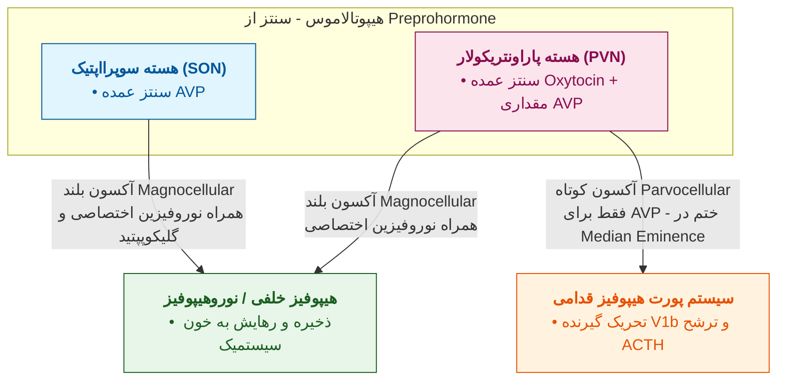

```chart
{
  "type": "line",
  "data": {
    "labels": ["0%", "-5%", "-10%", "-15%", "-20%"],
    "datasets": [
      {
        "label": "ترشح نمایی AVP در کاهش حجم خون (هایپوولمی)",
        "data": [1, 2, 5, 15, 30],
        "borderColor": "#d32f2f",
        "backgroundColor": "rgba(211, 47, 47, 0.1)",
        "fill": true,
        "tension": 0.4
      },
      {
        "label": "ترشح خطی AVP در افزایش اسمولالیته (280 تا 300)",
        "data": [1, 3, 5, 8, 12],
        "borderColor": "#1976d2",
        "borderDash": [5, 5],
        "fill": false,
        "tension": 0.1
      }
    ]
  },
  "options": {
    "responsive": true,
    "plugins": {
      "title": {
        "display": true,
        "text": "مقایسه الگوی خطی (اسمولالیته) و نمایی (کاهش حجم خون) ترشح وازوپرسین (pg/mL)"
      }
    }
  }
}
```

### مقایسه ساختار شیمیایی و فارماکوکینتیک پپتیدهای نوروهیپوفیز

| ویژگی مقایسه‌ای              | آرژنین وازوپرسین (AVP / ADH)                                                                                                                                | اکسی‌توسین (Oxytocin)                                                                                 | دسموپرسین (Desmopressin / DDAVP)                                                                       |
| :--------------------------- | :---------------------------------------------------------------------------------------------------------------------------------------------------------- | :---------------------------------------------------------------------------------------------------- | :----------------------------------------------------------------------------------------------------- |
| **ماهیت و ساختار پایه**      | نوناپپتید حلقوی طبیعی در پستانداران (*به جز خوک: دارای لیزین در جایگاه 8 یا LVP*)؛<br>حلقه 6 آمینواسیدی (پل دی‌سولفیدی **Cys1-Cys6**) + دنباله 3 آمینواسیدی | نوناپپتید حلقوی طبیعی؛<br>حلقه 6 آمینواسیدی (پل دی‌سولفیدی **Cys1-Cys6**) + دنباله 3 آمینواسیدی       | آنالوگ سنتتیک تغییریافته AVP (*Deamino D-Arginine Vasopressin*)                                        |
| **تفاوت آمینواسیدی**         | جایگاه 3: **فنیل‌آلانین (Phe)**<br>جایگاه 8: **L-آرژنین (L-Arg)**                                                                                           | جایگاه 3: **ایزولوسین (Ile)**<br>جایگاه 8: **لوسین (Leu)**                                            | **دآمیناسیون سیستئین 1**<br>+ تبدیل L-Arg به **D-Arg (راست‌بر) در جایگاه 8**                           |
| **فارماکوکینتیک و نیمه‌عمر** | غیرقابل مصرف خوراکی (تخریب با پپتیداز معده)؛<br>تزریقی یا اسپری نازال؛<br>نیمه‌عمر کوتاه (**20 تا 30 دقیقه**)؛<br>تخریب با *وازوپرسیناز*                    | غیرقابل مصرف خوراکی؛<br>تزریقی یا اسپری نازال؛<br>نیمه‌عمر کوتاه؛<br>تخریب پلاسمایی با *اکسی‌توسیناز* | مقاوم به پپتیداز؛<br>**قابل مصرف خوراکی**، اسپری نازال و تزریقی؛<br>**طولانی‌اثر** (1 تا 2 بار در روز) |
| **اختصاصیت گیرنده**          | غیراختصاصی (تحریک V1a, V1b, V2)<br>⇦ عوارض عروقی و کرونری بالا                                                                                              | اختصاصی گیرنده اکسی‌توسین (OXTR)<br>(*در دوز بسیار بالا تقلید اثر ADH و احتباس آب*)                   | **بسیار اختصاصی گیرنده V2 کلیوی**<br>(حداقل اثر عروقی V1a؛ ایمن در بیماران قلبی)                       |

> [!warning] دیابت بی‌مزه بارداری (Gestational DI)
> در برخی زنان باردار، فعالیت آنزیم **وازوپرسیناز (Vasopressinase)** جفتی به شدت افزایش یافته و با تخریب سریع AVP مادر، باعث بروز **دیابت بی‌مزه (پلی‌اوری)** می‌شود (با وجود افزایش حساسیت کلیه به AVP در بارداری).

### مقایسه گیرنده‌های وازوپرسین (AVP) و اکسی‌توسین

| نوع گیرنده                                        | مسیر پیام‌رسان ثانویه                                                                                                                  | محل استقرار اصلی                                                                                                                                                  | اثرات فیزیولوژیک، بالینی و عوارض                                                                                                                                                                                                                                                                                                                                                                                                                                                                                                                                         | داروهای مرتبط (آگونیست / آنتاگونیست)                                                                                                                                   |
| :------------------------------------------------ | :------------------------------------------------------------------------------------------------------------------------------------- | :---------------------------------------------------------------------------------------------------------------------------------------------------------------- | :----------------------------------------------------------------------------------------------------------------------------------------------------------------------------------------------------------------------------------------------------------------------------------------------------------------------------------------------------------------------------------------------------------------------------------------------------------------------------------------------------------------------------------------------------------------------- | :--------------------------------------------------------------------------------------------------------------------------------------------------------------------- |
| **گیرنده V1a**<br>*(وسیع‌ترین پراکندگی)*          | **Gq / PLCβ / IP3 - DAG - Ca²⁺**<br>+ تحریک PLA2 و PLD (سنتز PGها) و PKC (تحریک **AP-1** و رشد سلولی)                                  | عضله صاف عروق، گوارش، پلاکت، آدرنال، میومتر رحم، مثانه، آدیپوسیت، هپاتوسیت، سلول بینابینی مدولای کلیه، *Vasa recta*، طحال، بیضه، CNS                              | **اسپاسم و انقباض عروق**، **اسپاسم کرونر و آنژین** (مهم‌ترین و خطرناک‌ترین عارضه AVP؛ **عدم تحمل و منع مصرف در CAD**) #قطعی، رنگ‌پریدگی صورت (*Facial pallor*)، تحریک لوله گوارش، تجمع پلاکتی، **گلیکوژنولیز کبدی**، انقباض *Vasa recta* (حفظ گرادیان اسمزی مدولا).<br>*کاربردها:* **کنترل خونریزی واریس‌های مری** (همراه **نیتروگلیسرین/GTN** جهت کاهش اسپاسم کرونر)، گاستریت هموراژیک، **سیستیت هموراژیک سیکلوفسفامید**، کاهش خونریزی جراحی (سوختگی، پیوند کبد، سزارین، میوم)، **ایلئوس پس از جراحی**، **دفع گاز روده** پیش از رادیوگرافی، شوک وازودیلاتوری و آسیستول. | *آگونیست:* **AVP**، **فلی‌پرسین**، **ترلی‌پرسین (Glypressin)**<br>*آنتاگونیست:* **کونیواپتان** (V1a/V2)؛ پتانسیل بلاکر V1a در **دیسمنوره، زایمان زودرس و پدیده رینود** |
| **گیرنده V1b (V3)**                               | **Gq / PLC / IP3 - Ca²⁺**                                                                                                              | سلول‌های کورتیکوتروپ **هیپوفیز قدامی**، مغز، پانکراس و مدولای آدرنال                                                                                              | تحریک **ترشح ACTH** #قطعی (ایجاد علائم شبه‌کوشینگ در هایپرترشح مزمن)                                                                                                                                                                                                                                                                                                                                                                                                                                                                                                     | **آنتاگونیست‌های V1b**: پتانسیل درمانی در **سندرم کوشینگ** (تومورهای مترشحه ACTH) #قطعی، استرس، **اضطراب و افسردگی**                                                   |
| **گیرنده V2**<br>*(حساس‌ترین در غلظت فیزیولوژیک)* | **Gs / آدنیلیل سیکلاز / ⇧ cAMP - PKA** #قطعی                                                                                           | 1. **کلیوی**: غشای بازولاترال سلول‌های اصلی (Principal) توبول جمع‌کننده (CD)، لوله ضخیم صاعد (**TAL**) و **IMCD**<br>2. **غیرکلیوی**: سلول‌های **اندوتلیال عروق** | 1. **کلیوی**: فسفوریلاسیون و الحاق **وزیکول‌های حاوی کانال آب (WCVs / آکواپورین-2)** به غشای آپیکال و مهار اندوسیتوز آن‌ها ⇦ بازجذب خالص آب؛ ⇧ بیان سیمپورتر **Na⁺-K⁺-2Cl⁻** در TAL؛ فعال‌سازی ترنسپورتر اوره (**VRUT**) در IMCD. *عارضه:* **هیپوناترمی رقت و مسمومیت با آب**.<br>2. **غیرکلیوی (تنها اثر خارج‌کلیوی V2)**: اگزوسیتوز اجسام *Weibel-Palade* و **آزادسازی فاکتورهای انعقادی (فاکتور VIII و فاکتور فون‌ویلبراند / vWF)** #قطعی                                                                                                                             | *آگونیست انتخابی:* **دسموپرسین (DDAVP)**<br>*آنتاگونیست فارماکولوژیک:* **واپتان‌ها (Vaptans)** (تولواپتان، موزاواپتان، کونیواپتان) #قطعی #قطعی                         |
| **گیرنده اکسی‌توسین (OXR / OXTR)**                | **Gq / PLC / IP3 - Ca²⁺**<br>(+ ورود کلسیم از کانال L-type و تحریک سنتز **PGF₂α** ⇦ فعال‌سازی کمپلکس Ca²⁺-کالمودولین و آنزیم **MLCK**) | میومتر رحم، سلول‌های **میواپی‌تلیوم** پستان، CNS (آمیگدال، هیپوکامپ، لیمبیک، نخاع)                                                                                | انقباض **ریتمیک و تونیک** رحم + نرم کردن سرویکس (*Cervix ripening*)، رفلکس خروج شیر (*Milk ejection*)، تقویت اعتماد و رفتار اجتماعی از طریق تعامل با دوپامین (**فرضیه برجستگی اجتماعی**؛ پتانسیل در فوبیای اجتماعی، اعتیاد و اوتیسم).                                                                                                                                                                                                                                                                                                                                    | *آگونیست:* **اکسی‌توسین**<br>*آنتاگونیست رقابتی و فارماکولوژیک:* **آتوسیبان (Atosiban)** #قطعی (توکولیتیک در زایمان زودرس؛ تایید در اروپا، عدم تایید FDA)              |

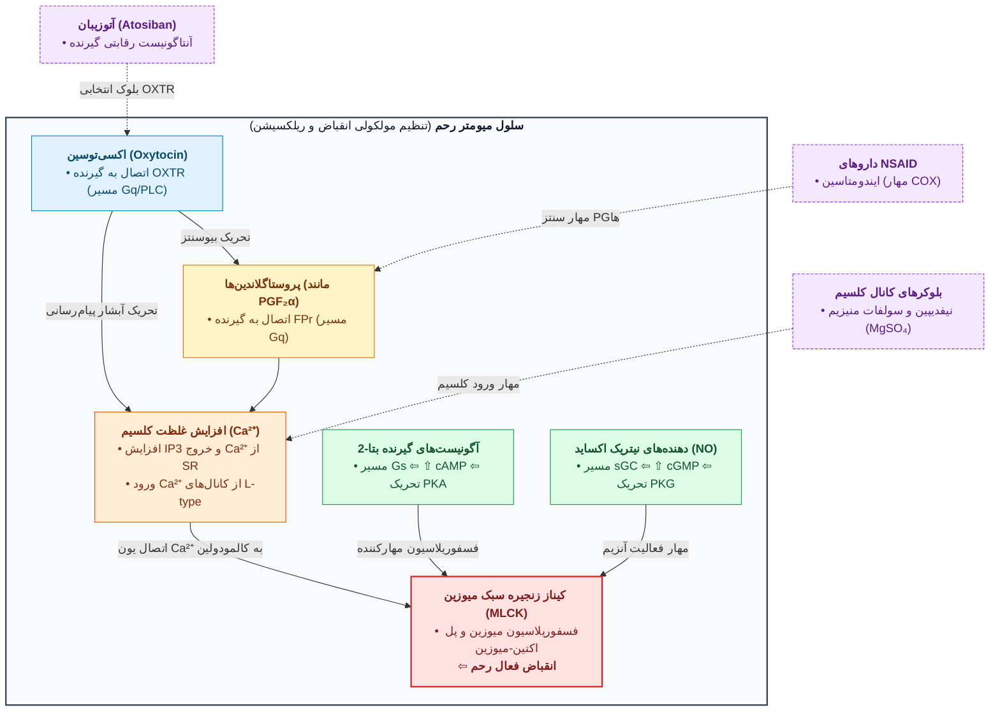

### داروهای محور AVP، اکسی‌توسین، توکولیتیک‌ها و تداخلات کلیوی
* **کاربردها و نکات دسموپرسین (DDAVP):**
  1. **داروی انتخابی نگهداری دیابت بی‌مزه مرکزی دائمی (Permanent)** (*در نوع گذرا/Transient ناشی از ترومای سر یا جراحی هیپوفیز، خود AVP کاربرد دارد*) و **تشخیص افتراقی دیابت بی‌مزه مرکزی از نفروژنیک** (در تست محرومیت از آب، دسموپرسین اسمولالیته ادرار را در نوع مرکزی بالا می‌برد ولی در نفروژنیک بی‌اثر است).
  2. **شب‌ادراری اولیه کودکان (Nocturnal enuresis)** و بهبود سردرد پس از پونکسیون کمری (*Post-LP headache*).
  3. **اختلالات خونریزی‌دهنده:** هموفیلی A، **بیماری فون‌ویلبراند نوع I و IIn**، و خونریزی ناشی از اورمی یا سیروز.
  4. **عوارض و کنتراایندیکاسیون‌های مطلق دسموپرسین:** خطر بالای **مسمومیت با آب (Water intoxication) و هیپوناترمی رقت** (لزوم چک الکترولیت‌ها؛ منع مصرف در هیپوناترمی و پلی‌دیپسی سایکوژنیک).
	  - **منع مصرف مطلق در فون‌ویلبراند نوع IIb (Type IIb vWD)** به دلیل ایجاد **ترومبوسیتوپنی گذرا اما شدید**!
* **کاربردهای واپتان‌ها (Vaptans):** موثرترین درمان دارویی **SIADH**، کاربرد در **نارسایی احتقانی قلب (CHF)** (به عنوان *آکوارتیک* و دفع آب خالص بدون الکترولیت)، هیپوناترمی، سیروز، ادم مغزی، سندروم نفروتیک، نفروپاتی دیابتی و گلوکوم.
* **عوامل تغییر دهنده حساسیت کلیه به AVP:**
  1. **افزایش‌دهنده‌های حساسیت کلیه به AVP (مفید در پارشیال DI):**
     * **پروستاگلاندین‌های کلیوی (به‌ویژه PGE₂):** **آنتاگونیست فیزیولوژیک AVP** در کلیه هستند (کاهش cAMP).
	     * بنابراین **NSAIDs (ایندومتاسین)** با مهار سنتز PGها، پاسخ‌دهی کلیه به AVP را **افزایش** می‌دهند #قطعی 
	     * *هشدار در بیماران CHF، سیروز با آسیت، نفروتیک و فشار خون:* وابستگی جریان خون کلیه به PGها ⇦ مصرف NSAIDs باعث احتباس آب، مقاومت به ضدفشار خون و نارسایی حاد کلیه می‌شود!.
     * **کلرپروپامید** و **کاربامازپین** (مفید در DI مرکزی دارای بیماری کرونری که تحمل AVP را ندارند).
  2. **کاهش‌دهنده‌های حساسیت کلیه به AVP (ایجاد دیابت بی‌مزه نفروژنیک):**
     * **لیتیوم (Lithium):** مهار آدنیلیل سیکلاز و کاهش cAMP + افزایش **PTH** در مصرف طولانی (PTH آنتاگونیست فیزیولوژیک AVP در کلیه است) ⇦ ایجاد دیابت بی‌مزه نفروژنیک در **یک‌سوم (1/3)** بیماران (گاه برگشت‌ناپذیر) #قطعی.
	     * *فاز نگهدارنده دوقطبی؛ در فاز حاد مانیا نورولپتیک و در افسردگی آنتی‌دپرسانت می‌دهند*.
     * **دمکلوسایکلین (دی‌متیل کلرتتراسایکلین):** کاربرد در SIADH (دارای سمیت کبدی و کلیوی در سیروز).
     * **واپتان‌ها**، **هایپرکلسمی** و **هایپوکالمی**.
* **درمان پارادوکسیکال دیابت بی‌مزه نفروژنیک با تیازیدها:** تجویز **دیورتیک تیازیدی** (با دوز دیورتیکی) + محدودیت نمک ⇦ دفع سدیم و کاهش خفیف حجم ECF ⇦ **افزایش جبرانی بازجذب سدیم و آب در توبول پروگزیمال** ⇦ کاهش رسیدن مایع به توبول دیستال و کاهش شدید حجم ادرار!
* **مقایسه محرک‌های رحمی و توکولیتیک‌ها:**
  * **اکسی‌توسین و پروستاگلندین‌ها:** ایجاد انقباضات ریتمیک برای القا و تقویت زایمان (پروستاگلندین‌ها به دلیل غیرپپتیدی بودن، ارزانی، پایداری و *Cervix ripening* عالی جایگزین اکسی‌توسین شده‌اند).
	  * *عوارض اوردوز اکسی‌توسین:* انقباض تتانیک و **پارگی رحم**، احتباس و مسمومیت با آب (تقلید ADH)، **پرفشاری خون و آریتمی قلبی (PVC، تاکی‌کاردی سینوسی)**.
  * **متیل‌ارگونوین (مترژین / Methergine):** ایجاد **اسپاسم تتانیک (Tetanus)** و بستن سرویکس؛ **فقط پس از خروج جفت و جنین برای کنترل خونریزی پس از زایمان (PPH)** کاربرد دارد!
  * **توکولیتیک‌ها (مهار زایمان زودرس):** **آتوسیبان**، **آگونیست‌های β₂**، **بلوکرهای کانال کلسیم (نیفدیپین)**، **سولفات منیزیم (MgSO₄)**، **آزادکننده‌های نیتریک اکساید (NO)**، **مهارکننده‌های COX (NSAIDs)**، و در مطالعات تجربی (دکتر دهپور): **کانابینوئیدها و کانابیدیول**.
* **درمان هیپرپرولاکتینمی و آمنوره:** **بروموکریپتین** و **کابرگولین** (آگونیست‌های دوپامینی D₂؛ تقلید اثر **PIF/دوپامین**) ⇦ **مهار ترشح پرولاکتین** ⇦ رفع مهار از ترشح ضربان‌دار GnRH و بازگشت تخمک‌گذاری و قاعدگی.

---

## 2. فارماکولوژی هورمون‌های جنسی

* **محور HPG و شبکه KNDy:** در کودکی هسته آرکوئیت مهار است. شبکه نورونی **KNDy** (ترشح‌کننده *Kisspeptin*، *Neurokinin B* و *Dynorphin*) در هیپوتالاموس (بخش غالب/Dominant محور) هم در شروع بلوغ (**Gonadarche**؛ ترشح ضربان‌دار GnRH ⇦ ابتدا افزایش **شبانه** و سپس شبانه‌روزی FSH/LH) و هم در **مرکز تنظیم دما (Thermoregulatory)** نقش دارد.
* **سایر هورمون‌های تخمدانی:** **Inhibin** (مهار FSH)؛ **Activin** (تحریک FSH؛ همراه FSH ⇦ ⇧ آروماتاز، پروژسترون و استروژن؛ همراه LH ⇦ ⇧ آروماتاز اما **مهار پاسخ پروژسترونی LH** و ⇩ استروژن)؛ **Relaxin** (ساختار دو زنجیره‌ای با باند دی‌سولفیدی **شبیه انسولین**؛ ⇧ گلیکوژن، ⇧ جذب آب و ⇩ انقباضات رحم).
* **علل عدم تخمک‌گذاری و آمنوره:** استرس شدید روحی، ورزش سنگین هوازی (ماراتن، شنا)، *Anorexia nervosa / Bulimia*، تومورها، و **هایپرپرولاکتینمی دارویی** با آنتاگونیست‌های دوپامین (**کلرپرومازین**) یا دوز بالای **متیل‌دوپا** (تولید متیل‌دوپامین).
* **دسته‌بندی و فارماکوکینتیک استروژن‌ها:**
  1. *طبیعی:* **استرادیول** (قوی‌ترین؛ ترشح مستقیم از گرانولوزا)، **استرون** و **استریول** (ساخت در کبد یا در **بافت چربی** از آندروستن‌دیون و تستوسترون توسط **آروماتاز**).
  2. *سنتتیک استروئیدی:* اتینیل‌استرادیول، مسترانول، کوئینسترول. *سنتتیک غیراستروئیدی:* **دی‌اتیل‌استیل‌بسترول (DES)** (عامل **آدنوکارسینوم سلول شفاف واژن و سرویکس** در جنین دختر در سنین بلوغ)، هگزسترول، بنزسترول، کلروتری‌آنیزن، متالن‌استریل. *فیتواستروژن‌ها:* سویا (*Soybeans*)، *Saw palmetto*؛ *آلاینده‌های صنعتی مقلد استروژن:* فتالات‌ها و آلکیل‌فنول‌ها (ظروف پلاستیکی/نچسب در حرارت یا فریز).
  3. **حامل پلاسمایی و سیکل انتروهپاتیک:** اتصال به **SHBG (α₂-globulin)**. کنژوگاسیون کبدی ⇦ دفع صفراوی ⇦ **دکنژوگاسیون توسط فلور میکروبی روده** و بازجذب. **مصرف آنتی‌بیوتیک‌های وسیع‌الطیف** فلور روده را از بین برده و با شکستن سیکل انتروهپاتیک باعث **کاهش استروژن، شکست OCP و حاملگی ناخواسته** می‌شود! اشکال غیرخوراکی (پچ، کرم واژینال) با حذف عبور اول کبدی، **عوارض انعقادی و افزایش سوبسترای رنین بسیار کمتری** دارند.
* **مکانیسم و اثرات استروژن‌ها:** اتصال به گیرنده هسته‌ای (**ERα** فعال و **ERβ**) ⇦ جدایی **HSP90** ⇦ تشکیل همودایمر αα یا هترودایمر αβ (**حضور زیرواحد β مانع رونویسی می‌شود!**) و اتصال به **ERE** (*اثرات غیرژنومیک سریع:* ⇧ برداشت کلسیم در گرانولوزا و ⇧ جریان خون رحم).
  * *اثرات بافتی:* رشد مجاری (**Ductal**) پستان، بسته شدن اپی‌فیز، پیگمانتاسیون پوست (**ملاسما/کلوآسما**؛ نیازمند ضدآفتاب)، **Up-regulation گیرنده‌های پروژسترون**، القای **آپوپتوز استئوکلاست‌ها**، بهبود لیپید (**⇧ HDL و ⇧ TG، ⇩ LDL و کلسترول**)، **⇧ سوبسترای رنین (آنژیوتانسینوژن)** و احتباس آب و نمک، حس خوب در CNS (*افت ناگهانی استرادیول پس از زایمان عامل افسردگی پس از زایمان است*)، و **افزایش انعقادپذیری خون** (**⇧ فاکتورهای II, VII, IX, X** و پلاسمینوژن، **⇩ آنتی‌ترومبین III**).

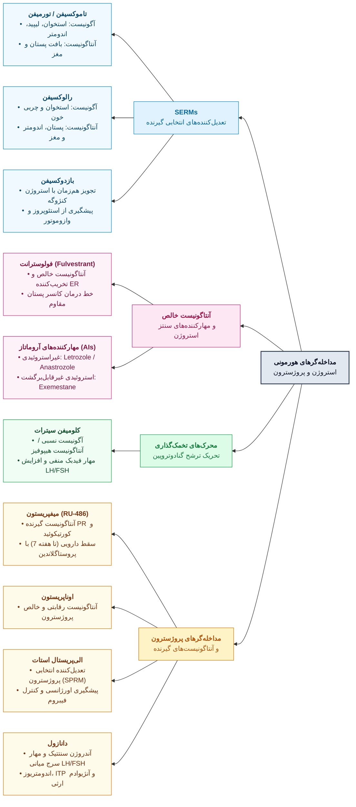

### جدول جامع پروژستین‌ها، کنتراسپتیوها (OCP)، HRT و SERMs

| دسته یا رژیم دارویی                              | داروهای شاخص و ویژگی‌ها                                                                                                                                                                                                                      | مکانیسم اثر و کاربرد بالینی                                                                                                                                                                                                                                                                                                                                                                                                                                                                                               | عوارض جانبی، تداخلات و نکات امتحانی                                                                                                                                                                                                                                                                                                                                                                                           |
| :----------------------------------------------- | :------------------------------------------------------------------------------------------------------------------------------------------------------------------------------------------------------------------------------------------- | :------------------------------------------------------------------------------------------------------------------------------------------------------------------------------------------------------------------------------------------------------------------------------------------------------------------------------------------------------------------------------------------------------------------------------------------------------------------------------------------------------------------------ | :---------------------------------------------------------------------------------------------------------------------------------------------------------------------------------------------------------------------------------------------------------------------------------------------------------------------------------------------------------------------------------------------------------------------------- |
| **پروژسترون طبیعی** و **پروژستین‌های نسل 1 و 2** | *طبیعی:* **پروژسترون** (شیاف واژینال *Cyclogest*)<br>*سنتتیک قدیمی:* **مدروکسی‌پروژسترون (DMPA / Depo-Provera)**، **دیدروژسترون (دوفاستون)**، مژسترول، **لاینسترنول**، **نوراتیندرون**، **لوونورژسترل** (IUD یا کاشتنی *Norplant*)، نورژسترل | *اثرات پروژسترون:* تحریک **LPL** و رسوب چربی، **⇧ انسولین پایه**، اثر **ترمژنیک** (⇧ دما 0.5-1 درجه در میانه سیکل)، اثر **خواب‌آور (Hypnotic)**، رشد بخش **آسینار/ترشحی** پستان، و **Down-regulation گیرنده‌های ER** در اندومتر.<br>*کاربردها:* **سقط عادتی** (پروژسترون)، لکه‌بینی فاز لوتئال (دوفاستون؛ *در لکه‌بینی فاز فولیکولار استروژن می‌دهیم*)، **کنتراسپتیو دوران شیردهی (لاینسترنول)**، **آندومتریوز لگنی** (تزریق عضلانی DMPA)، و **هیپرپلازی ساده آندومتر و منوراژی** (**LNG-IUS / Mirena** استاندارد طلایی). | پروژسترون طبیعی متابولیسم عبور اول کبدی شدید دارد (دفع ادراری به شکل *Pregnanediol glucuronide*).<br>مشتقات 19-نورتستوسترون (نوراتیندرون، لوونورژسترل) **خواص آندروژنیک بالا** دارند ⇦ **آکنه، هیرسوتیسم و کاهش HDL**.<br>**عارضه مهم مصرف طولانی تزریق DMPA:** سرکوب گنادوتروپین و استروژن ⇦ **کاهش تراکم استخوان و استئوپروز (Osteoporosis)**!                                                                              |
| **پروژستین‌های نسل 3 و نسل 4**                   | *نسل 3:* **دزوژسترل، ژستودن، نورژستیمیت**<br>*نسل 4:* **دروسپیرنون** (در قرص *Yas/Yasmin*)، نومژسترول، نستورون                                                                                                                               | *نسل 3:* دارای **کمترین اثر آندروژنیک** ⇦ ترکیب آن‌ها با اتینیل‌استرادیول داروی تاییدشده در **خانم‌های مبتلا به آکنه متوسط**.<br>*دروسپیرنون (نسل 4):* آنالوگ اسپیرونولاکتون (مهار 3β-HSD و **آنتاگونیست آلدوسترون** و آندروژن) ⇦ **بهترین انتخاب در خانم شاکی از آکنه، نفخ، احتباس مایعات و افزایش وزن ناشی از پروژستین‌های قبلی**!                                                                                                                                                                                      | نسل 3 باعث کاهش HDL یا هیرسوتیسم نمی‌شوند.<br>دروسپیرنون به دلیل خاصیت آنتی‌مینرالوکورتیکوئیدی، احتباس آب و نمک را کم می‌کند.                                                                                                                                                                                                                                                                                                 |
| **قرص‌های ضدبارداری ترکیبی (COCs / OCP)**        | اشکال **مونوفازیک**، **دی‌فازیک و تری‌فازیک** (*لکه‌بینی کمتر در چندفازیک‌ها*)                                                                                                                                                               | *جزء استروژنی:* مهار فیدبکی FSH/LH و **مهار تخمک‌گذاری**.<br>*جزء پروژستینی:* ضخیم کردن موکوس سرویکس و کاهش حرکات لوله فالوپ (⇩ لانه‌گزینی).<br>*مزایای غیرضدبارداری:* ⇩ حاملگی خارج رحمی، ⇩ کیست تخمدان و PCOS، **⇩ سرطان تخمدان و اندومتر**، بهبود آرتریت روماتوئید و اندومتریوز.                                                                                                                                                                                                                                       | *عوارض شدید:* **ترومبوآمبولی وریدی (DVT/PE)**، MI، سکته مغزی، یرقان کلستاتیک، افسردگی.<br>**توصیه جهت کاهش ریسک ترومبوآمبولی:** استفاده از **فرآورده ترکیبی با دوز پایین‌تر استروژن (Lower estrogen dose)** #قطعی.<br>**منع مصرف/جایگزینی OCP:** **سردرد میگرنی** (حتی کنترل‌شده با سوماتریپتان ⇦ ریسک سکته مغزی)، **بروز DVT (قطع فوری استروژن!)**، فیبروم رحم، سیگاری قهار، گروه خونی O، و نوجوان قبل از بسته شدن صفحه رشد. |
| **هورمون‌درمانی یائسگی (HRT)**                   | **استروژن کنژوگه (Premarin)** به تنهایی یا همراه **مدروکسی‌پروژسترون**                                                                                                                                                                       | در خانم **فاقد رحم (سابقه هیسترکتومی)** دچار علائم وازوموتور (گرگرفتگی و تعریق شبانه): **استروژن کنژوگه به تنهایی بهترین درمان است** #قطعی.<br>در صورت **وجود رحم**: افزودن پروژستین برای جلوگیری از **سرطان آندومتر** (*استروژن تنها ریسک سرطان آندومتر را تا 15 برابر بالا می‌برد!*).                                                                                                                                                                                                                                   | **پروژستین ریسک سرطان پستان را کم نمی‌کند** (بلکه افزایش می‌دهد!).<br>*درمان‌های غیرهورمونی گرگرفتگی:* **کلونیدین** (عارضه شایع: **خشکی دهان**) و **Fezolinetant** (آنتاگونیست گیرنده **NK3** در شبکه KNDy).                                                                                                                                                                                                                  |
| **تعدیل‌کننده‌های انتخابی استروژن (SERMs)**      | **تاموکسیفن** (متابولیت فعال: *Endoxifen*)، تورمیفن، **رالوکسیفن**، **بازدوکسیفن**                                                                                                                                                           | *تاموکسیفن:* درمان سرطان پستان ER+ (کاهش 35% سرطان پستان مقابل).<br>*رالوکسیفن:* آگونیست در استخوان و لیپید، **آنتاگونیست در پستان و اندومتر** ⇦ **انتخاب ارجح در خانم یائسه دچار استئوپنی دارای سابقه فامیلی قوی سرطان پستان** #قطعی.<br>*استروژن کنژوگه + بازدوکسیفن:* **حذف خطر هیپرپلازی آندومتر بدون عوارض جانبی پروژستین** (نفخ، درد پستان).                                                                                                                                                                        | **خطر عمده تاموکسیفن:** اثر آگونیستی در رحم و کبد ⇦ **هیپرپلازی و سرطان آندومتر** #قطعی + **ترومبوآمبولی وریدی (DVT)**.<br>عارضه مشترک همه SERMها: **تشدید گرگرفتگی (Hot flushes)**.                                                                                                                                                                                                                                          |
| **کلومیفن سیترات** و **مهارکننده‌های آروماتاز**  | **Clomiphene**، **آناستروزول، لتروزول** (غیراستروئیدی)، **اگزمستان** (استروئیدی غیرقابل برگشت)                                                                                                                                               | *کلومیفن:* آنتاگونیست استروژن در هیپوتالاموس/هیپوفیز ⇦ حذف فیدبک منفی و **افزایش FSH/LH** (تحریک تخمک‌گذاری در ناباروری و PCOS؛ سوءمصرف در بدنسازان).<br>*مهارکننده آروماتاز:* خط درمان سرطان پستان و کمک به بلوغ زودرس (*خط اول بلوغ زودرس: آنالوگ مداوم GnRH مثل **تریپتورلین و گوسرلین***).                                                                                                                                                                                                                            | **عارضه مهم کلومیفن:** بزرگ شدن تخمدان و **سندرم تحریک بیش از حد تخمدان (OHSS)** (درد شکم، نفخ، آسیت، افزایش وزن سریع، تنگی نفس) + اختلال بینایی (**Afterimages**).<br>**عارضه مشترک مهارکننده آروماتاز، DMPA و گلوکوکورتیکوئید:** **کاهش تراکم استخوان (Loss of BMD)**.                                                                                                                                                      |

> [!tip] مدیریت دیسمنوره، منوراژی، PMS، ضدبارداری اورژانسی و آنژیوادم ارثی
> * **دیسمنوره و منوراژی:** خط اول **NSAIDs** (مفنامیک اسید، ناپروکسن؛ شروع **بلافاصله پیش از خونریزی** جهت مهار PGF₂α و PGE₂). خط دوم منوراژی: **ترانگزامیک اسید**. در بین آنتی‌کولینرژیک‌ها فقط **دی‌سیکلومین** اثر آنتی‌اسپاسمودیک مستقیم بر رحم دارد.
> * **سندروم پیش از قاعدگی (PMS):** علائم در فاز لوتئال (نرمال در روزهای 4 تا 12). **خط اول درمان: SSRIs (فلوکستین و سرتالین)** که در PMS **اثر سریع** دارند (کپسول آهسته‌رهش **90 میلی‌گرم هفتگی فلوکستین**).
> * **ضدبارداری اورژانسی (Morning After):** **لوونورژسترل** (1 یا 2 قرص)، قرص **LD** (4+4) یا **HD** (2+2)، استروژن دوز بالا، **اولیپریستال (SPRM)** و **میفپریستون (RU-486)** (آنتاگونیست PR و GR؛ کاربرد در سقط سه ماهه اول تا هفته 7 همراه میزوپروستول/دینوپروستون).
> * **دانازول (Danazol):** آندروژن سنتتیک ضعیف (مهار سرج میانی LH/FSH و آنزیم‌های استروئیدوژنز)؛ **داروی انتخابی پیشگیری از حملات آنژیوادم ارثی** (تحریک سنتز کبدی **مهارکننده استراز C1 / C1-INH**) + کاربرد در اندومتریوز، بیماری فیبروکیستیک پستان، هموفیلی A و B (کریسمس) و ITP.

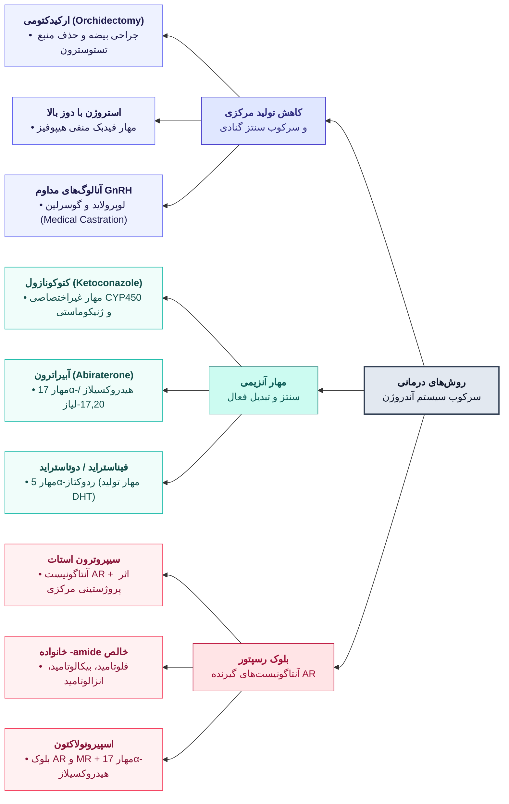

### فارماکولوژی آندروژن‌ها و آنتی‌آندروژن‌ها

* **فیزیولوژی و انواع آندروژن‌ها:** 95% تستوسترون از سلول‌های **لایدیگ بیضه**؛ تبدیل به فرم فعال **دی‌هیدروتستوسترون (DHT)** توسط **5α-reductase**. تستوسترون خالص خوراکی به دلیل متابولیسم عبور اول کبدی بی‌اثر است.
  * *استرهای تزریقی:* پروپیونات، انانتات، سیپیونات، آندکانوات.
  * *نسبت آندروژنیک به آنابولیک:* تستوسترون/متیل‌تستوسترون/فلوکسی‌مسترون (1:1)؛ اکسی‌متولون (1:3)؛ ناندرولون دکانوات (1:2.5 تا 1:4)؛ استانوزولول (1:3 تا 1:6)؛ اتیل‌استرنول (1:4 تا 1:8)؛ **اکساندرولون (Oxandrolone) دارای بالاترین نسبت آنابولیک (1:3 تا 1:13)**.
  * *اثرات و عوارض:* تعادل مثبت نیتروژن، تحریک **EPO** (پلی‌سیتمی؛ *در دوپینگ ارتفاعات گاهی از سیلدنافیل/تادالافیل برای اتساع عروق ریه استفاده می‌شود*)، **کاهش HDL**، بسته شدن زودرس اپی‌فیز در کودکان، و **مردانه‌سازی در زنان** (بزرگی کلیتوریس، کلفتی صدا، هیرسوتیسم).
  * **دو عارضه بسیار مهم امتحانی آندروژن‌ها:**
    1. **تستوسترون در مردان هیپوگناد/سالمند:** تبدیل محیطی به استرادیول توسط آروماتاز ⇦ **ژنیکوماستی (Gynecomastia)** (و خطر تشدید BPH و کانسر پروستات در سالمندان).
    2. **مشتقات 17α-آلکیله خوراکی (مثل اکساندرولون، اکسی‌متولون، استانوزولول، متیل‌تستوسترون):** سمیت کبدی بالا، **یرقان کلستاتیک (Cholestatic jaundice)** و در مصرف طولانی **کارسینوم هپاتوسلولار (HCC)**!
* **جزئیات داروهای آنتی‌آندروژن و سرطان پروستات:**
  1. **فلوتامید، بیکالوتامید، نیلوتامید و انزالوتامید (Enzalutamide):** آنتاگونیست‌های رقابتی گیرنده آندروژن (AR). **چرا در کانسر پیشرفته پروستات حتماً باید همراه آنالوگ پیوسته‌رهش GnRH (لوپرولاید) تجویز شوند؟** زیرا مصرف تنهایی فلوتامید/انزالوتامید با حذف فیدبک منفی آندروژن در هیپوفیز، **باعث افزایش ترشح LH (و تستوسترون) می‌شود** #قطعی؛ افزودن آگونیست مداوم GnRH محور را سرکوب کرده و **ترشح تستوسترون را کاهش می‌دهد**.
  2. **آبیراترون (Abiraterone):** مهارکننده برگشت‌ناپذیر **CYP17 (17α-هیدروکسیلاز و 17,20-لیاز)** ⇦ **کاهش سنتز کورتیزول و استروئیدهای آدرنال و بیضه** در کانسر پروستات مقاوم (باید همراه دگزامتازون/پردنیزولون داده شود تا جلوی افزایش جبرانی ACTH گرفته شود).
  3. **فیناستراید و دوتاستراید:** مهارکننده **5α-ردوکتاز**؛ **درمان انتخابی هایپرپلازی خوش‌خیم پروستات (BPH)** (مرد مسن با تکرر ادرار، شب‌ادراری، بزرگی پروستات و PSA نرمال زیر 4) و طاسی مردانه. *نکته:* در مردانی که قصد فرزندآوری دارند به دلیل ورود به منی و تراتوژنیک بودن باید قطع شود! (*در ریزش موی زنان با آندروژن خون نرمال، به جای فیناستراید از بلاکر گیرنده مثل سیپروترون/اسپیرونولاکتون استفاده می‌شود*).
  4. **سیپروترون استات:** کاربرد در هیرسوتیسم زنان و **کاهش میل جنسی مفرط مردان (Hypersexuality)**.
  5. **ضدبارداری شیمیایی مردان:** تستوسترون انانتات + لوونورژسترل، سیپروترون استات، و **Gossypol** (مشتق دانه پنبه؛ تخریب اپی‌تلیوم لوله‌های سمینیفروس و آزواسپرمی).

---

## 3. فارماکولوژی تیروئید و ضددیابت

### الف) فارماکولوژی تیروئید و داروهای ضدتیروئید

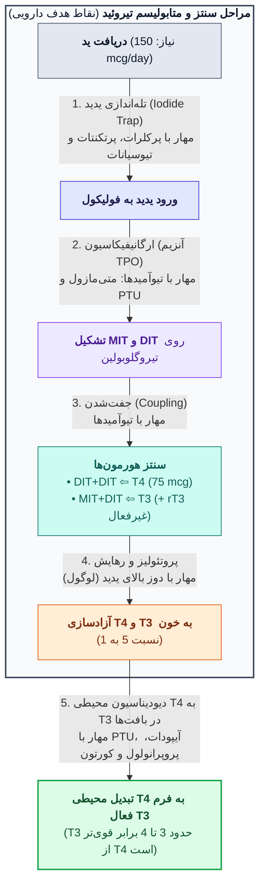

* **نکات کلیدی فارماکوکینتیک، مکانیسم و درمان کم‌کاری تیروئید (Hypothyroidism):**
  * **مکانیسم اثر هورمون تیروئید:** محلول در چربی؛ گیرنده‌ها در **هسته** (⇧ RNA پلیمراز و سنتز پروتئین)، **میتوکندری** (تنظیم مستقیم ATP) و **غشا** (تحریک پمپ **Na⁺/K⁺-ATPase** و تولید حرارت). *آنمی در تیروئید:* در کم‌کاری به علت کاهش سنتز RBC و در پرکاری به علت افزایش متابولیسم و تخریب RBC رخ می‌دهد.
  * **لووتیروکسین سدیم (L-Thyroxine):** **ساختار شیمیایی دقیقاً مشابه T4 طبیعی** #قطعی #قطعی؛ **داروی انتخابی خط اول درمان هیپوتیروئیدی (در افراد عادی، بارداری و کمای میکس‌ادم)** #قطعی #قطعی.
    * *چرا با وجود اینکه T4 اثر ضعیف‌تری نسبت به T3 دارد (افینیتی 10 برابر کمتر)، داروی انتخابی است؟* زیرا نیمه‌عمر طولانی (**7 روز** در مقابل 24 ساعت لیوتیرونین)، جذب عالی در دئودنوم و ایلئوم (80%)، اتصال بالای **TBG** و تبدیل یکنواخت درون‌سلولی به T3 دارد (بیمار هر دو هورمون T4 و T3 را خواهد داشت و دچار نوسان و آریتمی قلبی نمی‌شود). (*سایر فرآورده‌ها:* **لیوتیرونین** = L-T3 سنتتیک پرعارضه برای قلب؛ **لیوتریکس** = مخلوط 4 به 1 از T4 و T3؛ **Thyroid USP** = تیروئید خشک حیوانی منسوخ و آلرژن).
    * *تداخلات جذب لووتیروکسین:* **کلستیرامین**، **فروس سولفات (آهن)**، **آلومینیوم ام‌جی**، ضدصرع‌ها و NSAIDs غلظت T4 را کم می‌کنند. لووتیروکسین اثر **وارفارین** و نیاز به **انسولین** را بالا می‌برد. (در صورت بروز **آنژین صدری یا آریتمی** باید فوراً قطع شود).
    * *نکته TBG در بارداری و مصرف استروژن (OCP):* افزایش TBG باعث افزایش **T4 توتال** می‌شود، اما **T4 آزاد (Free) نرمال** می‌ماند (در خانم باردار هیپوتیروئید دوز لووتیروکسین باید حفظ یا افزایش یابد).

### جدول مقایسه‌ای داروهای ضدتیروئید (درمان Hyperthyroidism)

| دارو / دسته دارویی | مکانیسم اثر دقیق | ویژگی‌های بالینی، عوارض و نکات امتحانی |
| :--- | :--- | :--- |
| **پروپیل‌تیواوراسیل (PTU)** | مهار آنزیم **TPO** (مهار ارگانیفیکاسیون و کوپلینگ) + **مهار دیودیناسیون محیطی T4 به T3** | **داروی ارجح و انتخابی در دوران بارداری (به‌ویژه سه ماهه اول) و شیردهی!** #قطعی #قطعی زیرا نسبت به متی‌مازول **اتصال پروتئینی بالاتر** داشته، یونیزه‌تر است و **کمتر از جفت و شیر عبور می‌کند** (عدم ایجاد آپلازیا کوتیس). *تداخلات:* تقویت اثر وارفارین، لیتیوم، سولفونامید و سالیسیلات. |
| **متی‌مازول (Methimazole)** | مهار آنزیم **TPO** (بدون اثر بر تبدیل محیطی) | **داروی ارجح در افراد عادی (غیرباردار)**؛ حدود 10 برابر قوی‌تر از PTU، مصرف **یک‌بار در روز**. |
| **کاربی‌مازول (Carbimazole)** | **پیش‌دارو (Prodrug) متی‌مازول** #قطعی #قطعی | خودش به تنهایی اثری ندارد و در بدن با هیدرولیز به **متی‌مازول** تبدیل شده و در **درمان هیپرتیروئیدی** مصرف می‌شود #قطعی. |
| **پروپرانولول (بتابلوکر)** | بلوک گیرنده‌های بتا + مهار تبدیل محیطی T4 به T3 در دوز بالا | علت اصلی مصرف در هیپرتیروئیدی: **کاهش سریع علائم سمپاتیکی بیمار** (تپش قلب، تاکی‌کاردی، لرزش، اضطراب) #قطعی. (در صورت منع مصرف بتابلوکر در آسم ⇦ **دیلتیازم**؛ **باربیتورات‌ها** نیز با القای آنزیمی کبد متابولیسم T4 را تسریع می‌کنند). |
| **یدیدها (لوگول، KI)** و **مواد حاجب (آیپودات، آیپونیک اسید)** | *یدید:* **مهار آزادسازی (Release) هورمون** و کاهش عروق غده.<br>*آیپودات:* مهار قوی تبدیل T4 به T3. | یدیدها **سریع‌ترین شروع اثر (2 تا 7 روز)** را دارند (کاربرد در طوفان تیروئیدی و آماده‌سازی جراحی). *منع مصرف مطلق یدید و ید رادیواکتیو (I-131):* **بارداری** (گواتر جنینی). (*پیش از I-131، تیوآمیدها باید 4 روز قطع شوند؛ 80% پس از I-131 کم‌کار می‌شوند*). |

> [!danger] چرا اثر تیوآمیدها 3 تا 4 هفته طول می‌کشد؟ + عارضه آگرانولوسیتوز و طوفان تیروئیدی
> * **تاخیر اثر تیوآمیدها:** زیرا تیوآمیدها جذب ید و **آزادسازی هورمون‌های از پیش ذخیره‌شده را مهار نمی‌کنند** (تا تخلیه ذخایر تیروئید اثرشان ظاهر نمی‌شود؛ تجمع داخل غده طول اثرشان را مستقل از نیمه‌عمر پلاسمایی می‌کند).
> * **آگرانولوسیتوز تیوآمیدها:** خطرناک‌ترین عارضه؛ با بروز **تب یا گلودرد ناگهانی** بیمار باید فوراً دارو را قطع کند.
> * **پروتکل طوفان تیروئیدی (Thyroid Storm):** استامینوفن (*آسپرین ممنوع!*) + پروپرانولول + PTU/متی‌مازول (از طریق NG tube یا رکتال) + محلول لوگول (یدید) + آیپودات + دگزامتازون/هیدروکورتیزون وریدی.

---

### ب) فارماکولوژی انسولین و داروهای ضددیابت

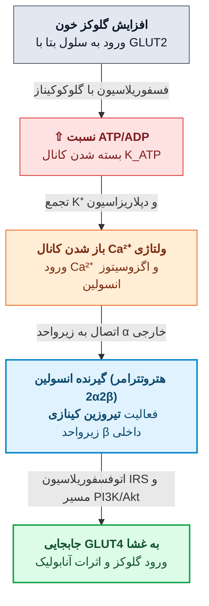

* **نکات پایه انسولین و گلوکاگون:**
  * **گلوکاگون:** افزایش **cAMP** (بدون نیاز به گیرنده بتا!) ⇦ گلیکوژنولیز و اینوتروپ/کرونوتروپ مثبت؛ کاربرد در **هایپوگلیسمی شدید بیهوش** (1mg زیرجلدی/عضلانی؛ در بیمارستان **گلوکز 50% وریدی** خط اول است) و **مسمومیت با بتابلوکرها**.
  * **انسولین:** 51 اسیدآمینه (زنجیره A=21 و B=30 متصل با 2 پل دی‌سولفیدی؛ هر میلی‌گرم = 28 واحد)؛ ترشح از پانکراس به صورت پیش‌ساز غیرفعال **پروانسولین** (همراه C-peptide). **انسولین گاوی در 3 اسیدآمینه و انسولین خوکی در 1 اسیدآمینه (B30) با انسولین انسانی متفاوت است** (گزینه انحرافی "تفاوت 1 اسیدآمینه با نوع گاوی" غلط است!). نیمه‌عمر پلاسمایی انسولین حدود **5 تا 6 دقیقه** نیست بلکه اثر بیولوژیک طولانی‌تر دارد؛ نکته صحیح امتحانی: **گیرنده‌های انسولین فعالیت تیروزین کینازی دارند** #قطعی.

### جدول جامع انواع انسولین‌ها و داروهای ضددیابت خوراکی و تزریقی

| دسته و نام دارو | مکانیسم اثر و ویژگی‌های ساختاری | فارماکوکینتیک، عوارض و نکات طلایی امتحانی |
| :--- | :--- | :--- |
| **انسولین‌های سریع‌الاثر:**<br>**Lispro, Aspart, Glulisine** | تغییرات اسیدآمینه انتهای B (مثلاً جابجایی ProB28 و LysB29 در لیسپرو) ⇦ ممانعت از تشکیل هگزامر | **سریع‌ترین شروع اثر (5 تا 15 دقیقه پس از تزریق زیرجلدی)** #قطعی، پیک 1 ساعت، طول اثر 3-5 ساعت؛ شفاف؛ کمترین تغییرپذیری جذب (5%) و کمترین هایپوگلیسمی شبانه. |
| **انسولین کوتاه‌اثر:**<br>**Regular** | ساختار دقیقاً مشابه انسولین انسانی (تشکیل هگزامر حول روی در زیرجلد) | شروع 30 دقیقه، پیک 2-3 ساعت، طول 5-8 ساعت؛ شفاف. **تنها انسولین قابل تزریق وریدی (IV)** (در DKA و جراحی)؛ **قابل مخلوط شدن در یک سرنگ با انسولین‌های متوسط‌الاثر (NPH/Lente) قبل از تزریق**. |
| **انسولین متوسط‌الاثر:**<br>**NPH (Isophane), Lente** | کمپلکس با پروتئین **پروتامین** | شروع 1-2 ساعت، پیک 4-10 ساعت، طول 10-18 ساعت؛ محلول **کدر (Turbid)**؛ فقط زیرجلدی. |
| **انسولین طولانی‌اثر:**<br>**Glargine (Lantus)**, **Detemir** | *گلارژین:* جایگزینی Asn(A21) با Gly + دو آرژنین در B31-B32.<br>*دتمیر:* اتصال اسید چرب میریستیک به B29. | **گلارژین:** طولانی‌اثر (24 ساعت و بدون پیک/Peakless) و **دارای pH اسیدی (pH = 4.0)** #قطعی (ایجاد میکروپرسیپیتاسیون در pH خنثی بافت)؛ **هرگز نباید با سایر انسولین‌ها در یک سرنگ مخلوط شود!** |
| **بیگوانیدها:**<br>**Metformin (متفورمین)** | حساس‌کننده به انسولین (**Euglycemic**): کاهش گلوکونئوژنز کبدی، مهار اکسیداسیون لاکتات + اثر مرکزی مغزی بر نورون‌های **SF-1** و پروتئین **Rap1** | **خط اول دیابت نوع 2** (و PCOS). **پس از مصرف به تنهایی ایجاد هایپوگلیسمی نمی‌کند!** #قطعی #قطعی<br>*عوارض و منع مصرف:* عوارض گوارشی، **کاهش جذب ویتامین B12**، و خطر مرگبار **اسیدوز لاکتیک** ⇦ **منع مصرف مطلق در اسیدوز لاکتیک و حالت‌های آنوکسیک/هیپوکسیک (شوک، نارسایی کلیه، کبد و قلب و الکلیسم)** #قطعی. |
| **تیازولیدین‌دیون‌ها (TZDs):**<br>**Pioglitazone (پیوگلیتازون)**, Rosiglitazone | **اتصال و تحریک گیرنده هسته‌ای PPAR-γ** (پراکسی‌زوم پرولیفراتور فعال‌شده با گاما) #قطعی ⇦ کاهش مقاومت به انسولین | Euglycemic (بدون هایپوگلیسمی)؛ شروع اثر کند (چند هفته). *نکات:* القای متابولیسم OCP و برقراری تخمک‌گذاری ⇦ **ریسک حاملگی ناخواسته**؛ سمیت کبدی و احتباس مایع. |
| **سولفونیل‌اوره‌ها و مگلیتینیدها:**<br>*نسل 1:* **تولبوتامید، کلرپروپامید**<br>*نسل 2:* **گلی‌بوراید (گلی‌بن‌کلامید)، گلی‌پیزاید، گلیمی‌پیراید**<br>*مگلیتینید:* **رپاگلیناید، ناتگلیناید** | **مهار کانال‌های پتاسیمی حساس به ATP** در سلول بتا ⇦ دپلاریزاسیون و ترشح انسولین | عارضه اصلی: **هایپوگلیسمی و افزایش وزن**.<br>*نکات اختصاصی:* **تولبوتامید** کوتاه‌اثر (5 ساعت) و **ایمن‌ترین در سالمندان**؛ **کلرپروپامید** طولانی‌اثر (32 ساعت) و **ممنوع در سالمندان**؛ **گلی‌پیزاید** کوتاه‌ترین نیمه‌عمر (3 ساعت) و کمترین هایپوگلیسمی در سولفونیل‌اوره‌ها؛ **گلیمی‌پیراید** کمترین دوز (1mg)؛ **ناتگلیناید** کمترین هایپوگلیسمی در کل ترشح‌کننده‌ها، بدون نیاز به تیتراسیون و **ایمن در نارسایی کلیه**. |
| **مهارکننده‌های آلفا-گلوکوزیداز:**<br>**Acarbose (آکاربوز), Miglitol** | مهار آنزیم آلفا-گلوکوزیداز روده (کاهش هضم نشاسته و دی‌ساکاریدها) | عوارض: نفخ شدید، اسهال (منع مصرف در **IBD**). **نکته طلایی:** در صورت بروز هایپوگلیسمی در مصرف‌کننده آکاربوز، باید **فقط با گلوکز خالص (دکستروز) درمان شود و نه با ساکارز (شکر معمولی)**! |
| **داروهای محور اینکرتین:**<br>• **Sitagliptin (سیتاگلیپتین)**, Saxagliptin *(مهارکننده DPP-4)*<br>• **Exenatide** *(آگونیست GLP-1)*<br>• **Tirzepatide (Mounjaro)** | *سیتاگلیپتین (خوراکی):* مهار آنزیم DPP-4 ⇦ جلوگیری از تخریب و **افزایش سطح اینکرتین‌ها (GLP-1 و GIP)** #قطعی.<br>*تیرزپاتید (مانجارو - تزریقی):* آگونیست دوگانه **GIP و GLP-1**. | اینکرتین‌ها وابسته به گلوکز عمل می‌کنند (⇧ انسولین، ⇩ گلوکاگون، تاخیر تخلیه معده) و **هایپوگلیسمی نمی‌دهند**.<br>**نکته تیرزپاتید (مانجارو):** از طریق **گیرنده‌های GLP-1 (و GIP) اثر ضددیابتی** خود را اعمال می‌کند و باعث **کاهش وزن چشمگیر (تا 15% و بیشتر)** می‌شود (جایگزین انسولین یا خط اول نیست). |
| **مهارکننده‌های SGLT2:**<br>**Dapagliflozin (داپاگلیفلوزین)** | مهار هم‌انتقال‌دهنده سدیم-گلوکز نوع 2 در توبول کلیه ⇦ **جلوگیری از بازجذب مجدد گلوکز کلیوی** و دفع ادراری گلوکز | داروی خوراکی؛ کنترل قند خون بدون هایپوگلیسمی همراه با **کاهش وزن**. |

---

## 4. فارماکولوژی کورتیکواستروئیدها

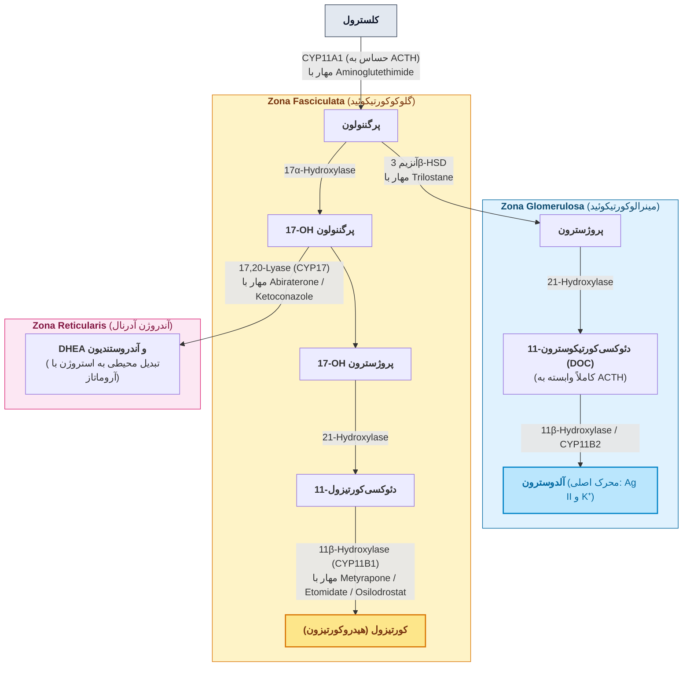

* **تنظیم محور HPA:** ترشح CRH از هیپوتالاموس (تحریک با استرس، هیپوگلیسمی، سرما، درد، **IL-1, IL-2, IL-6, TNF-α**، استیل‌کولین و سروتونین؛ مهار با کورتیزول، ACTH و **GABA**؛ اثر دوگانه نوراپی‌نفرین) ⇦ تجزیه **POMC** در هیپوفیز به **ACTH، α-MSH و β-endorphin**.
	* در غیاب ACTH، ترشح آلدوسترون نصف می‌شود اما ترشح **DOC** کاملاً وابسته به ACTH است.
* **حامل پلاسمایی و ریتم شبانه‌روزی:** 90% متصل به **CBG (α₂-globulin)** (افینیتی بالا، ظرفیت کم)، 5% آلبومین، 5% آزاد (نیمه‌عمر کورتیزول 90 دقیقه).
  * **پیک غلظت کورتیزول در 8 صبح و حداقل در 8 شب (غروب) است**؛ اما به دلیل فعالیت آنزیم **استیلاز**، **حساسیت (Affinity) گیرنده GR در 8 صبح حداقل و در 8 شب حداکثر است!** بنابراین تجویز کورتون در غروب/بعدازظهر بیشترین سرکوب محور HPA را می‌دهد.
	  * *قانون آکروفاز:* تجویز آنتی‌هیستامین در رینیت، H2-blocker در زخم پپتیک و تئوفیلین در آسم در **شب**؛ تجویز کورتون در **اول صبح**.
* **آنزیم 11β-HSD و تداخل شیرین‌بیان (Licorice - سوال تیر 404):** آنزیم **11β-hydroxysteroid dehydrogenase نوع 2** در کلیه، کولون و غدد بزاقی، **کورتیزول (Cortisol)** را به فرم غیرفعال **کورتیزون** تبدیل می‌کند تا گیرنده مینرالوکورتیکوئیدی تحریک نشود.
	* مصرف زیاد **شیرین‌بیان** این آنزیم را مهار کرده و با **جلوگیری از غیرفعال شدن کورتیزول**، باعث تجمع کورتیزول، تحریک شدید گیرنده آلدوسترون، **پرفشاری خون، احتباس آب و سدیم و هیپوکالمی** می‌شود (ممنوع در CHF و HTN)!
* **مکانیسم سلولی و ضدالتهابی/ایمنی:** گیرنده غیرفعال در **سیتوپلاسم** متصل به پروتئین‌های پایدارکننده (**HSP90, HSP70, HSP40 / FKBP**) ⇦ اتصال لیگاند و جدایی HSPها ⇦ دایمریزاسیون و اتصال به **GRE** در هسته + مهار مستقیم فاکتورهای رونویسی **NF-κB و AP-1**.
  1. **مهار التهاب:** القای سنتز پروتئین **آنکسین-1 (لیپوکورتین)** ⇦ **مهار آنزیم فسفولیپاز A2 (PLA2)** ⇦ **کاهش سنتز پروستاگلاندین‌ها و لوکوترین‌ها** + کاهش بیان **COX-2** + **کاهش آزادسازی سایتوکاین‌ها (IL-1, IL-6, TNF-α) از مونوسیت‌ها و ماکروفاژها** + مهار ارائه آنتی‌ژن روی MHC I/II و کاهش رهایش هیستامین از ماست‌سل.
  2. **انقباض عروقی موضعی:** مهار ترنسپورترهای خارج‌نورونی برداشت کاتکول‌آمین‌ها ⇦ تحریک گیرنده **α₁ عروقی**.
  3. **تغییرات سلول‌های خونی:** **افزایش نوتروفیل خون (نوتروفیلی)** (به علت افزایش رهایش از مغز استخوان و کاهش مهاجرت به بافت التهاب) و افزایش RBC و پلاکت؛ اما **کاهش لنفوسیت، مونوسیت، ائوزینوفیل و بازوفیل خون** (بازتوزیع به بافت لنفاوی و لنفولیز).

### جدول مقایسه‌ای قدرت، دوز معادل، کاربردها و عوارض کورتیکواستروئیدها و مهارکننده‌ها

*(ستون دوم بصورت «قدرت ضدالتهابی: احتباس نمک (دوز معادل)» نگاشته شده است)*

| دسته و نام دارو                                                                                                                                                         |                                                                    مشخصات                                                                     | کاربردهای بالینی و نکات طلایی امتحانی                                                                                                                                                                                                                                                                                                                                                                                           |
| :---------------------------------------------------------------------------------------------------------------------------------------------------------------------- | :-------------------------------------------------------------------------------------------------------------------------------------------: | :------------------------------------------------------------------------------------------------------------------------------------------------------------------------------------------------------------------------------------------------------------------------------------------------------------------------------------------------------------------------------------------------------------------------------ |
| **کوتاه‌اثر تا متوسط‌اثر:**<br>**Hydrocortisone (Cortisol)**, Cortisone<br>**Prednisone, Prednisolone**, Methylprednisolone                                             | هیدروکورتیزون:<br>**1 : 1** (20mg)<br>کورتیزون:<br>0.8 : 0.8 (25mg)<br>پردنیزولون:<br>**5 : 0.3** (5mg)<br>متیل‌پردنیزولون:<br>5 : 0.25 (4mg) | **هیدروکورتیزون وریدی:** انتخاب اول در **بحران حاد آدرنال** (شروع اثر سریع).<br>**پردنیزولون:** خط اول ایمونوساپرسیو کمکی همراه پلاسمافرز در **پورپورای ترومبوسیتوپنیک ترومبوتیک (TTP)** (مرد HIV+ با تب، اختلال هوشیاری، نارسایی کلیه، آنمی همولیتیک و ترومبوسیتوپنی).                                                                                                                                                         |
| **متوسط تا طولانی‌اثر (فاقد احتباس نمک):**<br>**Triamcinolone** (4mg)<br>**Betamethasone** (0.6mg)<br>**Dexamethasone** (0.75mg)                                        |                 تریامسینولون:<br>**5 : 0** (موضعی استوناید: 100)<br>بتامتازون:<br>**25-40 : 0**<br>دگزامتازون:<br>**30 : 0**                  | به دلیل **احتباس نمک صفر**، ایمن در CHF و HTN. *کلوبتازول* قوی‌ترین پماد موضعی است (ممنوع در صورت و کودکان).<br>**بلوغ ریه جنین (زیر هفته 34):** تزریق عضلانی **بتامتازون** به مادر (اتصال کمتر به پروتئین پلاسما و عبور بهتر از جفت).<br>**هیپرگلیسمی پس از تزریق داخل مفصلی تریامسینولون در استئوآرتریت زانو:** به علت **افزایش گلوکونئوژنز کبدی، کاهش برداشت محیطی گلوکز (مقاومت به انسولین) و افزایش تجزیه پروتئین** #قطعی. |
| **مینرالوکورتیکوئیدها:**<br>**Fludrocortisone**, DOCA                                                                                                                   |                                         فلودروکورتیزون:<br>**10 : 250** (2mg)<br>DOCA:<br>**0 : 20**                                          | **درمان بیماری آدیسون (نارسایی اولیه آدرنال ناشی از سل یا اتوایمیون):** تجویز ترکیبی **کورتیزول (هیدروکورتیزون) + فلودروکورتیزون**؛ اگر بیمار آدیسون علی‌رغم دریافت هیدروکورتیزون دچار **دهیدراتاسیون و هیپوناترمی** باشد، باید **فلودروکورتیزون** اضافه شود #قطعی #قطعی.                                                                                                                                                       |
| **مهارکننده‌های سنتز و مرکزی کوشینگ:**<br>Pasireotide, Cabergoline,<br>Aminoglutethimide, Trilostane,<br>Ketoconazole, Metyrapone,<br>Osilodrostat, Etomidate, Mitotane |                                                         مهار آنزیمی یا مرکزی محور HPA                                                         | *پازیروتاید:* آگونیست SSTR5؛ *کابرگولین:* آگونیست D2؛ *آمینوگلوتتیمید:* مهار CYP11A1؛ *تریلوستان:* مهار 3β-HSD؛ *میتوتان:* آدرنولیتیک در کارسینوم آدرنال.<br>**متیراپون، اتومیدات و اوسیلودروستات:** مهار **11β-hydroxylase** (*متیراپون تنها داروی مجاز در کوشینگ بارداری است*؛ عارضه: احتباس آب و نمک و هیرسوتیسم به علت تجمع DOC و آندروژن؛ *اتومیدات وریدی* در کوشینگ حاد و بدحال).                                         |
| **آنتاگونیست‌های گیرنده GR:**<br>**Mifepristone (RU-486)**,<br>**Relacorilant**,<br>**Miricorilant**                                                                    |                                         بلوک مستقیم گیرنده گلوکوکورتیکوئید<br>(جلوگیری از جدایی HSP)                                          | **میفپریستون (در دوز بالا)** و **رلاکوریلانت (Relacorilant)** (اختصاصی GR بدون اثر بر PR): درمان انتخابی **هیپرگلیسمی کنترل‌نشده در سندرم کوشینگ / کارسینوم آدرنال غیرقابل جراحی**.<br>**میریکوریلانت (Miricorilant):** کاهش وزن و بهبود متابولیک در **افزایش وزن ناشی از اولانزاپین** و درمان کبد چرب (NASH) از طریق **مهار گیرنده گلوکوکورتیکوئید (در مغز/کاهش اشتها و بافت چربی)**.                                          |
| **آنتاگونیست‌های آلدوسترون (MR):**<br>**Spironolactone**,<br>Eplerenone,<br>Canrenone,<br>**Finerenone**                                                                |                                                 بلوک گیرنده MR<br>در توبول دیستال و جمع‌کننده                                                 | **اسپیرونولاکتون:** داروی انتخابی در **هیپرآلدوسترونیسم اولیه (سندرم کان / هیپرتروفی دوطرفه آدرنال)** (پرفشاری خون، Na=150، **K=2.4 هیپوکالمی**، **pH=7.5 آلکالوز**، فلج موقت و رنین پایین) + کاهش مرگ‌ومیر در **CHF** (مهار ریمودلینگ قلب، آسیب اندوتلیال و اختلال بارورسپتور).<br>*فاینرنون:* اختصاصی قلب و کلیه (مهار نفروپاتی دیابتی).                                                                                      |

* **هدف از تجویز گلوکوکورتیکوئید در هیپرپلازی مادرزادی آدرنال (CAH ناشی از نقص 21β-هیدروکسیلاز):** اعمال فیدبک منفی و **مهار (ساپرس) ترشح ACTH** تا ساخت بیش از حد آندروژن‌های آدرنال متوقف شود #قطعی #قطعی.
* **استراتژی‌های به حداقل رساندن سرکوب محور HPA:** تجویز یک‌روز در میان (*Alternate-day*)، استفاده از اشکال موضعی/استنشاقی، حداقل دوز موثر، و تجویز **تک‌دوز در اول صبح** (تجویز دو-سوم صبح و یک-سوم بعدازظهر محور را سرکوب می‌کند و استراتژی غلطی است!).
* **قانون قطع تدریجی (Tapering) و دوز استرس:** مصرف بیش از 2 تا 4 هفته محور را سرکوب می‌کند؛ در صورت قطع ناگهانی پردنیزولون و بروز خستگی، تهوع و افت فشار خون (80/50)، درمان فوری **شروع مجدد پردنیزولون و سپس قطع تدریجی (Tapering)** است. همچنین در بیمار تحت درمان مزمن (مثلاً دگزامتازون پس از پیوند کلیه) که دچار **تصادف شدید یا جراحی** می‌شود، باید **دوز دگزامتازون را فوراً افزایش داد (Stress dose)**.
* **عوارض خاص کورتون‌ها:**
  1. **تنها عارضه برگشت‌ناپذیر (Irreversible) پس از قطع دارو:** **نکروز آواسکولار (آسپتیک) سر استخوان فمور/هیپ (Avascular necrosis of femoral heads)**!
  2. **در کودکان مصرف‌کننده دوز بالای کورتون استنشاقی:** عارضه نگران‌کننده اختصاصی **توقف و سرکوب رشد قدی (Growth suppression)** است.
  3. **در بزرگسالان مصرف‌کننده کورتون استنشاقی:** شایع‌ترین عارضه موضعی **کاندیدیاز دهانی (Oral candidiasis / برفک)** است.
  4. **سایر عوارض:** گلوکوم، کاتاراکت خلفی ساب‌کپسولار، زخم پپتیک (تشدید شدید با NSAIDs/آسپرین)، **پرفشاری خون** (*گزینه افت فشار خون یا Hypotension جزو عوارض مصرف کورتون نیست!*؛ همچنین در **سندرم کوشینگ** تجویز کورتون کنتراایندیکه است)، **هایپوکالمی** (افزایش شیب فاز 4 پتانسیل عمل قلب و ایجاد آریتمی اکتوپیک)، سرخوشی (تحریک دوپامین در **VTA و هسته اکومبنس**) و سایکوز.

---

## 5. فارماکولوژی هموستاز کلسیم و استخوان

* **توزیع و شیب غلظتی کلسیم (بیشترین شیب غلظتی در بدن):**
  * **کلسیم داخل سلولی:** **کمترین مقدار کلسیم در بدن** (~100 نانومولار یا ساب‌میکرومولار؛ خروج با پمپ PMCA و اتصال به کالمودولین).
  * **کلسیم خارج سلولی (ECF و پلاسما):** در محدوده **2.5 میلی‌مولار (2.1 تا 2.6 mM معادل 8.5 تا 10.4 mg/dL)** #قطعی. شامل سه فرکشن:
	  1) **یونیزه (50% = 1.2 mM):** تنها فرم فعال بیولوژیک؛
	  2) **کمپلکس با فسفات و سیترات (10%)** (*مجموع 60% قابل انتشار/Diffusible*)؛
	  3) **متصل به پروتئین (40%):** غیرقابل انتشار؛ **بیشترین میزان اتصال کلسیم سرم به آلبومین (80 تا 90% بخش پروتئینی)** است.
* **کینتیک جذب روده‌ای و بازجذب کلیوی:**
  * **کلیه:** ارگانی که **بیشترین میزان کلسیم فیلترشده را بازجذب می‌کند** (فیلتراسیون 9000 mg/day و بازجذب **95% تا 99%** معادل 8850 mg).
  * **روده باریک:** جذب فعال **وابسته به ویتامین D (کلسی‌تریول) عمدتاً در دئودنوم (دوازدهه)** از طریق کانال **TRPV6**، پروتئین **Calbindin D9K** و پمپ **PMCA1b / NCX1** صورت می‌گیرد (در شرایط عادی بیشترین مقدار جذب به صورت انتشار غیرفعال در ژژنوم و ایلئوم است؛ جذب فعال فسفات در **ژژنوم** با کوترنسپورتر **NPT2b** تحریک‌شده با ویتامین D رخ می‌دهد).

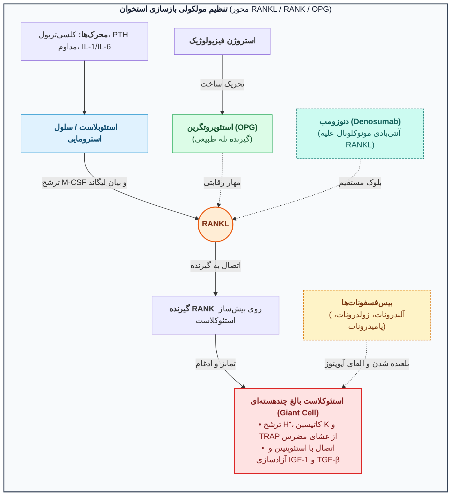

### جدول مقایسه‌ای هورمون‌ها و داروهای تنظیم‌کننده کلسیم و استئوپروز

| هورمون یا دارو                                                                                                                  | مکانیسم اثر و تاثیر بر کلسیم و فسفات                                                                                                                                                                                                           | کاربردهای بالینی، عوارض و نکات طلایی امتحانی                                                                                                                                                                                                                                                                                                                                                                              |
| :------------------------------------------------------------------------------------------------------------------------------ | :--------------------------------------------------------------------------------------------------------------------------------------------------------------------------------------------------------------------------------------------- | :------------------------------------------------------------------------------------------------------------------------------------------------------------------------------------------------------------------------------------------------------------------------------------------------------------------------------------------------------------------------------------------------------------------------ |
| **هورمون پاراتیروئید (PTH)** و **تری‌پاراتاید (Teriparatide)**                                                                  | **عامل اصلی کنترل‌کننده ترشح PTH: سطح کلسیم پلاسما** از طریق گیرنده **CaSR** (افزایش کلسیم ⇦ تحریک Gq/IP3 و مهار Gi/cAMP ⇦ **مهار ترشح PTH**).<br>*اثر PTH:* **⇧ کلسیم و ⇩ فسفات خون** (مهار NPT2A در توبول پروگزیمال + تحریک 1α-hydroxylase). | **تری‌پاراتاید** (قطعه 34 آمینواسیدی نوترکیب PTH): **تنها داروی آنابولیک (استخوان‌ساز)**؛ زمانی که به صورت **متناوب (Intermittent) و دوز کم روزانه** تزریق شود، در درمان **استئوپروز** بسیار موثر است (بیشترین افزایش BMD؛ عارضه: افت فشار وضعیتی).<br>*در نارسایی کلیه قطعه PTH(7-84) تجمع می‌یابد؛ گیرنده PTH1R به PTH و PTHrP پاسخ می‌دهد ولی PTH2R فقط به PTH*.                                                       |
| **کلسی‌تونین (Calcitonin / Salcatonin)**                                                                                        | ترشح از سلول‌های C تیروئید در پاسخ به هایپرکلسمی؛<br>**مهار مستقیم استئوکلاست‌ها** (حذف غشای مضرس) و افزایش دفع ادراری کلسیم و فسفات.                                                                                                          | **هورمون فیزیولوژیک اصلی هیپوکلسمیک (کاهنده کلسیم خارج سلولی)** #قطعی #قطعی (همراه کاهش فسفات).<br>کاربرد در استئوپروز و هایپرکلسمی (اسپری نازال سالمون)؛<br>عیب: ایجاد سریع **تحمل (Tolerance)**، گرگرفتگی صورت و طعم بد دهان.                                                                                                                                                                                           |
| **ویتامین D فعال (Calcitriol)**                                                                                                 | فعال‌سازی در کبد (25-OH / کلسی‌فدیول) و سپس در کلیه توسط **1α-hydroxylase** به **1,25(OH)2D3 (کلسی‌تریول)**.<br>*اثر:* **⇧ کلسیم و ⇧ فسفات خون** (تفاوت کلیدی با PTH!).                                                                        | کاربرد در راشیتیسم، استئومالاسی (**به‌ویژه در نارسایی مزمن کلیه/CRF**)، هایپوپاراتیروئیدیسم و **پسوریازیس**.<br>*مسمومیت ویتامین D:* هایپرکلسمی، مسمومیت دیگوکسین و در جنین **تنگی مادرزادی فوق دریچه‌ای آئورت**.                                                                                                                                                                                                         |
| **فاکتور FGF23 (همراه Klotho)**                                                                                                 | ترشح از استئوسیت استخوان در پاسخ به بار بالای فسفر؛<br>مهار NPT2A کلیه و مهار 1α-hydroxylase.                                                                                                                                                  | کاهش فسفات خون (فسفاتوری) و کاهش کلسی‌تریول.                                                                                                                                                                                                                                                                                                                                                                              |
| **بیس‌فسفونات‌ها:**<br>*خوراکی:* **آلندرونات، ریزدرونات، اتیدرونات**<br>*تزریقی وریدی:* **زولدرونات (Zoledronate)، پامیدرونات** | آنالوگ پیروفسفات؛<br>بلعیده شدن توسط استئوکلاست و **القای آپوپتوز استئوکلاست‌ها** + اثر ضد رگ‌زایی.                                                                                                                                            | **زولدرونات و پامیدرونات:** بیس‌فسفونات‌های **تزریقی وریدی**؛ **زولدرونات موثرترین دارو در درمان هیپرکلسمی (به‌ویژه هیپرکلسمی بدخیمی)** است #قطعی<br>(پروتکل هیپرکلسمی: 1. نرمال سالین 6-8 لیتر ⇦ 2. فوروزماید پس از اصلاح حجم ⇦ 3. زولدرونات/پامیدرونات).<br>**قانون مصرف آلندرونات:** ناشتا با آب ساده دمینرالیزه و 1 ساعت سرپا ماندن (پیشگیری از **ازوفاژیت شدید**).<br>*اتیدرونات در دوز بالا شکستگی را زیاد می‌کند!* |
| **سیناکلست (Cinacalcet)**                                                                                                       | داروی **کلسیمیمتیک (Calcimimetic)**؛<br>تحریک گیرنده **CaSR** در پاراتیروئید و مهار ترشح PTH.                                                                                                                                                  | درمان هایپرپاراتیروئیدیسم ثانویه (در CRF) و کارسینوم پاراتیروئید.<br>(*تفاوت با Calcium sensitizers:* حساس‌کننده‌های کلسیم روی میوکارد قلب در CHF اثر می‌کنند!).                                                                                                                                                                                                                                                          |

> [!danger] دو هشدار مرگبار در تجویز املاح کلسیم (درمان هایپوکلسمی)
> 1. املاح تزریقی کلسیم (کلسیم کلراید و گلوکونات) **هرگز نباید عضلانی (IM) تزریق شوند** (ایجاد **نکروز شدید بافت**!).
> 2. در بیماران دچار **CHF مصرف‌کننده دیگوکسین**، تجویز کلسیم اکیداً ممنوع است (تشدید سمیت و آریتمی کشنده دیگوکسین).

```chart
{
  "type": "line",
  "data": {
    "labels": ["0", "6", "12", "18", "24", "30", "36"],
    "datasets": [
      {
        "label": "Teriparatide (بیشترین افزایش تراکم استخوان)",
        "data": [0, 4.5, 9, 13.8, null, null, null],
        "borderColor": "#8e24aa",
        "backgroundColor": "rgba(142, 36, 170, 0.1)",
        "tension": 0.2
      },
      {
        "label": "PTH + Estradiol",
        "data": [0, 4, 5.2, 8.6, 10.3, 11.6, 13.1],
        "borderColor": "#1e88e5",
        "tension": 0.2
      },
      {
        "label": "Alendronate",
        "data": [0, 4, 5.2, 6, 7, 7.6, 8],
        "borderColor": "#43a047",
        "tension": 0.2
      },
      {
        "label": "Estradiol",
        "data": [0, 1.8, 3.2, 3.8, 4.2, 4.6, 5.1],
        "borderColor": "#fb8c00",
        "tension": 0.2
      },
      {
        "label": "Raloxifene",
        "data": [0, 1.5, 2.7, 2.8, 3, 3.1, 3.2],
        "borderColor": "#e53935",
        "tension": 0.2
      },
      {
        "label": "Calcitonin",
        "data": [0, 2.4, 1.8, 1.9, 2, null, null],
        "borderColor": "#00acc1",
        "tension": 0.2
      }
    ]
  },
  "options": {
    "responsive": true,
    "plugins": {
      "title": {
        "display": true,
        "text": "مقایسه درصد افزایش تراکم استخوان مهره ای (% Change Lumbar Spine BMD) در طول 36 ماه درمان"
      }
    }
  }
}
```

---

# بخش دوم: پاتولوژی غدد (Endocrine Pathology)

## 1. کلیات مکانیسم هورمون‌ها و پاتولوژی هیپوفیز (قدامی و خلفی)

> [!info] طبقه‌بندی گیرنده‌های هورمونی و بافت‌شناسی هیپوفیز نرمال
> * **گیرنده‌های داخل‌سلولی (سیتوزولی یا هسته‌ای):** مخصوص هورمون‌های **محلول در چربی** شامل استروئیدها (**استروژن، آندروژن، گلوکوکورتیکوئید/کورتیزول**) و **تیروکسین (T4/T3)** (اتصال مستقیم تیروکسین به گیرنده هسته).
> * **گیرنده‌های سطح سلول (غشایی):** مخصوص هورمون‌های پپتیدی درشت (**GH، انسولین**) و مولکول‌های کوچک کاتکول‌آمینی (**اپی‌نفرین**) #قطعی (افزایش پیام‌رسان‌های ثانویه **cAMP، IP3 و Ca²⁺**).
> * **آناتومی و عروق هیپوفیز:** مستقر در **زین ترکی (Sella Turcica)** متصل با ساقه (*Stalk*). لوب قدامی دارای شبکه وریدی پورت کم‌فشار؛ لوب خلفی دارای خون‌رسانی شریانی مستقیم از کاروتید داخلی.
> * **سیتولوژی آدنوهیپوفیز در H&E:** 1) **اسیدوفیل (قرمز-صورتی):** سوماتوتروف (**GH**)، لاکتوتروف (**PRL**) و ماموسوماتوتروف (**GH+PRL**)؛ 2) **بازوفیل (آبی):** کورتیکوتروف (**ACTH, POMC, MSH**؛ رنگ‌پذیر با **PAS**)، تایروتروف (**TSH**) و گنادوتروف (**FSH, LH**)؛ 3) **کروموفوب (بی‌رنگ):** سلول‌های تخلیه‌شده یا نابالغ. (*کنترل هیپوتالاموسی:* همه تحریکی به جز **دوپامین/PIF** مهارکننده PRL و **سوماتوستاتین/GHIH** مهارکننده GH و TSH).

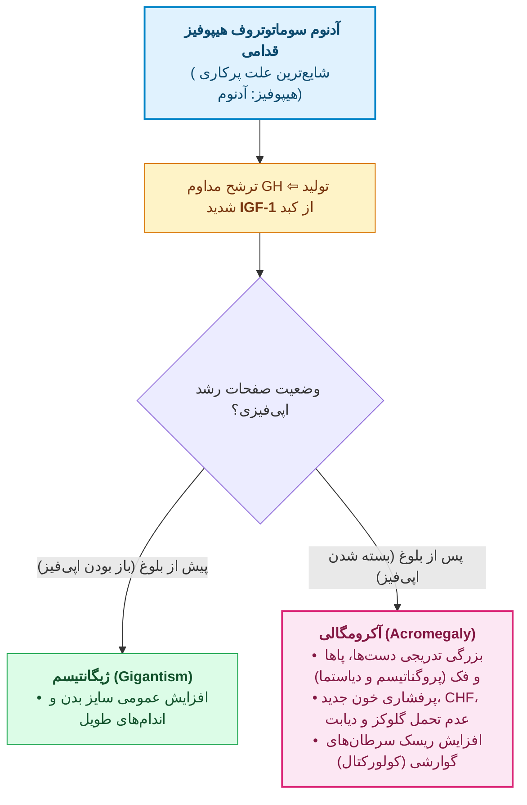

### جدول جامع پاتولوژی آدنوم‌های هیپوفیز قدامی (PitNET) و سندرم‌های وابسته

| ویژگی کلینیکوپاتولوژیک                                            | جزئیات، ژنتیک، مورفولوژی و نکات طلایی امتحانی                                                                                                                                                                                                                                                                                                                                                                                                                                                                                                                                                                                                                                                                                                                                                                                  |
| :---------------------------------------------------------------- | :----------------------------------------------------------------------------------------------------------------------------------------------------------------------------------------------------------------------------------------------------------------------------------------------------------------------------------------------------------------------------------------------------------------------------------------------------------------------------------------------------------------------------------------------------------------------------------------------------------------------------------------------------------------------------------------------------------------------------------------------------------------------------------------------------------------------------- |
| **اپیدمیولوژی و تظاهرات موضعی**                                   | **آدنوم خوش‌خیم هیپوفیز شایع‌ترین علت پرکاری غده هیپوفیز (Hyperpituitarism) است** (سنین 35-60 سال؛ میکروآدنوم < 1cm و ماکروآدنوم > 1cm).<br>*اثر توده‌ای (Mass effect):* سردرد، فرسایش سلا تورسیکا و فشار بر کیاسمای بینایی ⇦ **همی‌آنوپسی بای‌تمپورال (کاهش میدان دید طرفی)**.<br>*آپوپلکسی هیپوفیز:* خونریزی حاد داخل آدنوم ⇦ سردرد برق‌آسا، افت دید و کاهش هوشیاری (**اورژانس جراحی اعصاب**).                                                                                                                                                                                                                                                                                                                                                                                                                               |
| **دو معیار طلایی تشخیصی در هیستوپاتولوژی (افتراق از بافت نرمال)** | سلول‌های گرد/چندوجهی یک‌شکل با سیتوپلاسم ائوزینوفیل/بازوفیل در 30% موارد بدون کپسول و مهاجم به دورا و استخوان:<br>1. **مونومورفیسم سلولی (Cellular monomorphism):** یکنواختی کامل نوع سلول‌ها (برخلاف پلی‌مورفیسم بافت نرمال) #قطعی #قطعی.<br>2. **فقدان شبکه رتیکولین (Absence of reticulin network):** تخریب کامل داربست رتیکولین طبیعی #قطعی.                                                                                                                                                                                                                                                                                                                                                                                                                                                                               |
| **ژنتیک و مارکرهای رفتار تهاجمی (Aggressive)**                    | • **شایع‌ترین تغییر ژنومیک در آدنوم‌های هیپوفیز:** **جهش در پروتئین G (ژن GNAS)** (کدکننده زیرواحد آلفای Gs؛ در 40% سوماتوتروف‌ها).<br>• در آدنوم کورتیکوتروف: جهش فعال‌کننده **USP8** (30-60%)؛ در موارد ارثی (5%): جهش **MEN1** و **CDKN1B**.<br>• **مارکرهای رفتار اگرسیو (تهاجمی) و عود بیشتر:** **موتاسیون ژن TP53 (P53)** #قطعی، بیش‌بیانی **Cyclin D1** و خاموشی اپی‌ژنتیک **RB** (*تشخیص کارسینوم هیپوفیز فقط با اثبات متاستاز دوردست است*).                                                                                                                                                                                                                                                                                                                                                                           |
| **انواع اختصاصی آدنوم‌ها**                                        | 1. **آدنوم لاکتوتروف (پرولاکتینوما):** **شایع‌ترین آدنوم عملکردی (30%)**؛ تظاهر با آمنوره، گالاکتوره و ناباروری. (*تله اثر ساقه / Stalk Effect:* فشار هر توده‌ای روی ساقه مانع رسیدن دوپامین شده و پرولاکتین را به صورت خفیف **زیر 200 ng/mL** بالا می‌برد).<br>2. **آدنوم سوماتوتروف (10%):** دومین آدنوم شایع؛ مرد میانسال با بزرگی دست و فک، HTN، عدم تحمل گلوکز، **افزایش IGF-1** و ماکروآدنوم در MRI ⇦ تشخیص **Somatotroph Adenoma** (تست طلایی تشخیص: **عدم سرکوب GH در تست OGTT**).<br>3. **آدنوم کورتیکوتروف:** سلول‌های **PAS مثبت**؛ ایجاد **بیماری کوشینگ**. در صورت آدرنالکتومی دوطرفه و حذف فیدبک منفی کورتیزول ⇦ رشد تهاجمی ماکروآدنوم و هایپرپیگمانتاسیون شدید ناشی از MSH موسوم به **سندرم نلسون (Nelson syndrome)**.<br>4. **آدنوم گنادوتروف (FSH/LH):** معمولاً غیرعملکردی (Silent) و کشف در فاز ماکروآدنوم. |

> [!important] کم‌کاری هیپوفیز (Hypopituitarism)، سندرم شیهان و پاتولوژی هیپوفیز خلفی
> * **نارسایی هیپوفیز قدامی (تخریب > 75% پارانشیم):**
>   * **سندرم شیهان (Sheehan syndrome):** بزرگ شدن دو برابری هیپوفیز قدامی در بارداری (هایپرپلازی لاکتوتروف‌ها) + خون‌رسانی پورت کم‌فشار + خونریزی شدید و شوک هیپوولمیک حین زایمان ⇦ **نکروز ایسکمیک لوب قدامی** (اولین علامت: **عدم توانایی شیردهی**؛ سپس آمنوره، ریزش موی زهار و نارسایی ثانویه تیروئید و آدرنال بدون هایپرپیگمانتاسیون). **لوب خلفی به دلیل خون‌رسانی شریانی مستقیم آسیب نمی‌بیند!** (سایر علل نکروز: DIC، آنمی داسی‌شکل، تروما، افزایش ICP، ایمونوتراپی سرطان، سل و سارکوئیدوز).
> * **پاتولوژی هیپوفیز خلفی و قاعده طلایی لوکالیزاسیون ضایعه:**
>   1. **دیابت بی‌مزه مرکزی (کمبود وازوپرسین / ADH):** بیمار با سابقه **آسیب و ترومای سر (Head injury)** یا جراحی که دچار **پلی‌اوری، پلی‌دیپسی، افزایش سدیم (هایپرناترمی) و اسمولالیته پلاسما و کاهش وزن مخصوص (Specific gravity) ادرار** می‌شود #قطعی. (*در مقابل، SIADH اغلب ناشی از ترشح اکتوپیک ADH توسط **کارسینوم سلول کوچک ریه / SCLC** است و با احتباس آب و هیپوناترمی تظاهر می‌کند*).
>   2. **قاعده طلایی درگیری همزمان قدامی و خلفی:** نوجوان با علائم **دیابت بی‌مزه (کمبود ADH)** به همراه **کوتاهی قد (کمبود GH) و هیپوتیروئیدی (کمبود TSH)** ⇦ محل اصلی بیماری و ارگان هدف برای بررسی **هیپوتالاموس (یا ساقه هیپوفیز)** است! #قطعی

---

## 2. پاتولوژی غده تیروئید

* **فولیکول‌های تیروئید:** لوبول‌های حاوی 20 تا 40 فولیکول مفروش با اپی‌تلیوم مکعبی سازنده تایروگلوبولین (کلوئید صورتی).
	* **خط اول و حساس‌ترین تست غربالگری بیماری‌های تیروئید:** **سنجش TSH سرم**.
* **پرکاری تیروئید (تیروتوکسیکوز):**
  * *سه علت اصلی:* **بیماری گریوز (85% موارد)**، گواتر مولتی‌ندولار توکسیک، آدنوم توکسیک.
  * *تظاهرات بالینی و آزمایشگاهی:* خانم با تپش قلب، تاکی‌کاردی، اضطراب، تعریق، عدم تحمل گرما، لرزش، **اسهال و استئاتوره** (هایپرموتیلیتی گوارش)، میوپاتی پروگزیمال، نگاه خیره و *Lid lag* (تحریک سمپاتیک عضله تارس فوقانی) و **کاهش وزن علیرغم اشتهای خوب** همراه با **Free T4 بالا و TSH پایین** ⇦ تشخیص قطعی **پرکاری تیروئید (هیپرتیروئیدی)** (*در سالمندان به فرم مخفی یا Apathetic بروز می‌کند؛ در T3-toxicosis باید Free T3 چک شود*).
* **کم‌کاری تیروئید:**
  * *شایع‌ترین علت در جهان (و مناطق آندمیک):* **کمبود ید رژیم غذایی (Endemic iodine deficiency)** (نوجوان با عدم تحمل سرما، ضعف پیشرونده، میکس‌ادم و TSH=15).
  * *شایع‌ترین علت در مناطق با ید کافی:* **تیروئیدیت هاشیموتو**.
  * *کرتینیسم (نوزادی):* عقب‌ماندگی ذهنی شدید، کوتاهی قد، چهره خشن، زبان بزرگ بیرون‌زده (**ماکروگلوسی**) و **فتق نافی** (عبور T4 مادر در اوایل بارداری برای مغز جنین حیاتی است).
  * *میکس‌ادم (بزرگسالان):* کندی روانی شبیه افسردگی، پوست سرد، **افزایش کلسترول و LDL (آترواسکلروز)**، و رسوب گلیکوزآمینوگلیکان و هیالورونیک اسید در درم (ادم غیرگوده‌گذار و بم شدن صدا).
* **گواتر منتشر و مولتی‌ندولار (MNG):** کاهش سنتز هورمون ⇦ افزایش TSH ⇦ هایپرپلازی و اینولوشن مکرر ⇦ تیروئید بسیار بزرگ، نامتقارن و چندگره‌ای (تغییرات کیستیک، خونریزی، فیبروز و کلسیفیکاسیون).
	* *علائم:* اثرات فشاری موضعی (انسداد راه هوایی، دیسفاژی، سندرم SVC).
	* در 10% موارد طی 10 سال یک ندول خودمختار شده و **سندرم پلامر (گواتر مولتی‌ندولار توکسیک)** ایجاد می‌کند (پرکاری تیروئید **بدون افتالموپاتی و درموپاتی گریوز**).

### جدول مقایسه‌ای تیروئیدیت‌ها و بیماری گریوز

| بیماری                                           | پاتوژنز و اتیولوژی                                                                                                                                           | مشخصات کلیدی هیستوپاتولوژی                                                                                                                                                                                                                            | تظاهرات بالینی، اسکن و نکات امتحانی                                                                                                                                                                                                                                                      |
| :----------------------------------------------- | :----------------------------------------------------------------------------------------------------------------------------------------------------------- | :---------------------------------------------------------------------------------------------------------------------------------------------------------------------------------------------------------------------------------------------------- | :--------------------------------------------------------------------------------------------------------------------------------------------------------------------------------------------------------------------------------------------------------------------------------------- |
| **تیروئیدیت هاشیموتو (Hashimoto)**               | **بیماری خودایمن (Autoimmune)** #قطعی (تخریب فولیکول توسط **CD8+ CTLs**، سایتوکاین **IFN-γ** از Th1، و آنتی‌بادی‌های **Anti-TPO و Anti-Tg**؛ زنان 45-65 سال) | سه‌گانه پاتوگنومونیک:<br>1) **ارتشاح وسیع لنفوسیت‌های تک‌هسته‌ای**؛<br>2) **تشکیل فولیکول‌های لنفاوی با مراکز زایا (Germinal centers)**؛<br>3) **سلول‌های هرتل (Hürthle / انکوسیت)** با سیتوپلاسم فراوان گرانولار ائوزینوفیلیک پر از میتوکندری #قطعی. | بزرگی بدون درد تیروئید و هیپوتیروئیدی (گاه پرکاری گذرای اولیه یا *هاشیتوکسیکوز*).<br>هاشیموتو ریسک این موارد را بالا می‌برد: **لنفوم غیرهوچکین سلول B (MALT)**، **کارسینوم پاپیلاری (PTC)** و سایر بیماری‌های اتوایمیون (**ریسک کارسینوم فولیکولار یا مدولاری را بالا نمی‌برد!**) #قطعی. |
| **تیروئیدیت تحت‌حاد گرانولوماتوز (de Quervain)** | به دنبال **عفونت ویروسی** دستگاه تنفس فوقانی                                                                                                                 | تخریب فولیکول، نشت کلوئید و **التهاب گرانولوماتوز حاوی سلول‌های ژانت چند‌هسته‌ای (Multinucleated giant cells) بلعنده کلوئید** #قطعی.                                                                                                                  | خانم با **شروع حاد درد گردن (به‌ویژه حین بلع)**، تب خفیف، تیروئید کمی بزرگ و حساس، **افزایش شدید ESR** و CBC نرمال؛ بهبود خودبه‌خودی.                                                                                                                                                    |
| **تیروئیدیت ریدل (Riedel)**                      | بیماری سیستمیک مرتبط با **IgG4 (IgG4-RD)**                                                                                                                   | **فیبروز کلاژنی بسیار گسترده** با تهاجم به خارج کپسول (درگیری پاراتیروئید و عصب راجعه حنجره) + پلاسماسل‌های IgG4+.                                                                                                                                    | توده گردنی **بسیار سفت (سنگی) و فیکس‌شده** که کارسینوم آناپلاستیک را تقلید می‌کند؛ همراه با **فیبروز رتروپریتوئن**.                                                                                                                                                                      |
| **بیماری گریوز (Graves Disease)**                | خودایمن؛ تولید **آنتی‌بادی محرک علیه گیرنده TSH (TSI / TRAb از نوع IgG)**                                                                                    | غده بزرگ متقارن به رنگ قرمز گوشتی؛ سلول‌های ستونی بلند پرجمعیت با **پاپیلاهای فاقد محور فیبروواسکولار** و کلوئید کم‌رنگ با حاشیه دندانه‌دار (**Scalloped / Moth-eaten**).                                                                             | تریاد:<br>1) پرکاری تیروئید با گواتر منتشر؛<br>2) **افتالموپاتی (اگزوفتالموس)**؛<br>3) **درموپاتی (میکزدم پره‌تیبیال)**.<br>در اسکن رادیونوکلئید: **افزایش منتشر جذب ید (RAIU)**.                                                                                                        |

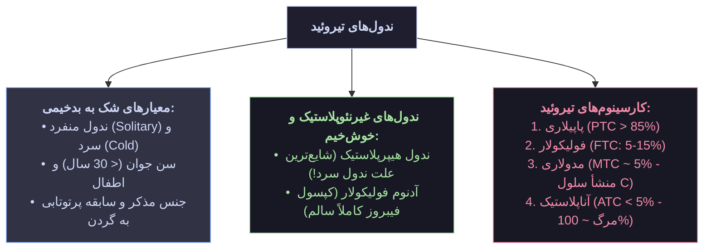

> [!warning] تله آماری ندول سرد (Cold Nodule) و منشأ سلولی سرطان‌های تیروئید
> * **محتمل‌ترین تشخیص در یک ندول منفرد سرد (Cold) در اسکن تیروئید چیست؟** اگرچه ندول سرد نسبت به ندول گرم ریسک بدخیمی بالاتری دارد، اما از نظر آماری اکثریت قاطع ندول‌های سرد، **ضایعات غیرنئوپلاستیک یعنی ندول هیپرپلاستیک (گواتر ندولار)** هستند!
> * **منشأ سلولی سرطان‌های تیروئید:** کارسینوم‌های پاپیلاری، فولیکولار و آناپلاستیک همگی از **سلول‌های اپی‌تلیوم فولیکولار** منشأ می‌گیرند؛ **تنها استثنا کارسینوم مدولاری (MTC) است** که از **سلول‌های پارافولیکولار (سلول‌های C ترشح‌کننده کلسی‌تونین)** منشأ می‌گیرد! #قطعی

### جدول مقایسه‌ای آدنوم و کارسینوم‌های چهارگانه غده تیروئید

| نوع تومور                                           | ژنتیک و ریسک‌فاکتورها                                                                                                                          | معیارهای تشخیصی هیستوپاتولوژیک و FNA                                                                                                                                                                                                                                                                                                                                              | الگوی متاستاز، سیر بالینی و نکات امتحانی                                                                                                                                                                                                                  |
| :-------------------------------------------------- | :--------------------------------------------------------------------------------------------------------------------------------------------- | :-------------------------------------------------------------------------------------------------------------------------------------------------------------------------------------------------------------------------------------------------------------------------------------------------------------------------------------------------------------------------------- | :-------------------------------------------------------------------------------------------------------------------------------------------------------------------------------------------------------------------------------------------------------- |
| **آدنوم فولیکولار (Follicular Adenoma)**            | *آدنوم غیرفعال (اکثریت):* جهش **RAS** یا **PTEN**.<br>*آدنوم توکسیک:* جهش فعال‌کننده **TSHR** یا **GNAS**.                                     | ندول منفرد کروی با فولیکول‌های یکنواخت و **کپسول فیبروز کاملاً سالم و دست‌نخورده (Intact capsule)**؛<br>فاقد تهاجم کپسولی یا عروقی.                                                                                                                                                                                                                                               | خوش‌خیم؛ با FNA قابل افتراق از کارسینوم فولیکولار نیست.                                                                                                                                                                                                   |
| **کارسینوم پاپیلاری (PTC)**<br>*(شایع‌ترین: > 85%)* | فعال‌سازی مسیر **MAP kinase** (جهش *BRAF* یا *RET/PTC*)؛ ریسک‌فاکتور اصلی: **پرتوهای یونیزان** در دو دهه اول زندگی.                            | *معیار کافی تشخیص (حتی بدون وجود پاپیلا در FNA):*<br>**ویژگی‌های هسته (Nuclear features):**<br>1. هسته‌های شفاف و خالی یا<br>**شیشه مات (Ground-glass / Orphan Annie eye)**<br>2. **شیارهای هسته‌ای (Nuclear grooves)**<br>3. **سودوانکلوزیون داخل هسته‌ای (Intranuclear inclusions)**<br>+ وجود **اجسام کلسیفیه ساموما (Psammoma bodies)** در محورهای فیبروواسکولار #قطعی #قطعی. | *شایع‌ترین واریانت:* واریانت فولیکولار کپسول‌دار.<br>**الگوی انتشار:** متاستاز از طریق لنف به **غدد لنفاوی گردن (در 50% موارد)**؛<br>**متاستاز خونی به ریه، استخوان و کبد در آن نادر است!** #قطعی<br>(بقای 10 ساله > 95%؛ پیش‌آگهی بدتر در بالای 40 سال). |
| **کارسینوم فولیکولار (FTC)**<br>*(5% تا 15%)*       | جهش **RAS** یا مسیر **PI3K/AKT**؛ شایع‌تر در زنان (3:1) و در **مناطق کمبود ید**.                                                               | *تنها یافته قابل اعتماد و ضروری برای تشخیص کارسینوم فولیکولار از آدنوم فولیکولار:*<br>اثبات **تهاجم به تمام ضخامت کپسول (Capsular invasion) و/یا تهاجم به عروق خونی (Vascular invasion)** در بررسی میکروسکوپی کامل کپسول #قطعی #قطعی.                                                                                                                                             | برخلاف PTC، درگیری لنف‌نود گردنی نادر است؛<br>انتشار عمدتاً **هماتوژن (خونی) به استخوان، ریه و کبد**.                                                                                                                                                     |
| **کارسینوم مدولاری (MTC)**<br>*(~ 5%)*              | منشأ از **سلول‌های C**؛ **70% اسپورادیک** و **30% فامیلیال** (سندرم **MEN-2A و MEN-2B**).<br>**جهش ژنتیکی تشخیصی:** پروتوانکوژن **RET** #قطعی. | سلول‌های چندوجهی تا دوکی با آرایش آشیانه‌ای (*Nesting*) همراه با **رسوب آمیلوئید مشتق از کلسی‌تونین در استروما** (رنگ‌پذیر با **کنگو رد**).<br>در فرم‌های ارثی: دوطرفه، چندکانونی و همراه با **هایپرپلازی سلول‌های C**.                                                                                                                                                           | **ترشح کلسی‌تونین** (مارکر تشخیصی و پیگیری در خون و IHC).<br>انتشار لنفاوی و خونی.                                                                                                                                                                        |
| **کارسینوم آناپلاستیک (ATC)**<br>*(< 5%)*           | میانگین سن **65 سال**؛ در 25% موارد روی زمینه **سابقه قبلی کارسینوم پاپیلاری (PTC) یا فولیکولار** با اضافه شدن **جهش TP53** رخ می‌دهد.         | تومور کاملاً تمایزنیافته (*Undifferentiated*) حاوی **سلول‌های بسیار بزرگ ژانت (Giant cells) به شدت آتیپیک و پلی‌مورفیک** و سلول‌های دوکی‌شکل با تهاجم به عضلات گردن #قطعی.                                                                                                                                                                                                        | توده حجیم با رشد سریع؛ **مرگ‌ومیر نزدیک به 100%**.                                                                                                                                                                                                        |

---

## 3. پاتولوژی غدد پاراتیروئید

* **مبانی پایه:** منشأ جنینی از **کیسه‌های حلقی سوم و چهارم**. شامل دو رده سلولی:
	1) **Chief cells (سلول‌های اصلی):** فراوان‌ترین سلول، ترشح‌کننده **PTH**؛
	2) **Oxyphil cells:** بزرگتر، سیتوپلاسم اسیدوفیلیک مملو از **میتوکندری‌های فشرده**.
* **هیپرپاراتیروئیدیسم اولیه (Primary Hyperparathyroidism):**
  * **علل به ترتیب شیوع:**
	  1) **آدنوم منفرد پاراتیروئید:** **شایع‌ترین علت** (85% تا 95% موارد) #قطعی 
	  2) **هایپرپلازی اولیه (منتشر یا ندولار):** 5% تا 10%
	  3) **کارسینوم پاراتیروئید:** **کمترین شیوع** (~1% موارد) #قطعی. (*ژنتیک:* بازآرایی **Cyclin D1** و جهش **MEN1**).
  * **مورفولوژی آدنوم پاراتیروئید:** درگیری فقط **یک غده**؛ به صورت یک **ندول کاملاً محدود با کپسول مشخص (Circumscribed nodule with well-defined capsule)** از سلول‌های Chief به همراه یک **حاشیه فشرده از بافت پاراتیروئید نرمال غیرنئوپلاستیک در بیرون کپسول**.
	  * *نکته تله:* مشاهده هسته‌های عجیب و پلی‌مورفیک موسوم به **Endocrine atypia** در آدنوم شایع است و نشانه بدخیمی نیست!.
  * **قابل اعتمادترین معیار میکروسکوپی تشخیص کارسینوم پاراتیروئید:** سیتولوژی، میتوز، آتیپی و نکروز غیرقابل اعتمادند؛ تنها معیار قطعی بدخیمی، **تهاجم به بافت‌های اطراف (Invasion) و متاستاز دوردست** است!
  * **پروفایل آزمایشگاهی و بالینی هیپرپاراتیروئیدیسم اولیه:** خانم با یبوست متناوب و سنگ‌های متعدد کلیه؛ آزمایشگاه: **افزایش کلسیم توتال و یونیزه سرم (مثلاً 11.5 mg/dL)، افزایش سطح PTH (مثلاً 127 pg/mL) و کاهش فسفر سرم (مثلاً 1.4 mg/dL)** ⇦ تشخیص **آدنوم پاراتیروئید (هیپرپاراتیروئیدی اولیه)** #قطعی.
  * **عوارض اسکلتی و کلیوی:**
	  1) استخوان: **استئیت فیبروزا سیستیکا** و تشکیل **تومور قهوه‌ای (Brown tumor)** (تجمع استئوکلاست‌ها، ژانت‌سل‌های واکنشی و هموسیدرین/خونریزی)؛
	  2) کلیه: سنگ کلیه (**نفرولیتیازیس**) و **نفروکلسینوز**؛
	  3) **کلسیفیکاسیون متاستاتیک** در معده، ریه، میوکارد و عروق.
* **هیپرپاراتیروئیدیسم ثانویه (Secondary):** بیمار با **افزایش کراتینین و اوره سرم (نارسایی مزمن کلیه / CRF)**، کلیه‌های کوچک و نفروکلسینوز (احتباس فسفات و کاهش 1α-هیدروکسیلاز ⇦ افت کلسیم سرم) ⇦ تحریک مزمن و **هایپرپلازی هر چهار غده پاراتیروئید (Parathyroid hyperplasia)** (افزایش چیف‌سل‌ها و *Water-clear cells*).
* **هیپوپاراتیروئیدیسم:** 1) **جراحی تیروئیدکتومی (شایع‌ترین علت)**؛ 2) **سندرم دی‌جرج** (حذف **22q11.2**؛ فقدان مادرزادی پاراتیروئید و تیموس + نقص قلبی)؛ 3) سندرم خودایمن پلی‌گلاندولار (جهش ژن **AIRE**).

---

## 4. پاتولوژی پانکراس درون‌ریز و دیابت ملیتوس

* **سلول‌های جزایر:** **بتا** (انسولین)، **آلفا** (گلوکاگون)، **دلتا** (سوماتواستاتین: مهار پاراکراین انسولین و گلوکاگون)، و **سلول‌های PP** (پپتید پانکراسی: تحریک آنزیم‌های معده و روده و **مهار حرکات دودی روده**).
* **اثرات انسولین بر بافت‌های محیطی (سوال تیر 404):**
  1. **بافت چربی:** افزایش برداشت گلوکز، افزایش سنتز چربی (لیپوژنز) و **مهار لیپولیز** (سرکوب لیپاز حساس به هورمون).
  2. **عضله اسکلتی:** افزایش برداشت گلوکز، **افزایش سنتز گلیکوژن** و **افزایش سنتز پروتئین**.
  3. **کبد:** مهار گلوکونئوژنز و تحریک گلیکوژنز و لیپوژنز.
* **معیارهای آزمایشگاهی تشخیص قطعی دیابت ملیتوس و پره‌دیابت (ADA / Robbins):**
  * **دیابت ملیتوس (تکرار در دو نوبت مجزا):**
	  1) قند خون ناشتا (**FBS / FPG**) **بیشتر یا مساوی 126 mg/dL** #قطعی 
	  2) قند 2 ساعته تست تحمل گلوکز خوراکی (**2-h OGTT** با 75 گرم گلوکز) **بیشتر یا مساوی 200 mg/dL**؛
	  3) **HbA1c بیشتر یا مساوی 6.5%**؛
	  4) قند تصادفی **≥ 200 mg/dL** همراه علائم کلاسیک (پلی‌اوری، پلی‌دیپسی، پلی‌فاژی) *(این مورد اگر یک‌بار دیده شود برای تشخیص کافی است!)*
  * **پره‌دیابت (Prediabetes):**
	  1) قند ناشتا (IFG): **100 تا 125 mg/dL**؛
	  2) **قند 2 ساعته تست تحمل گلوکز (IGT): 140 تا 199 mg/dL** (در بیمار با قند ناشتای 112، عدد **180 mg/dL** در تست 2 ساعته به نفع پره‌دیابت است!) #قطعی 
	  3) HbA1c: **5.7% تا 6.4%**.

### جدول مقایسه‌ای پاتوژنز، مورفولوژی و عوارض دیابت نوع 1 و نوع 2 و تومورهای PanNET

| ویژگی مقایسه‌ای               | دیابت نوع 1 (T1D)                                                                                                                                                                                   | دیابت نوع 2 (T2D)                                                                                                                                                        |
| :---------------------------- | :-------------------------------------------------------------------------------------------------------------------------------------------------------------------------------------------------- | :----------------------------------------------------------------------------------------------------------------------------------------------------------------------- |
| **پاتوژنز و ژنتیک**           | تخریب خودایمن سلول‌های بتا (بروز علائم پس از تخریب **> 90%** بتاسل‌ها)؛ حضور **اتوآنتی‌بادی ضد جزایر و ضد انسولین**؛ ارتباط قوی با ژن‌های **HLA (MHC I & II)**، پلی‌مورفیسم **CTLA4** و **PTPN22**. | مقاومت محیطی به انسولین (مهم‌ترین عامل: **چاقی** و افزایش اسید چرب آزاد/FFA) + نقص نسبی ترشح انسولین؛ **فاقد ارتباط با سیستم HLA (No HLA linkage)** و فاقد اتوآنتی‌بادی. |
| **مورفولوژی جزایر لانگرهانس** | **انسولیت (Insulitis):** ارتشاح لنفوسیت‌های T در جزایر + آتروفی و کاهش شدید سلول‌های بتا.                                                                                                           | **رسوب آمیلوئید (Amyloid deposition)** (مشتق از آمیلین/IAPP) در جزایر در مراحل پیشرفته.                                                                                  |
| **عوارض حاد متابولیک**        | **کتواسیدوز دیابتی (DKA):** قند **500 تا 700 mg/dL**، بوی میوه‌ای دهان و **تنفس کاسمال**.                                                                                                           | **کمای هایپراسمولار غیرکتوتیک (HHS / HONK):** قند **600 تا 1200 mg/dL** و دهیدراتاسیون شدید.                                                                             |

*(سایر انواع دیابت: فرم‌های مونوژنیک **MODY** و دیابت نوزادی، دیابت میتوکندریایی همراه ناشنوایی **MIDD**، بیماری‌های اگزوکرین پانکراس مثل پانکراتیت مزمن، CF و هموکروماتوز، اندوکرینوپاتی‌ها و سندرم‌های داون، کلاین‌فلتر و ترنر).*

> [!note] عوارض مزمن دیابت ملیتوس
> - **بیماری ماکروواسکولار (آترواسکلروز تسریع‌شده و هیالین آرتریولواسکلروزیس PAS مثبت):** **انفارکتوس میوکارد (MI) شایع‌ترین علت مرگ دیابتی‌هاست**؛ سکته مغزی و گانگرن پا.
> - **میکروآنژیوپاتی (ضخیم‌شدن منتشر غشای پایه مویرگ‌ها):** رتینوپاتی، نوروپاتی، و **نفروپاتی دیابتی** (شایع‌ترین علت ESRD و دومین علت مرگ؛ اولین تظاهر بالینی: **میکروآلبومینوری 30 mg تا 3.5 g در روز**؛ ضایعه اختصاصی پاتولوژی: **گلومرولواسکلروز ندولار یا کیمل‌استیل-ویلسون** و پاپیلایتیس نکروزان).


> [!important] تومورهای نورواندوکرین پانکراس (PanNETs)
> 1. **انسولینوما (Insulinoma):** **شایع‌ترین تومور نورواندوکرین پانکراس**؛ کوچک (< 2cm)، منفرد، **خوش‌خیم در بیش از 90% موارد**؛ حملات هایپوگلیسمی؛ نمای میکروسکوپی آشیانه‌ای همراه **رسوب آمیلوئید**.
> 2. **گاسترینوما (Gastrinoma):** ایجاد **سندرم زولینگر-الیسون** (زخم‌های پپتیک مقاوم و متعدد)؛ واقع در پانکراس یا دئودنوم؛ **بیش از 50% موارد بدخیم و متاستاتیک** هستند؛ همراهی با **MEN-1**.


---

## 5. پاتولوژی غده فوق‌کلیه (آدرنال) و سندرم‌های MEN

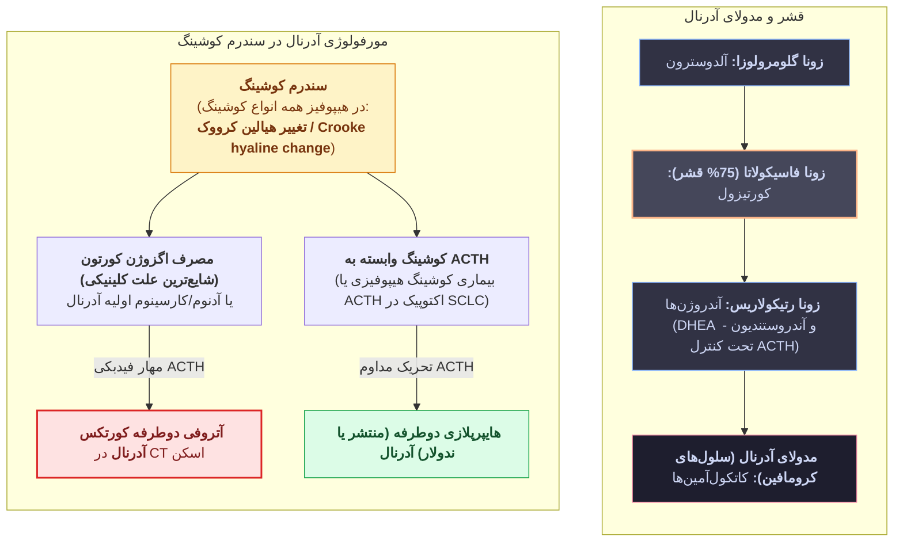

### جدول جامع پاتولوژی قشر و مدولای آدرنال

| بیماری یا تومور آدرنال                                  | اتیولوژی، پاتوژنز و ژنتیک                                                                                                                                                                                                                              | مورفولوژی (گروس و میکروسکوپی) و نکات امتحانی                                                                                                                                                                                                                                                                                                                                                                                                                                                                                                                                                                                                                              |
| :------------------------------------------------------ | :----------------------------------------------------------------------------------------------------------------------------------------------------------------------------------------------------------------------------------------------------- | :------------------------------------------------------------------------------------------------------------------------------------------------------------------------------------------------------------------------------------------------------------------------------------------------------------------------------------------------------------------------------------------------------------------------------------------------------------------------------------------------------------------------------------------------------------------------------------------------------------------------------------------------------------------------ |
| **سندرم کوشینگ یاتروژنیک (مصرف اگزوژن کورتون)**         | **شایع‌ترین علت سندرم کوشینگ**؛<br>مصرف کورتون در بیماری‌های خودایمنی (**لوپوس، آرتریت روماتوئید**) ⇦ مهار ترشح ACTH از هیپوفیز.                                                                                                                       | بیمار با چاقی تنه‌ای، استریا، هیرسوتیسم و فشار خون که در CT اسکن شکم **آتروفی دوطرفه قشر غده آدرنال (Cortical atrophy)** دارد<br>⇦ علت قطعی: **مصرف اگزوژن کورتیکواستروئید (کورتون)** #قطعی #قطعی.<br>(*در هیپوفیز قدامی:* جایگزینی گرانول‌های سلول کورتیکوتروف با فیلامنت‌های حدواسط هموژن موسوم به **تغییر هیالین کرووک / Crooke hyaline change**).                                                                                                                                                                                                                                                                                                                     |
| **هیپرآلدوسترونیسم اولیه (سندرم کان / Conn)**           | هایپرپلازی دوطرفه ایدیوپاتیک یا **آدنوم قشر آدرنال مترشحه آلدوسترون (آلدوسترونوما)**.                                                                                                                                                                  | بیمار جوان با سردرد، **فشار خون بسیار بالا (مثلاً 174/116)**، **هیپوکالمی**، افزایش آلدوسترون، **کاهش رنین** و توده آدرنال<br>⇦ تشخیص: **آدنوم کورتکس آدرنال (Adrenal cortical adenoma)** #قطعی.<br>*مورفولوژی:* توده منفرد کوچک (< 2cm) به رنگ **زرد درخشان (Bright yellow)**؛ سلول‌ها شبیه *زونا فاسیکولاتا* هستند؛ چون آلدوسترون ACTH را مهار نمی‌کند بنابراین **قشر مجاور آتروفه نمی‌شود**؛ حضور **اجسام اسپیرونولاکتون** در درمان دارویی.                                                                                                                                                                                                                            |
| **هیپرپلازی مادرزادی آدرنال (CAH / سندرم آدرنوژنیتال)** | توارث اتوزومال مغلوب؛<br>**شایع‌ترین کمبود آنزیمی (> 90% موارد): نقص آنزیم 21-هیدروکسیلاز (21-hydroxylase deficiency)** #قطعی<br>⇦ کاهش کورتیزول، افزایش شدید ACTH و انحراف پیش‌سازها (**افزایش 17-هیدروکسی پروژسترون سرم**) به سمت آندروژن‌ها.        | • در نوزاد دختر: **شایع‌ترین علت ابهام جنسی (Ambiguous genitalia / سودوهرمافرودیتیسم)** در بدو تولد (ارگان هدف بررسی: **آدرنال**).<br>• در پسر 4-5 ساله: **بلوغ زودرس کاذب و ویریلیزاسیون** (موهای شرمگاهی، بزرگی آلت، بوی بدن بزرگسالان).<br>• **یافته مورفولوژیک در غدد آدرنال:** **هایپرپلازی قشر آدرنال (Cortical hyperplasia)** دوطرفه #قطعی #قطعی.                                                                                                                                                                                                                                                                                                                  |
| **نارسایی قشر آدرنال (آدیسون و بحران حاد)**             | 1. **مزمن (بیماری آدیسون):** **شایع‌ترین علت: آدرنالیت اتوایمیون (60-70%)**؛<br>سایر علل: سل، ایدز، کارسینوم متاستاتیک.<br>2. **حاد (Adrenal crisis):** قطع ناگهانی کورتون، DIC، ضدانعقادها، و سپسیس مننگوکوکی برق‌آسا (**سندرم واترهاوس-فریدریشسن**). | در بحران حاد: خونریزی ماسیو دوطرفه آدرنال.<br>*نکته کارسینوم قشر آدرنال:* تومور بزرگ (> 200-300 گرم)؛ افتراق از آدنوم با **معیار ویس (Weiss criteria)**.<br>**متاستاز به کورتکس آدرنال بسیار شایع‌تر از کارسینوم اولیه آدرنال است!**                                                                                                                                                                                                                                                                                                                                                                                                                                      |
| **فئوکروموسیتوما (Pheochromocytoma)**                   | تومور **سلول‌های کرومافین مدولای آدرنال**؛<br>ترشح کاتکول‌آمین‌ها (افزایش **VMA و متانفرین ادرار 24 ساعته**) و ایجاد فشار خون قابل جراحی.<br>همراهی با جهش **RET (MEN-2)** و **NF1**.                                                                  | **قانون 10 درصد (Rule of 10s):** 10% خارج آدرنال (**پاراگانگلیوما** در ارگان زاکرکندل یا جسم کاروتید؛ پس **90% داخل آدرنال هستند!** و گزینه *"10% داخل آدرنال هستند"* غلط است!) #قطعی ، 10% دوطرفه (در فامیلیال 50%)، 10% فامیلیال، 10% کودکان، و **10% بدخیم**.<br>• **یافته هیستولوژیک مشخصه:** آشیانه‌های گرد سلولی موسوم به **لانه زلبالن (Zellballen nests)** احاطه‌شده با سلول‌های پشتیبان (*Sustentacular*) و شبکه پرعروق (مثبت در رنگ‌آمیزی نقره) #قطعی.<br>• **تنها معیار قابل اعتماد و قطعی برای تشخیص بدخیمی در فئوکروموسیتوما:** **وجود متاستاز دوردست (Presence of metastases)** (پلئومورفیسم، نکروز، میتوز و تهاجم کپسولی/عروقی ملاک بدخیمی نیستند!) #قطعی. |

### جدول مقایسه‌ای سندرم‌های نئوپلازی متعدد اندوکرین (MEN)

| ویژگی                                | سندرم MEN-1 (سندرم ورمر)                                                                                                                                                                      | سندرم MEN-2A (سندرم سیپل)                                                                                                                                           | سندرم MEN-2B                                                                                                                                                                                                  |
| :----------------------------------- | :-------------------------------------------------------------------------------------------------------------------------------------------------------------------------------------------- | :------------------------------------------------------------------------------------------------------------------------------------------------------------------ | :------------------------------------------------------------------------------------------------------------------------------------------------------------------------------------------------------------ |
| **ژن و پروتئین جهش‌یافته**           | ژن سرکوب‌گر تومور **MEN1** (پروتئین **Menin**)                                                                                                                                                | پروتوانکوژن **RET** (گیرنده تیروزین کیناز)                                                                                                                          | پروتوانکوژن **RET** (گیرنده تیروزین کیناز)                                                                                                                                                                    |
| **ارگان‌های درگیر (به ترتیب اهمیت)** | 1. **پاراتیروئید:** هایپرپاراتیروئیدیسم اولیه (80-95%)<br>2. **پانکراس:** تومورهای نورواندوکرین (PanNETs مثل گاسترینوما و انسولینوما؛ **علت اصلی مرگ**)<br>3. **هیپوفیز قدامی:** پرولاکتینوما | 1. **تیروئید:** کارسینوم مدولاری (**MTC** در ~100%)<br>2. **مدولای آدرنال:** **فئوکروموسیتوما** (40-50%)<br>3. **پاراتیروئید:** **هایپرپلازی پاراتیروئید** (10-20%) | 1. **تیروئید:** کارسینوم مدولاری (**MTC** مهاجم‌تر)<br>2. **مدولای آدرنال:** **فئوکروموسیتوما**<br>3. **فاقد درگیری پاراتیروئید!**<br>4. **گانگلیونوروماهای مخاطی** (لب، زبان، گوارش) + **فنوتیپ مارفانوئید** |
