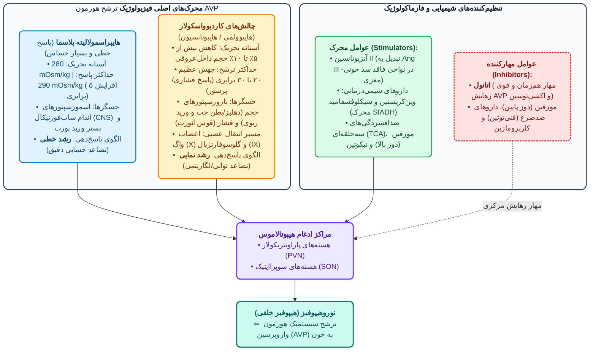
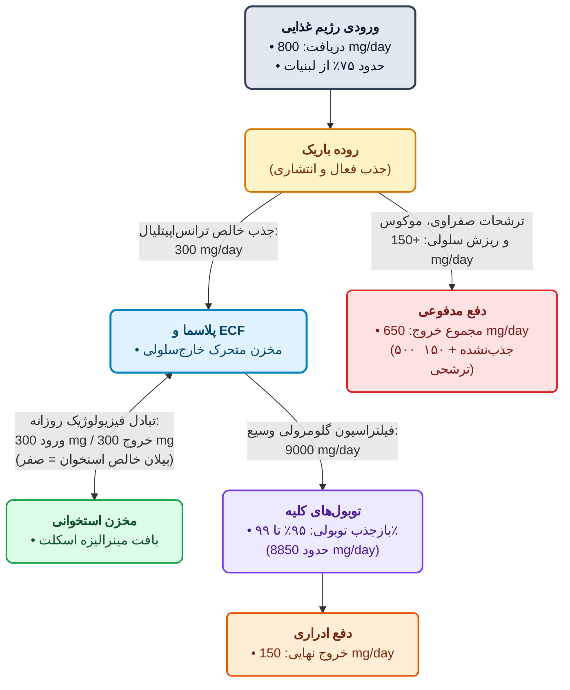
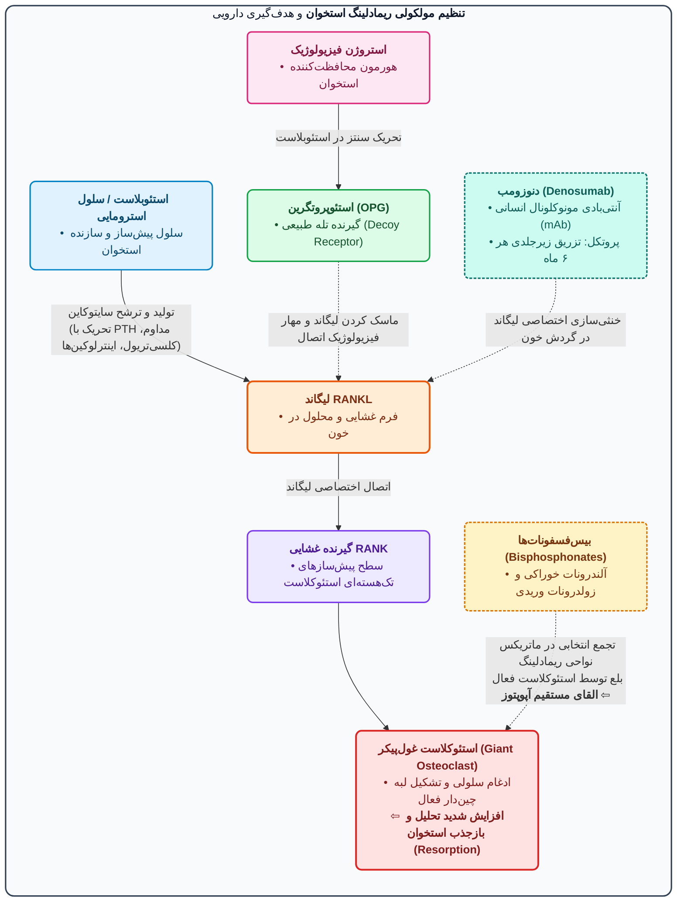
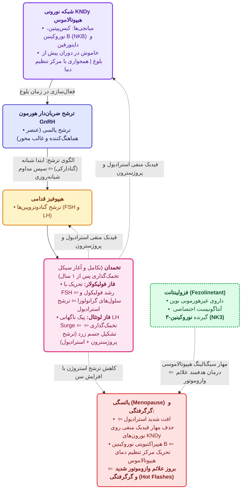
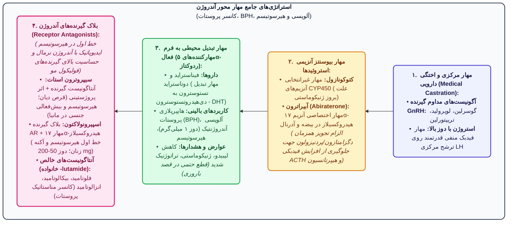
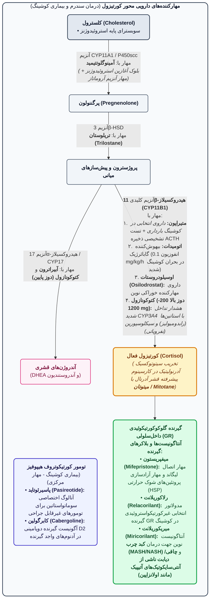
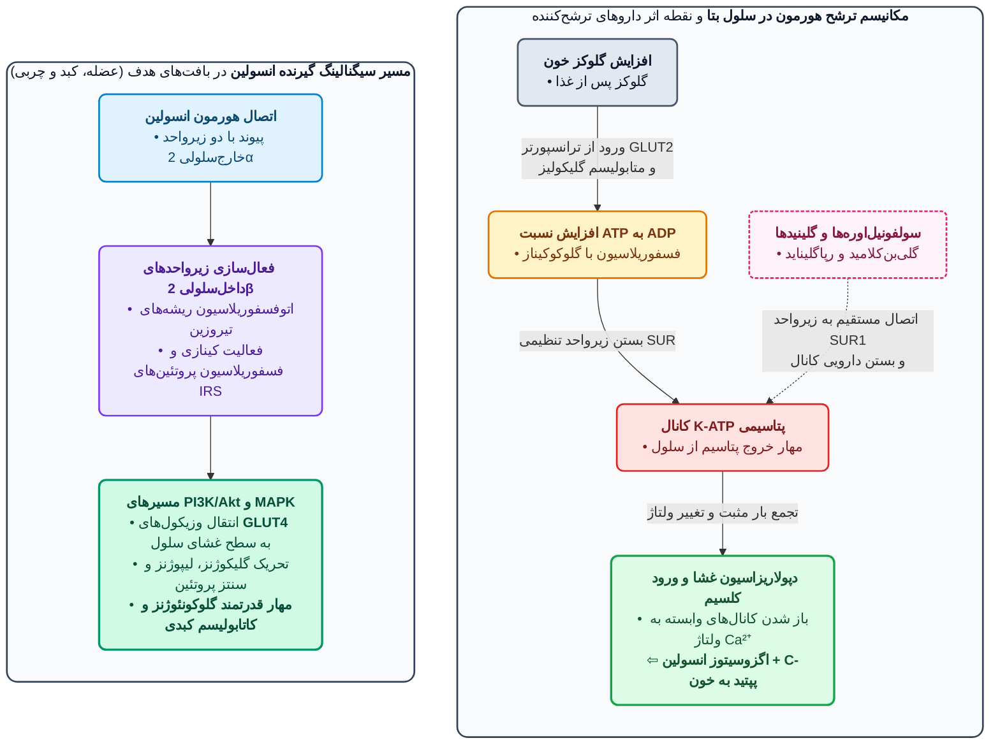

# 1. هیپوفیز خلفی (نوروهیپوفیز) و هموستاز آب

> [!info] مفهوم نوین هورمون و نوروترنسمیتر
> نقص تعریف قدیمی هورمون (ترشح از غدد درون‌ریز به خون ⇦ اثر در بافت دورتر)؛ علت: نقش **نوروترنسمیتر** مغزی **AVP** و **اکسی‌توسین** علاوه‌بر اثرات سیستمیک (حیاتی در ارتباطات بین‌نورونی، تنظیم اتونوم، ترمورگولاسیون، رفتار اجتماعی / *Social Behavior*). پراکندگی اکسی‌توسین (*هورمون عشق / Passion Hormone*) از ساقه مغز تا کورتکس.

## آناتومی، سنتز و ساختار شیمیایی
* **منشأ سنتز (هیپوتالاموس، نه هیپوفیز!):** جسم سلولی نورون‌های **مگنوسلولار (Magnocellular)** در ۲ هسته **پاراونتریکولار (PVN)** (محل اصلی ساخت AVP) و **سوپرااپتیک (SON)**.
  * *نکته تستی:* سنتز **فقط یکی** از ۲ هورمون (AVP یا اکسی‌توسین) در هر نورون (عدم سنتز همزمان).
  * **مسیرهای آکسونی:**
    1. **مگنوسلولار (بلند):** ختم به نوروهیپوفیز ⇦ خون سیستمیک (مسیر **همیشگی** اکسی‌توسین؛ بی‌ارتباط با هیپوفیز قدامی).
    2. **پارووسلولار (Parvocellular - کوتاه):** مختص **AVP** ⇦ سیستم پورتال هیپوفیز قدامی ⇦ تحریک گیرنده **V1b** ⇦ ⇧ ترشح **ACTH**.
* **مراحل سنتز:** **پره-پروهورمون** ⇦ **پروهورمون** ⇦ شکستن + اتصال به پپتید حامل **نوروفیزین (Neurophysin)** (اختصاصی هر هورمون) ⇦ انتقال آکسونی و ذخیره در گرانول‌های پایانه نوروهیپوفیز.
* **منابع خارج عصبی (Extraneuronal):**
  * **AVP:** قلب، آدرنال، اکتوپیک در تومورها (به‌ویژه کانسر ریه).
  * **اکسی‌توسین:** بیضه مردان (موثر بر حرکت اسپرم) و بافت تناسلی.

| ویژگی | آرژنین وازوپرسین (AVP / ADH) | اکسی‌توسین (Oxytocin) | دزموپرسین (DDAVP - صناعی) |
| :--- | :--- | :--- | :--- |
| **ساختار پایه** | نوناپپتید (۹ آمینواسید): حلقه ۶تایی دی‌سولفیدی + دنباله ۳تایی | نوناپپتید: حلقه ۶تایی + دنباله ۳تایی | آنالوگ صناعی AVP (تغییر L-Arg به **D-Arg** در موقعیت ۸ + دآمیناسیون سیستئین ۱) |
| **تفاوت آمینواسیدی** | موقعیت ۳: **Phe** / موقعیت ۸: **L-Arg** (خوک: لایزین/LVP) | موقعیت ۳: **Ile** / موقعیت ۸: **Leu** | فرم طبیعی بدن **L**؛ دزموپرسین فرم **D** |
| **تجویز** | تزریقی، اسپری بینی (*عدم جذب خوراکی*؛ پپتیدی) | تزریقی (انفوزیون)، اسپری بینی (*عدم جذب خوراکی*) | تزریقی، اسپری بینی، **مقداری جذب خوراکی** |
| **نیمه‌عمر / متابولیسم** | کوتاه (۲۰-۳۰ دقیقه)؛ تخریب با پپتیدازها (**وازوپرسیناز**) | کوتاه؛ تخریب با پپتیدازها (**اکسی‌توسیناز**) | **طولانی‌اثر (Long-acting)**؛ مقاوم به پپتیدازها (۱-۲ بار/روز) |
| **اختصاصیت گیرنده** | غیرانتخابی (V2 > V1) | گیرنده اکسی‌توسین (شبیه V1) | **انتخابی قوی V2** (اثرات کلیوی ≫ عروقی/اکسترارنال؛ ایمن‌تر در ایسکمی قلبی) |

> [!warning] دیابت بی‌مزه بارداری
> ⇧ شدید **وازوپرسیناز** جفتی ⇦ تخریب AVP خون ⇦ **دیابت بی‌مزه (پلی‌اوری)** ناشی از کمبود هورمون (کلیه سالم). درمان: **دزموپرسین** (مقاوم به وازوپرسیناز؛ گاه دائمی).

### نکات طلایی ترشح AVP، گیرنده‌ها و داروها
* **اسمولورسپتورهای پورتال کبدی:** مصرف غذای پرنمک ⇦ پیام ترشح AVP به مغز **قبل از تغییر اسمولاریته سیستمیک**.
* **سقف تغلیظ ادرار:** اسمولاریته ۲۸۰-۲۹۰ ⇦ بازجذب آب خالص با AVP (حفظ حیات در بیابان). حداکثر تغلیظ ادرار انسان: **1200 mOsm/kg**؛ اسمولاریته پلاسما > ۲۹۰ ⇦ عدم کفایت AVP ⇦ الزام **تشنگی (نوشیدن آب)**.
* **تست محرومیت از آب (Water Deprivation):** تفکیک دیابت بی‌مزه مرکزی (NDI/CDI)؛ تزریق AVP اگزوژن ⇦ پاسخ مثبت در نوع **مرکزی (سنترال)** vs عدم پاسخ در نوع **نفروژنیک (رنال)**.
* **چالش حجمی vs اسمولاریته:** چالش کاردیوواسکولار **قوی‌تر** (رشد لگاریتمی ۲۰-۳۰x vs حسابی ۵x). هایپراسمولاریته خالص ⇦ فقط اثرات **کلیوی (حساس‌ترین عملکرد)**؛ خونریزی شدید (⇩ حجم > 10%) ⇦ ⇧ شدید AVP ⇦ اثرات **اکسترارنال (انقباض عروقی)** (علت **رنگ‌پریدگی پوست** در شوک هموراژیک: انقباض عروق زیرجلدی با AVP).
* **تداخل سیکلوفسفامید:** آلکیله‌کننده سرکوبگر مغز استخوان (برخلاف **وین‌کریستین**: *Bone-marrow sparing*). متابولیت سیکلوفسفامید ⇦ **سیستیت هموراژیک** ⇦ الزام هیدراتاسیون. سیکلوفسفامید (محرک AVP) + تحمیل آب ⇦ خطر **مسمومیت با آب (Water Intoxication) و هایپوناترمی (Na < 120 mEq/L ⇦ تشنج و مرگ)**. (کاربرد TCAها در شب‌ادراری کودکان: تحریک خفیف ترشح AVP).
* **بیماری کوشینگ (مرکزی):** تحریک مفرط ACTH توسط AVP (پارووسلولار) ⇦ ⇧ ACTH ⇦ **هایپرپیگمانتاسیون**.
* **علل دیورز اتانول:** 1. مهار مستقیم ترشح مغزی AVP، 2. تحمیل حجم بالای آب (آبجو ۵٪، شراب ۱۲-۱۴٪). (تزریق وریدی اتانول ۵٪ در گذشته جهت مهار زایمان زودرس / توکولیتیک؛ منسوخ به دلیل عدم کارایی قطعی).
* **گیرنده‌های AVP:**
  1. **V1a (جی‌پروتئین Gq ⇦ فسفولیپاز C ⇦ IP3/DAG ⇦ ⇧ Ca²⁺ داخل سلولی + تولید پروستاگلاندین‌ها و لوکوترین‌ها):** عضلات صاف عروق (انقباض؛ خطر در عروق کرونر)، دستگاه گوارش (اسپاسم و ⇩ ترشحات؛ آمادگی جراحی)، پلاکت‌ها (ذخیره در دنس‌گرانول‌ها کنار سروتونین/5-HT و آزادسازی ترومبوکسان A2 ⇦ تسهیل تجمع پلاکتی؛ *اکسی‌توسین فاقد این اثر*).
  2. **V1b:** هیپوفیز قدامی (⇧ ترشح ACTH).
  3. **V2 (جی‌پروتئین Gs ⇦ آدنیلات سیکلاز ⇦ ⇧ cAMP ⇦ PKA):** غشای بازولترال مجاری جمع‌کننده کلیه (اگزوسیتوز و استقرار کانال‌های آب **آکواپورین-2 / AQP2** در غشای آپیکال ⇦ بازجذب آب؛ حساس‌ترین اثر AVP) + **اندوتلیوم عروق** (آزادسازی **فاکتور 8** و **فاکتور فون‌ویلبراند / vWF** ⇦ درمان اختلالات خونریزی‌دهنده؛ حساسیت کمتر از اثر کلیوی).
* **فیدبک منفی کلیوی پروستاگلاندین‌ها (PGs):** تحریک AVP در کلیه ⇦ ساخت PGs (**آنتاگونیست فیزیولوژیک AVP**؛ افزایش‌دهنده دفع آب جهت جلوگیری از احتباس مفرط).
* **تداخلات دارویی پاسخ کلیه به AVP:**
  * **تقویت‌کننده‌ها (درمان دیابت بی‌مزه پارشیال):** **NSAIDs (به‌ویژه ایندومتاسین)** با مهار ساخت PG کلیوی ⇦ تشدید اثر AVP. *خطر بالینی:* در سیروز با آسیت، نارسایی قلبی (CHF)، هایپرتانسیون کنترل‌شده (به‌ویژه مردان ایرانی > ۵۰ سال که با قطع خودسرانه دارو تصور بهبودی دارند) که دچار هایپوولمی موثر و وابستگی به PG کلیوی هستند ⇦ مصرف NSAID ⇦ احتباس شدید آب، ادم و شکست درمان ضد فشارخون.
  * **تضعیف‌کننده‌ها (ایجاد دیابت بی‌مزه نفروژنیک / درمان SIADH):** **لیتیوم** (داروی تثبیت‌کننده دوقطبی جهت پیشگیری از عود؛ ایجاد نفروژنیک DI گاه غیرقابل‌برگشت + افزایش سطح PTH در مصرف طولانی؛ الزام پایش سطح خونی) و **دمکلوسایکلین** (تتراسایکلین؛ کاربرد در SIADH و مسمومیت با آب؛ خطر سمیت کبدی/کلیوی).
* **آنالوگ‌ها و آنتاگونیست‌های AVP:**
  * **فلی‌پرسین (Felypressin):** آنالوگ منقبض‌کننده عروقی (V1a > V2)؛ کاربرد در خونریزی‌های موضعی و واریس مری.
  * **واپتان‌ها (Vaptans - مثل تولواپتان، کونیواپتان):** آنتاگونیست‌های فارماکولوژیک گیرنده V2 (و V1a)؛ خط اول نوین در **SIADH**، مسمومیت با آب و **نارسایی قلبی (CHF)** (دفع آب خالص بدون تغییر غلظت آگونیست).

## فارماکولوژی اکسی‌توسین و توکولیتیک‌ها
* **مکانیسم اثر:** گیرنده Gq ⇦ ⇧ IP3/Ca²⁺ (انقباض مستقیم میومتر) + **⇧ سنتز پروستاگلاندین‌ها** در رحم (انقباض غیرمستقیم).
* **تنظیم فیزیولوژیک:** تحریک با مکیدن پستان (Suckling)، دستکاری پستان، هایپراسمولاریته و خونریزی. **استرادیول** (⇧ حساسیت و تولید) vs **پروژسترون** (مهارکننده؛ افت پروژسترون در پایان بارداری ⇦ شروع زایمان). مهار محیطی با **ریلکسین** و **اپی‌نفرین**.
* **حساسیت رحم:** رحم غیرباردار (فاقد پاسخ) vs نیمه دوم بارداری (**۸ برابر** حساس‌تر + **۲۰ تا ۳۰ برابر** آپ‌رگولاسیون گیرنده‌های اکسی‌توسین). ایجاد انقباضات ریتمیک در عضله صاف فاقد خودکاری دائمی (مشابه وازدفران در مردان؛ برخلاف عضله صاف عروق فاقد خودکاری و روده دارای خودکاری دائمی).
* **کاربردهای بالینی:** 1. القا (Induction) و تقویت (Augmentation) زایمان (امروزه جایگزینی نسبی با پروستاگلاندین‌ها به دلیل اثر Ripening سرویکس و سهولت مصرف)، 2. **خونریزی پس از زایمان (PPH)** (ایجاد اسپاسم رحمی؛ در کنار **متیل‌ارگونوین / مترژین** و پروستاگلاندین‌ها)، 3. رفلکس خروج شیر (Milk Ejection / Let-down) (انقباض سلول‌های میواپیتلیال پستان)، 4. سوءمصرف اسپری بینی در جامعه جهت بهبود روابط اجتماعی (فاقد تایید علمی).
* **عارضه اوردوز:** پارگی رحم (Uterine Rupture) به دلیل حساسیت بالای رحم باردار.
* **توکولیتیک‌ها (مهار زایمان زودرس):** **آتوسيبان (Atosiban)** (آنتاگونیست اختصاصی گیرنده اکسی‌توسین؛ تایید در اروپا، عدم تایید FDA). سایر روش‌های کم‌اثر/ناموفق: مهارکننده‌های کانال کلسیم، آگونیست‌های بتا-۲، نیتریک اکساید (NO)، NSAIDs. *افق نوین:* مشتقات **کانابیدیول (CBD)** (فاقد اثرات روان‌گردان THC؛ کاربرد فعلی در تهوع شیمی‌درمانی، درد، صرع و اشتها).

---

# 2. هوموستاز کلسیم و فارماکولوژی استخوان

> [!info] توزیع و فرکشن‌های کلسیم بدن
> * **کل کلسیم بدن:** مردان ~ **1300g**، زنان ~ **1000g** (**99%** در استخوان و دندان به فرم **هیدروکسی‌آپاتیت** همراه فسفات؛ **1%** خارج سلولی).
> * **شیب غلظتی عظیم (بیشترین در بین کاتیون‌ها نسبت به Na, K, Mg):** خارج سلولی **~ 2.5 mM** (2.1-2.6 mM) vs داخل سلولی **ساب‌میکرومولار (~ 100 nM)** (تفاوت ده‌ها هزار برابری!).
> * **نقش کلسیم:** داخل سلولی (پیامبر ثانویه از طریق اتصال به **کالمودولین** ⇦ انقباض، ترشح/فیوژن، فعال‌سازی آنزیم‌ها؛ افزایش طولانی‌مدت ⇦ آسیب میتوکندری و مرگ سلول؛ تنظیم با شبکه آندوپلاسمی، کانال‌های کلسیمی و پمپ **PMCA / Ca²⁺-ATPase** غشایی علی‌رغم شیب غلظت) vs خارج سلولی (انقباض عضلانی، انعقاد خون، ریمادلینگ استخوان؛ مبنای تعریف هایپر/هایپوکلسمی).
> * **۳ فرکشن کلسیم پلاسما (2.5 mM):** 1. **یونیزه (50% = 1.2 mM):** تنها فرم **فعال بیولوژیک** و قابل انتشار، 2. **متصل به پروتئین (40%):** **90% به آلبومین** + 10% گلوبولین‌های α, β, γ (غیرفعال و غیرقابل انتشار؛ مشابه داروهای باندشده)، 3. **کمپلکس با آنیون‌ها (10%):** با فسفات و سیترات (قابل انتشار / Diffusible؛ جمعاً **60%** کلسیم پلاسما قابل انتشار است).

* **مکانیسم جذب روده‌ای:**
  1. **دئودنوم:** جذب **فعال و اختصاصی** وابسته به **کلسی‌تریول (Vit D3)**؛ حیاتی در کمبود کلسیم غذایی، **مختل در سالمندان**.
  2. **ژژنوم و ایلئوم:** **انتشار غیرفعال (Passive Diffusion)**؛ مسئول **بیشترین درصد جذب** در شرایط عادی؛ مختل در استئاتوره، اسهال مزمن و رزکشن روده.
* **تداخلات دارویی کینتیک کلسیم:**
  * **لوپ دیورتیک‌ها (فوروزماید):** ⇧ دفع ادراری کلسیم (ممنوع در مصرف طولانی در مستعدین استئوپروز).
  * **تیازیدها:** ⇧ دفع سدیم اما **⇧ بازجذب توبولی کلسیم** (دیورتیک انتخابی در ریسک استئوپروز).
  * **گلوکوکورتیکوئیدها و فنی‌توئین (مصرف طولانی سال‌ها در صرع یا سرکوب ایمنی):** ⇩ جذب روده‌ای کلسیم ⇦ استئوپروز.

| هورمون | منشأ، ساختار و گیرنده | تنظیم ترشح | اثرات بر کلسیم، فسفات و ارگان‌ها | نکات بالینی و فارماکولوژیک |
| :--- | :--- | :--- | :--- | :--- |
| **پاراتورمون (PTH)** | پاراتیروئید؛ پلی‌پپتید فعال **۸۴ آمینواسیدی**. **PTH1R:** اتصال PTH و **PTHrP**. **PTH2R:** فقط اتصال PTH. | حسگر غشایی **CaSR** (متصل به **Gq** ⇦ ⇧ Ca داخل سلولی و **Gi** ⇦ ⇩ cAMP). *استثنا:* ⇧ کلسیم داخل سلولی در پاراتیروئید (و سلول‌های ژوکستاگلومرولار کلیه برای رنین) ⇦ **مهار ترشح!** **ویتامین D:** مهار مستقیم سنتز PTH. | **⇧ Ca / ⇩ PO₄** پلاسما. 1. کلیه: بازجذب **مستقیم** Ca (99%)، دفع PO₄، القای **1α-هیدروکسیلاز** در توبول پروگزیمال. 2. روده: جذب **غیرمستقیم** Ca (با واسطه ساخت Vit D). 3. استخوان: وابسته به الگو. | **PTHrP:** ترشح از تومورها ⇦ هایپرکلسمی بدخیمی (بدون نقش فیزیولوژیک). **اثر دوگانه استخوانی:** غلظت بالا/مداوم ⇦ کاتابولیک (Resorption)؛ تجویز **متناوب (Intermittent)** ⇦ **آنابولیک** (**تری‌پاراتاید** در درمان استئوپروز). |
| **ویتامین D3 (کلسی‌تریول)** | هیدروکسیلاسیون کبدی (25-OH) ⇦ کلیوی (**1,25-(OH)2-D3**). منشأ حیوانی **۱۰ برابر قوی‌تر** از گیاهی (در بالین یکسان با تنظیم دوز). | تحریک **1α-هیدروکسیلاز** با PTH و هایپوکلسمی. (مختل در نارسایی مزمن کلیه / CKD). | **⇧ Ca / ⇧ PO₄** پلاسما. حفظ همزمان Ca و PO₄ (تفاوت کلیدی با PTH: فسفات پایین در هایپرپاراتیروئیدی vs فسفات بالا در مسمومیت Vit D). | در لنفوم: بیان اکتوپیک گیرنده‌های Vit D ⇦ هایپرکلسمی بدخیمی. کمبود Vit D + Ca ⇦ استئومالاسی و استئوپروز. |
| **کلسی‌تونین (Calcitonin)** | سلول‌های پارافولیکولار (C-cells) تیروئید. | **هورمون هایپوکلسمیک:** ⇧ ترشح در هایپرکلسمی (عکس PTH). | **⇩ Ca** پلاسما. مهار **مستقیم استئوکلاست‌ها** (جلوگیری از تشکیل Ruffled border و اتصال به استخوان کورتیکال). | **تومورمارکر تشخیصی:** کارسینوم مدولاری تیروئید (MTC). **کاربرد:** استئوپروز و هایپرکلسمی حاد. **عیب بزرگ:** ایجاد سریع **تولرانس (Tachyphylaxis)** پس از چند روز مصرف. |

### مدیریت هایپرکلسمی حاد و فارماکولوژی استئوپروز
* **علل هایپرکلسمی:** بیماران **سرپایی** (شایع‌ترین: **هایپرپاراتیروئیدی اولیه**) vs بیماران **بستری** (شایع‌ترین: **بدخیمی‌ها**).
* **درمان اورژانس هایپرکلسمی (خطر مرگ؛ پلی‌اوری ⇦ ⇩ شدید حجم داخل عروقی):**
  1. **هیدراتاسیون وسیع با نرمال‌سالین (6-8 لیتر!):** خط اول حیاتی جهت جبران حجم.
  2. **لوپ دیورتیک (فوروزماید):** **فقط پس از جبران کامل حجم** (جلوگیری از اورلود و افزایش دفع کلسیم).
  3. **بیس‌فسفونات‌های تزریقی:** **زولدرونات (Zoledronate)** (قوی‌ترین و خط اول)، **پامیدرونات (Pamidronate)**.
  4. **کلسی‌تونین:** شروع اثر سریع (مفید در چند روز اول قبل از ایجاد تولرانس).
  5. **گلوکوکورتیکوئیدها (پردنیزولون 60-80 mg):** شروع اثر کند (۷-۱۰ روز)؛ موثر در هایپرکلسمی ناشی از لنفوم و مسمومیت Vit D.

* **نکات طلایی بیس‌فسفونات‌ها (آلندرونات خوراکی، زولدرونات تزریقی ۱-۲ بار در سال):**
  * **مکانیسم:** تشکیل کمپلکس با کاتیون‌ها، تمرکز در نواحی ریمادلینگ، القای آپوپتوز استئوکلاست + خواص ضدسرطان نوین.
  * **کینتیک و روش مصرف آلندرونات:** جذب خوراکی بسیار ناچیز (**~ 1%**)؛ اختلال شدید جذب با کاتیون‌ها (کلسیم، منیزیم). **الزامات مصرف:** صبح ناشتا (حداقل ۱ ساعت قبل از صبحانه)، فقط با یک لیوان **آب ساده/دمینرالیزه** (ممنوعیت آب معدنی به دلیل املاح!)، ماندن در وضعیت **ایستاده یا نشسته (عمودی)** حداقل ۳۰-۶۰ دقیقه جهت پیشگیری از **ازوفاژیت (شایع‌ترین عارضه)**.
  * **سمیت کلیوی:** الزامی بودن چک **کراتینین** قبل از تجویز طولانی‌مدت (ممنوع در نارسایی کلیه).
* **تعدیل‌کننده‌های انتخابی گیرنده استروژن (SERMs - تاموکسیفن، رالوکسیفن):** آگونیست در استخوان و کبد (بهبود چربی)، آنتاگونیست در پستان، بی‌اثر/آنتاگونیست در رحم (رالوکسیفن). عوارض در مصرف طولانی: گرگرفتگی (Hot Flashes) و حوادث ترومبوآمبولیک/قلبی.

---

# 3. هورمون‌های جنسی (گنادی)، کنتراسپتیوها و آنتاگونیست‌ها

* **علل آمنوره و اختلال تخمک‌گذاری (Anovulation):** 1. التهاب شدید، 2. **هایپرپرولاکتینمی:** تومور لاکتوتروف یا داروها (**کلرپرومازین** و آنتی‌سایکوتیک‌ها با بلاک D2، **متیل‌دوپا** در دوز بالا با تولید متیل‌دوپامین و مهار اثر دوپامین/PIF)، 3. اختلالات آدرنال/تیروئید، 4. اختلالات تغذیه‌ای (**آنورکسیا نروزا، بولیمیا** در مدل‌ها)، 5. استرس روحی شدید (فوت همسر ⇦ مهار GnRH)، 6. ورزش‌های هوازی سنگین (زنان دونده ماراتن و شناگران استقامتی).

## استروژن‌ها و پروژستین‌ها
* **انواع استروژن‌ها:**
  1. **طبیعی:** **استرادیول (E2)** (قوی‌ترین؛ ترشح از گرانولوزا)، **استرون (E1)** و **استریول (E3)** (تولید در کبد و بافت محیطی/چربی از آندروستن‌دیون توسط آنزیم **آروماتاز**).
  2. **صناعی استروئیدی:** **اتینیل‌استرادیول**، مسترانول، کوئین‌استرول.
  3. **صناعی غیراستروئیدی:** **دی‌اتیل‌استیل‌بسترول (DES)** (*تراتوژن کلاسیک:* مصرف در بارداری با جنین دختر ⇦ **آدنوکارسینوم سلول شفاف سرویکس/واژن** در سن بلوغ دختر!)، کلروتری‌آنیزن، متالن‌استریل.
  4. **فیتواستروژن‌ها (گیاهی):** حاوی فلاونوئیدها (سویا/Soybean، ساپالمتو)؛ کاربرد در گرگرفتگی.
  5. **گزنواستروژن‌ها (صنعتی):** فتالات‌ها، آلکیل‌فنول‌ها (ظروف نچسب در دمای بالا، بطری آب پلاستیکی در یخ‌زدگی یا آب جوش ⇦ اختلالات هورمونی).
* **کینتیک استروژن‌ها:** اتصال پلاسمایی به **SHBG (α2-گلوبولین)** و آلبومین. متابولیسم کبدی ⇦ کنژوگاسیون و دفع صفراوی ⇦ دکنژوگاسیون توسط **فلور میکروبی روده** ⇦ بازجذب (**سیکل انتروهپاتیک**).
  * *نکات تستی سیکل انتروهپاتیک:* 1. **آنتی‌بیوتیک‌های وسیع‌الطیف** ⇦ نابودی فلور روده ⇦ شکست سیکل و ⇩ سطح استروژن ⇦ **شکست قرص ضدبارداری و حاملگی ناخواسته!**، 2. استروژن خوراکی ⇦ غلظت کبدی بالا ⇦ تحریک شدید ساخت فاکتورهای انعقادی (**2, 7, 9, 10**)، پلاسمینوژن، **آنژیوتانسینوژن (سوبسترای رنین)** و **⇩ آنتی‌ترومبین III**. (تجويز **پوستی/پچ یا واژینال** ⇦ حذف عبور اول کبدی و ⇩ عوارض ترومبوآمبولیک و فشاری).
* **مکانیسم گیرنده استروژن (ERα و ERβ در هسته):** اتصال لیگاند ⇦ جدایی **HSP90** ⇦ دایمریزاسیون (هومو یا هترودایمر) ⇦ اتصال به پروموتر **ERE** در DNA. (**ERα فعال فیزیولوژیک**؛ تشکیل دایمر با **ERβ ⇦ مهار رونویسی!**؛ اتصال کورگولاتورها، سایتوکاین‌ها و فاکتورهای رونویسی ⇦ تغییر پاسخ بافتی و مبنای ساخت SERMs). اثرات: 1. ژنومیک (کند؛ رشد و سنتز پروتئین)، 2. پاراکراین/اتوکراین (آزادسازی سایتوکاین و فاکتور رشد)، 3. غیرژنومیک سریع (جذب کلسیم در گرانولوزا، ⇧ جریان خون رحم).
* **اثرات فیزیولوژیک و متابولیک استروژن:** بلوغ جنسی زنانه، رشد استرومای پستان، رشد طولی و **بستن اپی‌فیز استخوان**، **هایپرپیگمانتاسیون (ملاسما/کلوآسما)** (الزام ضدآفتاب)، هایپرپلازی آندومتر (در صورت عدم حضور پروژسترون)، استخوان (القای آپوپتوز استئوکلاست و مهار PTH)، لیپیدها (**⇧ HDL، ⇩ LDL و کلسترول، ⇧ TG** ⇦ اثر ضدآتروژنیک اما افزایش ریسک ترومبوز به دلیل فاکتورهای انعقادی)، CNS (⇧ لیبیدو، ⇧ محور استرس/CRF/ACTH/کورتیزول و کاتکول‌آمین‌ها، ایجاد حس خوب/Well-being و تحریک‌پذیری؛ افت ناگهانی استرادیول پس از زایمان ⇦ **افسردگی پس از زایمان / Post-gestational Depression**)، احتباس آب و نمک (⇧ آنژیوتانسینوژن + نشت مایع و سدیم به فضای بینابینی ⇦ فعال‌سازی RAAS ⇦ ادم و افزایش وزن کاذب)، **آپ‌رگولاسیون گیرنده‌های پروژسترون**.

| نسل / دسته پروژستین | داروهای شاخص | ویژگی‌های اختصاصی و کاربرد بالینی |
| :--- | :--- | :--- |
| **طبیعی** | **پروژسترون** | ترشح از جسم زرد و جفت؛ پیش‌ساز آندروژن، استروژن و کورتون؛ **عبور اول کبدی بسیار بالا** (عدم مصرف خوراکی؛ متابولیت ادراری: **پرگناندیول گلوکورونید**). کاربرد شیاف واژینال (**سیکلوژست**) در سقط عادتی (Habitual Abortion؛ اثربخشی واقعی ~ ۲۰٪ در مطالعات بزرگ) و آمپول (2x50mg) در آمنوره. |
| **نسل قدیم (صناعی)** | **مدروکسی‌پروژسترون (MPA)**، مجسترول، دیدروژسترون (**دوفاستون**)، **لاینسترنول** | مشتقات ۱۹-نور؛ دارای **خواص آندروژنیک** (عارضه: هیرسوتیسم، آکنه، پوست چرب، **⇩ HDL**). **لاینسترنول:** قرص ضدبارداری انتخابی در **دوران شیردهی** (عدم کاهش شیر برخلاف استروژن). **دوفاستون:** درمان لکه‌بینی فاز لوتئال (روز ۱۴ به بعد؛ لکه‌بینی فاز فولیکولار ۱-۱۴ با استروژن درمان می‌شود). |
| **نسل سوم** | **دزوژسترل**، **ژستودن**، **نورژستیمیت**، لوونورژسترل | **حداقل اثرات آندروژنیک** (عدم ایجاد هیرسوتیسم و عدم تخریب پروفایل لیپیدی). |
| **نسل چهارم** | **دروسپیرنون (Drospirenone)**، نومژسترول | موجود در قرص‌های **یاز (Yaz) و یاسمین** (همراه اتینیل‌استرادیول). فاقد اثر آندروژنیک، دارای **خاصیت آنتی‌مینرالوکورتیکوئیدی (آنتاگونیست آلدوسترون)** و مهار 3β-HSD ⇦ جلوگیری از احتباس آب و نمک. |

* **اثرات اختصاصی پروژستین‌ها (آماده‌سازی برای لانه‌گزینی):** **داون‌رگولاسیون گیرنده‌های استروژن** در آندومتر (پیشگیری از هایپرپلازی و کانسر آندومتر؛ ایجاد خونریزی Withdrawal با قطع دارو)، رشد آسینی‌های ترشحی پستان، متابولیسم (فعال‌سازی لیپوپروتئین لیپاز و ذخیره چربی، **⇧ انسولین پایه** و پاسخ به گلوکز، ⇧ گلیکوژن کبد و کتوژنز)، CNS (**اثر هیپنوتیک و آرام‌بخش**؛ عکس استروژن)، **اثر ترموژنیک** (⇧ 0.5-1°C دمای بدن در میانه سیکل)، رقابت نسبی با آلدوسترون در کلیه (⇧ رفلکسی محور RAAS).
* **سایر هورمون‌های تخمدان:** **اینهیبین** (مهار FSH)، **اکتیوین** (⇧ FSH؛ همراه با FSH ⇦ ⇧ آروماتاز و استروژن/پروژسترون؛ همراه با LH ⇦ ⇧ آروماتاز اما ⇩ استروژن/پروژسترون)، **ریلکسین** (ساختار دو زنجیره‌ای دی‌سولفیدی شبیه انسولین؛ ⇧ گلیکوژن و جذب آب، شل‌کننده میومتر).

### کاربردهای بالینی، عوارض و منع مصرف استروژن و پروژستین
* **هایپوگنادیسم اولیه دختران:** شروع در ۱۱-۱۳ سالگی با دوز کم استروژن (اتینیل‌استرادیول 5-10 mcg یا استروژن کنژوگه/پرمارین 0.625-1.25 mg روزهای ۱ تا ۲۵) جهت تقلید بلوغ ⇦ سپس افزودن مدروکسی‌پروژسترون (10 mg از روز ۱۵ به مدت ۱۰-۱۴ روز) جهت برقراری سیکل.
* **هورمون‌درمانی جایگزین (HRT) در یائسگی:**
  * **رژیم درمانی:** در زنان **دارای رحم** ⇦ استروژن + **الزاماً پروژستین** (جلوگیری از کانسر آندومتر؛ رژیم سیکلیک ۲۵ روز استروژن + ۱۰ روز آخر پروژستین، یا رژیم مداوم). در زنان **هیسترکتومی‌شده** ⇦ **استروژن تنها** (۵ روز در هفته یا مداوم).
  * **استفاده از حداقل دوز موثر:** جلوگیری از خونریزی رحمی دارویی که با خونریزی ناشی از **بدخیمی آندومتر** اشتباه می‌شود!
  * **ریسک سرطان:** 1. **کانسر آندومتر:** ارتباط مستقیم با استروژن تنها (⇧ ۲-۴ برابر در دوز کم، **⇧ ۱۵ برابر** در مصرف > ۵ سال؛ **خنثی شدن کامل ریسک با افزودن پروژستین**). 2. **کانسر پستان:** عدم افزایش ریسک در مصرف کوتاه‌مدت (< ۷ سال در افراد فاقد سابقه فامیلی)؛ ⇧ ۱۰٪ در مصرف طولانی با دوز بالا. *نکته تستی:* افزودن پروژستین به استروژن نه‌تنها ریسک کانسر پستان را کم نمی‌کند، بلکه با افزایش تکثیر اپیتلیال و تراکم سینه، **ریسک را افزایش می‌دهد!**
  * **بیماری‌های قلبی-عروقی:** علی‌رغم کاهش ۵۰٪ MI و ۴۰٪ سکته در مطالعات اولیه، مطالعات وسیع نشان‌دهنده **افزایش ریسک ترومبوآمبولی و حوادث قلبی** در شروع دیرهنگام HRT در سالمندان یا مبتلایان به بیماری زمینه‌ای قلبی/آترواسکلروز است (عدم تجویز در این افراد).
  * **گزینه‌های جایگزین در گرگرفتگی و آتروفی واژن:** کرم واژینال استروژن کنژوگه (۳ بار در هفته)، **کلونیدین** (آگونیست α2 مرکزی؛ کاهش تون سمپاتیک؛ شایع‌ترین عارضه در زنان یائسه: **خشکی دهان** و افت فشار)، **فزولینتانت**.
* **درمان دیسمنوره و منوراژی:**
  * **خط اول:** **NSAIDs** (مفنامیک اسید با دوز بارگیری 500mg سپس 250mg/6h، ناپروکسن، ملوکسیکام، دیکلوفناک؛ پاسخ کاملاً **فردی/Individualized**). مکانیسم: مهار سنتز **PGF2α و PGE1** در آندومتر. *شرط کارایی حداکثری:* شروع مصرف **قبل از آغاز خونریزی** و به محض احساس علائم اولیه!
  * **خط دوم منوراژی:** **ترانگزامیک اسید (ترانسامین)**.
  * **دیسمنوره مقاوم (Intractable):** قرص‌های ضدبارداری (مهار کامل سیکل). *نکته:* ضداسپاسم‌های آنتی‌کولینرژیک (مثل هیوسین) در دیسمنوره **بی‌اثرند** (کمبود گیرنده موسکارینی در رحم)، به جز **دی‌سیکلومین** (دارای اثر شل‌کننده مستقیم عضله صاف رحم).
* **عوارض و کنترااندیکاسیون‌های استروژن/OCP:** تهوع صبحگاهی (بهبود با **ویتامین B6**؛ در تهوع بارداری **زنجبیل/Ginger** موثر است؛ نقش بالای **اثر نوسبو / Nocebo Effect** و وسواس بیمار با خواندن بروشور دارو!)، تندرنس پستان، تشدید **میگرن** (به ویژه در زمان قطع قرص و افت/نوسان سطح هورمون)، کلستاز و سنگ کیسه صفرا، هایپرتانسیون. **منع مصرف مطلق:** تومورهای وابسته به استروژن (پستان/رحم)، خونریزی واژینال با علت نامشخص، سابقه ترومبوآمبولی (DVT/PE)، بیماری فعال کبدی، فیبروم رحمی، کودکان قبل از بلوغ (بستن اپی‌فیز)، **سیگاری‌های قهار (Heavy Smokers > ۳۵ سال)** و احتیاط در **گروه خونی O** (ریسک ترومبوز).
* **مزایای غیرکنتراسپتیو OCPها:** ⇩ کیست تخمدان و PCOS، ⇩ کانسر تخمدان و آندومتر، ⇩ حاملگی خارج رحمی (EP)، بهبود آرتریت روماتوئید و PMS.
* **کنتراسپشن اورژانسی (Post-coital / Morning-after):** مصرف حداکثر ظرف ۷۲ ساعت: 1. **لوونورژسترل** (تک‌دوز 1.5mg یا دو دوز 0.75mg به فاصله ۱۲ ساعت)، 2. روش Yuzpe: قرص **HD** (۲ عدد هر ۱۲ ساعت؛ مجموعاً ۴ عدد) یا **LD** (۴ عدد هر ۱۲ ساعت؛ مجموعاً ۸ عدد)، 3. استروژن دوز بالا، 4. **اولی‌پریستال**، 5. **میفپریستون**.

### تعدیل‌کننده‌ها، آنتاگونیست‌ها و داروهای PCOS و PMS
| دسته / دارو | مکانیسم عمل | کاربرد بالینی و نکات امتحانی |
| :--- | :--- | :--- |
| **تاموکسیفن (Tamoxifen)** *(و تورمیفن)* | **SERM:** آنتاگونیست در پستان / آگونیست در استخوان، کبد و **آندومتر**. *(دارای متابولیت فعال اندوکسیفن)*. | درمان و پیشگیری از **کانسر پستان ER+** (در جراحی یک‌طرفه سینه، مصرف ۵ ساله تاموکسیفن ریسک کانسر در **سینه مقابل را ۳۵٪ کاهش می‌دهد**). *عارضه مهم:* هایپرپلازی و **کانسر آندومتر**، گرگرفتگی، ترومبوز. |
| **رالوکسیفن (Raloxifene)** | **SERM:** آگونیست در استخوان و لیپید / **آنتاگونیست در پستان و آندومتر**. | پیشگیری و درمان **استئوپروز** یائسگی (بدون ریسک کانسر آندومتر!). عارضه: گرگرفتگی، DVT. |
| **بازدوکسیفن (Bazedoxifene)** | **SERM جدید** (همراه با استروژن کنژوگه). | درمان استئوپروز و علائم وازوموتور یائسگی (استفاده از اثر استروژن بر استخوان و مهار اثر آن بر پستان و رحم توسط بازدوکسیفن). |
| **فولوسترانت (Fulvestrant)** | **آنتاگونیست خالص (Pure) گیرنده استروژن** در تمام بافت‌ها. | کانسر پستان پیشرفته **مقاوم به تاموکسیفن**. |
| **کلومیفن (Clomiphene)** | **پارشیال آگونیست استروژن** در هیپوفیز قدامی ⇦ حذف فیدبک منفی استرادیول ⇦ **⇧ FSH و LH**. | **محرک تخمک‌گذاری** در ناباروری و PCOS (100mg روزانه برای ۵ روز در میانه سیکل) و IVF. *سوءمصرف در مردان بدنساز:* ⇧ LH ⇦ ⇧ تستوسترون درون‌زا. *عوارض:* گرگرفتگی، سردرد، بزرگی تخمدان، یبوست، سمیت کبدی (در مصرف مداوم)، اختلال بینایی (**تشدید پس‌تصویر / After-image**). |
| **مهارکننده‌های آروماتاز** | مهار تبدیل آندروژن به استروژن. 1. غیراستروئیدی (برگشت‌پذیر): **لتروزول، آناستروزول، فادروزول**. 2. استروئیدی (برگشت‌ناپذیر/Irreversible): **اگزمستان (Exemestane)**. | خط اول کمکی در **کانسر پستان ER+**، کاربرد کمکی در **بلوغ زودرس دختران** (*خط اول بلوغ زودرس:* آنالوگ‌های پیوسته‌رهش GnRH مثل **تریپتورلین و گوسرلین**). |
| **میفپریستون (RU-486)** *(و لیلوپریستون)* | آنتاگونیست رقابتی گیرنده **پروژسترون** و **گلوکوکورتیکوئید**. | 1. **سقط جنین دارویی** در سه‌ماهه اول (تا هفته ۷؛ همراه با پروستاگلاندین E1/میزوپروستول یا دینوپروستون)، 2. کنتراسپتیو اورژانسی، 3. سندرم کوشینگ. |
| **اولی‌پریستال (Ulipristal)** | **SPRM** (تعدیل‌کننده انتخابی گیرنده پروژسترون)؛ مهار LH و اثر آنتی‌پرولیفراتیو. | 1. کنتراسپتیو اورژانسی، 2. **درمان دارویی فیبروم رحمی (لیومیوم)** و جایگزین جراحی. |
| **دانازول (Danazol)** | مشتق ایزوکسازول با اثرات ضعیف **آندروژنیک**، پروژستینی و گلوکوکورتیکوئیدی؛ مهار آنزیم‌های استروئیدوژنز و **مهار پیک میانه سیکل FSH/LH**. | 1. **آندومتریوز** (خط اول سنتی)، 2. بیماری فیبروکیستیک پستان، 3. هموفیلی، بیماری کریسمس، ITP و آنژیوادم ارثی. *عوارض:* هیرسوتیسم، آکنه، کلستاز. |

* **سندرم تخمدان پلی‌کیستیک (PCOS):** شیوع ۴-۷٪؛ هایپرآندروژنیسم وابسته به گنادوتروپین (⇧ LH)، عدم تخمک‌گذاری، ناباروری، **مقاومت به انسولین** و سندرم متابولیک. درمان: **متفورمین** (⇩ مقاومت به انسولین، تسهیل پاسخ تخمدان به گنادوتروپین‌ها و القای تخمک‌گذاری؛ اثربخشی معادل کلومیفن اما **ایمن‌تر در مصرف طولانی**؛ عوارض: گوارشی، ⇩ جذب **ویتامین B12**، و **اسیدوز لاکتیک** در نارسایی کلیه/کبد).
* **سندرم پیش از قاعدگی (PMS / PMDD):** رخداد در فاز لوتئال؛ علائم روانی (افسردگی، انزوا، تحریک‌پذیری شدید) و جسمی (نفخ، درد شکم، ماستالژی، آکنه). **خط اول درمان:** **SSRIs (فلوکستین، سرترالین)** (*نکته طلایی:* برخلاف افسردگی که اثر SSRI نیازمند ۳ هفته زمان است، در PMS **شروع اثر بسیار سریع** است! فرمولاسیون ویژه: کپسول آهسته‌رهش **فلوکستین 90mg هفتگی** فقط در فاز لوتئال). سایر داروها: آلپرازولام، بروموکریپتین، اسپیرونولاکتون، NSAIDs، کلسیم.

## آندروژن‌ها و آنتی‌آندروژن‌ها
* **فیزیولوژی و کینتیک:** ترشح ۹۵٪ **تستوسترون** از سلول‌های لایدیگ بیضه + ۵٪ آدرنال (DHEA, آندروستن‌دیون). تبدیل تستوسترون در بافت‌های هدف (پروستات، فولیکول مو) توسط آنزیم **5α-ردوکتاز** به فرم فعال‌تر **دی‌هیدروتستوسترون (DHT)**.
  * **اشکال دارویی:** تستوسترون خالص خوراکی بی‌اثر است (عبور اول کبدی بسیار بالا). 1. **استرهای تزریقی روغنی (طولانی‌اثر):** تستوسترون انانتات، سیپیونات، پروپیونات، آندکانوات. 2. **مشتقات 17α-آلکیله (خوراکی و دارای اثرات آنابولیک بسیار قوی نسبت به آندروژنیک؛ مثل اکساندرولون 13:1 vs تستوسترون 1:1):** **متیل‌تستوسترون، اکسی‌متولون، استانوزولول** (فرم دامی/اسبی در باشگاه‌ها!)، **فلوکسی‌مسترون، اکساندرولون**. *نکته فوق‌امتحانی:* مشتقات ۱۷-آلکیله در مصرف طولانی باعث **یرقان کلستاتیک** و **کارسینوم هپاتوسلولار (HCC / سرطان کبد)** می‌شوند! (سایر مشتقات: ناندرولون دکانوات، تستولاکتون).
* **اثرات، کاربردها و عوارض آندروژن‌ها:**
  * **اثرات:** صفات ثانویه مردانه، رشد مو در بدن اما **ریزش مو با الگوی مردانه در ورتکس سر (ناشی از DHT)**، هایپرتروفی عضلانی و تعادل مثبت نیتروژن (آنابولیک)، بستن اپی‌فیز، **⇧ فاکتورهای انعقادی**، **⇩ HDL**، **⇧ ساخت اریتروپویتین (EPO)** و هموگلوبین. (*نکته دوپینگ ورزشی:* سوءمصرف EPO یا **سیلدنافیل/تادالافیل** توسط ورزشکاران در ارتفاعات مثل مکزیک جهت گشادی عروق ریوی و ⇧ اکسیژن‌رسانی؛ کاربرد اصلی مهارکننده‌های PDE5 در هایپرتانسیون ریوی کودکان و بزرگسالان).
  * **کاربردها:** 1. هایپوگنادیسم مردانه (در کم‌کاری هیپوفیز، صبر تا سن بلوغ و سپس شروع درمان)، 2. کاشکسی و تحلیل عضلانی در بیماران End-stage، 3. کاربردهای قدیمی منسوخ: آنمی آپلاستیک/فانکونی/همولیتیک (جایگزینی با EPO نوترکیب: اپوتین آلفا و داربوپویتین) و استئوپروز (جایگزینی با بیس‌فسفونات‌ها). عدم تایید FDA در سالمندان به دلیل ریسک تشدید **BPH و کانسر پروستات**.
  * **عوارض:** در زنان (**ویریلیزاسیون/ماस्कولینیزاسیون**: هیرسوتیسم، کلفتی صدا، بزرگی کلیتوریس، آمنوره، آکنه، طاسی سر)، احتباس آب و سدیم، پرخاشگری شدید (Aggression) و وابستگی روانی در بدنسازان، **آزواسپرمی و الیگواسپرمی** (به دلیل مهار فیدبکی FSH/LH؛ کاربرد رژیم تستوسترون انانتات + لوونورژسترل یا داروی گیاهی **گوسیپول / Gossypol** از دانه پنبه/کتان جهت تخریب برگشت‌پذیر توبول‌های منی‌ساز به عنوان کنتراسپتیو مردانه).

---

# 4. کورتیکواستروئیدها (کورتون‌ها) و آنتاگونیست‌های آدرنال

* **آناتومی و آنزیم‌های کلیدی قشر آدرنال** (مدولا: ترشح اپی‌نفرین و نوراپی‌نفرین):
  1. **زونا گلومرولوزا:** ساخت **آلدوسترون** (آنزیم کلیدی: **21-هیدروکسیلاز**؛ تنظیم اصلی با **آنژیوتانسین II** و پتاسیم؛ نقش نسبی ACTH: در غیاب ACTH کاهش ۵۰٪ ترشح آلدوسترون، اما ترشح پیش‌ساز آن یعنی **دزوکسی‌کورتیکوسترون / DOC** کاملاً وابسته به ACTH است!).
  2. **زونا فاسیکولاتا:** ساخت **کورتیزول** (آنزیم کلیدی: **11β-هیدروکسیلاز**؛ تحت کنترل کامل محور **CRF ⇦ POMC ⇦ ACTH**؛ پیش‌ساز POMC تولیدکننده ACTH، **α-MSH** و **بتا-اندورفین** است).
  3. **زونا رتیکولاریس:** ساخت **آندروژن‌ها** (DHEA, DHEA-S, آندروستن‌دیون، آندروستن‌دیول دارای اثر استروژنی؛ آنزیم کلیدی: **17α-هیدروکسیلاز**).
* **ریتم سیرکادین کورتیزول و پارادوکس حساسیت گیرنده:**
  * **غلظت پلاسمایی (۱۰-۲۰ mg/day):** حداکثر در **۸ صبح**، حداقل در **۸ شب**.
  * **آفینیته گیرنده (نسبت معکوس با غلظت!):** در ۸ صبح **کمترین حساسیت** (به دلیل حداکثر فعالیت آنزیم **استیلاز** و استیله شدن گیرنده گلوکوکورتیکوئیدی) vs در ۸ شب **بیشترین حساسیت**!
  * *کاربرد بالینی:* تجویز کورتون‌های اگزوژن در صبح و ظهر (منع تجویز در غروب/شب؛ زیرا به دلیل حساسیت بالای گیرنده‌ها در شب، **بیشترین سرکوب محور هیپوفیز-آدرنال** در تجویز شبانه رخ می‌دهد!).
* **مفهوم آکروفاز (Acrophase) در زمان‌بندی تجویز داروها (کرونوفارماکولوژی):** حداکثر شدت علائم بیماری در شبانه‌روز ⇦ تنظیم زمان دارو: 1. **رینیت آلرژیک:** اوج علائم اول صبح ⇦ مصرف آنتی‌هیستامین شب قبل خواب، 2. **پپتیک اولسر:** اوج اسید ساعت ۲-۳ بامداد ⇦ مصرف H2-بلاکر شب و PPI صبح، 3. **آسم:** اوج حملات ۳-۴ صبح ⇦ مصرف تئوفیلین آخر شب، 4. **پرفشاری خون:** اوج اول صبح (⇧ کاتکول‌آمین‌ها).
* **کینتیک کورتیزول و تداخل مرگبار شیرین‌بیان:** اتصال ۹۰٪ به **CBG (ترانس‌کورتین؛ α2-گلوبولین)** (افزایش CBG در بارداری و پرکاری تیروئید ⇦ ⇧ کورتیزول توتال با نرمال ماندن فرم آزاد) + ۵٪ آلبومین. نیمه‌عمر پلاسمایی ~ ۶۰-۹۰ دقیقه.
  * **آنزیم 11β-HSD نوع ۲ (در کلیه، کولون، غدد بزاقی):** تبدیل کورتیزول (فعال روی گیرنده مینرالوکورتیکوئید) به **کورتیزون (غیرفعال)** جهت محافظت گیرنده‌های آلدوسترون از اشباع با کورتیزول! (نوع ۱ در کبد برعکس عمل می‌کند: تبدیل کورتیزون به کورتیزول فعال).
  * **تداخل شیرین‌بیان (Licorice / Glycyrrhiza glabra - داروی گیاهی زخم معده):** مهار آنزیم **11β-HSD2** ⇦ عدم غیرفعال‌سازی کورتیزول در کلیه ⇦ تحریک شدید گیرنده‌های مینرالوکورتیکوئیدی ⇦ **احتباس شدید آب و نمک، هایپرتانسیون، هایپوکالمی و تشدید کشنده نارسایی قلبی (CHF)!**
* **مکانیسم سلولی گلوکوکورتیکوئیدها:** گیرنده در **سیتوپلاسم** (GRα فعال؛ GRβ مهاری) متصل به چپرون‌های **HSP90/70/40** ⇦ ورود لیگاند و جدایی HSP ⇦ دایمریزاسیون و ورود به هسته ⇦ 1. اتصال به پروموتر **GRE** (تحریک رونویسی پروتئین‌های ضدالتهاب)، 2. **مهار مستقیم فاکتورهای رونویسی التهابی (NF-κB و AP-1)** بدون نیاز به دایمریزاسیون (مهار ساخت سایتوکاین‌های پیش‌التهابی IL-1, IL-2, IL-6, TNF-α).

### اثرات فیزیولوژیک، فارماکولوژیک و عوارض کورتون‌ها
1. **اثرات اجازه‌ای (Permissive Effects - در غلظت‌های بسیار کم فیزیولوژیک):** حضور کورتیزول برای پاسخ‌دهی عروق و برونش به **کاتکول‌آمین‌ها** (در شوک آدیسون، تزریق کاتکول‌آمین بدون هیدروکورتیزون فشار را بالا نمی‌برد!) و اثر لیپولیتیک کاتکول‌آمین‌ها، GH و ACTH بر بافت چربی الزامی است.
2. **متابولیسم کربوهیدرات، چربی و پروتئین:** ⇧ گلوکونئوژنز و ذخیره گلیکوژن کبد، مهار مصرف محیطی گلوکز و ایجاد **مقاومت به انسولین (آنتاگونیست فیزیولوژیک انسولین)** ⇦ **هایپرگلیسمی** (خروج دیابت از کنترل در پالس‌تراپی ام‌اس یا تروما). چربی: فعال‌سازی لیپاز حساس به هورمون (لیپولیز در اندام‌ها) + لیپوژنز ناشی از ⇧ انسولین در تنه/صورت ⇦ **توزیع مجدد چربی (Moon Face و Buffalo Hump)**. پروتئین: **آنابولیک در کبد** (سنتز پروتئین‌های عملکردی/آنزیم‌ها) اما **کاتابولیک/آنتیآنابولیک شدید در محیط** (تحلیل عضلات و **میوپاتی**، نازکی و استریای پوست، تاخیر ترمیم زخم، توقف رشد طولی کودکان).
3. **ضدالتهاب و سرکوب ایمنی (قوی‌ترین اثر درمانی):**
   * مهار **فسفولیپاز A2** (توسط القای لیپوکورتین/آنکسین) ⇦ توقف رهاسازی اسید آراشیدونیک از غشا ⇦ مهار همزمان مسیرهای **COX (پروستاگلاندین‌ها)** و **LOX (لوکوترین‌ها)**. *(نکته: عدم مهار ۱۰۰٪ التهاب؛ به دلیل وجود مسیرهای تولید مدیاتور مستقل از PLA2)*.
   * **توزیع لکوسیت‌ها (مهم!):** ⇩ شدید **لنفوسیت‌ها (اثر لنفولیتیک بر T و B)**، **ائوزینوفیل‌ها، بازوفیل‌ها و مونوسیت‌ها** در خون محیطی، اما **⇧ نوتروفیل‌های خون (نوتروفیلی)** (به دلیل ⇧ رهاسازی از مغز استخوان + کاهش چسبندگی اندوتلیال و جلوگیری از خروج نوتروفیل از رگ به بافت ملتهب!). همچنین ⇧ RBC، هموگلوبین و پلاکت.
   * مهار ارائه آنتیژن توسط **سلول‌های دندریتیک (APCs)** روی MHC-I/II به لنفوسیت‌های T-helper + مهار ترنسپورترهای خارج‌نورونی کاتکول‌آمین‌ها (⇧ کاتکول‌آمین در مجاورت گیرنده α1 عروق ⇦ انقباض عروقی و ⇩ ادم و اگزودا).
4. **سایر ارگان‌ها و عوارض جانبی:**
   * **گوارش:** مهار ساخت PGI2 و PGE2 محافظ مخاط، ⇩ موکوس و بی‌کربنات + سرکوب ایمنی علیه *H. pylori* ⇦ **زخم پپتیک و پرفوراسیون** (تشدید شدید خونریزی در مصرف همزمان با **آسپرین و NSAIDs**).
   * **استخوان و مفاصل:** آنتاگونیزه کردن Vit D، ⇩ جذب روده‌ای و ⇧ دفع کلیوی کلسیم + مهار استئوبلاست ⇦ **استئوپروز شدید** (به‌ویژه در زنان یائسه) + عارضه خطرناک و برگشت‌ناپذیر **نکروز آسپتیک (آواسکولار) سر فمور (Aseptic Necrosis of Hip)**!
   * **قلب و الکترولیت‌ها:** احتباس آب و سدیم (ادم، تشدید CHF و فشارخون) + دفع پتاسیم و هیدروژن (**آلکالوز متابولیک هایپوکالمیک**؛ خطرناک در بیماران قلبی به دلیل **افزایش شیب فاز ۴ پتانسیل عمل** و ایجاد کانون‌های اکتوپیک و آریتمی!).
   * **چشم:** مصرف موضعی/سیستمیک طولانی ⇦ **کاتاراکت ساب‌کپسولار خلفی** و تشدید **گلوکوم**.
   * **CNS:** تحریک مسیر پاداش دوپامینی (VTA به نوکلئوس اکامبنس) ⇦ **سرخوشی (Euphoria)** و وابستگی روانی، بی‌خوابی، هایپومانیا، سایکوز، افزایش اشتها (کاربرد در کاشکسی سرطان) و افسردگی در مصرف طولانی/قطع.
   * **پوست و مو:** نازکی پوست در مصرف موضعی طولانی، آکنه، **افزایش رشد مو در مصرف موضعی** (کاربرد تزریق داخل ضایعه **تریامسینولون** رقیق‌شده یا پماد با پانسمان بسته/Occlusive dressing جهت ⇧ جذب در درمان **آلوپسی آره‌آتا / طاسی سکه‌ای**؛ در مقابل، کاربرد دگزامتازون سیستمیک دوز کم جهت سرکوب ACTH در آکنه و هیرسوتیسم با منشأ آدرنال).
   * **بلوغ ریه جنین:** تجویز **بتامتازون (12mg عضلانی، تکرار پس از ۱۸-۲۴ ساعت)** به مادر در زایمان‌های زودرس **زیر ۳۴ هفته** جهت تحریک ساخت **سورفکتانت** و پیشگیری از سندرم زجر تنفسی نوزاد (RDS).

| دسته (طول اثر) | دارو | قدرت ضدالتهابی | احتباس آب و نمک | دوز معادل (mg) | نکات اختصاصی و اشکال دارویی |
| :--- | :--- | :---: | :---: | :---: | :--- |
| **کوتاه‌اثر** *(۱ تا ۱۲ ساعت)* | **هیدروکورتیزون (کورتیزول)** | **1** | **1** | **20** | خط اول در **نارسایی حاد آدرنال** (100mg IV هر ۸ ساعت) و **بیماری آدیسون** (20-30mg خوراکی روزانه) به دلیل شروع اثر سریع. |
| | **کورتیزون** | 0.8 | 0.8 | **25** | پیش‌دارو (نیازمند تبدیل کبدی به هیدروکورتیزون توسط 11β-HSD1). |
| | **پردنیزولون** | 4 | 0.8 | **5** | پرمصرف‌ترین کورتون خوراکی در بیماری‌های التهابی و روماتولوژیک. |
| | **متیل‌پردنیزولون** | 5 | 0.5 | **4** | پالس‌تراپی وریدی (ام‌اس) یا فرم آهسته‌رهش عضلانی (دپومدرول؛ سوسپانسیون شیری‌رنگ). |
| **متوسط‌الاثر** *(۱۲ تا ۳۶ ساعت)* | **تریامسینولون** | 5 | **0** | **4** | فاقد احتباس آب و نمک؛ فرم استوناید با جذب پوستی عالی؛ تزریق داخل مفصلی و داخل ضایعه (آلوپسی). |
| | **پارامتازون / فلوپردنیزولون** | 10 / 15 | 0 / 0 | **2 / 1.5** | فاقد اثرات مینرالوکورتیکوئیدی. |
| **طولانی‌اثر** *(۳۶ تا ۷۲ ساعت)* | **بتامتازون** | **25 - 40** | **0** | **0.6** | شروع اثر کندتر در فرم تزریقی اما دوام طولانی؛ انتخابی در **بلوغ ریه جنین**. (پماد ماندگارتر از کرم روی پوست؛ **کلوبتازول** قوی‌ترین کورتون موضعی است ⇦ ممنوع در صورت، دور چشم و کودکان!). |
| | **دگزامتازون** | **25 - 30** | **0** | **0.75** | کاربرد در **تست سرکوب دگزامتازون** (1mg ساعت ۱۱ شب و چک کورتیزول ۸ صبح جهت تشخیص کوشینگ)، ادم مغزی، و کوکتل **ضدتهوع شیمی‌درمانی** (همراه اندانسترون/متوکلوپرامید). |
| **مینرالوکورتیکوئید** | **فلودروکورتیزون** | 10 | **125 - 250!** | - | قرص خوراکی مکمل هیدروکورتیزون در **بیماری آدیسون** (در کنار آمپول قدیمی **DOCA** با قدرت ضدالتهابی صفر). |

* **سرکوب محور آدرنال (Adrenal Suppression):** مصرف دوز بالای کورتون بیش از **۲ هفته** ⇦ مهار ACTH و آتروفی آدرنال. قطع ناگهانی ⇦ **بحران حاد آدرنال** (تهوع، استفراغ، لتارژی، افت فشار وضعیتی، شوک). **الزام قطع تدریجی (Tapering)** + رژیم پرپروتئین، مایعات و پتاسیم. (کورتون‌های استنشاقی در آسم/COPD مثل بکلومتازون، فلوتیکازون، بودزوناید کمترین سرکوب سیستمیک را دارند).
* **هایپرپلازی مادرزادی آدرنال (CAH):** نقص آنزیمی (شایع‌ترین: **کمبود 21-هیدروکسیلاز** ⇦ ⇩ کورتیزول و آلدوسترون ⇦ ⇧ شدید ACTH ⇦ هایپرپلازی غده و انحراف مسیر به ساخت آندروژن‌ها ⇦ **ویریلیزاسیون جنین دختر**؛ در کمبود **11β یا 17α-هیدروکسیلاز** به دلیل تجمع DOC، بیمار دچار **هایپرتانسیون** می‌شود!). درمان: جایگزینی کورتون جهت مهار ACTH.

* **آنتاگونیست‌های آلدوسترون (MRA) در نارسایی قلبی (CHF):** آلدوسترون در CHF باعث **ریمادلینگ و کاردیومگالی، آسیب اندوتلیال، فیبروز عروقی و اختلال عملکرد بارورسپتورها** (تحریک مداوم سمپاتیک علی‌رغم جبران برون‌ده) می‌شود. تجویز MRAها خط اول کاهش مرگ‌ومیر در CHF است:
  1. **اسپیرونولاکتون:** غیراختصاصی (عارضه ژنیکوماستی و اختلال هورمونی؛ مزیت در هیرسوتیسم).
  2. **اپلرنون (Eplerenone) و کانرنون:** اختصاصی گیرنده آلدوسترون (فاقد عوارض جنسی).
  3. **فاینرنون (Finerenone):** داروی بسیار جدید و فوق‌اختصاصی بر قلب و کلیه؛ تاییدشده جهت **کاهش نفروپاتی دیابتی و آلبومینوری**.

---

# 5. فارماکولوژی تیروئید و داروهای ضدتیروئید

* **فیزیولوژی و سنتز:** جذب انتخابی **150 mcg/day** ید توسط تیروئید (پمپ **Iodide Trap**؛ مهار رقابتی این پمپ توسط آنیون‌های **پرکلرات، پرتکنتات و تیوسیانات** موجود در شلغم، ترب و کلم ⇦ گواتروژن و کم‌کاری تیروئید در دامپزشکی و انسان).
  * **مراحل سنتز:** جذب ید ⇦ **ارگانیفیکاسیون** (اتصال ید به تیروزین و ساخت MIT و DIT) ⇦ **کوپلینگ (Coupling):** `DIT + DIT ⇦ T4 (تیروکسین)` (~ 75 mcg/day؛ نسبت به T3 حدود ۵ به ۱) و `MIT + DIT ⇦ T3` (و مقدار ناچیزی **rT3 / Reverse T3** که به دلیل تفاوت فضایی آرایش یدها کاملاً **غیرفعال بیولوژیک** است).
  * **تبدیل محیطی:** منشأ اصلی T3 در بدن، **دی‌یدیناسیون محیطی T4 به T3** است.
* **کینتیک و گیرنده‌ها:** جذب خوراکی عالی (**T3: 95%** vs **T4: 80%**؛ کاهش جذب T4 در تغییر فلور روده و مصرف همزمان **آهن، شربت آلومینیوم-منیزیم، و رزین کلستیرامین**؛ تداخل با وارفارین و داروهای ضدصرع/NSAIDs).
  * **اتصال پلاسمایی:** به **TBG (Thyroxine-Binding Globulin)**؛ در **بارداری، مصرف استروژن و OCP** ⇦ ⇧ ساخت TBG کبدی ⇦ **⇧ T4 و T3 توتال** در آزمایش خون، اما **ثابت ماندن فرم آزاد (Free T4/T3)** و طبیعی بودن وضعیت تیروئید (تله تشخیصی!).
  * **گیرنده‌ها:** در **هسته سلول** (تنظیم رونویسی ژن و ساخت RNA پلیمراز؛ نیازمند زمان)، **میتوکندری** (تولید ATP و مصرف اکسیژن) و غشا (تحریک مستقیم پمپ **Na⁺/K⁺-ATPase**). **قدرت و آفینیته T3 چندین برابر T4 است**؛ نیمه‌عمر **T4 ~ ۱ هفته تا ۱ ماه** vs **T3 ~ ۱ روز تا ۱ هفته**.

| ویژگی بالینی | کم‌کاری تیروئید (Hypothyroidism) | پرکاری تیروئید (Hyperthyroidism) |
| :--- | :--- | :--- |
| **شایع‌ترین علت (اتوایمیون)** | **تیروئیدیت هاشیموتو** (آنتی‌بادی تخریب‌کننده فولیکول‌ها). *(در نوزادان: **کرتینیسم** ⇦ عقب‌ماندگی ذهنی و جسمی شدید؛ الزام غربالگری بدو تولد)*. | **بیماری گریوز (Graves)** (تولید آنتی‌بادی محرک شبیه TSH / **TSH کاذب**؛ در آزمایشگاه: **⇧ T4/T3، ⇩ شدید TSH واقعی**، ⇧ آنتی‌بادی). |
| **پوست، مو و متابولیسم** | پوست **سرد، خشک و چروکیده**، موهای خمیده و ریخته، عدم تحمل سرما، **چاقی** با اشتهای کم، **یبوست**، برادی‌کاردی. | پوست **گرم، داغ و مرطوب (تعریق)**، موهای براق و افراشته، عدم تحمل گرما، **لاغری** علی‌رغم پرخوری، **اسهال** (سمع صداهای شکمی از دور!)، تاکی‌کاردی و آریتمی. |
| **اعصاب و روان (CNS)** | کم‌تحرکی، پرخوابی، انزوا و گوشه‌گیری (**مشابه افسردگی**؛ الزام چک تیروئید در بیماران روان‌پزشکی!). | بی‌خوابی، تحریک‌پذیری، **پرخاشگری و نوروز**، ترمور. |
| **خون‌سازی (مکانیسم آنمی!)** | **هر دو ایجاد آنمی خفیف می‌کنند!** در هایپو: به دلیل **کاهش سنتز RBC** در مغز استخوان. | در هایپر: به دلیل **افزایش متابولیسم و تخریب زودرس RBCها**! |

### درمان کم‌کاری تیروئید (Hypothyroidism)
* **داروی انتخابی خط اول: لووتیروکسین (Levothyroxine - ایزومر چپ‌گرد سنتتیک T4؛ قرص 50, 75, 100 mcg)**.
  * **چرا T4 بر T3 ارجح است؟ (سوال قطعی امتحانی!):** 1. تجویز T4 با تبدیل تدریجی در بدن، **هر دو هورمون T4 و T3** را تامین می‌کند (تجویز T3 تنها، بدن را از T4 محروم می‌کند)، 2. نیمه‌عمر طولانی و سطح خونی پایدار، 3. **عوارض جانبی قلبی کمتر** (T3 به دلیل قدرت بالا و شروع تهاجمی/Aggressive خطر تاکی‌کاردی، آنژین و آریتمی بالایی دارد). عوارض اوردوز لووتیروکسین: علائم هایپرتیروئیدی و ناباروری/ایمپوتنس.
* **سایر فرآورده‌ها:** 1. **لیوتیرونین (Liothyronine - قرص 25 mcg T3):** فقط در شرایط خاص نیازمند شروع اثر سریع (مثل شروع درمان **کمای میگزدم**؛ هرچند در میگزدم هم لووتیروکسین دوز بالا از راه گاواژ/وریدی همراه اصلاح آب و الکترولیت و فشارخون ارجح است)، 2. **لیوترکس (Liotrix):** مخلوط T4 و T3 به نسبت **۴ به ۱**، 3. قرص تیروئید حیوانی (گاوی/خوکی؛ منسوخ به دلیل آلرژی و عدم ثبات دوز).

### داروهای ضدتیروئید (درمان Hyperthyroidism)

> [!note] چهار رده دارویی و داروهای کمکی در درمان پرکاری تیروئید و طوفان تیروئیدی
> 
> **1. تیوآمیدها (خط اول دارویی)**
> - متی‌مازول (قرص *5, 10mg*)، کاربی‌مازول (*پیش‌داروی متی‌مازول*)، پروپیل‌تیواوراسیل (*PTU*) (قرص *100mg*)
> - **مکانیسم:** مهار ارگانیفیکاسیون و کوپلینگ (*مهار سنتز هورمون جدید*)
> - **نکته امتحانی:** تاخیر ۳-۴ هفته‌ای در شروع اثر بالینی! (*به دلیل عدم اثر بر ذخایر عظیم هورمون‌های از پیش ساخته‌شده در غده*)
> 
> **2. یدید با دوز فارماکولوژیک بالا (محلول لوگول / یدید پتاسیم)**
> - **مکانیسم:** اعمال فیدبک منفی حاد (*اثر Wolff-Chaikoff*) و مهار سریع آزادسازی هورمون (*شروع اثر در ۲-۳ روز*)
> - **عوارض و محدودیت:** طعم فلزی، رنگین کردن مخاط، التهاب غدد بزاقی، خطر تشدید پرکاری در صورت مصرف قبل از تیوآمیدها (*خط آخر/آمادگی جراحی؛ ممنوع در بارداری*)
> 
> **3. مواد حاجب یددار رادیولوژی (آیوپانوئیک اسید / ایپودات سدیم - کپسول 500mg)**
> - کشف اتفاقی؛ مهار قوی تبدیل محیطی *T4 به T3* و کاهش فعالیت غده؛ داروی کمکی عالی در طوفان تیروئیدی و عدم تحمل تیوآمید
> 
> **4. ید رادیواکتیو (I-131)**
> - جذب انتخابی توسط تیروئید و ساطع کردن *اشعه بتا (β)* ⇦ تخریب بدون درد پارانشیم فولیکولی (*جایگزین جراحی پرخطر در غده پرعروق*)
> - **الزامات:** اسکن و محاسبه دوز، قطع قبلی تیوآمیدها جهت جذب حداکثری، گاه نیاز به دوز دوم
> - **نتیجه در > 80% موارد:** تبدیل پرکاری به کم‌کاری دائمی تیروئید (*مطلوب؛ درمان آسان با نصف قرص لووتیروکسین!*)
> - **منع مصرف مطلق:** *بارداری، شیردهی و سن زیر ۲۰-۳۰ سال*
> 
> **5. داروهای کمکی و مدیریت طوفان تیروئیدی (Thyroid Storm)**
> - **پروپرانولول** (*کنترل تاکی‌کاردی و ترمور*) یا **دیلتیازم** (*در منع بتابلاکر جهت پیشگیری از آریتمی*)
> - **گلوکوکورتیکوئیدها (دگزامتازون/هیدروکورتیزون):** مهار تبدیل محیطی *T4 به T3* + حمایت استرس
> - **فنوباربیتال:** دو مزیت (*ضد اضطراب و آرام‌بخش + القای آنزیم‌های کبدی و تسریع تخریب T4!*)
> - **طوفان تیروئیدی (اورژانس کشنده با تب، آریتمی، کما):** محیط سرد، بتابلاکر، دوز بالای *PTU/متی‌مازول* از راه گاواژ یا رکتال (*عدم وجود فرم تزریقی تیوآمیدها!*)

* **مقایسه طلایی متی‌مازول و PTU (سوال قطعی امتحانی!):**
  * **متی‌مازول:** قدرت (**Potency**) بالاتر، نیمه‌عمر طولانی‌تر (تجویز **یک بار در روز**؛ پذیرش عالی در افراد عادی).
  * **پروپیل‌تیواوراسیل (PTU):** قدرت کمتر، نیمه‌عمر کوتاه (نیاز به مصرف ۳ بار در روز)، اما **داروی انتخابی در دوران بارداری (سه‌ماهه اول) و شیردهی!** *علت:* اتصال پروتئینی بسیار بالاتر PTU ⇦ عبور بسیار کمتر از جفت و ترشح ناچیز در شیر.
  * **عوارض تیوآمیدها:** شایع‌ترین: راش پوستی، آلرژی، اختلال گوارشی، آرترالژی، هپاتیت نادر. **خطرناک‌ترین عارضه (نادر): آگرانولوسیتوز** (افت شدید WBC؛ هشدار به بیمار جهت مراجعه فوری و قطع دارو در صورت بروز **تب، گلودرد و علائم شبیه سرماخوردگی**؛ برگشت‌پذیر با قطع دارو). تداخلات: تقویت اثر ضد انعقادها، کاهش اثر سالیسیلات/NSAIDs، افزایش سمیت لیتیوم.

---

# 6. فارماکولوژی پانکراس، انسولین و داروهای ضددیابت

* **هورمون‌های پانکراس درون‌ریز:** **انسولین** (سلول‌های بتا)، **گلوکاگون** (سلول‌های آلفا)، سوماتواستاتین، پلی‌پپتید آمیلوئید جزایر (IAPP/آمیلین) و پلی‌پپتید پانکراسی.
  * **فارماکولوژی گلوکاگون:** عمل دقیقاً عکس انسولین؛ تحریک گیرنده Gs ⇦ **⇧ cAMP** ⇦ ⇧ قند خون + اثر **اینوتروپ و کرونوتروپ مثبت قلبی** (کاملاً مشابه **بتا-آگونیست‌ها**) + شل‌کننده عضلات صاف گوارش. **کاربردها:** 1. اورژانس **هایپوگلیسمی شدید و کما** (آمپول لیوفیلیزه 1mg زیرجلدی/عضلانی همراه بیمار؛ در بیمار هوشیار مصرف قند خوراکی یا مالیدن عسل/شربت غلیظ به مخاط بوکال، اما در بیمار بی‌هوش خوراندن مطلقاً ممنوع است و در بیمارستان **20-50 ml گلوکز 50% وریدی** تزریق می‌شود؛ *نکته:* در دیابت طولانی‌مدت به دلیل نوروپاتی اتونوم، علائم هشداردهنده سمپاتیک/پاراسمپاتیک هایپوگلیسمی مثل تاکی‌کاردی و تعریق از بین رفته و بیمار ناگهان وارد کما می‌شود!)، 2. **آنتی‌دوت مسمومیت با بتابلاکرها (پروپرانولول)**، 3. رادیولوژی گوارش (شل کردن روده).
* **طبقه‌بندی ۴گانه دیابت ملیتوس و عوارض مزمن (از فرق سر تا نوک پا!):**
  * **انواع:** **نوع 1** (تخریب اتوایمیون سلول‌های بتا در سنین < ۳۰ سال؛ وابسته مطلق به انسولین)، **نوع 2** (مقاومت به انسولین، نقص گیرنده و GLUTها، یا ترشح انسولین معیوب در بزرگسالان چاق؛ ۳۰٪ در صورت عدم درمان تبدیل به نوع ۱ می‌شوند؛ اهمیت بالای اصلاح سبک زندگی و آموزش در انجمن‌هایی مثل **گابریک**)، **نوع 3** (ناشی از سموم، مواد شیمیایی تخریب‌کننده بتا در آزمایشگاه، و داروها مثل کورتون)، **نوع 4 (بارداری / GDM)** (ناشی از تغییرات هورمونی جفت مثل hCG در اولین بارداری).
  * **عوارض مزمن:** **رتینوپاتی** (شایع‌ترین علت اولین مراجعه بیمار!)، **نفروپاتی** (علامت اولیه: **شب‌ادراری / Nocturia**)، **نوروپاتی محیطی** (گزگز و سوزن‌سوزن شدن پاها)، **زخم پای دیابتی** (مقاوم به درمان، عفونت و گانگرن به دلیل نقص ایمنی؛ اولویت واکسیناسیون کووید)، **اختلال عملکرد جنسی (Sexual Dysfunction)** (بسیار شایع در مردان؛ عدم ابراز به دلیل خجالت)، ⇧ ۳۰٪ پرفشاری خون و بیماری‌های قلبی-عروقی.

### ساختار و انواع انسولین‌ها
* **ساختار انسولین:** پیش‌ساز **پروانسولین** ⇦ جدایی قطعه **C-پپتید** (شاخص آزمایشگاهی عالی برای سنجش انسولین درون‌زا) ⇦ انسولین فعال (**۵۱ آمینواسید** در ۲ زنجیره: **A با ۲۱ آمینواسید** و **B با ۳۰ آمینواسید** متصل با **۲ پل دی‌سولفیدی**؛ هر میلی‌گرم = **۲۸ واحد بین‌المللی**).
  * *نکته امتحانی:* انسولین رایج امروزی، **انسولین انسانی نوترکیب (Recombinant Human Insulin)** است (انسولین خوکی ۱ آمینواسید و گاوی ۳ آمینواسید تفاوت داشت ⇦ منسوخ به دلیل واکنش آلرژیک و **لیپودیستروفی / آتروفی یا هایپرتروفی چربی محل تزریق**). همه انسولین‌ها **زیرجلدی (SC)** تزریق می‌شوند (با سرنگ ۱۰۰ واحدی ارزان یا قلم‌های انژکتور/Pen راحت‌تر؛ عدم در دسترس قرار دادن کل انسولین در نوجوانان نوع ۱ به دلیل ریسک خودکشی با تزریق وریدی!).

| دسته انسولین | داروهای شاخص (و تغییر ساختاری) | ظاهر ویال | شروع اثر | طول اثر | نکات طلایی بالینی و امتحانی |
| :--- | :--- | :---: | :---: | :---: | :--- |
| **سریع‌الاثر** *(Rapid-acting)* | **لیسپرو (Lispro)** (جابجایی لیزین و پرولین در زنجیره B)، **آسپارت (Aspart)**، **گلولیزین** | شفاف | **۵ تا ۱۵ دقیقه!** | ۳ تا ۵ ساعت | تزریق **بلافاصله قبل از غذا (سر سفره!)**؛ آزادی عمل و کیفیت زندگی عالی برای بیمار؛ پوشش قند پس از غذا. |
| **کوتاه‌اثر** *(Short-acting)* | **رگولار (Regular / Human Insulin)** *(فرم هگزامر متصل به اتم روی/Zinc؛ نیاز به زمان جهت باز شدن)* | شفاف | ۳۰ دقیقه | ۵ تا ۸ ساعت | تزریق ۳۰ دقیقه قبل از غذا. **تنها انسولین قابل تزریق وریدی (IV) در اورژانس‌ها (کتواسیدوز دیابتی / DKA و کمای هایپرگلیسمیک)!** |
| **متوسط‌الاثر** *(Intermediate)* | **NPH (ایزوفان / پروتامین)** *(کمپلکس انسولین با پروتئین پروتامین ماهی قزل‌آلا)*، **لنت (Lente)** | **کدر (شیری‌رنگ)** *(سوسپانسیون رسوبی)* | ۱ تا ۲ ساعت | ۱۲ تا ۱۸ ساعت | تزریق ۱-۲ بار در روز جهت تامین انسولین پایه؛ قابل اختلاط در یک سرنگ با رگولار یا سریع‌الاثرها (فرم‌های آماده مخلوط مثل **نووومیکس** یا هومولوگ‌میکس). |
| **طولانی‌اثر** *(Long-acting)* | **گلارژین (Glargine / لانتوس)** *(افزودن ۲ آرژنین با کربوکسیل اسیدی به انتهای زنجیره + تغییر آمینواسید)*، اولترالنت | **شفاف** *(علی‌رغم طولانی‌اثر بودن!)* | ~ ۱ ساعت | **> ۲۰ تا ۲۴ ساعت** | **پروفایل کاملاً بدون پیک (Peakless)** (حداقل ریسک هایپوگلیسمی شبانه؛ تزریق ۱ ساعت قبل خواب). *نکته فوق‌امتحانی:* دارای **pH اسیدی (pH = 4)**؛ **ممنوعیت مطلق اختلاط با سایر انسولین‌ها در یک سرنگ!** (رسوب در بافت خنثای بدن و آزادسازی آهسته). |

### داروهای ضددیابت خوراکی و تزریقی غیرانسولینی (درمان دیابت نوع ۲)
* **اصول کلی داروهای خوراکی:** متابولیسم کبدی و دفع کلیوی (منع مصرف اغلب داروها در نارسایی شدید کبد و کلیه). شروع درمان با مونوتراپی (**متفورمین خط اول**) و سپس رژیم‌های ترکیبی.

| دسته دارویی | داروهای شاخص | مکانیسم عمل دقیق | مزایا، عوارض و نکات امتحانی |
| :--- | :--- | :--- | :--- |
| **بیگوانیدها** *(خط اول درمان)* | **متفورمین (Metformin)** *(قرص 500, 1000mg معمولی و آهسته‌رهش)* | **خارج پانکراسی** (عدم اثر بر ترشح انسولین!): بهبود حساسیت گیرنده‌ها، مهار گلوکونئوژنز کبدی (مهار تبدیل لاکتات به گلوکز) + **مکانیسم جدید مرکزی:** اثر بر نورون‌های **SF-1 هیپوتالاموس** و پروتئین **Rap1**! | **یوگلیسمیک (عدم ایجاد هایپوگلیسمی!)**، **کاهش وزن** خفیف (سوءمصرف در لاغری!). *عوارض:* گوارشی (تهوع، اسهال؛ ایجاد تحمل با زمان)، **⇩ جذب ویتامین B12** (تشدید نوروپاتی؛ الزام مکمل B12). *خطرناک‌ترین عارضه (کشنده):* **اسیدوز لاکتیک** (ممنوعیت مطلق در **الکلی‌ها، نارسایی کلیوی/کبدی و شرایط هیپوکسیک/قلبی-ریوی**!). |
| **سولفونیل‌اوره‌ها** *(ترشح‌کننده‌ها)* | **نسل ۱:** **کلرپروپامید** (طولانی‌اثرترین!)، **تولبوتامید** (کوتاه‌اثر؛ نیمه‌عمر ۵ ساعت)، تولازامید (۷ ساعت)، استوهگزامید. **نسل ۲:** **گلی‌بوراید (گلی‌بن‌کلامید)**، **گلی‌پیزاید** (کوتاه‌اثرترین؛ ۳ ساعت)، **گلیمپراید**. | بستن کانال پتاسیمی حساس به ATP در سلول بتا ⇦ دپولاریزاسیون و ترشح انسولین + کاهش گلوکاگون در درازمدت. | **ایجاد هایپوگلیسمی و افزایش وزن!** (عدم کاهش ریسک قلبی-عروقی). *نکته رزیدنتی:* **کلرپروپامید** (مصرف روزی نصف/یک قرص) به دلیل طول اثر بسیار بالا در **سالمندان مطلقاً ممنوع است** (ریسک کمای هایپوگلیسمیک)؛ در سالمندان از کوتاه‌اثرها مثل **تولبوتامید یا گلی‌پیزاید** استفاده می‌شود. |
| **مگلیتینیدها** *(گلینیدها)* | **رپاگلینید (Repaglinide)** (طول اثر ۵-۸ ساعت)، **ناتگلینید (Nateglinide)** (پیک در ۲۰ دقیقه!). | بستن کانال K-ATP (مشابه سولفونیل‌اوره اما با اتصال و جدایی بسیار سریع). | شروع اثر بسیار سریع (**مصرف بلافاصله قبل از هر وعده غذایی**؛ کنترل قند پس از غذا). **ناتگلینید:** کمترین ریسک هایپوگلیسمی در بین ترشح‌کننده‌ها؛ **ایمن‌تر در سالمندان و نارسایی کلیه**. |
| **تیازولیدین‌دیون‌ها** *(گلینتازون‌ها)* | **پیوگلیتازون (Pioglitazone)**، **روزیگلیتازون (آواندیا)**، تروگلیتازون (جمع‌آوری‌شده). | آگونیست گیرنده هسته‌ای **PPAR-γ (نوع گاما)** (تنظیم ژن‌های متابولیسم گلوکز و چربی) ⇦ **کاهش مقاومت به انسولین**. | عدم ایجاد هایپوگلیسمی. *عوارض و نکات:* **سمیت کبدی**، احتباس مایع، **القا متابولیسم استروئیدها و OCPها + تحریک تخمک‌گذاری ⇦ ریسک بالای حاملگی ناخواسته!** (ممنوع در بارداری). |
| **مهارکننده‌های α-گلوکوزیداز** | **آکاربوز (Acarbose)**، **میگلیتول (Miglitol)** | مهار آنزیم آلفا-گلوکوزیداز روده و جلوگیری از شکستن نشاسته، سلولز و دی‌ساکاریدها به گلوکز. | **داروهای کمکی** (عدم ایجاد هایپوگلیسمی در مصرف تکی). *عارضه اصلی (سوال امتحانی!):* تخمیر کربوهیدرات‌های جذب‌نشده توسط فلور روده ⇦ **نفخ شدید، تولید گاز، دل‌درد و اسهال** (ممنوع در **IBD، IBS و انسداد روده**). |
| **محور اینکرتین** *(GLP-1 و DPP-4)* | 1. آگونیست GLP-1 (تزریقی): **اگزناتاید (Exenatide)**. 2. مهارکننده DPP-4 (خوراکی): **سیتاگلیپتین**، ساکساگلیپتین، لیناگلیپتین. | اینکرتین‌ها پس از غذا از روده ترشح شده ⇦ **⇧ انسولین و ⇩ گلوکاگون** (وابسته به گلوکز). **سیتاگلیپتین** آنزیم تخریب‌کننده اینکرتین (DPP-4) را مهار می‌کند. | **عدم ایجاد هایپوگلیسمی**، سیتاگلیپتین خنثی روی وزن (پرمصرف به تنهایی یا در ترکیب با متفورمین)، اگزناتاید کاهنده وزن (عارضه: تهوع). |
| **مهارکننده‌های SGLT2** | **داپاگلیفلوزین (Dapagliflozin)**، امپاگلیفلوزین | مهار هم‌انتقال‌دهنده سدیم-گلوکز نوع ۲ در توبول پروگزیمال کلیه ⇦ **مهار بازجذب گلوکز و دفع ادراری قند (گلیکوزوری)**. | داروی نوین عالی؛ عدم ایجاد هایپوگلیسمی، **کاهش وزن چشمگیر** و محافظت قلبی-کلیوی. |
| **آگونیست دوگانه** *(جدیدترین رده)* | **تیرزپاتاید (Tirzepatide / مانجارو)** | آگونیست همزمان گیرنده‌های اینکرتینی **GLP-1 و GIP** (تزریقی زیرجلدی؛ معمولاً هر ۱-۲ هفته). | قوی‌ترین داروی ضددیابت و **کاهش وزن شدید (تا ۱۵٪ یا بیشتر)**؛ بسیار گران‌قیمت، شیوع بالای سوءمصرف خودسرانه جهت لاغری (هشدار گزارش‌های **آسیب کبدی درازمدت**؛ الزام تجویز فقط در چاقی مفرط تحت نظر متخصص). |
