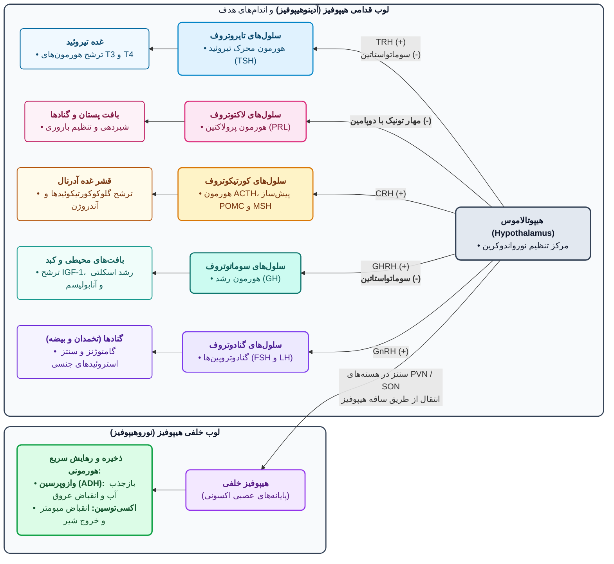
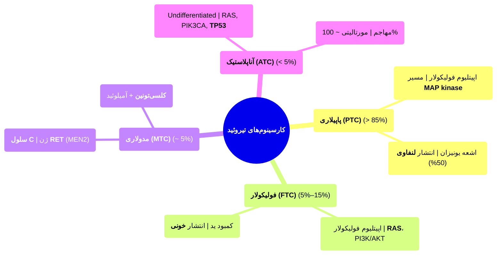
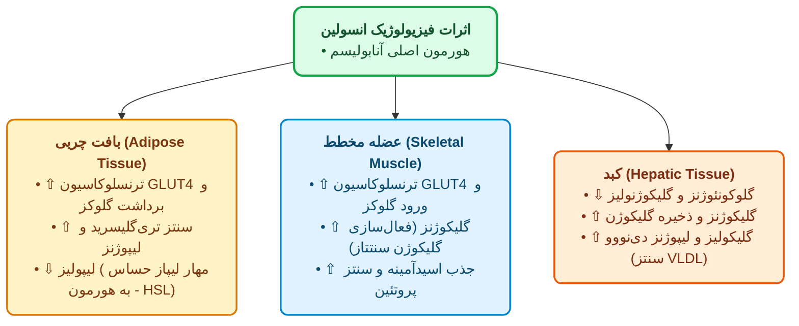
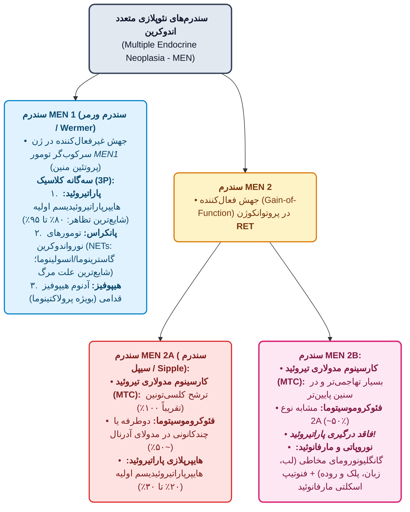

# 1. کلیات و مکانیسم هورمون‌ها

> [!info] مکانیسم اثر هورمون‌ها و گیرنده‌ها
> - **گیرنده سطح سلول (غشایی)**:
>   - *انواع*: **پپتیدی** (**GH**، **انسولین**) + **مولکول کوچک** (**اپی‌نفرین**).
>   - *مکانیسم*: اتصال به گیرنده ⇦ ⇧ پیام‌رسان ثانویه درون‌سلولی (**cAMP**، **IP3**، **Ca²⁺ یونیزه**) ⇦ رونویسی (Transcription) ژن ⇦ ایجاد/تقویت عملکرد هورمون.
> - **گیرنده درون‌سلولی (سیتوزولی / هسته‌ای)**:
>   - *ویژگی*: **محلول در چربی (Lipid-soluble)** ⇦ عبور از غشا.
>   - *گیرنده هسته‌ای*: **استروئیدها** (**استروژن**، **آندروژن**، **گلوکوکورتیکوئیدها**) + **تایروکسین (T4)**.

- **مکانیسم بیماری‌های غدد**: 1. تولید **⇧ (بیش از حد)**؛ 2. تولید **⇩ (کمتر از حد)**؛ 3. تولید کافی + **مقاومت ارگان هدف**؛ 4. **نئوپلاسم‌ها**.

---

# 2. پاتولوژی غده هیپوفیز (Pituitary Gland)

## 2.1. آناتومی، هیستولوژی و فیزیولوژی پایه
- **ویژگی و ارتباط**: کوچک، *لوبیایی‌شکل*، اتصال به هیپوتالاموس با **ساقه (Stalk)** + *شریان و ورید هیپوفیزیال (Hypophyseal artery & vein)* + ارتباط نورونی.
- **لوب‌ها**: 1. **قدامی (آدنوهیپوفیز)**: تولید **هورمون‌های تروفیک** (محرک تیروئید، آدرنال، گناد، پستان)؛ 2. **خلفی (نوروهیپوفیز)**: ذخیره و آزادسازی سریع به خون 2 هورمون پپتیدی **ADH** و **اکسی‌توسین** (**تولید در هیپوتالاموس** ⇦ صرفاً ذخیره در خلفی).

| سلول (آدنوهیپوفیز) | H&E سیتوپلاسم | هورمون ترشحی | نکات کلیدی |
| :--- | :--- | :--- | :--- |
| **سوماتوتروف** | **اسیدوفیلیک / ائوزینوفیلیک** (قرمز-صورتی) | GH (هورمون رشد) | مهار: **سوماتواستاتین**؛ تحریک: GHRH |
| **لاکتوتروف** | **اسیدوفیلیک / ائوزینوفیلیک** | پرولاکتین (PRL) | مهار: **دوپامین** هیپوتالاموس |
| **ماموسوماتوتروف** | اسیدوفیلیک | **GH** + **PRL** | دوهورمونه |
| **کورتیکوتروف** | **بازوفیلیک** (آبی) | **ACTH**، **POMC**، **MSH** | POMC: پرو-اوپیوملانوکورتین؛ MSH: محرک ملانوسیت |
| **تایروتروف** | **بازوفیلیک** | TSH | تحریک: TRH |
| **گنادوتروف** | **بازوفیلیک** | FSH، LH | تحریک: GnRH |
| **کروموفوب** | **Non-staining** (حد وسط / بی‌رنگ) | فاقد ترشح | **نابالغ (Immature)** |

> [!important] علائم موضعی و فشاری ضایعات هیپوفیز
> - **همی‌آناپسی بای وتمپورال (Bitemporal Hemianopsia / اختلال دید کناری دوطرفه)**: مجاورت و فشار بر **کیاسمای اپتیک**.
> - **آپوپلکسی هیپوفیز (Pituitary Apoplexy)**: خونریزی حاد داخل ضایعه ⇦ **بزرگی ناگهانی** ⇦ **⇩ هوشیاری** ⇦ **اورژانس نوروسرجری**.

---

## 2.2. هایپرپیتویتاریسم و آدنوم هیپوفیز (Pituitary Neuroendocrine Tumor)
- **علت هایپرپیتویتاریسم**: شایع‌ترین = **آدنوم لوب قدامی** (نادر: ضایعات خارج هیپوفیزی).
- **اپیدمیولوژی**: پیک **35–60 سال**؛ شیوع **> 10% جمعیت**.
- **تقسیم‌بندی**: *تشخیص نوع هورمون در آزمایشگاه*: **IHC (ایمونوهیستوشیمی)**. *عملکردی*: **فانکشنال** (ترشحی) vs **نان‌فانکشنال / Silent** (فاقد ترشح ⇦ بی‌علامت تا *اثر فشاری* ⇦ تشخیص دیررس در حد **ماکروآدنوم**). *سایزی*: **میکروآدنوم** (**< 1 cm**) vs **ماکروآدنوم** (**> 1 cm**).
- **پاتوژنز و ژنتیک**: 1. **جهش پروتئین G (GNAS)**: شایع‌ترین؛ در **40% سوماتوتروف‌ها** + **کمی از کورتیکوتروف‌ها**؛ 2. **جهش USP8 (Ubiquitin-specific protease 8)**: در **30%–60% کورتیکوتروف‌ها**؛ 3. **ارثی (5%)**: سندرم **MEN1** یا جهش **CDKN1B**؛ 4. **مارکرهای رفتار مهاجم (Aggressive) و رشد سریع**: **Overexpression سایکلین D1** + **جهش TP53** + **خاموشی اپی‌ژنتیک (Silencing) ژن RB (رتینوبلاستوما)**.
- **مورفولوژی**: *Gross*: توده کرم‌رنگ با حدود مشخص؛ **70%** کوچک و محدود به **سلاتورسیکا**؛ **30%** فاقد کپسول و مهاجم به اطراف (**استخوان، دورا، مغز**)؛ سایز بزرگ ⇦ **خونریزی و نکروز**. *Micro*: سلول‌های **یونیفرم چندوجهی (Polygonal)**، هسته‌های گرد یکنواخت، آرایش *صفحه‌ای (Sheet / Patternless)*، *پاپیلا* (انگشت‌مانند) یا *طناب (Cord)*. میتوز کم. سیتوپلاسم اسیدوفیل، بازوفیل یا کروموفوب (بسته به هورمون).

> [!warning] 2 معیار طلایی افتراق آدنوم از بافت نرمال (غیرنئوپلاستیک) هیپوفیز
> 1. **مونومورفیسم (مونوتونی) سلولی** (یک‌شکل شدن سلول‌ها)؛ 2. **غیاب شبکه رتیکولین (Loss of reticulin)** با **رنگ‌آمیزی رتیکولین** (**بهترین متد افتراق**).

---

## 2.3. انواع اختصاصی آدنوم‌های هیپوفیز و کارسینوم

| نوع آدنوم                    | شیوع و پاتولوژی اختصاصی                                                                                               | بالین و نکات تشخیصی کلیدی                                                   |
| :--------------------------- | :-------------------------------------------------------------------------------------------------------------------- | :-------------------------------------------------------------------------- |
| **لاکتوتروف (پرولاکتینوما)** | **شایع‌ترین آدنوم هایپرفانکشنال**؛ ترشح PRL                                                                           | **آمنوره**، **گالاکتوره**، نازایی، اختلال جنسی                              |
| **سوماتوتروف**               | **دومین شایع (10%)**؛ ترشح GH (و ⇧ **IGF-1**)؛ *Micro*: **Densely** یا **Sparsely granulated** (افتراق با **IHC**) | قبل بسته شدن اپی‌فیز: **ژیگانتیسم**؛ بعد بسته شدن اپی‌فیز: **آکرومگالی** |
| **کورتیکوتروف**              | ترشح **ACTH** ⇦ ⇧ کورتیزول آدرنال؛ سلول‌ها **PAS مثبت**                                                               | **بیماری کوشینگ**، **هایپرپیگمانتاسیون پوست**، **سندرم نلسون**              |
| **گنادوتروف**                | ترشح FSH و LH (**FSH > LH**)                                                                                          | غالباً **Silent (بی‌علامت)**؛ تظاهر با **Mass effect** در سایز بزرگ         |
| **تایروتروف**                | ترشح TSH                                                                                                              | هایپرتیروئیدی با منشأ هیپوفیز                                               |
| **ماموسوماتوتروف**           | ترشح همزمان GH + PRL                                                                                                  | علائم ترکیبی                                                                |

- **نکات و تله‌های امتحانی آدنوم‌ها**:
  - **علل غیرپرولاکتینومایی هایپرپرولاکتینمی**: 1. بارداری؛ 2. **استروژن دوز بالا** طولانی‌مدت؛ 3. نارسایی کلیه؛ 4. **هایپوتیروئیدی**؛ 5. ضایعات هیپوتالاموس (حذف مهار دوپامین)؛ 6. داروهای **مهارکننده آپتیک دوپامین**؛ 7. **Stalk Effect**: فشار هر ضایعه **سوپراسلار** (تومور مغزی یا آدنوم غیرلاکتوتروف بزرگ) بر ساقه ⇦ حذف دوپامین ⇦ ⇧ PRL. *تله تستی*: ⇧ خفیف PRL سرم (**< 200 mg/L**) ≠ لزوماً لاکتوتروف بودن آدنوم (غالباً ناشی از Stalk effect).
  - **سوماتوتروف**:
	  - *ژیگانتیسم* (کودکان): بزرگی جنرالیزه بدن + دست و پای نامتناسب بزرگ و بلند (گاه + شواهد آکرومگالی).
	  - *آکرومگالی* (بزرگسالان): بزرگی بارز **بافت نرم، پوست و ارگان‌ها** + درگیری استخوان و انگشتان + **پروگناتیسم** (بزرگی و جلوزدگی فک).
		  - *عوارض آکرومگالی*: **دیابت** (مقاومت/تحمل محیطی به انسولین ناشی از GH)، اختلال گناد، ضعف عضلانی جنرالیزه، **HTN**، درد مفاصل، **CHF (نارسایی احتقانی قلب)**، **⇧ ریسک کنسرهای گوارشی (GI)**.
	  - *تشخیص آزمایشگاهی*: **عدم مهار GH پس از دوز گلوکوز خوراکی** (برخلاف نرمال).
  - **کورتیکوتروف**:
	  - *سندرم vs بیماری کوشینگ*: ⇧ کورتیزول از هر منبعی = **سندرم کوشینگ**؛ اختصاصاً ناشی از آدنوم ACTH-ساز هیپوفیز = **بیماری کوشینگ**.
	  - *هایپرپیگمانتاسیون*: تیرگی پوست در اثر ⇧ همزمان **POMC، ACTH و MSH**. **سندرم نلسون**: حذف اثر مهاری کورتیکواستروئید آدرنال روی میکروآدنوم کورتیکوتروف ⇦ رشد سریع آدنوم و اثر فشاری بر مغز.
  - **کارسینوم هیپوفیز**: بسیار نادر؛ تشخیص فقط با **متاستاز** یا **تهاجم مستقیم (Direct invasion)** به خارج سلا.

---

## 2.4. هایپوپیتویتاریسم و بیماری‌های هیپوفیز خلفی
- **علل هایپوپیتویتاریسم (⇩ هورمون‌های تروفیک)**: ضایعات خود هیپوفیز (فشار آدنوم فانکشنال/نان‌فانکشنال بر سلول‌های مجاور)، تروما، جراحی، پرتودرمانی، تومور هیپوتالاموس.
- **علل نکروز ایسکمیک آدنوهیپوفیز**: **سندرم شیهان**، **DIC**، **آنمی داسی‌شکل (Sickle cell)**، ⇧ ICP، تروما، انواع **شوک**، شیمی‌درمانی، جراحی، **سل (TB)**.
- *نکته کلیدی*: هایپوپیتویتاریسم + **اختلال هیپوفیز خلفی** (مثل دیابت بی‌مزه) ⇦ منشأ **تقریباً همیشه (Almost always) در هیپوتالاموس**.

> [!important] سندرم شیهان (Sheehan Syndrome)
> نکروز ایسکمیک هیپوفیز قدامی پس از خونریزی شدید زایمان/سزارین (**Postpartum**).
> *پاتوژنز*: بارداری ⇦ هایپرپلازی و بزرگی سلول‌های PRL-ساز ⇦ بزرگی آدنوهیپوفیز بدون ⇧ متناسب خون‌رسانی (تغذیه از **سیستم وریدی کم‌فشار**) ⇦ حساسیت شدید به افت فشار/خونریزی ⇦ نکروز.
> *عدم درگیری خلفی*: خون‌رسانی مستقیم از **شاخه‌های شریانی** (حساسیت کمتر به ایسکمی).

- **بالین کمبود آدنوهیپوفیز**: *⇩ GH*: اختلال رشد کودکان؛ *⇩ گنادوتروپین‌ها*: آمنوره/نازایی زنان، ⇩ میل/تکامل جنسی؛ *⇩ TSH و ACTH*: هایپوتیروئیدی و هایپوآدرنالیسم؛ *⇩ PRL*: **عدم توانایی شیردهی (Lactation failure)** پس از زایمان.
- **بیماری‌های هیپوفیز خلفی**: 1. **دیابت بی‌مزه (DI)**: ⇩ **ADH** ⇦ عدم بازجذب آب ادرار در کلیه ⇦ **پلی‌اوری** (علل: تروما، نئوپلاسم، التهاب، جراحی)؛ 2. **SIADH (ترشح نابجای ADH)**: ⇧ ADH ⇦ بازجذب بیش از حد آب در کلیه. علل: ترشح اکتوپیک از تومور بدخیم (شایع‌ترین: **SCLC ریه**)، بیماری‌های غیرتومورال ریه، آسیب موضعی هیپوتالاموس.

---

# 3. پاتولوژی غده تیروئید (Thyroid Gland)

## 3.1. آناتومی، هیستولوژی و فیزیولوژی
- **ساختار**: 2 لوب متصل با **ایسموس (Isthmus)** در قدام و پایین حنجره ⇦ لوبول‌ها (هر لوبول = **20–40 فولیکول** منظم).
	- *فولیکول*: پوشش **اپیتلیوم مکعبی تا استوانه‌ای کوتاه** (ترشح **تایروگلوبولین**) + مرکز حاوی **کلوئید** صورتی (جنس = تایروگلوبولین ذخیره‌شده).
- **فیزیولوژی**: اتصال TSH به گیرنده فولیکولار ⇦ تبدیل تایروگلوبولین به **T4 (تایروکسین)** و کمتر **T3** ⇦ در خون اکثر T3/T4 متصل به پروتئین پلاسما (تعیین سطح کلی)، اما تنظیم دقیق روی **بخش آزاد (Unbound / Free)** ⇦ در محیط تبدیل اکثر **T4 به T3**.
	- *مقایسه*: **T4 فعالیت (مقدار) بیشتر**؛ **T3 میل ترکیبی (Affinity) بیشتر** برای گیرنده هسته‌ای.

---

## 3.2. تایروتوکسیکوز، هایپرتیروئیدی و هایپوتیروئیدی

> [!info] تایروتوکسیکوز و 3 علت شایع آن
> ⇧ سطح هورمون‌های تیروئیدی بیش از نیاز. **3 علت شایع**: 1. **بیماری گریوز** (اتوایمیون با هایپرپلازی دیفیوز؛ **85% موارد هایپرتیروئیدی**)؛ 2. **گواتر مولتی‌ندولار توکسیک**؛ 3. **آدنوم هایپرفانکشنال (توکسیک) تیروئید**.

| ویژگی                    | هایپرتیروئیدی (تایروتوکسیکوز)                                                                                  | هایپوتیروئیدی (کرتینیسم و میگزدم)                                                                                    |
| :----------------------- | :------------------------------------------------------------------------------------------------------------- | :------------------------------------------------------------------------------------------------------------------- |
| **متابولیسم و پوست**     | هایپرمتابولیسم، **⇩ وزن با اشتهای خوب**، عدم تحمل گرما، پوست **نرم، گرم و مرطوب (تعریق زیاد)**                 | کندی متابولیسم، ⇩ تعریق، **پوست سرد** (⇩ جریان خون)، ⇧ **توتال کلسترول و LDL** (آترواسکلروز)                         |
| **گوارش**                | تحریک مداوم ⇦ **هایپرموتیلیتی**، اسهال، سوءجذب، استئاتوره                                                      | ⇩ حرکات ⇦ **یبوست (Constipation)**                                                                                   |
| **قلبی-عروقی**           | تپش قلب، **تاکی‌کاردی**، ⇧ ضربان و انقباض (نیاز بالای محیط به O₂)                                              | ⇩ برون‌ده و جریان خون                                                                                                |
| **نوروماسکولار و CNS**   | اضطراب، ترمور دست، ضعف عضلات پروگزیمال (**Thyroid myopathy**)                                                  | میگزدم: ضعف جنرالیزه، **آپاتی**، کندی ذهنی شبیه **افسردگی (Depression)**                                             |
| **چشم و ظاهر اختصاصی**   | **نگاه خیره (Stare)** و **Lid lag**: تحریک سمپاتیک **عضلات تارسال** (نگهدارنده پلک فوقانی) و تاخیر ریلکسیشن آن | میگزدم: تجمع **GAG و اسید هیالورونیک** در پوست، زیرجلد و احشا ⇦ **ادم Non-pitting**، بزرگی زبان، **صدای خشن و عمیق** |
| **بهترین تک‌تست تشخیصی** | **TSH سرم** (⇩ حتی در ساب‌کلینیکال)                                                                            | **TSH سرم** (⇧ در فرم اولیه)                                                                                         |

- **نکات ویژه**:
  - **طوفان تیروئیدی (Thyroid Storm)**: هایپرتیروئیدی شدید ناگهانی (معمولاً در **گریوز**) ناشی از **⇧ حاد کاتکول‌آمین‌ها** (عفونت، جراحی، قطع داروی ضدتیروئید، استرس) ⇦ **اورژانس پزشکی** (مرگ ناشی از **آریتمی قلبی**).
  - **تله T3 Toxicosis**: غالباً ⇩ TSH + ⇧ Free T4 داریم؛ اما در **T3 توکسیکوزیس** ممکن است Free T4 نرمال یا ⇩ باشد ⇦ در شک به هایپرتیروئیدی با Free T4 نرمال، قبل از برچسب ساب‌کلینیکال **حتماً T3 چک شود**.
  - **علل هایپوتیروئیدی**: *اولیه*: تیروئیدی (مادرزادی، اتوایمیون، یاتروژنیک). **شایع‌ترین در جهان**: **کمبود آندمیک ید غذایی** (~ 2 میلیارد نفر)؛ سایر مادرزادی‌ها: ژنتیکی (دیس‌ژنز تیروئید، گواتر دیس‌هورمونوژنتیک). **شایع‌ترین در مناطق کافی از نظر ید**: **تیروئیدیت هاشیموتو**. *ثانویه*: هیپوفیزی (⇩ TSH).
  - **کرتینیسم (هایپوتیروئیدی مادرزادی کمبود ید)**: کوتاهی قد، **عقب‌ماندگی ذهنی (Mental disability)**، اختلال کامل عضلانی و CNS، صورت خشن، **زبان بیرون‌زده**، **فتق نافی (Umbilical hernia)**. *بارداری*: در **اوایل بارداری** (قبل از تکامل تیروئید جنین) وابستگی جنین به **T3/T4 مادری** (عبور از جفت) ⇦ هایپوتیروئیدی مادر در اوایل بارداری = اختلال ذهنی شدید جنین.

---

## 3.3. تیروئیدیت‌ها (Thyroiditis)

| تیروئیدیت                             | پاتوژنز و اپیدمیولوژی                                                                                                                                                                            | مورفولوژی (Gross & Micro)                                                                                                                                                                                                                     | بالین و سیر بیماری                                                                                                                                                                              |
| :------------------------------------ | :----------------------------------------------------------------------------------------------------------------------------------------------------------------------------------------------- | :-------------------------------------------------------------------------------------------------------------------------------------------------------------------------------------------------------------------------------------------- | :---------------------------------------------------------------------------------------------------------------------------------------------------------------------------------------------- |
| **هاشیموتو** (*لنفوسیتیک مزمن*)    | اتوایمیون (**آنتی‌بادی** ضد تیروئید در تقریباً همه بیماران)؛ **45–65 سال**؛ **زنان 10–20 برابر مردان**؛ ژنتیک (**40% همگامی دوقلوهای همسان**؛ **50% آنتی‌بادی + در خواهر/برادر بی‌علامت**) | بزرگی تیروئید؛ ارتشاح شدید لنفوسیت، پلاسماسل و ماکروفاژ + **فولیکول لنفاوی با Germinal center** + فولیکول آتروفیک + **سلول هرتل (Hürthle / Oxyphil / Oncocyte)** (متاپلازی با سیتوپلاسم فراوان گرانولار ائوزینوفیلیک) + فیبروز | بزرگی **بدون درد** در زنان میانسال + **هایپوتیروئیدی**؛ گاه تایروتوکسیکوز گذرا ناشی از تخریب فولیکول (**هاشیتوکسیکوزیس**)؛ *⇧ ریسک تومورهای اپیتلیال تیروئید (بحث‌برانگیز/Controversial)* |
| **گرنولوماتوز تحت‌حاد** (*دکرون*)  | به دنبال **عفونت ویروسی** یا التهاب تنفسی فوقانی (سرماخوردگی)                                                                                                                                    | سفت، کپسول سالم (بزرگ شده/نشده)؛ تخریب فولیکول و خروج کلوئید ⇦ ابتدا **نوتروفیل**، سپس لنفوسیت، پلاسماسل و ماکروفاژ + **واکنش گرنولوماتوز و Multinucleated giant cells** دور کلوئید ⇦ بهبود با فیبروز                                   | **درد گردن** (تشدید با **بلع**)، تب، درد عضلانی، بزرگی تیروئید؛ آزمایشگاه: **⇧ لوکوسیت و ⇧ ESR**؛ سیر: **هایپرتیروئیدی گذرا** ⇦ **هایپوتیروئیدی** ⇦ بهبود                                 |
| **بدون درد** (*لنفوسیتیک تحت‌حاد*) | اتوایمیون (اتوآنتی‌بادی +)؛ غالباً پس از زایمان (**Postpartum**)                                                                                                                              | ارتشاح لنفوسیتی                                                                                                                                                                                                                               | بدون درد؛ فاز اول **تایروتوکسیکوز** (تخریب بافت) ⇦ **یوتیروئید**                                                                                                                             |
| **ریدل (Riedel)**                     | نادر؛ دسته **IgG4-related disease**                                                                                                                                                           | ارتشاح لنفوپلاسماسیتیک + **فیبروز بسیار شدید** با تهاجم به اطراف (**پاراتیروئید** و **عصب راجعه حنجره**)                                                                                                                                   | تیروئید **بسیار سفت (Hard) و فیکس** (**تقلید بدخیمی**)؛ همراهی با **فیبروز رتروپریتوئن** و سایر اندام‌ها                                                                                     |

---

## 3.4. بیماری گریوز و گواتر (دیفیوز و مولتی‌ندولار)
- **بیماری گریوز (Graves)**: **شایع‌ترین علت هایپرتیروئیدی آندوژن**. اتوآنتی‌بادی **IgG** علیه گیرنده TSH با اثر غالباً **تحریکی (Stimulatory)** و تقلید TSH (برخی بلاک‌کننده‌اند اما تحریکی غالب است).
	- *Gross*: بزرگی **متقارن (Symmetrical)** و دیفیوز.
	- *Micro*: هایپرپلازی و شلوغی (Crowding) سلول‌های فولیکولار بلند ⇦ **پاپیلاهای کوچک** در لومن (**فاقد ویژگی هسته‌ای PTC**) + کلوئید کمرنگ با حاشیه موش‌خورده (**Scalloping / Moth-eaten**) + ارتشاح لنفوئیدی.
	- *تریاد بالینی*: 1. تایروتوکسیکوز؛ 2. **افتالموپاتی** (**اگزوفتالموس**، نگاه خیره، Lid lag)؛ 3. **درموپاتی (میگزدم پرتیبیال)**: پوست ضخیم و پوسته‌پوسته (Scaly).
	- *آزمایشگاه*: ⇧ Free T4/T3، ⇩ TSH + **⇧ منتشر جذب ید رادیواکتیو**.
- **گواتر دیفیوز و مولتی‌ندولار (MNG)**:
	- *پاتوژنز*: ⇩ هورمون تیروئید ⇦ **⇧ جبرانی TSH** ⇦ هایپرتروفی و هایپرپلازی فولیکولار.
	- *انواع*: **آندمیک** (کمبود ید) vs **اسپورادیک** (کمتر شایع؛ در **زنان جوان** با ⇧ نیاز/Demand در فعالیت فیزیکی زیاد، یا مصرف مواد گواتروژن مثل **کلسیم**، **کاهو و کلم**).
	- *سیر*: 1. **دیفیوز**: بزرگی منظم؛ میکروسکوپی: سلول استوانه‌ای با پاپیلا و هایپرپلازی شبیه گریوز ⇦ اپیزودهای مکرر ⇦ 2. **MNG**: تیروئید **لوبوله، بسیار بزرگ و نامتقارن (Asymmetrical)**؛ میکروسکوپی: فولیکول‌های بزرگ پر از کلوئید با اپیتلیوم صاف و غیرفعال (Inactive).
	- *بالین MNG*: شایع‌ترین تظاهر = **اثر فشاری توده گردنی** (انسداد تنفسی، **دیسفاژی**، فشار بر عروق بزرگ). غالباً یوتیروئید؛ درصد کمی تایروتوکسیکوز = **MNG توکسیک (سندرم پلامر)** (**فاقد افتالموپاتی و درموپاتی** برخلاف گریوز).

---

## 3.5. ندول‌ها و نئوپلاسم‌های تیروئید

> [!warning] 5 ویژگی بالینی نگران‌کننده در ندول تیروئید (به نفع بدخیمی)
> 1. **منفرد (Solitary)** (چندندولی = خوش‌خیم)؛ 2. **کودکان و جوانان (< 30 سال)**؛ 3. **مردان**؛ 4. سابقه **تماس با اشعه (Radiation)**؛ 5. **Cold nodule** (غیرفعال هورمونی / عدم جذب ید رادیواکتیو).

- **آدنوم تیروئید (Follicular Adenoma)**: خوش‌خیم از اپیتلیوم فولیکولار؛ غالباً **نان‌فانکشنال** (مگر **توکسیک آدنوما** ⇦ هایپرتیروئیدی).
	- *ژنتیک*: **توکسیک** = جهش سوماتیک **Gain-of-function در TSHR** یا **GNAS** (تحریک مداوم مستقل از TSH)؛ **نان‌فانکشنال** = هتروژن (**RAS** یا **PTEN**).
	- *مورفولوژی*: ندول **منفرد، گرد با حدود مشخص** (فشار بر اطراف) و **کپسول کاملاً سالم (Intact)**؛ میکروسکوپی: فولیکول‌های یکنواخت حاوی کلوئید، بدون میتوز و بدون هسته بدخیمی. **معیار افتراق از FTC**: عدم **تهاجم به کپسول و عروق** با بررسی کامل کپسول.
- **کارسینوم‌های تیروئید**: منشأ اکثراً از **اپیتلیوم فولیکولار** و **Well-differentiated** (به جز **MTC** از **سلول‌های پارافولیکولار / C-cells**).

| ویژگی | کارسینوم پاپیلاری (PTC) | کارسینوم فولیکولار (FTC) | کارسینوم آناپلاستیک (ATC) | کارسینوم مدولاری (MTC) |
| :--- | :--- | :--- | :--- | :--- |
| **شیوع و منشأ** | **> 85%** (شایع‌ترین)؛ فولیکولار | **5%–15%** (دومین)؛ فولیکولار | **< 5%**؛ فولیکولار (بدون تمایز) | **~ 5%**؛ نورواندوکراین (**سلول C**) |
| **اپیدمیولوژی و ریسک** | **اشعه یونیزان** (دهه‌های اول زندگی) | سن بالاتر؛ **زنان 3 برابر**؛ **کمبود ید** | میانگین **65 سال**؛ **25%** سوار بر PTC/FTC | **70% اسپورادیک**؛ **30% فامیلیال** (**MEN 2A/2B**، FMTC) |
| **ژنتیک** | مسیر **MAP kinase** | شایع‌ترین: **RAS**؛ سپس **PI3K/AKT** | **RAS**، **PIK3CA**، **TP53** | فامیلیال: **جهش Germ-line ژن RET** |
| **Gross** | منفرد/مولتی‌فوکال؛ پاپیلاهای ریز در برش | ندول **منفرد**، حدود مشخص یا مهاجم | توده **حجیم (Bulky)** با تهاجم سریع به گردن | اسپورادیک: منفرد؛ **فامیلیال: دوطرفه و مولتی‌سنتریک** |
| **Micro** | پاپیلاهای شاخه‌شاخه با **ساقه فیبرووسکولار** و پوشش یک/چند لایه مکعبی + **هسته اختصاصی** + **اجسام پساموما** | سلول یونیفرم سازنده **فولیکول‌های بسیار کوچک** حاوی کلوئید؛ تشخیص فقط با **تهاجم به کپسول/عروق** | به شدت آناپلاستیک: **بزرگ پلئومورفیک** (پلی‌گونال)، **دوکی (Spindle)** یا **مخلوط هر دو** | آشیانه (Nesting)، ترابکول یا شبه‌غده از سلول چندوجهی/دوکی + **رسوب آمیلوئید در استروما** |
| **متاستاز و بالین** | توده بدون درد گردن؛ انتشار **لنفاوی** (**50%** غدد گردن)؛ خونی ناشایع؛ **بقای 10 ساله > 95%** | ندول منفرد **Cold**؛ انتشار **خونی** (**ریه، استخوان، کبد**)؛ لنفاوی ناشایع | رشد سریع؛ **مورتالیتی ~ 100%** | ترشح **کلسی‌تونین**؛ فامیلیال: **هایپرپلازی مولتی‌سنتریک سلول C** در اطراف |

- **نکات طلایی کارسینوم‌های تیروئید**:
  1. **ویژگی‌های هسته‌ای PTC (مهم‌ترین و کافی‌ترین معیار حتی در FNA و بدون پاپیلا)**:
	  1. *کروماتین Finely dispersed* (سنباده‌کشیده) ⇦ هسته شفاف و خالی = **نمای شیشه مات (Optically clear / Ground-glass)**؛
	  2. **Intranuclear inclusions** (Invagination سیتوپلاسم به هسته)؛
	  3. **Intranuclear grooves** (خط وسط هسته شبیه خط قرص / **نمای دانه قهوه / Coffee-bean**).
  2. **سایر نکات PTC**:
	  - *اجسام پساموما* = کلسیفیکیشن دوایر متحدالمرکز (در تیروئید غالباً در PTC؛ همچنین در *مننژیوما* و *کارسینوم تخمدان*).
	  - *شایع‌ترین واریانت*: **Encapsulated follicular variant**.
	  - *پروگنوز بد*: سن **> 40 سال** + **متاستاز دوردست** + **گسترش خارج تیروئیدی**.
  3. **نکته FTC**: افتراق از آدنوم نیازمند **Extensive histologic sampling** (پاس کردن کل کپسول).
  4. **نکته MTC**: آمیلوئید (صورتی آمورف از **بقایای کلسی‌تونین**) ⇦ هایلایت با **کنگو رد** (غیرضروری برای تشخیص روتین)؛ ردیابی کلسی‌تونین هم در سلول توموری و هم در آمیلوئید.

---

# 4. پاتولوژی غدد پاراتیروئید (Parathyroid Glands)

## 4.1. آناتومی، هیستولوژی و فیزیولوژی
- **پایه**: از **Pouches فارنژیال 3 و 4**؛ مجاور پل‌های فوقانی و تحتانی تیروئید.
	- *سلول‌ها*: 1. **Chief cells**: گرانول‌های **PTH**؛ 2. **Oxyphil cells**: کمی بزرگتر، **سیتوپلاسم اسیدوفیلیک (صورتی)** پر از **میتوکندری‌های فشرده (Packed)**.
- **عملکرد PTH (در پاسخ به ⇩ کلسیم آزاد)**:
	1. ⇧ بازجذب توبولی کلسیم؛
	2. ⇧ دفع ادراری فسفات (⇦ **⇩ فسفات سرم** و ⇧ کلسیم آزاد)؛
	3. تبدیل ویتامین D به فرم فعال (**دی‌هیدروکسی**) در کلیه توسط **آلفا-1-هیدروکسیلاز** (⇧ جذب گوارشی کلسیم)؛
	4. ⇧ فعالیت **استئوکلاست‌ها**.

---

## 4.2. هایپرپاراتیروئیدیسم و هایپوپاراتیروئیدیسم

| ویژگی             | هایپرپاراتیروئیدیسم اولیه (Primary)                                                                                                                                                                        | هایپرپاراتیروئیدیسم ثانویه (Secondary)                                                                                                                                     |
| :---------------- | :--------------------------------------------------------------------------------------------------------------------------------------------------------------------------------------------------------- | :------------------------------------------------------------------------------------------------------------------------------------------------------------------------- |
| **علت و پاتوژنز** | اختلال خود پاراتیروئید (علت مهم **هایپرکلسمی**): 1. **آدنوم (85%–95%)**؛ 2. **هایپرپلازی اولیه (5%–10%)**؛ 3. **کارسینوم (~ 1%)**. *ژنتیک آدنوم*: Rearrangement **Cyclin D1** یا جهش **MEN1**. | ⇩ مزمن کلسیم ⇦ تحریک جبرانی پاراتیروئید؛ شایع‌ترین: **نارسایی کلیه** (**⇧ فسفات** ⇦ ⇩ مستقیم کلسیم + نقص **آلفا-1-هیدروکسیلاز** ⇦ ⇩ ویتامین D فعال و جذب گوارشی). |
| **مورفولوژی**     | آدنوم: درگیری **1 غده**؛ نرم، خرمایی با کپسول ظریف؛ غالباً **Chief cells** (گاه اکسی‌فیل، کیست خوش‌خیم و شبه‌فولیکول) + **Rim بافت نرمال** خارج کپسول.                                            | هایپرپلازی غدد؛ ⇧ تعداد **Chief cells** + گاه ⇧ **Water-clear cells** (سیتوپلاسم شفاف).                                                                                 |

- **آتیپی اندوکراین (Endocrine Atypia) — تله تستی**: در آدنوم پاراتیروئید، Chief cells بزرگتر با هسته‌های متفاوت و سلول‌های **Bizarre & pleomorphic** دیده می‌شود ⇦ **نشانه بدخیمی نیست!** (تشخیص کارسینوم با سیتولوژی غیرممکن است؛ **تنها معیار قطعی کارسینوم**: **تهاجم موضعی** و **متاستاز**).
- **تغییرات اندامی هایپرپاراتیروئیدیسم اولیه**:
	1. *اسکلتی*: ⇧ استئوکلاست (جذب استخوان) و ⇧ استئوبلاست؛ در موارد شدید: نازکی کورتکس، فیبروز مغز استخوان، خونریزی و کیست = **استئیت فیبروزا سیستیکا**؛ تجمع استئوکلاست، سلول ژانت و دبری خونریزی ⇦ توده شبیه تومور = **تومور قهوه‌ای (Brown tumor)**؛
	2. *کلیوی*: **نفرولیتیازیس** (سنگ) + **نفروکلسینوزیس** (رسوب در اینترستیشیوم و توبول)؛
	3. *کلسیفیکاسیون متاستاتیک*: رسوب کلسیم در **معده، ریه، میوکارد و عروق**.
- **هایپوپاراتیروئیدیسم**:
	1. **جراحی گردن** (شایع‌ترین؛ حذف ناخواسته حین جراحی تیروئید/پاراتیروئید)؛
	2. **غیاب مادرزادی**: شایع‌ترین = **سندرم دی‌جورج (آپلازی تیموس)** ناشی از **حذف کروموزوم 22** (+ نقایص قلبی کودکان)؛
	3. **اتوایمیون**: **سندرم پلی‌گلندولار اتوایمیون** (جهش ژن **AIRE**).

---

# 5. پاتولوژی بخش اندوکراین پانکراس

## 5.1. جزایر لانگرهانس و فیزیولوژی انسولین
- **سلول‌ها**: 1. **بتا (β)**: **انسولین** (⇩ گلوکز)؛ 2. **آلفا (α)**: **گلوکاگون** (⇧ گلوکز)؛ 3. **دلتا (δ)**: **سوماتواستاتین** (**مهار انسولین و گلوکاگون**)؛ 4. **PP cell**: **پلی‌پپتید پانکراسی** (**تحریک آنزیم‌های معده و روده** + **مهار Motility روده**).

> [!info] معیارهای تشخیص دیابت (نیازمند تکرار در روز دیگر؛ به جز قند تصادفی + علائم کلاسیک) و پره‌دیابت
> - **دیابت**: 1. **FPG ≥ 126**؛ 2. **Random ≥ 200** (+ علائم کلاسیک)؛ 3. **2-h OGTT** (با **75 گرم گلوکز**) **≥ 200**؛ 4. **HbA1c ≥ 6.5%**.
> - **پره‌دیابت**: 1. **IFG (ناشتا)**: **100–125**؛ 2. **قند 2 ساعته**: **140–199**؛ 3. **HbA1c**: **5.7%–6.4%**.

- **تنظیم گلوکز**: تولید کبدی + برداشت محیطی (عضله اسکلتی) + انسولین و گلوکاگون. **مهم‌ترین محرک ترشح انسولین**: **سطح گلوکز خون**.
	- *ناشتا (Fasting)*: ⇩ انسولین و ⇧ گلوکاگون ⇦ **گلوکونئوژنز** و **گلیکوژنولیز** کبدی.
- **اینکرتین‌ها**: ترشح از **روده باریک** پس از غذا ⇦ **1. تحریک انسولین**، **2. ⇩ گلوکاگون**، **3. کندی تخلیه معده** (حس پری). در **T2D** مهار شده‌اند؛ داروهای جدید کنترل دیابت و کاهش وزن **عملکرد اینکرتین را بازیابی می‌کنند**.

---

## 5.2. مقایسه انواع دیابت و عوارض حاد و مزمن

| ویژگی                 | دیابت نوع 1 (T1D)                                                                                                                                       | دیابت نوع 2 (T2D)                                                                                                           |
| :-------------------- | :------------------------------------------------------------------------------------------------------------------------------------------------------ | :-------------------------------------------------------------------------------------------------------------------------- |
| **اپیدمیولوژی**       | کمتر؛ شروع **< 20 سالگی**؛ وزن نرمال                                                                                                                    | **غالب موارد**؛ سن بالاتر؛ **چاق (Overweight)**                                                                             |
| **پاتوژنز و انسولین** | تخریب ایمونولوژیک **> 90% سلول بتا** (> 90% اتوآنتی‌بادی +) ⇦ ⇩ پیشرونده انسولین. (*2 فرم*: **اتوایمیون** آنتی‌بادی+ و **ایدیوپاتیک** آنتی‌بادی-) | 1. **مقاومت محیطی به انسولین** (اصلی؛ ریسک‌فاکتور: **چاقی**)؛ 2. **اختلال سلول بتا**. انسولین ابتدا **⇧ جبرانی**، سپس ⇩. |
| **ژنتیک و جزایر**     | ارتباط با **MHC کلاس I و II (HLA)**؛ ⇩ تعداد/سایز جزایر + **Insulitis (ارتشاح لوکوسیتی)**                                                            | فاقد لینکج HLA؛ کاهش کمتر سلول‌ها، فاقد التهاب بارز                                                                         |
| **عارضه حاد**         | **کتواسیدوز دیابتی (DKA)**: قند **500–700**؛ تهوع/استفراغ، **درد شکم**، بوی کتون، **تنفس کاسمال** ⇦ کما (درمان: **انسولین + اصلاح اسیدوز**)       | **کمای هایپراسمولار غیرکتوتیک (HHNS)**: قند **600–1200** ⇦ **دیورز اسموتیک** و **دهیدراتاسیون شدید**                     |

- **نکات تکمیلی دیابت**:
  - *مراحل T1D*: **استیج 1**: نورموگلایسمی (عملکرد بتا 100%) ⇦ **استیج 2**: ⇩ عملکرد بتا و اختلال تحمل گلوکز (**Pre-symptomatic**) ⇦ **استیج 3**: سقوط بتا و علائم.
  - *مکانیسم مقاومت به انسولین*: عدم مهار گلوکونئوژنز کبد + ⇩ برداشت گلوکز و سنتز گلیکوژن ⇦ **⇧ قند Postprandial (2 ساعت پس از غذا)** + عدم مهار لیپاز چربی ⇦ **⇧ FFA سرم**.
  - *سایر انواع دیابت*:
	  1. **مونوژنیک** (نقص تک‌ژنی تکامل بتا یا ژن انسولین): **MODY** (شبیه T2D در **جوانان**) و **دیابت نوزادی (Neonatal)**؛
	  2. **MIDD**: دیابت + **ناشنوایی** (نقص **میتوکندریال**، توارث مادری)؛
	  3. **اگزوکرین پانکراس** (پانکراتیت مزمن، کنسر پانکراس، سیستیک فایبروزیس)؛
	  4. **داروها** (**کورتون**).
  - *تریاد بالینی*: **پلی‌اوری**، **پلی‌دیپسی**، **پلی‌فاژی**.
- **عوارض مزمن دیابت**:
  1. **ماکرووسکولار (لایه عضلانی شریان بزرگ و متوسط)**: **آترواسکلروز تسریع‌شده** ⇦ کرونر (**MI = شایع‌ترین علت مرگ دیابتی‌ها**)، مغزی (**CVA و خونریزی**)، اندام تحتانی (**گانگرن** و عفونت)، نارسایی عروقی کلیه. **آرتریولواسکلروز هیالن**: ضخیم شدن و پیچ‌خوردگی (Tortuous) شریانچه با رسوب هیالن (**PAS مثبت**)؛ مرتبط با **HTN** در دیابتی‌ها.
  2. **میکرووسکولار (میکروآنژیوپاتی)**: **ضخیم شدن غشای پایه (BM)** عروق کوچک (پوست، عضله، رتین، گلومرول و مدولای کلیه) و توبول کلیه (**PAS مثبت**) ⇦ مسئول **نفروپاتی**، **رتینوپاتی** (+ کاتاراکت و گلوکوم) و **نوروپاتی** (محیطی و اتونوم مثل مثانه).
  3. **نفروپاتی دیابتی**: **دومین علت مرگ دیابتی‌ها** و **شایع‌ترین علت ESRD در آمریکا**.
	  - *اولین تظاهر*: **میکروآلبومینوری** (**30 mg/day تا 3.5 g/day**).
	  - *Gross (نفرواسکلروز)*: سطح **Granular (دانه‌دانه)** و نامنظم + **کورتکس بسیار نازک**.
	  - *3 ضایعه*: 1. گلومرولی: شاخص‌ترین = **گلومرولواسکلروز ندولار (کیمل‌استیل-ویلسون)** (**توپی‌های آمورف صورتی PAS+ در محیط گلومرول**)؛ 2. عروقی: آرتریولواسکلروز هیالن؛ 3. پیلونفریت و **پاپیلیت نکروزان**.

---

## 5.3. تومورهای نورواندوکراین پانکراس (PanNETs)

| ویژگی                | انسولینوما (Insulinoma)                                                                                          | گاسترینوما (Gastrinoma)                                                                                        |
| :------------------- | :--------------------------------------------------------------------------------------------------------------- | :------------------------------------------------------------------------------------------------------------- |
| **شیوع، منشأ و محل** | **شایع‌ترین PanNET**؛ از **سلول بتا**؛ داخل پانکراس، **منفرد** و **< 2 cm** (نادر: مولتی‌فوکال)               | ترشح گاسترین؛ در پانکراس، اطراف پانکراس یا **دیواره دئودنوم**؛ همراهی با **MEN1** (غالباً **چندکانونی**) |
| **بدخیمی و Micro**   | **< 10% بدخیم** (تهاجم/متاستاز)؛ کپسول‌دار، الگوی **آشیانه‌ای (Nesting)** با سلول یکنواخت + **رسوب آمیلوئید** | **> 50% بدخیم** در زمان تشخیص؛ انواع داخل پانکراس از نظر مورفولوژی **Bland (آرام)** و فاقد آناپلازی         |
| **بالین**            | ترشح انسولین ⇦ **حملات هایپوگلایسمی**                                                                            | **سندرم زولینگر-الیسون**: ⇧ گاسترین ⇦ ⇧ اسید ⇦ **زخم معده مکرر**                                               |

---

# 6. پاتولوژی غده آدرنال (Adrenal Gland)

## 6.1. کورتکس آدرنال: لایه‌ها، هایپرفانکشن و نارسایی
- **لایه‌های کورتکس (از زیر کپسول به روی مدولا = GFR)**: 1. **گلومرولوزا**: **مینرالوکورتیکوئید (آلدوسترون)**؛ 2. **فاسیکولاتا** (**75% کورتکس**): **گلوکوکورتیکوئید (کورتیزول)**؛ 3. **رتیکولاریس**: **استروژن و آندروژن‌ها (DHEA و آندروستن‌دیون)**.
- **هایپرفانکشن کورتکس**:
  1. **سندرم کوشینگ (⇧ کورتیزول)**: **شایع‌ترین علت کلی = مصرف اگزوژن کورتون (یاتروژنیک)**.
	  - *آندوژن*: بیماری کوشینگ (هیپوفیز)، ACTH اکتوپیک (**SCLC ریه**)، نئوپلاسم آدرنال.
	  - *مورفولوژی*: در آدرنال از آتروفی (چروکیده در مصرف اگزوژن) تا هایپرپلازی ندولار.
		  - **تغییر هیالنی کروک (Crooke hyaline change)**: شایع‌ترین تغییر در **تمام حالات هایپرکورتیزولیسم (آندوژن و اگزوژن)**؛ جایگزینی سیتوپلاسم گرانولار بازوفیلیک سلول‌های ACTH-ساز هیپوفیز با **مواد هموژن بازوفیلیک**.
  2. **هایپرآلدوسترونیسم اولیه**:
	  - *علل*: 1. **هایپرپلازی ایدیوپاتیک دوطرفه** (**شایع‌تر**)؛ 2. **آدنوم آلدوسترون‌ساز** (منفرد، **< 2 cm**، **زرد درخشان** پر از چربی؛ میکروسکوپی شبیه **زونا فاسیکولاتا**!).
	  - *پاتوفیزیولوژی*: بازجذب سدیم/آب و دفع پتاسیم ⇦ **HTN (مهم‌ترین عارضه)**.
	  - *نکات*: حضور **اجسام آلدوسترونی / اسپیروونولاکتونی** (صورتی با حدود مشخص در کورتکس) + **عدم مهار ACTH** (برخلاف آدنوم کورتیزول‌ساز، کورتکس اطراف و مقابل **آتروفیک نمی‌شود**).
  3. **سندرم آدرنوژنیتال و CAH**: تبدیل **DHEA و آندروستن‌دیون** آدرنال به **تستوسترون** در محیط (بیضه)؛ **تحت کنترل ACTH** (برخلاف گناد). **CAH**: بیماری **اتوزومال مغلوب** نقص آنزیمی سنتز استروئید ⇦ **⇩ کورتیزول** ⇦ **⇧ جبرانی ACTH** ⇦ هایپرپلازی آدرنال و **⇧ آندروژن‌ها**. **شایع‌ترین (> 90%) = کمبود 21-هیدروکسیلاز** (لازم برای **کورتیزول و آلدوسترون**، غیرضروری برای هورمون جنسی).
	  - *بالین ⇧ آندروژن*: **زنان**: هیکل عضلانی، **هایپرتروفی کلیتوریس**، **سودوهرمافرودیتیسم**، اولیگوآمنوره، هیرسوتیسم و آکنه؛ **مردان**: بزرگی ژنیتالیای خارجی و **بلوغ زودرس** (اکثراً **بارور/Fertile**، برخی **اولیگواسپرمی** ناشی از نقص سلول لیدیگ).

| نارسایی اولیه کورتکس     | علل و ریسک‌فاکتورها                                                                                                 | پاتوژنز و نکات بالینی                                                                                                           |
| :----------------------- | :------------------------------------------------------------------------------------------------------------------ | :------------------------------------------------------------------------------------------------------------------------------ |
| **حاد (Adrenal Crisis)** | 1. **خونریزی حاد آدرنال** (**آنتی‌کواگولانت**، **DIC**، **سپسیس**) 2. **قطع ناگهانی (Withdrawal) کورتون اگزوژن** | **سندرم واترهاوس-فریدریکسن**: سپسیس **نایسریا مننژیتیدیس** ⇦ خونریزی و آتروفی آدرنال. قطع کورتون باید **بسیار تدریجی** باشد. |
| **مزمن (بیماری آدیسون)** | 1. **اتوایمیون**؛ 2. **سل (TB)** یا **ایدز**؛ 3. **متاستاز کانسر**                                                  | ناشایع؛ تخریب پیشرونده کورتکس و ⇩ مزمن هورمون‌ها.                                                                               |

---

## 6.2. نئوپلاسم‌های کورتکس و مدولای آدرنال
- **نئوپلاسم‌های کورتکس**:
  1. **آدنوم آدرنوکورتیکال**: توده **تک با حدود مشخص (Circumscribed)** (برخلاف هایپرپلازی ندولار). در هر لایه‌ای باشد، میکروسکوپی **همیشه شبیه زونا فاسیکولاتا** است ⇦ **عدم امکان تعیین نوع هورمون و Functional status با Gross یا Micro**.
  2. **کارسینوم آدرنوکورتیکال**: ناشایع، **بسیار بزرگتر** (تا **200–300 گرم**)، فاقد کپسول، Well-differentiated یا Bizarre. افتراق از آدنوم با **معیارهای وایس (Weiss criteria)** (میتوز، نکروز، تهاجم کپسولی/عروقی). **متاستاز به کورتکس آدرنال بسیار شایع‌تر از کارسینوم اولیه آن است**.
- **فئوکروموسیتوما (مدولای آدرنال)**: از **سلول‌های کرومافین**؛ ترشح **کاتکول‌آمین** و پپتید ⇦ **HTN واضح**.
	- *Gross*: کوچک، زرد-خرمایی (بزرگتر = خونریزی، نکروز، کیست).
	- *Micro*: **آشیانه‌های (Nests)** سلول چندوجهی/دوکی احاطه‌شده با **سلول‌های پشتیبان (Sustentacular cells)** در **استرومای بسیار پرعروق**.

> [!important] قانون 10% و ژنتیک فئوکروموسیتوما
> **10% خارج آدرنال** در **ارگان‌های زاکرکندل** (**دوشاخه شدن آئورت**، نزدیکی **IMA**، حوالی **اجسام کاروتید**) = **پاراگانگلیوما**؛
> **10% دوطرفه** (در فامیلیال تا **50%**)؛
> **10% بدخیم**.
> *ژنتیک*: هتروژن؛ مهم‌ترین = **RET** (**MEN 2**) و **NF1** (**نوروفیبروماتوز 1**).

---

# 7. سندرم‌های نئوپلازی اندوکراین متعدد (MEN Syndromes)

| ویژگی                        | سندرم MEN 1                                                       | سندرم MEN 2A                 | سندرم MEN 2B                                                                                      |
| :--------------------------- | :---------------------------------------------------------------- | :--------------------------- | :------------------------------------------------------------------------------------------------ |
| **ژنتیک**                    | تومورساپرسور **MEN1** (**Menin**)                                 | پروتوانکوژن **RET**          | پروتوانکوژن **RET**                                                                               |
| **پاراتیروئید**              | **هایپرپاراتیروئیدیسم اولیه** (**شایع‌ترین: 80%–95%**)         | هایپرپلازی پاراتیروئید       | *ندارد (فاقد هایپرپاراتیروئیدیسم اولیه)*                                                          |
| **تیروئید و آدرنال**         | —                                                                 | **MTC** + **فئوکروموسیتوما** | **MTC** + **فئوکروموسیتوما**                                                                      |
| **پانکراس / هیپوفیز / سایر** | • **PanNET** (**علت شایع مرگ**) • **ماکروآدنوم پرولاکتین‌ساز** | —                            | 1. **گانگلیونوروماهای مخاطی** (گوارش، لب، زبان) 2. **ظاهر مارفانوئید** (قد بلند و اندام کشیده) |
